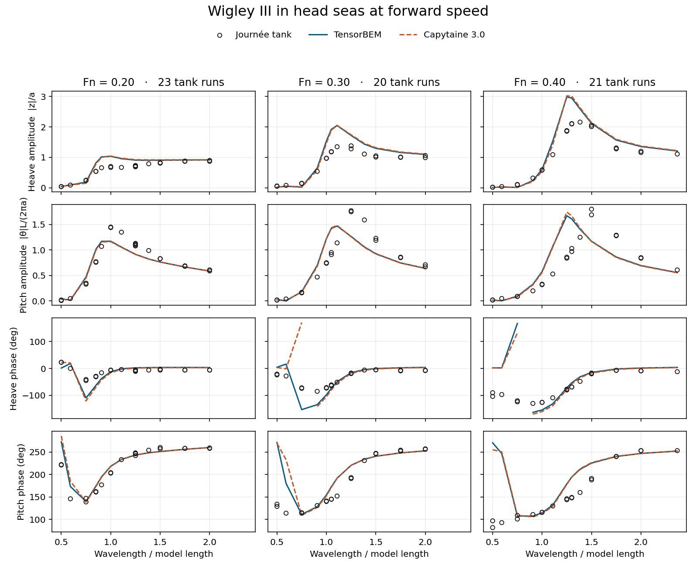

# Wigley III heave and pitch in head seas at forward speed

TensorBEM misses the towing-tank motion acceptance criteria at all three tested speeds. On 19 cases with matched measurements, replacing the predicted radiation matrices with measured ones lowers heave and pitch amplitude RMS errors from 0.335 and 0.322 to 0.089 and 0.168. Replacing excitation alone gives 0.335 and 0.351. These substitutions diagnose which inputs matter to the response. They use tank measurements at the evaluated conditions and provide no out-of-sample prediction.

The [sectional radiation and withheld-speed study](radiation_models.md) tests a corrected strip-theory formulation at all 104 forced-motion records. Using only the two endpoint speeds for tank calibration, held-speed pitch passes the experimental criteria while heave misses its maximum-amplitude limit.

The [double-body flow and speed-reversal study](double_body_results.md) improves geometry-only motion amplitude RMS at all three speeds. The tank-assisted parity model passes both heave and pitch at the withheld middle speed.



## Experiment and calculation

J.M.J. Journée's Delft report 0909, *Experiments and Calculations on Four Wigley Hull Forms in Head Waves*, gives the geometry, model loading, motion axes and response conventions. Model III is 3.0 × 0.30 × 0.1875 m. Its displacement is 0.078 m³, model mass 78 kg and pitch radius of gyration 0.75 m. The rotation center for the calculations is amidships at the still waterplane, 0.0175 m above the center of gravity. The model can heave and pitch. The other four rigid motions are constrained. The experimental series below cover Fn = 0.20, 0.30 and 0.40. [Report PDF and original ASCII archive with checksums](../journee_wigley3_zero_speed/README.md#geometry-and-measurements)

| Source table (report page) | Recorded quantity | Retained records |
|---|---|---:|
| 8-III (53) | Free heave/pitch amplitude and phase in regular head waves | [64 wave runs](motions.csv) across 37 speed/wavelength pairs |
| 6-III (47) | Vertical excitation force and pitch moment on the restrained hull | [42 wave runs](loads.csv) across 21 pairs |
| 2-III (35), 3-III (39) | Forced heave at 2.5 and 5.0 cm, forced pitch at 1.5° and 3.0° | [104 records](radiation.csv), with both responses per driven motion |

Both solvers use fresh water at 1000 kg/m³, g = 9.81 m/s², the same wetted hull and hydrostatic and rigid-body matrices. Head waves propagate in −x, the ship advances at U = Fn√(gL), and the incident wave amplitude is one metre for normalization. The undisturbed wave has intrinsic frequency ω = √(gk) and the encounter frequency is ωₑ = ω + kU. The native public entry point is `tensorbem.forward_speed.solve_forward_speed_heave_pitch`. It solves two radiation problems and one scattering problem on constant triangular panels. The small-speed model uses the outgoing deep-water Green function at ωₑ, uniform base flow −U, the pitch radiation correction U n_z, and convective pressure ρ(iωₑφ + U∂φ/∂x). A nodal reconstruction gives the surface-tangent derivative and the boundary condition supplies the normal derivative. Incident-wave pressure uses the intrinsic Airy solution. Capytaine 3.0.0 independently assembles radiation, diffraction and Froude–Krylov forces within a similar uniform-flow approximation. Fn = 0.40 probes that approximation at the upper end of this tank series. [Capytaine theory manual](https://capytaine.org/v3.0.0/theory_manual/theory.html)

Each route solves [C − ωₑ²(M + A) − iωₑB] ξ = F. Table 8 uses |ξ₃|/a and |ξ₅|L/(2πa), with phase −arg(ξ). Table 6 uses |F₃|/(a C₃₃) and |F₅|/(ka C₅₅), with the report's reference scales C₃₃ = 6119 N/m and C₅₅ = 2874 N m. Each measured replicate contributes to RMS and maximum error. The peak comparison averages measured amplitudes at each sampled wavelength. The [same limits used at zero speed](../journee_wigley3_zero_speed/limits.json) require amplitude RMS ≤ 0.10 and maximum ≤ 0.20. Wrapped phase RMS ≤ 15° and maximum ≤ 30° apply when measured and predicted amplitudes both reach 0.10. Peak location may differ by at most one sampled interval. Force and moment scores are diagnostic.

## Predictions versus the tank

| Fn | Motion runs | Native heave amplitude RMS / max | Native pitch amplitude RMS / max | Heave / pitch phase RMS (°) | Capytaine heave / pitch amplitude RMS |
|---:|---:|---:|---:|---:|---:|
| 0.20 | 23 | 0.191 / 0.365 | 0.165 / 0.293 | 25.2 / 8.2 | 0.194 / 0.164 |
| 0.30 | 20 | 0.380 / 0.744 | 0.322 / 0.529 | 17.5 / 17.7 | 0.370 / 0.325 |
| 0.40 | 21 | 0.467 / 1.128 | 0.416 / 0.832 | 17.0 / 27.2 | 0.486 / 0.438 |

Each code ran 37 distinct wave/speed pairs on 264, 480 and 760 panels. Between the two finest meshes, the maximum absolute changes in native heave and pitch amplitude are 0.0161 and 0.0078 across the 37 cases. The corresponding Capytaine changes are 0.0254 and 0.0199. Capytaine issued panel-resolution warnings on part of the sweep. The largest relative linear-solve residual on the native finest mesh is 7.46 × 10⁻¹⁶ and the largest reported condition number is 114.3. At Fn = 0.40 and λ/L = 1.25 one tank run gives heave 1.86 and pitch 0.84, against TensorBEM's 2.988 and 1.672. The measured pitch peak occurs at λ/L = 1.50, whereas both codes peak at 1.25. All three mesh levels, both solvers, individual replicates and scored phase rows appear in the [summary](scores.csv) and [pointwise errors](errors.csv).

## Which inputs account for the discrepancy?

Use the 19 wave/speed pairs with motion, restrained-load and in-band forced-motion data. At each encounter frequency, interpolate the two forced-oscillation levels separately in ω/√(g/L), then average the two estimates for each coefficient. For the force-row/motion-column convention, Table 2-III supplies 33 and 53, and Table 3-III supplies 55 and 35. Dimensional mass scales are ρ∇, ρ∇L and ρ∇L² for heave, cross and pitch entries, respectively. Multiply each mass scale by √(g/L) for the corresponding damping scale. Average same-wave measured **complex** loads before solving. Maintain the same rigid mass and hydrostatic matrices in every substitution. Score against the mean measured response amplitude at each pair, weighting each pair equally. The subset differs from the 64-run full-series score above. Fn = 0.30 and 0.40 at λ/L = 0.50 fall outside the common forced-oscillation band and are excluded. [Excluded matched cases](outside_radiation_band.csv)

| Inputs replaced with measurements | Heave amplitude RMS | Pitch amplitude RMS |
|---|---:|---:|
| None (native prediction) | 0.3353 | 0.3221 |
| Wave force and moment only | 0.3345 | 0.3510 |
| Pitch added inertia A₅₅ only | 0.3047 | 0.2150 |
| Pitch damping B₅₅ only | 0.5306 | 0.4025 |
| All radiation entries in A and B | 0.0893 | 0.1683 |
| Radiation and wave excitation | 0.0507 | 0.0472 |

The moment excitation amplitude alone has RMS error 0.019, 0.019 and 0.060 at the three speeds. Radiation errors occur in multiple entries. At Fn = 0.40 and λ/L = 1.50, TensorBEM gives pitch added inertia A₅₅ = 13.30 kg m² versus 19.11 from the forced experiments. Pitch damping B₅₅ = 106.63 N m s versus 58.13, and the cross added mass A₃₅ = −20.27 kg m versus −4.75. Substituting pitch damping alone worsens the combined RMS. A predictive improvement should therefore be checked against the coupled radiation matrix, especially near the response peaks. The 0.0472 pitch RMS uses both measured inputs. It describes consistency between separate tank experiments. These finite-speed records leave the [zero-speed short-wave pitch discrepancy](../journee_wigley3_zero_speed/README.md) unresolved. [All 34 in-band coefficient comparisons for both codes](coefficient_errors.csv) · [Per-pair substitutions](substitutions.csv)

## Reproduce

Install the project with `pip install -e '.[dev,visualization]'`. Install `capytaine==3.0.0` for the independent comparison. Run from the repository root. The committed CSVs already contain the extracted source rows and both solvers' results. To repeat extraction, pass the original ZIP to `python -m benchmarks.journee_wigley3_forward_speed.import_tables /path/to/0909-DUT-92.zip`; the importer verifies its SHA-256.

```sh
export OPENBLAS_NUM_THREADS=1 OMP_NUM_THREADS=1
python -m benchmarks.journee_wigley3_forward_speed.run tensorbem
python -m benchmarks.journee_wigley3_forward_speed.run capytaine
python -m benchmarks.journee_wigley3_forward_speed.assess
python -m benchmarks.journee_wigley3_forward_speed.plot
python -m pytest -q tests/test_journee_wigley3_forward_speed.py
```

[tensorbem.csv](tensorbem.csv) and [capytaine.csv](capytaine.csv) preserve frequencies, mass and restoring terms, all hydrodynamic coefficients, complex excitation and motion responses. `python -m benchmarks.journee_wigley3_forward_speed.assess --require-pass` reproduces all score files and exits 1 while the finest-mesh native experimental acceptance criteria fail.
