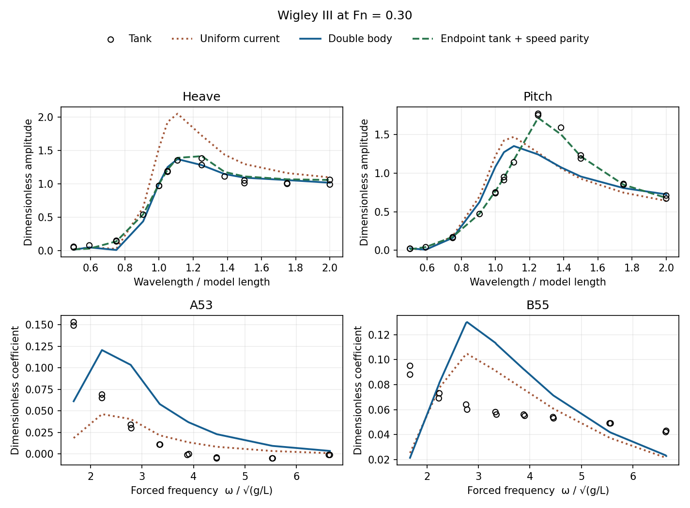

# Wigley III with double-body hull flow and a speed-reversal check

A hull-specific model calibrated on the speed endpoints Fn = 0.20 and 0.40 passes both motion criteria at the withheld Fn = 0.30. A geometry-only double-body calculation improves all six motion amplitude RMS values relative to the original uniform-flow 3-D solver. Its phase and amplitude errors still prevent experimental acceptance. These two results use different inputs.



## Held-speed prediction with reversal symmetry

For a fore/aft-symmetric hull at fixed encounter frequency, reflecting x and reversing ship velocity preserves heave and reverses pitch. The diagonal radiation coefficients are even functions of signed speed; the heave/pitch cross terms are odd. Between the two available speeds we interpolate each diagonal coefficient in Fn². For each cross term we interpolate its ratio to Fn in Fn² and multiply by the target Fn. Each choice is the lowest-degree polynomial of the relevant parity passing through the two endpoint values. The wave direction breaks this symmetry for excitation: use the previous complex-load interpolation at fixed wavelength. No motion measurements or middle-speed component records enter the calculation. Band limits, fallback components, grids and score thresholds are identical to the earlier [linear endpoint model](radiation_models.md).

| Fn = 0.30, 20 free-motion wave runs | Linear-in-Fn amplitude RMS / max | Parity amplitude RMS / max | Parity phase RMS / max (°) | Experimental criteria |
|---|---:|---:|---:|---|
| Heave | 0.0714 / 0.2106 | 0.0543 / 0.1332 | 9.73 / 24.76 | Pass |
| Pitch | 0.0222 / 0.0602 | 0.0293 / 0.0881 | 7.32 / 17.63 | Pass |

At λ/L = 1.25, predicted heave changes from 1.491 to 1.413 for measured values of 1.28 and 1.38. The predicted heave peak is one sampled wavelength step from the measured peak; pitch peaks at the measured 1.25. Seventeen wave runs qualify for each phase comparison. At the calibration speeds the two interpolants coincide. The parity model passes five of six motion/speed gates overall. Fn = 0.40 pitch retains a maximum absolute amplitude error of 0.2012 against 0.20. The middle-speed motion outcomes were known from the preceding experiment, making this a retrospective held-speed result. The test removes all middle-speed radiation and load records and reproduces all predicted motions. [Scores](speed_parity_scores.csv) · [Per-case coefficients and motions](speed_parity_motions.csv)

**Cross-hull check.** The same formula was applied without tuning to the authors' forced-heave and forced-pitch records on Wigley I and IV, using each hull's own two endpoint speeds. We test coefficient interpolation only on these additional hulls. Trials are matched at the actual middle-speed oscillation frequency, averaging each available endpoint amplitude after interpolation within its own band. Model IV has only one forced-oscillation level at Fn = 0.40. Every middle-speed row is retained with its band flag; errors use only common-band rows.

| Hull | In-band / available middle-speed coefficient entries | Coefficients with lower RMS than linear interpolation (of eight) |
|---|---:|---:|
| I | 112 / 128 | 3 |
| III | 100 / 128 | 6 |
| IV | 112 / 128 | 2 |

Parity is an exact symmetry constraint on this hull family. The low-order interpolation between two positive speeds has hull-dependent accuracy. For instance, on IV, A₃₅ RMS rises from 0.0058 to 0.0205. The motion qualification applies to Wigley III at this loading and held speed. [Cross-hull pointwise results](speed_parity_cross_hull.csv) · [Original report and archive provenance](../journee_wigley3_zero_speed/README.md#geometry-and-measurements)

## Geometry-only double-body calculation

The velocity close to the wetted hull is now computed from a steady exterior Laplace Neumann solve with the hull reflected across the still waterplane. The incident unit stream is −eₓ. With V denoting the total unit-speed steady velocity, the heave and pitch body conditions use the translational m-vector −(n·∇)V and rotational m-vector −(n·∇)(r×V), scaled by U. For body displacement d and tangent, incompressible potential flow, the scalar m-term equals divₛ[(d·n)V]. The solver evaluates this expression using the surface gradient and surface Laplacian of the total potential on local quadratic surface patches. The patches span adjacent triangles, using one-sided neighbors at normal jumps over 45°. The waves use pressure p/ρ = iωₑφ − UV·∇φ, including the incident wave. The unsteady Green function remains the isotropic encounter-frequency kernel. The force integral uses Eulerian unsteady pressure on the mean wetted surface. The steady-pressure shape force, the moving-waterline force and a translating free-surface Green function remain outside this approximation. [Amini-Afshar, equations 2.23 and 2.91](https://backend.orbit.dtu.dk/ws/portalfiles/portal/108666908/S171_Mostafa_Amini_Afshar.pdf) · [Double-body and Neumann–Kelvin model comparisons](https://www.sciencedirect.com/science/article/abs/pii/S0141118710000799)

The prepared unit-speed solution can be reused across the frequency sweep:

```python
from tensorbem.double_body_flow import prepare_double_body_flow
from tensorbem.forward_speed import solve_forward_speed_heave_pitch

flow = prepare_double_body_flow(mesh)
result = solve_forward_speed_heave_pitch(mesh, omega, speed, base_flow=flow)
```

Here omega is the intrinsic wave frequency in rad/s and speed is in m/s. Omitting `base_flow` selects the original uniform-flow model. No experimental coefficient enters either calculation.

| Fn | Uniform heave RMS | Double-body heave RMS / max | Double-body heave phase RMS / max (°) | Uniform pitch RMS | Double-body pitch RMS / max |
|---:|---:|---:|---:|---:|---:|
| 0.20 | 0.191 | 0.061 / 0.147 | 16.71 / 42.66 | 0.165 | 0.158 / 0.324 |
| 0.30 | 0.380 | 0.067 / 0.138 | 14.21 / 40.09 | 0.322 | 0.271 / 0.528 |
| 0.40 | 0.467 | 0.194 / 0.471 | 11.47 / 24.94 | 0.416 | 0.318 / 0.597 |

At Fn = 0.30, using only double-body radiation gives heave RMS 0.087; changing only wave excitation gives 0.329. With both corrections the maximum heave phase error occurs at λ/L = 0.907. All 64 original experimental motion runs appear in the comparison. The finest-mesh change from 480 to 760 panels is at most 0.0127 heave and 0.0265 pitch in absolute amplitude. For the finest grid, the maximum steady and wave BIE condition numbers are 69.0 and 114.3, scaled patch-fit condition is below 95.4, and relative BIE residuals stay below 9 × 10⁻¹⁶. [All 312 wave and forced-frequency calculations](double_body_coefficients.csv) · [Per-trial errors](double_body_errors.csv) · [Controlled load/radiation comparisons](double_body_scores.csv)

The reflected unit hemisphere has the exact unit-speed surface velocity −1.5(eₓ − nₓn), heave m-term 4.5 nₓn_z and zero pitch m-term about its center. Area-weighted RMS errors on 64, 256 and 1024 wetted panels decrease from 0.0536 to 0.0240 to 0.0118 for velocity, 0.5007 to 0.1135 to 0.0311 for the heave m-term, and 0.3273 to 0.0708 to 0.0176 for the pitch m-term. Tests also check the zero-speed identity, mesh compatibility and translation of the pitch reference point.

## Which radiation entries matter around the pitch peak?

Direct comparison with the 104 forced-oscillation records uses 67 distinct speed/frequency pairs. For the three targeted entries, the table gives dimensionless coefficient RMS on each term's own experimental records. [416 direct comparisons](double_body_forced.csv)

| Coefficient | Uniform 3-D | Sectional | Double-body 3-D |
|---|---:|---:|---:|
| A₃₅ | 0.0801 | 0.1382 | 0.0773 |
| A₅₃ | 0.0730 | 0.1446 | 0.0743 |
| B₅₅ | 0.0419 | 0.0575 | 0.0525 |

To quantify interactions, replace every subset of these three entries with the measured value at the encounter frequency. Keep the original uniform-model excitation, mass, hydrostatics and other five radiation entries fixed for each route. Compute each term's marginal squared-error reduction averaged over the six possible replacement orders (Shapley allocation). The three allocations sum to the squared-error reduction between replacing none and replacing all three. A negative value means the term worsens the response on average across those orders. These substitutions diagnose sensitivity and do not enter the geometry-only predictions above.

The common forced-motion band covers 34 of the 37 speed/wavelength pairs. The pitch-peak window includes the measured maximum and its nearest sampled wavelength on either side at each speed, giving 13 original wave runs. On these runs, substituting the three terms changes pitch RMS as follows:

| Radiation model, same uniform excitation | Original pitch RMS | All three measured | A₃₅ MSE reduction | A₅₃ MSE reduction | B₅₅ MSE reduction |
|---|---:|---:|---:|---:|---:|
| Uniform | 0.409 | 0.260 | 0.0302 | 0.0095 | 0.0598 |
| Sectional | 0.402 | 0.260 | 0.0288 | 0.0186 | 0.0467 |
| Double body | 0.379 | 0.268 | 0.0259 | 0.0848 | −0.0391 |

For the double-body radiation model at Fn = 0.40 alone, the allocations for A₅₃ and B₅₅ have opposite signs (+0.2250 and −0.2459). The combined pitch RMS changes only from 0.402 to 0.382 in that five-run window. An isolated damping adjustment cannot reproduce this interaction. [Per-trial allocations, including off-peak cases](double_body_attribution.csv)

## Reproduce

Use the same project environment as the [original forward-speed benchmark](README.md#reproduce). From the repository root:

```sh
export OPENBLAS_NUM_THREADS=1 OMP_NUM_THREADS=1
python -m benchmarks.journee_wigley3_forward_speed.double_body --workers 4
python -m benchmarks.journee_wigley3_forward_speed.base_flow_study
python -m benchmarks.journee_wigley3_forward_speed.speed_parity --require-held-speed-pass
python -m benchmarks.journee_wigley3_forward_speed.plot_base_flow
python -m pytest -q tests/test_wigley_double_body_flow.py
```

The double-body scientific gate (`base_flow_study --require-pass`) exits 1 while any of the six finest-mesh motion criteria fails. The separately scoped `speed_parity --require-held-speed-pass` exits 0 for the two middle-speed motions. Supply `--archive /path/to/0909-DUT-92.zip` to the parity script to regenerate the 176 original I/IV records; it verifies the author's ZIP checksum before extraction. [Source rows](additional_forced_hulls.csv)
