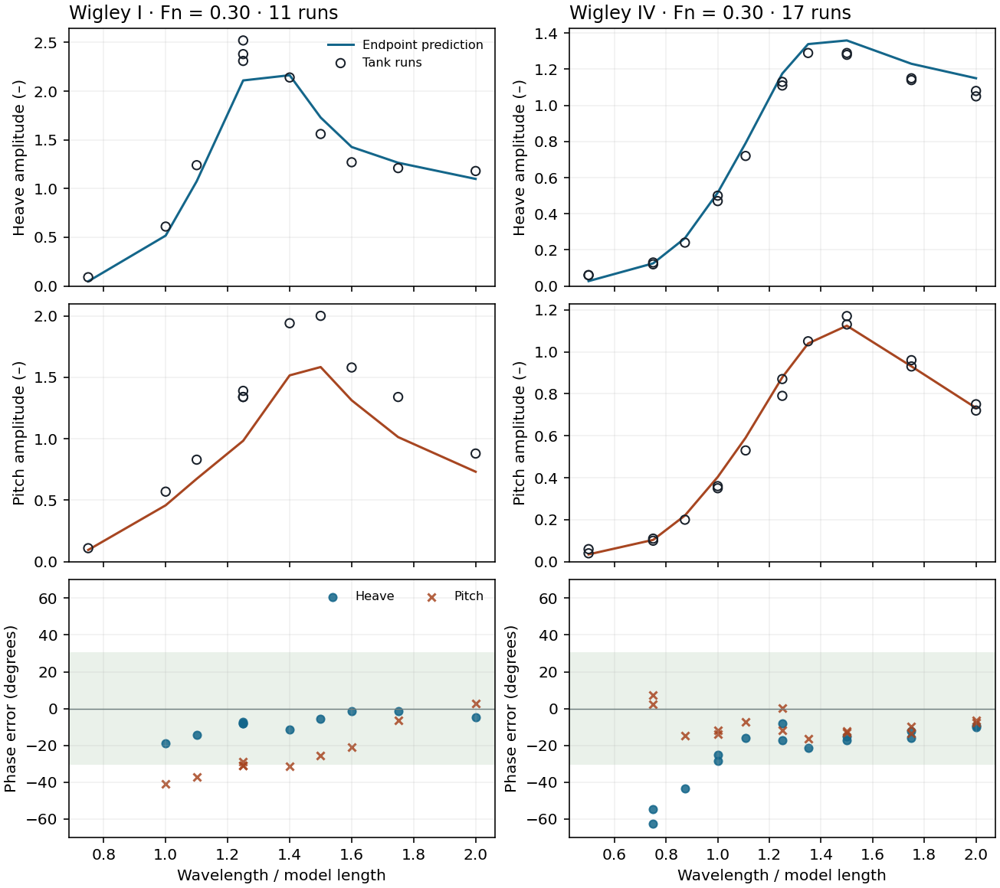

# Forward-speed motion verification on three Wigley hulls

At the withheld speed Fn = 0.30, the tank-assisted endpoint method passes both motions for Wigley III and pitch for Wigley IV. It misses both motions for Wigley I and heave phase for IV. All 48 original middle-speed wave runs enter these scores. Each hull supplies its own endpoint radiation and excitation. The independent geometry-only double-body solver still passes zero of the six full Wigley III motion series.

## Match the forced-test and response equations

Journée's report 0909, pp. 5–7, assigns hydrostatic stiffness to the real part of a forced oscillation. The measured added mass includes a term $C/\omega_e^2$. For Wigley III the published reduction used $C_{33}=6119$ N/m, $C_{55}=2874$ N m/rad and zero cross stiffness. The previous 760-panel response assembly used 6093.65 and 2819.92 respectively with the tabulated added mass. The geometry-only calculation includes the buoyancy and gravity moment in pitch, while the report uses the waterplane second moment. [Source report and archive checksums](../journee_wigley3_zero_speed/README.md)

We pair tabulated radiation with the report's restoring matrix, and native radiation with the mesh restoring matrix wherever the forced data lack frequency coverage. In $Z=C-\omega_e^2(M+A)-i\omega_e B$, the equivalent transformation at a given frequency is $A_{\rm mesh}=A_{\rm report}+(C_{\rm mesh}-C_{\rm report})/\omega_e^2$. The original dry mass, pitch origin, force normalization, interpolation, phase convention and acceptance thresholds are held fixed. Native double-body predictions remain the published geometry-only baseline. [Baseline study](double_body_results.md)

| Wigley III | Heave RMS / max | Pitch RMS / max | Largest scored pitch phase error | Full-series outcome |
|---|---:|---:|---:|---|
| Fn 0.20 | 0.0360 / 0.0906 | 0.0531 / 0.1133 | 18.22° | Both pass |
| Fn 0.30 | 0.0452 / 0.0853 | 0.0598 / 0.1698 | 17.89° | Both pass |
| Fn 0.40 | 0.0372 / 0.0751 | 0.1122 / 0.2678 | 12.06° | Pitch fails |

The largest high-speed pitch error is at λ/L = 1.384. File `08-III-40.exp`, line 9, group 2 records a 1.36 cm incident wave, pitch amplitude 1.25 and phase 160°. The previous prediction was 1.4512. The paired result is 1.5178 at 168.31°. Both versions locate the measured peak at λ/L = 1.50. Radiation at the target is interpolated in encounter frequency and the complex restrained loads are interpolated between λ/L = 1.25 and 1.50. Repeating the calculation with each of the two forced-amplitude groups and each restrained-wave group separately gives pitch amplitudes 1.5099–1.5277. All four overshoot the measured response. The four values measure sensitivity to the recorded input levels. [Trial errors](paired_trials.csv) · [Scores](paired_scores.csv) · [Four input combinations](pitch_level_sensitivity.csv)

## Locate the geometry-only phase errors

For each DOF $i$, eliminate the other motion $j$ from the full complex system. The effective excitation is $F_i-Z_{ij}F_j/Z_{jj}$ and the effective impedance is $Z_{ii}-Z_{ij}Z_{ji}/Z_{jj}$. Their quotient gives the complex response. For the report's phase convention, subtract the impedance lag from the effective excitation lag and wrap the result. The cancellation ratio divides the magnitude of the effective excitation by $|F_i|+|Z_{ij}F_j/Z_{jj}|$. Values approaching zero indicate stronger cancellation.

The following signed phase errors are in degrees. The substitutions use components at the **same speed** for diagnosis, including middle-speed component measurements. Each measured radiation substitution also pairs the report stiffness with that radiation. All four combinations are available for 33 of 37 speed/wavelength pairs, spanning 58 of the 64 wave runs. The file marks sampled versus interpolated loads and applies the original phase amplitude mask. [All substitutions](phase_substitutions.csv) · [Coverage of every point](phase_coverage.csv)

| Hull III trial | Geometry only | Measured excitation | Measured radiation + restoring | Both measured inputs |
|---|---:|---:|---:|---:|
| Heave, Fn 0.20, λ/L 0.75, group 2 | −42.66 | −11.83 | −11.29 | +0.40 |
| Heave, Fn 0.30, λ/L 0.907, group 2 | −40.09 | −11.99 | −27.51 | −1.79 |
| Pitch, Fn 0.40, λ/L 1.384, group 2 | +42.42 | +47.26 | +6.45 | +8.31 |

For middle-speed heave at λ/L = 0.907, changing excitation moves the effective-force lag from 10.35° to 38.45° with fixed physical impedance. The tank excitation here is interpolated. For high-speed pitch at λ/L = 1.384, replacing the radiation and restoring terms moves the effective impedance lag from 87.94° to 120.02°. Closely matching phase at this point can coexist with an excessive amplitude.

## Test the same endpoint procedure on Wigley I and IV

The source archive yields 45 endpoint restrained-load records for these two hulls, 176 forced oscillation records across three speeds, and 28 free-motion target runs. Prediction uses only Fn = 0.20 and 0.40 component data from the same hull. It retains the earlier even/odd speed interpolation for the radiation matrix and linear complex interpolation for wave excitation. Volume-derived masses are 94.6 and 156.0 kg, respectively. Both models use a 0.75 m pitch gyration radius with the reference at the amidships waterplane. Report restoring values for IV are twice those for I. [Input loads](transfer_loads.csv) · [Forced records](additional_forced_hulls.csv) · [Free motions](transfer_motions.csv)

| Hull at Fn 0.30 | DOF | Free runs / scored phases | Amplitude RMS / max | Phase RMS / max | Outcome |
|---|---|---:|---:|---:|---|
| I | Heave | 11 / 10 | 0.1865 / 0.4103 | 9.70° / 18.99° | Fail |
| I | Pitch | 11 / 10 | 0.3027 / 0.4240 | 28.25° / 41.07° | Fail |
| IV | Heave | 17 / 15 | 0.0594 / 0.1003 | 28.76° / 62.61° | Fail |
| IV | Pitch | 17 / 15 | 0.0351 / 0.0883 | 10.87° / 16.51° | Pass |



For Wigley IV heave at λ/L = 0.75, the predicted amplitude is 0.1252 against 0.13 and 0.12, while the predicted phase is 249.39° against 312° and 304°. At this point every component came from the endpoint measurements. For Wigley I pitch at λ/L = 1.40 the prediction is 1.516 against 1.94, also with all endpoint components.

Two of the 19 target hull/wavelength pairs require a native component. At λ/L = 0.75 the Wigley I Fn = 0.40 restrained-load record lacks a usable heave-force phase at either tested wave amplitude. The original pitch-moment data remain available and enter the prediction. At λ/L = 0.50 the Wigley IV target encounter frequency lies beyond the common endpoint radiation band. For both gaps, the fallback is the 760-panel uniform-current forward-speed solver with the original hull form, deep-water head seas and the encounter-frequency Green function. Wigley I uses the submerged sectional fullness term from report p. 3; IV uses the III section with twice the beam. On these grids the enclosed volumes are 0.09381 and 0.15466 m³, within 1% of the report's 0.0946 and 0.1560 m³. Both solves have relative residual below 10⁻¹⁵. Inputs, fallback provenance and conditioning are recorded for each wavelength. [Coefficients](transfer_coefficients.csv) · [Individual trial results](transfer_trials.csv) · [Series scores](transfer_scores.csv)

These results apply to regular head waves, with only heave and pitch free, on hulls with endpoint data in one published collection. Predictive accuracy from geometry alone on a new hull remains unverified. The high-speed III motion at λ/L = 1.384 has a single valid wave run, and there is no restrained-load measurement at that exact wavelength.

## Reproduction

From the repository root, with the project installed:

```sh
export OPENBLAS_NUM_THREADS=1 OMP_NUM_THREADS=1
python -m benchmarks.journee_wigley3_forward_speed.impedance_audit
python -m benchmarks.journee_wigley3_forward_speed.cross_hull_motions
python -m benchmarks.journee_wigley3_forward_speed.plot_transfer
python -m pytest -q tests/test_journee_motion_transfer.py tests/test_journee_wigley3_forward_speed.py tests/test_wigley_double_body_flow.py tests/test_journee_wigley3_zero_speed.py
```

Optional `--archive /path/to/0909-DUT-92.zip` on `cross_hull_motions` regenerates the I/IV transfer inputs after verifying the author's SHA-256. The separate `speed_parity --archive` command regenerates their forced oscillations. Each of `impedance_audit --require-pass` and `cross_hull_motions --require-pass` returns status 1 while its respective full-series scientific criteria fail.
