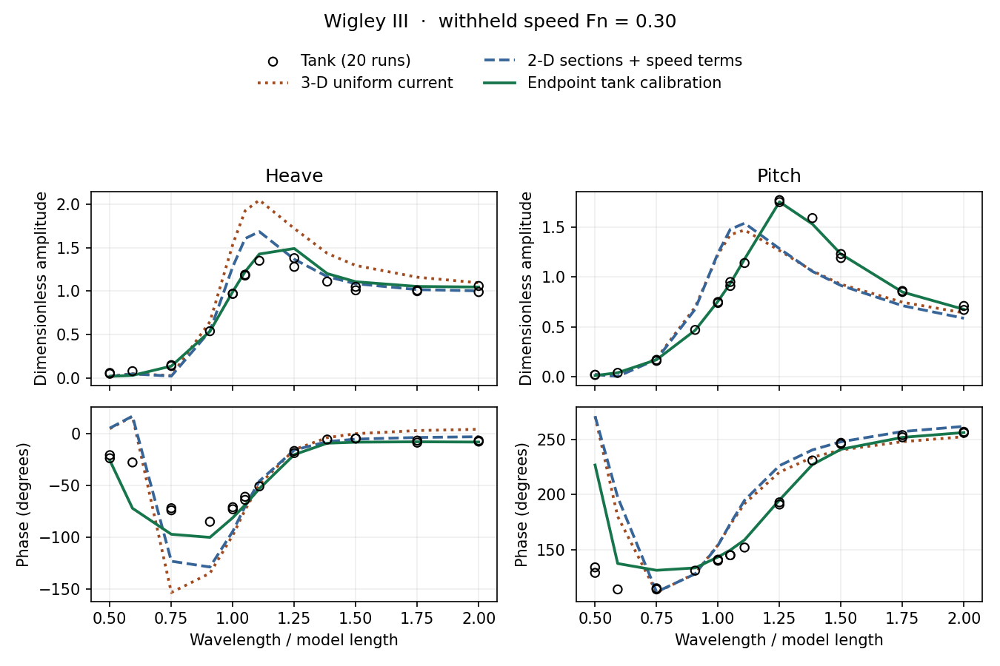

# Wigley III radiation and the withheld-speed test

At the held-out speed Fn = 0.30, the model calibrated on the two endpoint speeds passes the original pitch amplitude, phase and sampled-peak criteria across all 20 wave runs. Pitch amplitude RMS is 0.0222 and maximum error is 0.0602. Heave misses the maximum-amplitude limit at one replicate. The geometry-only sectional BEM improves heave RMS at all three speeds; its pitch RMS increases at all three. Its six combined experimental checks remain open.



## What changed in the physics

Journée's report 0909, p. 4, gives the double-ended heave/pitch speed terms, with the longitudinal coordinate positive forward and the pitch normal proportional to −x. For total sectional heave added mass A₃₃ and damping B₃₃ at encounter frequency ωₑ, the increments are

- ΔA₃₅ = −U B₃₃/ωₑ², ΔA₅₃ = −ΔA₃₅.
- ΔB₃₅ = U A₃₃, ΔB₅₃ = −ΔB₃₅.
- ΔA₅₅ = (U/ωₑ)² A₃₃ and ΔB₅₅ = (U/ωₑ)² B₃₃.

The prior interior correction in `stf_speed_correction_terms` assigned equal signs and used the same type of coefficient for each cross term. The conventional section-array entry point now applies the equations above. They describe a distinct approximation from the direct uniform-current 3-D solver in the [preceding study](README.md). Ships with an immersed transom need additional end terms and lie outside this verification. [Original report and source archive](../journee_wigley3_zero_speed/README.md#geometry-and-measurements)

The new sectional solver places constant pulsating-source panels on each open wetted contour, with its two endpoints at the waterline. The 2-D outgoing deep-water Green function imposes the free-surface condition. Submerged collocation points enforce unit body-normal heave velocity; integration uses the existing analytic logarithmic-panel terms and Gauss quadrature. Direct pressure integration supplies sectional A and B. Integrating each side's outgoing wave independently from the source density supplies an energy check on B. Gaussian stations on each half-hull resolve the actual Wigley III transverse parabolas. Longitudinal integration uses the rigid heave/pitch modes (1, −x), then adds the finite-speed corrections. Each RAO uses the same 760-panel 3-D wave excitation, hydrostatics and mass as the original comparison. No tank coefficient enters this sectional route. [Section solver and integration API](../../src/tensorbem/section_radiation.py)

| Fn | 3-D heave RMS | Sectional heave RMS | 3-D pitch RMS | Sectional pitch RMS |
|---:|---:|---:|---:|---:|
| 0.20 | 0.191 | 0.078 | 0.165 | 0.185 |
| 0.30 | 0.380 | 0.189 | 0.322 | 0.337 |
| 0.40 | 0.467 | 0.265 | 0.416 | 0.458 |

At Fn = 0.20 the sectional heave amplitude passes both amplitude limits; phase RMS is 18.70° against a 15° limit. Sectional grids use 8 stations × 12 wetted panels, 12 × 20 and 20 × 32. From the middle to finest resolution the largest motion-amplitude changes over the 37 cases are 0.0106 heave and 0.0090 pitch. Across all tested motion and forced frequencies, the maximum sectional damping discrepancy between pressure and energy, divided by sectional displaced mass times ωₑ, drops from 0.0602 through 0.0358 to 0.0218. The finest maximum residual is 8.9 × 10⁻¹⁵ or smaller and the maximum system condition number is 112.5 or smaller. The pressure estimate can lose relative accuracy or give a small negative value when true damping approaches zero at high frequency. The solver returns both estimates. Semicircular-section tests cover the low-frequency waterline-flux limit, the high-frequency dipole added mass and the finite-frequency energy balance. [Coefficients and numerical diagnostics](strip_coefficients.csv)

## Forced-motion comparison at the measured frequencies

The baseline 760-panel 3-D solver and the sectional model each ran at the actual frequencies of the 104 forced-motion records (67 distinct Fn/frequency pairs). Each record supplies four dimensionless coefficients from its driven motion, giving 416 direct comparisons. The RMS values below use each coefficient's normalization from report p. 7. Compare within a row; cross-coefficient magnitudes have different scales. [Measured and predicted entries](forced_comparison.csv)

| Coefficient | Native 3-D RMS | Sectional RMS |
|---|---:|---:|
| A₃₃ | 0.424 | 0.407 |
| A₃₅ | 0.080 | 0.138 |
| A₅₃ | 0.073 | 0.145 |
| A₅₅ | 0.053 | 0.019 |
| B₃₃ | 0.315 | 0.179 |
| B₃₅ | 0.216 | 0.089 |
| B₅₃ | 0.104 | 0.092 |
| B₅₅ | 0.042 | 0.058 |

Five coefficient RMS values improve. The two cross added-mass terms and the pitch damping RMS increase. For example, at Fn = 0.40 and λ/L = 1.50 the sectional B₅₅ is 122.73 N m s, compared with 106.63 for the uniform-current model and 58.13 from interpolated forced tests. Tightening the pitch-damping and cross-added-mass predictions around the encounter-frequency response peak is the remaining physics priority.

## Predicting a speed withheld from calibration

The tank-assisted model is specific to this Wigley III loading. Its calibration inputs are the 72 forced-motion and 28 restrained-wave records at Fn = 0.20 and 0.40. Fn = 0.30 contributes zero input rows from either series. Free-motion amplitudes and phases at all speeds are used only for scoring. This is a retrospective held-speed comparison on an existing public experiment.

At each anchor, both forced-oscillation amplitudes are interpolated separately at the requested encounter frequency, then averaged as in the preceding study. Restrained wave forces are averaged as complex phasors at a given λ/L, then interpolated in λ/L. These coefficients and normalized complex loads are interpolated linearly in Fn between the endpoints. The resulting dimensional A, B and F are passed through the original two-degree-of-freedom impedance and the original acceptance thresholds. The native predicted component supplies a fallback for inputs outside a calibration band's support. The output identifies that choice for each component and condition. The held-out λ/L = 0.50 uses native radiation. At Fn = 0.40, λ/L = 0.50 and 0.592 use native radiation and λ/L = 2.367 uses native wave loads. [Per-condition inputs and responses](candidate_motions.csv)

| Fn | Role | Runs | Heave amplitude RMS / max | Pitch amplitude RMS / max | Combined heave / pitch checks |
|---:|---|---:|---:|---:|---|
| 0.20 | Calibration speed, free motions reserved | 23 | 0.0426 / 0.1018 | 0.0260 / 0.0726 | Pass / pass |
| **0.30** | **Withheld speed** | **20** | **0.0714 / 0.2106** | **0.0222 / 0.0602** | **Fail / pass** |
| 0.40 | Calibration speed, free motions reserved | 21 | 0.0538 / 0.1017 | 0.0863 / 0.2012 | Pass / fail |

On the held speed, using only the endpoint radiation data with native excitation gives pitch RMS 0.137 and heave RMS 0.081. Using endpoint radiation and loads together recovers the measured pitch peak at λ/L = 1.25 and gives pitch phase RMS 6.77° and maximum 17.32°. For heave at λ/L = 1.25 the prediction is 1.4906; the two measured amplitudes are 1.28 and 1.38. The largest error, 0.2106, exceeds the 0.20 cutoff. The held-speed heave phase checks pass and the predicted peak at λ/L = 1.25 is one sampled interval from the measured peak at 1.108. The maximum-amplitude error is the only failed heave criterion at this withheld speed. [All candidate scores](candidate_scores.csv)

## Reproduction

Install TensorBEM with its development and visualization dependencies. From the repository root:

```sh
export OPENBLAS_NUM_THREADS=1 OMP_NUM_THREADS=1
python -m benchmarks.journee_wigley3_forward_speed.forced_baseline
python -m benchmarks.journee_wigley3_forward_speed.strip --workers 4
python -m benchmarks.journee_wigley3_forward_speed.radiation_study
python -m benchmarks.journee_wigley3_forward_speed.plot_holdout
python -m pytest -q tests/test_section_radiation.py tests/test_stf_haskind_reg.py tests/test_journee_wigley3_forward_speed.py
```

To recompute the 3-D excitation used for the motion sweep, run the native benchmark as described in its [reproduction instructions](README.md#reproduce). `radiation_study --require-pass` takes a candidate name, e.g. `python -m benchmarks.journee_wigley3_forward_speed.radiation_study --require-pass endpoint_radiation_load`, and exits 1 if any of its six experimental checks fails. Removing every held-speed forced and restrained row reproduces the same endpoint-model predictions in the regression test.
