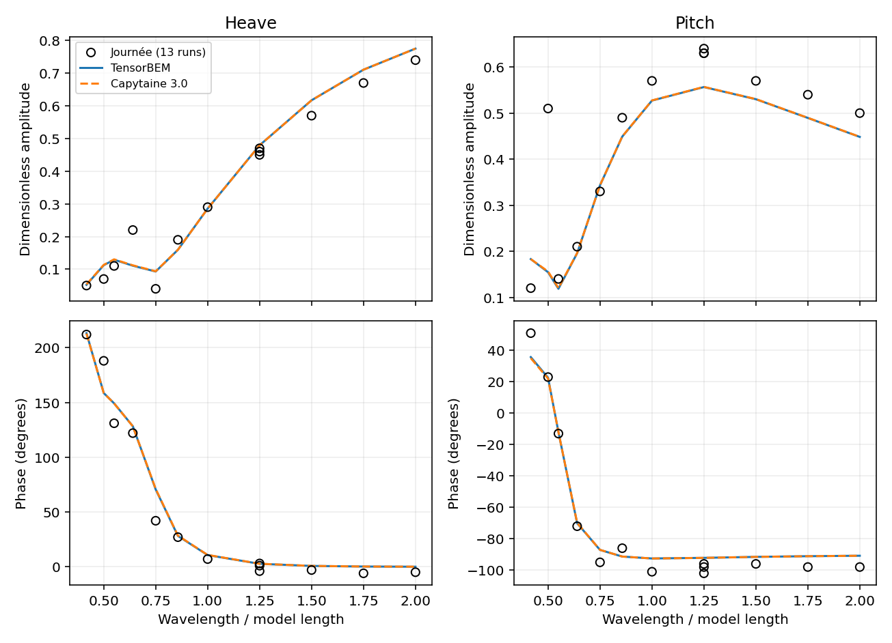

# Wigley III in regular head waves at zero speed

TensorBEM passes the declared heave amplitude and phase checks on the 13 measured runs. Pitch phase passes. Pitch amplitude fails both the RMS and maximum absolute error checks. The largest discrepancy occurs at λ/L = 0.50. Capytaine 3.0.0 reproduces nearly the same predictions with the same panels, mass and restoring matrix.



## Geometry and measurements

The model is identified as `journee-1992-wigley-iii`. Its half-breadth is `(B/2)(1-u²)(1-v²)(1+0.2u²)`, where u=2x/L and v=z/T. The parameter multiplying u² is Journée's a₂. His sectional correction α vanishes for model III. The IDs below distinguish hulls at identical 3 × 0.3 × 0.1875 m dimensions.

| Geometry ID | Longitudinal factor | Block coefficient | Waterplane coefficient | Volume (m³) |
|---|---:|---:|---:|---:|
| classic-parabolic-wigley | 0 | 0.444444 | 0.666667 | 0.075 |
| journee-1992-wigley-iii | 0.2 | 0.462222 | 0.693333 | 0.078 |
| tensorbem-legacy-cb0543 | 1.10875 | 0.543 | 0.8145 | 0.09163125 |

J.M.J. Journée, *Experiments and Calculations on Four Wigley Hull Forms in Head Waves*, DUT report 0909 (1992, reprinted 2003). Pages 2–3 give geometry and loading, pp. 9–10 give response definitions, p. 13 defines the motion axes, and Table 10-III (p. 57) gives the zero-speed responses. The author made the experimental data available for comparative studies.

- [Original report PDF](https://web.archive.org/web/20050915002525id_/http://www.ocp.tudelft.nl/mt/journee/Files/PapersReports/0909-DUT-92.pdf), SHA-256 `a18405ac4b7c18f61bfef63ce2aeb9c5058a397178979f77b05de92d503efd62`.
- [Author's ASCII archive](https://web.archive.org/web/20070126075416id_/http://www.ocp.tudelft.nl/mt/journee/Files/PapersReports/0909-DUT-92.zip), SHA-256 `dc930dbd62bfda3f37853f75911be74028b8d8baddbe3963643652fa3b90da59`. The local [table10.csv](table10.csv) selects columns 1, 2, 5, 6, 7 and 8 (one-based) from member `10-III-00.exp`. Phase angles in the printed table and archive are equivalent modulo 360°. The test rows use the ASCII data directly.
- At λ/L = 1.25, the three incident amplitudes are 2.34, 4.86 and 6.50 cm. Heave amplitudes span 0.45–0.47 and pitch 0.63–0.64. These repeats characterize only that condition. The table supplies no row-specific uncertainty interval. No graph digitization or uncertainty-based adjustment enters the scores.

## Model, outputs and acceptance

Use freshwater density 1000 kg/m³, g = 9.81 m/s², model mass 78 kg, pitch radius of gyration 0.75 m, CG at z = −0.0175 m, and rotations about amidships on the still waterplane. Fix surge, sway, roll and yaw, and solve the coupled heave/pitch submatrix. Both routes use deep water, zero speed, unit incident wave amplitude, the identical outward-normal triangular panels, and the mesh-based TensorBEM restoring matrix. The hydrodynamic coefficients and excitation are independently assembled by each solver. No fitted damping or calibration is applied.

For bow in +x and z up, use propagation direction π. The solver uses exp(−iωt), with Z = C − ω²(M + A) − iωB. The physical period is set by ω² = 2πg/λ. Convert the response to Table 10-III with −arg(ξ) for its cos(ωt + ε) phase convention, |ξ₃|/a for heave and |ξ₅|L/(2πa) for pitch. The pitch normalization uses model length over the entire band.

The [acceptance limits](limits.json) are project criteria. Both motions use dimensionless amplitude RMS ≤ 0.10 and maximum absolute error ≤ 0.20. Wrapped phase RMS ≤ 15° and maximum ≤ 30° apply where measured and predicted amplitudes both reach 0.10. Low-response rows remain in the pointwise output and the amplitude scores. Peaks are compared within one sampled wavelength step, averaging only repeated experimental amplitudes at a given wavelength for that calculation. Heave reaches its largest sampled response at the edge of the band; the comparison does not locate an interior resonance.

| TensorBEM panels | Heave amplitude RMS / max | Heave phase RMS / max (°) | Pitch amplitude RMS / max | Pitch phase RMS / max (°) |
|---:|---:|---:|---:|---:|
| 264 | 0.046 / 0.110 | 6.40 / 16.32 | 0.111 / 0.356 | 7.68 / 17.81 |
| 480 | 0.044 / 0.110 | 6.91 / 17.63 | 0.111 / 0.356 | 7.27 / 15.99 |
| 760 | 0.043 / 0.109 | 7.14 / 18.17 | 0.111 / 0.355 | 7.15 / 15.27 |

At 760 panels both solvers reproduce the measured sampled pitch peak location, 4.054 rad/s (λ/L = 1.25). The maximum amplitude change from 480 to 760 panels is 0.00241 for heave and 0.00255 for pitch. Capytaine emits panel-radius/wavelength resolution warnings on some short-wave cases. Two further refinements at λ/L = 0.50 gave:

| Panels | TensorBEM pitch | Capytaine pitch | Measured pitch |
|---:|---:|---:|---:|
| 760 | 0.15456 | 0.15613 | 0.51 |
| 1104 | 0.15477 | 0.15625 | 0.51 |
| 1512 | 0.15493 | 0.15628 | 0.51 |

Source Table 10-III independently prints 0.51 at this wavelength. Agreement between codes and stability under refinement narrow the investigation to shared model assumptions, input definitions and experimental conditions. They do not establish the cause. The archive contains forced-pitch coefficients (Table 3-III) and restrained wave moments (Table 6-III) at Fn = 0.20, 0.30 and 0.40. Its only zero-speed model III file is Table 10-III. Isolating excitation from radiation at this zero-speed discrepancy requires another source of measured coefficients or an independent test at the same speed. Forward-speed RAOs require separate excitation, radiation and encounter-frequency treatment.

## Reproduce

Install the project and plotting dependencies with `pip install -e '.[dev,visualization]'` and the independent solver with `pip install capytaine==3.0.0`. From the project root, with one BLAS/OpenMP thread:

```sh
cd benchmarks/journee_wigley3_zero_speed
export OPENBLAS_NUM_THREADS=1 OMP_NUM_THREADS=1
python run.py tensorbem
python run.py capytaine
python run.py tensorbem --short-wave
python run.py capytaine --short-wave
python assess.py
python plot.py
```

[tensorbem.csv](tensorbem.csv) and [capytaine.csv](capytaine.csv) include rigid mass, restoring terms, all four radiation matrix entries for each of A and B, complex excitation, motion amplitude and phase at 11 wavelengths on three meshes. F3 and F5 are force (N) and moment (N m) at a unit wave amplitude. [errors.csv](errors.csv) preserves each of the 13 trials, signed amplitude error, wrapped phase error and phase eligibility per solver and grid. [scores.json](scores.json) includes peak locations and individual gate decisions. `python assess.py --require-pass` writes the same results and exits 1 while the finest-grid TensorBEM pitch amplitude fails. The [native](tensorbem_half_length.csv) and [independent](capytaine_half_length.csv) short-wave refinements are follow-up diagnostics outside the three-grid score.
