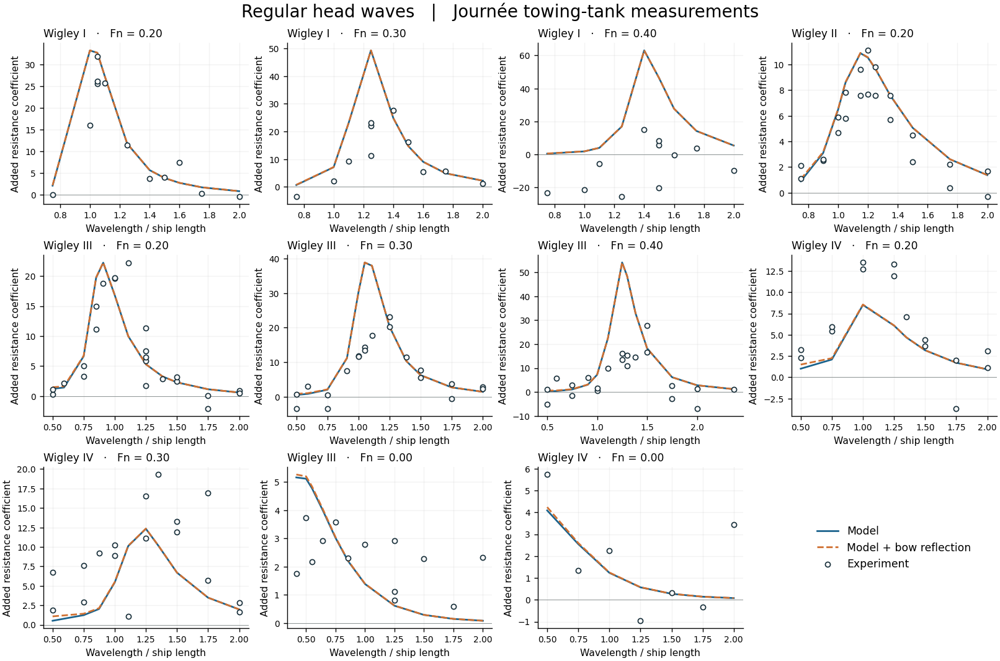
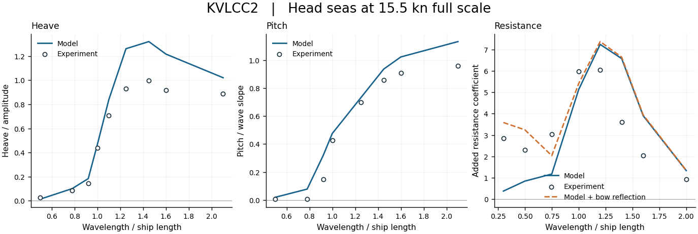
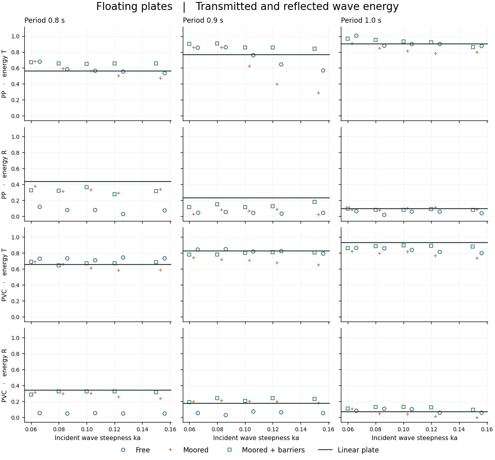

# Ship added resistance and wave scattering by a single floating plate

TensorBEM now compares its own predictions with 172 original Wigley tank runs, 25 published KVLCC2 experimental points, and 90 floating-plate conditions with measurements of both reflected and transmitted energy. This page describes solver-specific verification and experimental comparison. The numerical acceptance thresholds below are project tolerances. Individual experimental uncertainties have not been propagated into them. The solver parameters are shared across wave conditions, with no fit to the scored data.

| Experiment | Finely resolved numerical model used for scoring | Outcome |
|---|---|---|
| Four Wigley models, regular head waves | 480 hull panels, 21 longitudinal stations, 24 contour panels | 1/9 advancing series passes. Both zero-speed series fail. |
| KVLCC2 tanker, 15.5 kn head seas | 1,118 hull panels, 58 surface-piercing sections, 24 contour panels | Heave, pitch and both resistance models fail. The added-resistance peak is at the observed wavelength. |
| Single PP or PVC plate, 0.9 m water depth | 72 panels along the plate, Hermite elements and two outgoing-wave ports | Reflection and transmission both pass for the moored plates with overwash barriers. Only transmission passes for free plates. Both fail for the loosely moored plates without barriers. |

## Four Wigley models

The raw files supply incident amplitude, motions, phase and mean added resistance. Table 8 contributes 152 runs on 94 distinct hull/speed/wavelength combinations (34 model I, 22 II, 64 III, 32 IV). All 19 negative added-resistance measurements and all repeated amplitudes are retained. Three rows lack a motion phase. They are scored against both predictive methods and omitted only from the diagnostic that uses measured complex motion. Table 10 adds 13 zero-speed runs for model III and seven for model IV. Each row retains its original table, line and amplitude group. The plotted ordinate is mean added resistance divided by ρg a²B²/L. Journée defines the pitch ordinate as θL/(2πa), independent of wavelength. [Original report and ASCII archive](../journee_wigley3_zero_speed/README.md#geometry-and-measurements) · [Trials](../journee_added_resistance/trials.csv) · [All predictions](../journee_added_resistance/results.csv) · [Series scores](../journee_added_resistance/scores.csv)

The ship advances along positive x, with unit-amplitude incident head waves and harmonic convention exp(−iωₑt). The native uniform-flow 3-D solver determines free heave and pitch about the waterplane origin with the other rigid modes constrained. The sectional outgoing-wave solver produces heave added mass m(x) and damping N(x) at encounter frequency. With x positive forward and pitch positive bow-down, the sectional relative velocity is −iωₑ(ξ₃−xξ₅)+Uξ₅−w. The incoming wave's vertical velocity w uses the intrinsic wave frequency and is averaged over each wetted section's horizontal projection. Integrating the Gerritsma–Beukelman work gives k/(2ωₑ) times the integral of [N−U dm/dx] times the squared magnitude of relative velocity. For closed ends the implementation uses integration by parts and integrates the piecewise-linear interpolation. A second prediction adds the Fujii–Takahashi head-sea bow-reflection term. The two models use the same ship motions. The restrained and measured-motion runs serve as diagnostics. [Journée and Massie, chapter 8](https://ocw.tudelft.nl/wp-content/uploads/OffshoreHydromechanics_Journee_Massie.pdf) · [27th ITTC Seakeeping Committee, equations 12–14](https://ittc.info/media/6069/6-seakeeping-committee-new.pdf)

Each hull/speed series is scored over individual trials. RMS and maximum absolute resistance errors are divided by the largest absolute experimental coefficient in that series. Their limits are 0.20 and 0.40, respectively. The model peak must lie within one sampled wavelength of the observed peak, using the mean of repetitions at each wavelength. The coarser model uses 264 panels, 13 stations and 16 contour panels.

| Hull and Fn | Uncorrected normalized RMS | Maximum | Verdict |
|---|---:|---:|---|
| I, 0.20 / 0.30 / 0.40 | 0.187 / 0.611 / 1.393 | 0.540 / 1.376 / 2.603 | All fail |
| II, 0.20 | 0.146 | 0.295 | Pass |
| III, 0.20 / 0.30 / 0.40 | 0.178 / 0.476 / 0.637 | 0.550 / 1.095 / 1.468 | All fail |
| IV, 0.20 / 0.30 | 0.272 / 0.310 | 0.535 / 0.696 | Both fail |
| III / IV, zero speed | 0.462 / 0.288 | 0.916 / 0.589 | Both fail |

On model III at Fn 0.40 and λ/L 1.384, the tank coefficient is 14.50. The geometry-only result is 32.98, the measured-motion diagnostic is 38.92, and the restrained result is 0.91. Substituting tank motions does not resolve this point. At zero speed, model III's three runs at λ/L 1.25 vary from 2.92 to 1.12 to 0.80 as amplitude rises from 2.34 to 4.86 to 6.50 cm. All three share one prediction in the present small-wave model. Full three-dimensional second-order forces and finite-amplitude effects remain open.



## KVLCC2

The 1:80 model retains the published draft of 0.260 m, length 4 m, displacement 0.6106 m³, and longitudinal centre of gravity 3.48% of length forward of amidships. The 3-D mesh comes from NMRI's joined bow and stern patches, including the submerged bulb. The sectional solver uses the waterline-connected component of the published body plan, closing the last sectional intervals at the transom extension and FP. Coarse and fine meshes underestimate displacement by 2.39% and 0.85%. The model uses free heave and pitch and kyy/L = 0.25. The result table includes 0.24 and 0.26 sensitivity columns. The precise pitch inertia and experimental surge restraint in Lee's runs are unconfirmed. [Workshop surface grid](https://www.nmri.go.jp/study/research_organization/fluid_performance/cfd/cfdws05/gothenburg2000/data/KVLCC2_data/kvlcc2_surfacemesh.ZIP) · [Body-plan offsets](https://www.nmri.go.jp/study/research_organization/fluid_performance/cfd/cfdws05/gothenburg2000/data/KVLCC2_data/kvlcc2_offsets.ZIP)

The experimental points are the Lee et al. markers reproduced by Kim et al., figures 5 and 6 (regular head seas, 15.5 kn full scale). The importer reads vector marker centres against the plotted axis frames. It stores λ/L to 0.01 and ordinates to 0.001, retaining only identifiable experimental markers. Those decimal places describe extraction resolution. Raw acquisition precision, replicates, phases and uncertainty bars cannot be recovered from these centres. The KVLCC2 pitch ordinate is θ/(ka). [Kim et al., Ocean Engineering 140 (2017), 466–476](https://doi.org/10.1016/j.oceaneng.2017.06.019) · [Source PDF](https://strathprints.strath.ac.uk/61235/1/Kim_etal_OE_2017_added_resistance_and_motions_of_KVLCC2_in_head_seas.pdf) · [Digitized points](../kvlcc2_head_seas/observations.csv) · [Predictions](../kvlcc2_head_seas/results.csv) · [Scores](../kvlcc2_head_seas/scores.csv)

| Finest-grid quantity | Points | RMS | Maximum | RMS / maximum limits |
|---|---:|---:|---:|---|
| Heave / wave amplitude | 9 | 0.194 | 0.332 | 0.10 / 0.20 |
| Pitch / wave slope | 8 | 0.105 | 0.174 | 0.10 / 0.20 |
| Added resistance, radiation only | 8 | 0.301 | 0.493 | 0.20 / 0.40 |
| Added resistance with bow reflection | 8 | 0.245 | 0.504 | 0.20 / 0.40 |

The motion errors use absolute RAO units. Resistance errors use the experimental peak coefficient of 6.041 as denominator. Each gate also requires a peak within one sampled wavelength and displacement within 1%. The bow correction changes λ/L 0.30 from 0.376 to 3.585 against a measured 2.848. At λ/L 1.20, the measured peak is 6.041 and the two model peaks are 7.238 and 7.370. The correction improves short waves while increasing the largest absolute error elsewhere.



## Single floating plate

A finite-depth, two-dimensional Laplace boundary-element fluid is coupled to a free-edge Euler–Bernoulli plate of finite length. The fixed bottom is impermeable. The uncovered water surface obeys the linear free-surface condition. At both vertical ports the outgoing boundary condition retains the propagating mode and evanescent modes. The plate is discretized with cubic Hermite elements. The public solver returns complex amplitudes, energy-balance defect and linear-system residual. It represents unit-span, lossless flexure, zero draft and no overwash, surge or mooring loads. One prediction per material and period is applied across steepnesses and experimental configurations.

Nelli et al. tested 1.0 m × 1.9 m × 0.01 m polypropylene and PVC plates with periods 0.8, 0.9 and 1.0 s and five wave steepnesses. Figures 13–14 give 90 paired conditions. The importer keeps the reflected and transmitted marker centres and their independently digitized ka values. Each plotted value is an energy fraction. The digitizer rounds ka and energy to 0.0001 and does not digitize the plotted uncertainty bars. Experimental loss is reconstructed as 1−R−T and retains its sign. The acceptance limits are RMS ≤ 0.10 and maximum ≤ 0.20 separately for R and T in each configuration. [Nelli et al., Wave Motion 70 (2017), 209–221](https://doi.org/10.1016/j.wavemoti.2016.09.003) · [Source manuscript](https://digital.library.adelaide.edu.au/server/api/core/bitstreams/370161c8-1616-4d72-83ac-9984f16ac00a/content) · [Measurements](../floe_transmission/observations.csv) · [Predictions](../floe_transmission/results.csv) · [Scores at all four resolutions](../floe_transmission/scores.csv)

| Configuration, 30 pairs each | Transmission RMS / maximum | Reflection RMS / maximum | Joint result |
|---|---|---|---|
| Freely floating | 0.076 / 0.197 | 0.211 / 0.406 | Fail |
| Loosely moored | 0.151 / 0.482 | 0.093 / 0.210 | Fail |
| Moored with barriers suppressing overwash | 0.067 / 0.141 | 0.071 / 0.158 | Pass |

The free-plate transmission maximum decreases from 0.243 to 0.210, 0.199 and 0.197 over 12, 24, 48 and 72 plate panels. Its reflection still fails at 72. For moored PP at period 0.9 s and ka ≈ 0.153, the experimental energy deficit reaches 0.691. The lossless model requires R+T = 1 regardless of steepness. The paired observations expose a limitation that a transmission-only comparison would miss. The barrier result applies to these polymer flume tests. Physical sea ice, large-floe fields, fracture and ship ice resistance require separate validation.



## Reproduce

From the repository root, install the project and use the following commands. All measured points and the compact KVLCC2 panels are included. The optional import path verifies each source archive or PDF against its SHA-256. PyMuPDF is required only for re-extracting publication markers.

```sh
python -m pip install -e '.[dev,visualization]'
export OPENBLAS_NUM_THREADS=1 OMP_NUM_THREADS=1
python -m benchmarks.journee_added_resistance.run --workers 4
python -m benchmarks.kvlcc2_head_seas.run --workers 2
python -m benchmarks.floe_transmission.run
python -m benchmarks.marine_experiments.plot
python -m pytest -q tests/test_marine_experiments.py
```

Pass `--require-pass` to any of the three case runners to return exit code 1 while its finest-grid acceptance fails. Wigley's required route is the uncorrected geometry-only model. Rows for each diagnostic and for the separate bow-reflection prediction remain in its score file.

```sh
python -m benchmarks.journee_added_resistance.run --archive 0909-DUT-92.zip --workers 4
python -m benchmarks.kvlcc2_head_seas.geometry kvlcc2_surfacemesh.ZIP kvlcc2_offsets.ZIP
python -m pip install PyMuPDF
python -m benchmarks.marine_experiments.import_figures kvlcc2 Kim_2017.pdf
python -m benchmarks.marine_experiments.import_figures floe Nelli_2017.pdf
```

### Regression and the existing shore-fast ice reference

The extended run includes the six new tests, the Journée tests, the sectional radiation and double-body tests, flexural-gravity tests, ship-motion conventions, hydrostatic RAOs and ice RAOs. It produced 295 passes and 48 failures. All 48 failing pytest node IDs also fail on the unmodified parent commit `7898931c`, in the legacy shore-fast ice test `tests/test_flexural_gravity_fox_squire.py`. The test's original JFM citation conflicts with the authors' publication record. Its numeric arrays have no traceable source extraction here. They remain unresolved, independent of the finite-length polymer flume benchmark. [Fox and Squire, JGR 95 (1990), 11629–11639](https://doi.org/10.1029/JC095iC07p11629) · [Author's publication list](https://www.physics.otago.ac.nz/data/fox/publications/publications.html)

The next discriminating ship comparison is a three-dimensional second-order pressure or far-field force evaluated on the same cases, especially zero-speed Wigley and the KVLCC2 short-wave points. For plates, the paired energy deficit provides a measurable target for dissipation and overwash. S-175/DTC oblique seas, OC6 platform loads, full-ship bending loads and continuous level-ice resistance each require their own experimental conditions and scoring.
