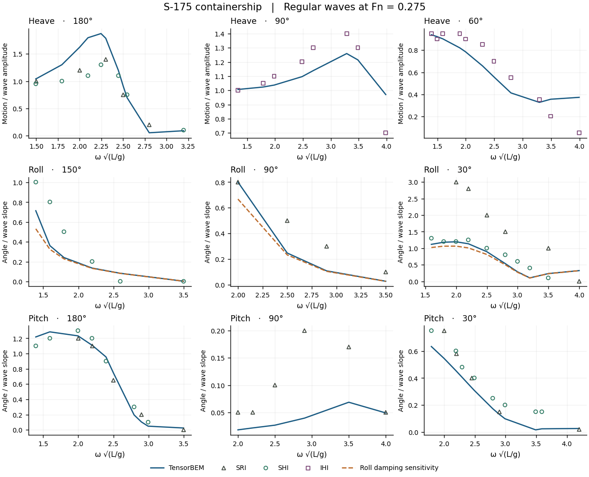

# S-175 container ship in oblique regular waves

The six-mode forward-speed solver predicts heave, roll and pitch on the published S-175 hull at Fn = 0.275. Figures 1–3 in João Pedro Gil Rosa's 2019 IST summary reproduce experimental markers from the ITTC comparative programme alongside two numerical codes. We extract only the 87 laboratory markers, across nine response/heading pairs, five headings and three facilities. The panel legends identify SRI, IHI and SHI separately. The 79 distinct heading/frequency combinations are each solved on two grids. Measured inputs are digitized marker centres. They do not recover time histories or facility-specific uncertainty. [Rosa, figures 1–3 and section 3.3](https://fenix.tecnico.ulisboa.pt/downloadFile/1689244997260485/Resumo_Alargado.pdf) · [Digitized observations](observations.csv)

## Geometry and calculation

The 24 half sections come from the S175 ShipX MGF archived in MSS-Capytaine. MGF longitudinal coordinates increase aft and heights are measured up from the baseline. The importer reverses x, clips to the 9.5 m draft, samples wetted girths by arc length and closes the supplied end sections. The solver mirrors the patch to obtain both sides. Computational scale is 1:70. Full-scale reference length is 175 m, beam 25.4 m and input mass 24,609,620 kg. The centre of gravity is 2.5475 m aft and 0.05 m above the waterplane. The roll, pitch and yaw radii of gyration are 8.331, 42 and 42 m. The finer grid underestimates target displacement by 0.63%, versus 1.08% at 596 panels. The computed transverse metacentric heights are 1.02 and 1.06 m full scale. The original comparative trials do not supply individual ballast, inertia and restraint settings in the digitized paper. We use one explicit MSS loading for all three laboratories. [MGF geometry](https://github.com/cybergalactic/MSS-Capytaine/blob/47106de10b73e6a6c764c23d6b3919779b40721a/vessels_capytaine/s175_mgf/s175.mgf) · [Mass and inertia source](https://github.com/cybergalactic/MSS-Capytaine/blob/47106de10b73e6a6c764c23d6b3919779b40721a/vessels_capytaine/s175_mgf/config.json)

The public `tensorbem.forward_speed.solve_forward_speed_modes` assembles one diffraction column and the requested rigid-mode radiation columns at signed encounter frequency ωₑ = ω−kU cos β. At negative encounter frequency the outgoing Green operator is conjugated. Exact zero encounter is singular. At positive forward speed the uniform-base-flow pitch and yaw boundary corrections are +U n_z and −U n_y. Convective pressure uses the derivative along the ship axis. The original head-sea heave/pitch entry point delegates to the same solver. This is a mean-wetted-surface, small-speed approximation. Dynamic trim, steady wave-making, viscous roll damping, wave breaking and manoeuvring are outside the baseline model. A roll damping sensitivity uses an additional 20% of critical roll damping derived from the effective roll inertia and roll restoring on that grid. The susceptibility of roll to damping is reported separately from the geometry-only score.

The abscissa is the intrinsic frequency ω√(L/g). The tests at 30°, 60° and 150° are oblique, 90° is beam seas and 180° is head seas. Heave is divided by incident amplitude, and roll and pitch by wave slope. For each response/heading pair, RMS error and maximum absolute error are divided by the largest absolute measured response among its laboratory points. Each pair requires normalized RMS ≤ 0.20, normalized maximum ≤ 0.40 and geometric volume error ≤ 1%. The limits are provisional project tolerances. Sampling accuracy on each plot depends on axis span. The importer rounds the recovered coordinates to three decimal places. Laboratory measurements are pooled only within a single motion and heading, with all individual markers retained.

For the 30° pitch marker at nondimensional frequency 4.200 the encounter frequency is very close to zero. Both the signed encounter ratio and the scaled dynamic-matrix condition number are reported. Neutral rigid-body modes and the small uncertainty in digitized frequency make that row particularly sensitive. The scaled near-axis expansion in the 3-D Green function avoids the overflow previously encountered in this region. The numerical fix does not supply any missing physical dissipation. [Pointwise results](results.csv) · [Gate and sensitivity scores](scores.csv) · [Capytaine spot checks](capytaine.csv)

## Measured performance

Four of nine response and heading pairs pass on 1,372 panels. The finest grid clears the 1% displacement requirement. The coarser grid misses that geometric criterion even where its motion errors are small.

| Motion | Heading | Experiment points | Normalized RMS | Maximum | Verdict |
|---|---:|---:|---:|---:|---|
| Heave | 60° | 11 | 0.155 | 0.338 | Pass |
| Heave | 90° | 8 | 0.095 | 0.193 | Pass |
| Heave | 180° | 12 | 0.235 | 0.497 | Fail |
| Pitch | 30° | 13 | 0.150 | 0.273 | Pass |
| Pitch | 90° | 6 | 0.425 | 0.803 | Fail |
| Pitch | 180° | 12 | 0.059 | 0.090 | Pass |
| Roll | 30° | 15 | 0.261 | 0.602 | Fail |
| Roll | 90° | 4 | 0.203 | 0.315 | Fail |
| Roll | 150° | 6 | 0.243 | 0.439 | Fail |

At 30° and ω√(L/g) = 2.0 the SRI roll response reaches 3.00 per unit wave slope. The model gives 1.195 and adding the illustrative damping lowers it further to 1.063. All three roll groups fail. The finite set of experimental points does not resolve every resonance peak. Adding damping indiscriminately would increase the error at this point.

The extra Capytaine 3.0.0 check independently solves six radiation problems and diffraction on the 596-panel mesh at three sampled headings/frequencies. At beam seas and ω√(L/g) = 2.5, TensorBEM/Capytaine give heave 1.099/1.101, roll 0.261/0.254 and pitch 0.0258/0.0276. At 60° and 2.295, the two codes give roll 15.63/14.42. That large roll estimate lacks a corresponding experimental roll point in that panel. These spot checks only compare the two numerical implementations.

At the 30° pitch point nearest synchronism the measured RAO is 0.020 and the fine-grid model gives 0.0270. Perturbing the nondimensional frequency by ±0.005 changes the prediction to 0.0265 and 0.0248 and crosses the sign change in encounter frequency. The central dimensionless motion-matrix condition number is 1.73 × 10⁷. The perturbation is a numerical sensitivity test; the original publication supplies no frequency uncertainty for that marker. [Synchronism sensitivity](synchronism.csv)

## Reproduction

Run at the repository root after installing the project with its development and visualization extras. The prepared geometry and measurements are sufficient to repeat the calculation. The optional importer checks the SHA-256 hashes of the MGF and experimental paper before reading their contents.

```sh
export OPENBLAS_NUM_THREADS=1 OMP_NUM_THREADS=1
python -m benchmarks.s175_oblique.run --workers 3
python -m benchmarks.s175_oblique.synchronism
python -m benchmarks.s175_oblique.plot
python -m pytest -q tests/test_s175_oblique.py
python -m pip install capytaine==3.0.0
python -m benchmarks.s175_oblique.crosscheck
```

To repeat the data extraction, install PyMuPDF and run `python -m benchmarks.s175_oblique.import_data s175.mgf Resumo_Alargado.pdf`. The `--require-pass` option on the benchmark runner returns exit code 1 if any finest-grid primary comparison fails.


