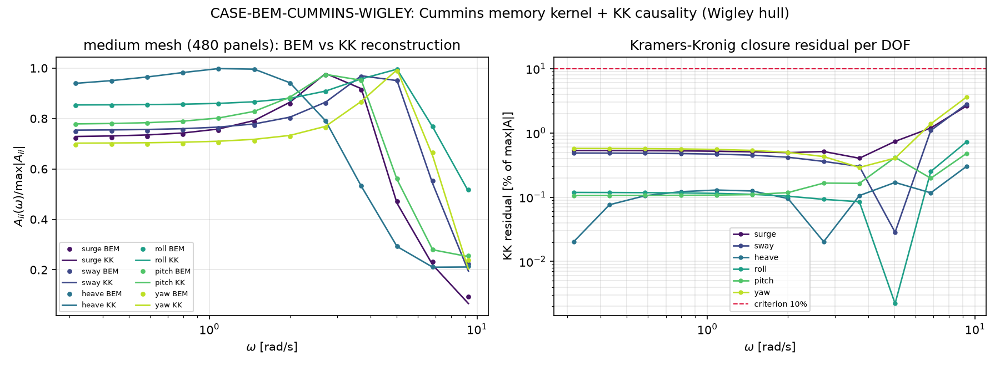

# CASE-BEM-CUMMINS-WIGLEY

Auto-rendered by `tensorbem.benchmarks.case_bem_cummins_wigley`; every number below is read from `case_result.json` produced by the same run.

## 1. Case setup

| item | value |
| --- | --- |
| hull form | mathematical Wigley hull y = (B/2)(1-(2x/L)^2)(1-(z/T)^2) |
| L / B / T [m] | 3.0 / 0.3 / 0.1875 |
| Cb (analytic) | 0.4444 |
| displaced volume (analytic) [m^3] | 0.075 |
| frequency band [rad/s] | 0.2 .. 12.0 |
| frequency nodes | 41 (log-spaced) |
| meshes | coarse: 12x4, medium: 20x6 |
| CHIEF irregular-frequency suppression | auto |

Criterion source: tensor_case_pool id=145 (tol_policy <10%).



## 2. Gates

| gate | criterion | threshold | passed |
| --- | --- | --- | --- |
| C1 | geometry precondition (Cb, L/B, B/T, displaced volume) | Cb within 1% of 4/9; volume within 2%; L/B=10; B/T=1.6 | PASS |
| C0 | solver validity: converged BIE solves and non-negative damping | max solver relative residual <= 0.01 and min B >= 0 | PASS |
| C0_coarse | solver validity: converged BIE solves and non-negative damping | max solver relative residual <= 0.01 and min B >= 0 | PASS |
| C2 | panel resolution at the top of the band (medium mesh) | k*sqrt(A_panel,max) <= 1 | PASS |
| C3 | Kramers-Kronig closure of the added mass (6 DOF) | max over decidable samples and DOF |A_BEM-A_KK|/max|A_BEM| <= 10% (a sample is decidable when the closed-form bound on the omitted s > s_max integral is <= 5%) | PASS |
| C3a | Kramers-Kronig closure of the added mass (6 DOF) with A_inf supplied by the independent image solve: zero free parameters | max over decidable samples and DOF |A_BEM-A_KK|/max|A_BEM| <= 10% (a sample is decidable when the closed-form bound on the omitted s > s_max integral is <= 5%) | PASS |
| C7 | A_inf anchor: the band-closure least-squares offset vs the independent image-method limit | |A_inf(fit) - A_inf(anchor)| / max|A_ii| <= 10% per DOF; anchor self-check (half-immersed sphere, exact m_full/4) <= 3% | PASS |
| C3_coarse | Kramers-Kronig closure of the added mass (6 DOF) | max over decidable samples and DOF |A_BEM-A_KK|/max|A_BEM| <= 10% (a sample is decidable when the closed-form bound on the omitted s > s_max integral is <= 5%) | PASS |
| C3a_coarse | Kramers-Kronig closure of the added mass (6 DOF) with A_inf supplied by the independent image solve: zero free parameters | max over decidable samples and DOF |A_BEM-A_KK|/max|A_BEM| <= 10% (a sample is decidable when the closed-form bound on the omitted s > s_max integral is <= 5%) | PASS |
| C4 | Cummins round trip B->K->B (heave) | max pointwise relative error <= 2% | PASS |
| C5 | Cummins free decay vs frequency-domain damping ratio (heave) | |zeta_decay - zeta_fd|/zeta_fd <= 5% | PASS |
| C6a | negative control: zero damping gives zero decay (heave) | max|K| <= 1e-12, zeta_decay <= 1e-3, late/early amplitude ratio >= 0.98 | PASS |
| C6b | negative control: corrupted damping shape must fail the KK gate | max over decidable samples and DOF |A_BEM-A_KK|/max|A_BEM| <= 10% (a sample is decidable when the closed-form bound on the omitted s > s_max integral is <= 5%) | PASS |
| C5b | Cummins free decay vs frequency-domain damping ratio, all decidable restoring modes | |zeta_decay - zeta_fd|/zeta_fd <= 5% on every scored mode (heave C5 is the case criterion; modes whose residual is not decided by the single-frequency estimator are reported, not scored) | PASS |
| C10 | external code anchor: capytaine, solved on the identical panels, must reproduce the 6x6 radiation matrices | max_{cells,omega} |X_capytaine - X_tensorbem| / max_omega |X_tensorbem| <= 10% (case criterion), null cells excluded (amplitude < 1% of the largest diagonal amplitude) | PASS |

## 3. Reference vs got (KK closure, per DOF)

Reference = direct BEM added mass at the same sample frequency; got = KK reconstruction from the damping sweep with a power-law tail. Errors are normalised by `max|A|` of the DOF.

| DOF | max rel. residual | worst sample omega | A_BEM (ref) | A_KK (got) | abs. error | A_inf (closure) | tail exponent p | tail valid |
| --- | --- | --- | --- | --- | --- | --- | --- | --- |
| surge | 2.62% | 9.291 | 0.209531 | 0.150014 | 0.0595 | 0.585909 | 0.276 | no |
| sway | 2.81% | 9.291 | 42.1326 | 36.8216 | 5.31 | 75.733 | -0.317 | no |
| heave | 0.30% | 9.291 | 30.2899 | 29.8644 | 0.426 | 50.9302 | 1.49 | no |
| roll | 0.72% | 9.291 | 0.300277 | 0.296088 | 0.00419 | 0.384917 | -0.168 | no |
| pitch | 0.48% | 9.291 | 8.80361 | 8.63987 | 0.164 | 14.8116 | 1.62 | no |
| yaw | 3.60% | 9.291 | 34.0748 | 28.9233 | 5.15 | 56.7785 | -0.889 | no |

### 3b. Same closure on the coarse mesh (band sensitivity / convergence)

| DOF | coarse max rel. residual | medium max rel. residual |
| --- | --- | --- |
| surge | 2.58% | 2.62% |
| sway | 2.70% | 2.81% |
| heave | 0.28% | 0.30% |
| roll | 0.75% | 0.72% |
| pitch | 0.50% | 0.48% |
| yaw | 3.40% | 3.60% |

### 3c. A_inf anchor (independent image solve) and the zero-free-parameter closure

`C3` estimates `A_inf` by least squares on the same band it judges (one free parameter).  `C3a` supplies it from the antisymmetric-image solve instead, so the KK relation is tested with no free parameter; `C7` is the same comparison read the other way round -- how far off the fitted parameter is.

| DOF | A_inf (fit) | A_inf (anchor) | abs. diff | diff / max\|A\| | diff / \|A_inf(anchor)\| | KK residual, A_inf fitted (C3) | KK residual, A_inf anchored (C3a) |
| --- | --- | --- | --- | --- | --- | --- | --- |
| surge | 0.585909 | 0.484905 | 0.101 | 4.45% | 20.83% | 2.62% | 7.07% |
| sway | 75.733 | 66.6249 | 9.11 | 4.81% | 13.67% | 2.81% | 7.62% |
| heave | 50.9302 | 50.0661 | 0.864 | 0.61% | 1.73% | 0.30% | 0.91% |
| roll | 0.384917 | 0.374906 | 0.01 | 1.73% | 2.67% | 0.72% | 2.45% |
| pitch | 14.8116 | 14.5733 | 0.238 | 0.70% | 1.64% | 0.48% | 1.17% |
| yaw | 56.7785 | 49.2552 | 7.52 | 5.25% | 15.27% | 3.60% | 8.85% |

Anchor self-check (half-immersed sphere, exact `A_inf(heave) = m_full/4`): 360 panels, error 2.02% vs the 3% bar -> PASS.

Anchored closure worst DOF: **yaw** at 8.85% (criterion 10%).

### C4: Cummins round trip B->K->B (heave)

Threshold: max pointwise relative error <= 2% -> **PASS**

| quantity | value |
| --- | --- |
| dof | 2 |
| dof_name | heave |
| damping_relative_error_max | 0.0008687 |
| added_mass_relative_error_max | 0.1088 |
| kernel_causal | yes |
| kernel_even_parity_relative_error | 0 |
| kernel_tau_max | 25 |
| kernel_dt | 0.002 |

### C5: Cummins free decay vs frequency-domain damping ratio (heave)

Threshold: |zeta_decay - zeta_fd|/zeta_fd <= 5% -> **PASS**

| quantity | value |
| --- | --- |
| dof | 2 |
| dof_name | heave |
| zeta_decay | 0.1346 |
| zeta_frequency_domain | 0.1295 |
| relative_error | 0.0396 |
| natural_frequency_in_band | yes |
| status | decided |
| damped_period_s | 0.814 |
| natural_frequency_rad_s | 7.79 |
| added_mass_at_natural | 28.86 |
| damping_at_natural | 213.3 |
| restoring_n_per_m | 6016 |
| oscillator_stiffness_source | rho g A_wp of the panelised hull (A_wp = 0.5985 m^2) |
| oscillator_inertia | 76.88 |
| oscillator_inertia_kind | mass |
| oscillator_inertia_source | rho * nabla (displaced mass at equilibrium) |
| displaced_mass_kg | 76.88 |
| added_mass_inf_used | 50.93 |
| added_mass_inf_source | KK closure (least-squares offset) |
| n_peaks | 5 |
| peak_amplitude_floor | 0.01 |
| dt | 0.002 |
| duration | 40 |

### C6a: negative control: zero damping gives zero decay (heave)

Threshold: max|K| <= 1e-12, zeta_decay <= 1e-3, late/early amplitude ratio >= 0.98 -> **PASS**

| quantity | value |
| --- | --- |
| kernel_max_abs | 0 |
| zeta_zero_damping | -6.145e-08 |
| amplitude_ratio_late_over_early | 1 |
| n_peaks | 36 |

### C6b: negative control: corrupted damping shape must fail the KK gate

Threshold: max over decidable samples and DOF |A_BEM-A_KK|/max|A_BEM| <= 10% (a sample is decidable when the closed-form bound on the omitted s > s_max integral is <= 5%) -> **PASS**

| quantity | value |
| --- | --- |
| mesh | medium |
| worst_dof | surge |
| worst_relative_residual | 0.2064 |
| worst_relative_residual_all_samples | 0.2064 |
| all_dof_fully_decidable | no |
| kk_budget_tolerance | 0.05 |
| tail_fit_model | B(s) = C s^-p on the upper quartile of the sweep |
| truncation_budget_model | B continued above s_max as C s^-p with p from the last three tabulated samples, anchored at the last sample; the omitted PV integral is then closed in form |
| added_mass_inf_estimator | least-squares closure (one free parameter) |
| free_parameters | 1 |
| added_mass_inf_cross_check_worst | 0.326 |
| added_mass_inf_cross_check_note | C3 lets one free parameter (A_inf) absorb a constant offset, so a closure that only shifts A would still pass. The independent A_inf + c/omega^2 tail fit is therefore reported next to it: a closure A_inf far from the tail fit means the residual is being absorbed, not explained. |

## 5. Verdict

15 / 15 gates passed (all pass).

Case tolerance (KK closure) = 10%; coarse-mesh closure and the corrupted damping control are reported alongside so the verdict cannot be read as a self-fulfilling gate.

## 6. Reproduction

```
PYTHONPATH=src python -m tensorbem.benchmarks.case_bem_cummins_wigley --out benchmarks/verified/casepool_bem_cummins_wigley --jobs 1
```

