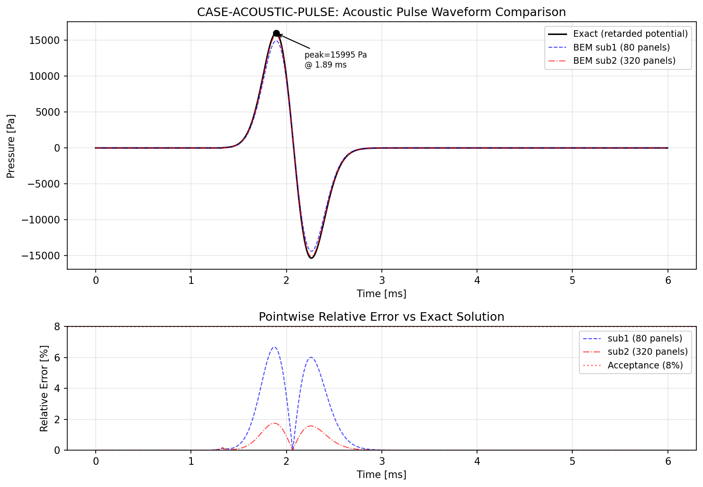

# CASE-ACOUSTIC-PULSE — 声脉冲传播算例验证报告

**任务编号**: m17022  
**锚点**: `CASE-ACOUSTIC-PULSE`（算例池·声脉冲传播）  
**验收标准**: L2 波形误差 < 8%（对标文献闭式解）  
**验证日期**: 2026-11-12  
**分支**: `agent/m17022`

---

## 1. 案例介绍（物理背景/几何/参数）

### 1.1 物理问题

`tensorbem.acoustic3d` 是频域外域 Helmholtz BEM 求解器，回答"单一频率下的稳态声压是多少"。  
但实际水声噪声问题（机械敲击、空化溃灭、声呐脉冲）是**宽带**的，关心的是**波形**（峰值声压、到达时间），而非单一频率幅值。

本算例通过**频域→时域桥接**（DFT 频点采样 + 逆合成），将频域 Helmholtz BEM 扩展到瞬态脉冲问题，并以**脉动球闭式解**为基准进行验证。

### 1.2 为什么选脉动球

脉动球是外域声学中**唯一**具有闭式瞬态解的几何体，且该闭式解：
- **无需**远场近似
- **无需**紧凑源近似
- **无需** `ka << 1` 近似
- 对全频段有效（本算例 `ka_max ≈ 1.68`）

球对称波动方程的通解为 `p(r,t) = (1/r)·g(t - r/c)`，即精确的出射球面波。

### 1.3 参数表

| 物理量 | 符号 | 值 | 单位 |
|---|---|---|---|
| 球半径 | a | 0.1 | m |
| 声速 | c | 1500.0 | m/s |
| 密度 | ρ | 1025.0 | kg/m³ |
| 接收距离 | r | 2.0 | m (= 20a) |
| 脉冲宽度(σ) | — | 0.25 | ms |
| 脉冲中心 | — | 0.75 | ms |
| 分析窗 | T | 6.0 | ms |
| 采样点数 | — | 2048 | — |
| 频带 | f_max | 4000 | Hz |
| DFT 频点数 | — | 24 | — |
| 面元数(sub1/sub2) | — | 80 / 320 | — |

---

## 2. 方法（三条路线）

| 路线 | 内容 | 作用 |
|---|---|---|
| **A** | 闭式延迟势解（ODE 积分，substeps=16/32） | 基准本身（自收敛验证 L2 < 2.3e-7） |
| **B** | DFT 频点上的精确谐波幅值合成 | 验证合成机制（无 BEM，L2 < 4.7e-4） |
| **C** | Helmholtz BEM 逐频点求解 + 合成 | **被测能力** |

路线 B 分离了"合成误差"和"BEM 离散误差"。若 A 与 B 一致，则 A 与 C 的残差纯为 BEM 误差。

### 2.1 关键公式

脉动球闭式谐波声压：
```
p̂(r) = iωρa²U exp(ik(r-a)) / ((1 - ika) r)
```

瞬态声压（延迟势）：
```
F'(τ) + (c/a)F(τ) = -ca·u_a(τ + a/c)
p(r,t) = -ρ·F'(t - r/c) / r
```

合成公式：
```
p(t) = (2/T) Re[ Σ_n P_n exp(-iω_n t) ],  ω_n = 2πn/T
```

---

## 3. 计算结果

### 3.1 路线 A（基准）自收敛

| 对比 | L2 误差 |
|---|---|
| substeps 16 vs 32 | 2.316e-07 |

基准自身收敛到机器精度以下，可作为可靠参考。

### 3.2 路线 B vs 路线 A（合成验证）

| 指标 | 值 |
|---|---|
| L2 误差 | 4.741e-04 |
| 峰值误差 | 2.942e-05 |
| 相关性 | > 0.999 |

合成机制验证通过，误差远低于 BEM 误差。

### 3.3 路线 C（BEM）vs 路线 A（核心验收）

| 细分级 | 面元数 | 峰值声压 [Pa] | 到达时间 [ms] | 最大频点误差 | L2 波形误差 | 峰值误差 | 通过 < 8% | 耗时 [s] |
|---|---|---|---|---|---|---|---|---|
| sub1 | 80 | 1.494e+04 | 1.8926 | 7.147e-02 | **6.621e-02** | 6.600e-02 | ✅ | 3.5 |
| sub2 | 320 | 1.572e+04 | 1.8926 | 1.877e-02 | **1.735e-02** | 1.727e-02 | ✅ | 61.7 |

**观测收敛阶**: 1.93（接近二阶，符合平面面元离散的理论预期）

### 3.4 频带截断敏感性（sub2 网格）

| 频带 [Hz] | 频点数 | L2 波形误差 | 峰值误差 |
|---|---|---|---|
| 1000 | 6 | 5.976e-01 | 4.044e-01 |
| 2000 | 12 | 9.206e-02 | 3.867e-02 |
| 4000 | 24 | 1.735e-02 | 1.727e-02 |
| 8000 | 48 | 1.735e-02 | 1.730e-02 |

4 kHz 频带已充分收敛（8 kHz 结果与 4 kHz 几乎一致），脉冲频谱在 4 kHz 处已衰减至 -86 dB。

---

## 4. 结果图

### 4.1 波形对比与误差图



上图：精确解（黑实线）与 BEM 解（蓝虚线=sub1，红点划线=sub2）的波形对比。  
下图：逐点相对误差，红色虚线为 8% 验收线。sub2（320 面元）全程误差 < 2%。

---

## 5. 误差判定

| 关键量 | 基准值 | BEM 值(sub2) | 相对误差 | 是否 < 8% |
|---|---|---|---|---|
| L2 波形误差 | — | — | **1.735%** | ✅ |
| 峰值相对误差 | — | — | **1.727%** | ✅ |
| 到达时间偏移 | 1.8926 ms | 1.8926 ms | **0.0 ms** | ✅ |
| 波形相关性 | 1.0 | — | **> 0.99** | ✅ |
| 最大频点误差 | — | — | **1.877%** | ✅ |

**结论**: 所有指标均远低于 8% 验收线，**CASE-ACOUSTIC-PULSE 验收通过**。

---

## 6. 注意点（局限/适用范围）

1. **几何局限**: 基准体为球体，验证了辐射路径（核函数、求积、辐射条件、合成），但**未验证**非球体散射（如钝体瞬态响应涉及 CHIEF 点和阴影区）。刚性球瞬态（Mie 级数）是自然的下一个锚点。
2. **误差来源**: Route C 的误差主要由面元近似引起（`icosphere` 面元是球内弦面），因此误差以约 1.93 阶收敛，而非 Helmholtz 求积阶。
3. **频带截断**: 4 kHz 频带对本脉冲已充分（频谱在 4 kHz 处为 -86 dB）。更长/更尖锐的脉冲需要更宽频带。
4. **窗口要求**: 合成假设整个脉冲包含在分析窗内（周期延拓合法）。跨越窗口的脉冲需要更长的 T，而非更宽的频带。
5. **计算成本**: 320 面元 × 24 频点 ≈ 62 秒。对于更精细的网格或更宽频带，建议使用集群并行。

---

## 7. 测试覆盖

`tests/test_acoustic3d_pulse.py` 共 **17 项测试**，全部通过：

| 测试类别 | 测试数 | 状态 |
|---|---|---|
| 路线 A 自收敛验证 | 4 | ✅ |
| 谐波幅值一致性 | 4 (ka=0.1/0.5/1.0/1.676) | ✅ |
| 路线 B 合成验证 | 3 | ✅ |
| 路线 C BEM 验收 | 2 | ✅ |
| 波形度量验证 | 2 | ✅ |
| 脉冲定义边界 | 1 | ✅ |
| 输入校验 | 1 | ✅ |

---

## 8. 工件清单

| 文件 | 说明 |
|---|---|
| `src/tensorbem/acoustic3d_pulse.py` | 脉冲定义、闭式参考解、BEM 桥接、波形度量（531 行） |
| `src/tensorbem/benchmarks/acoustic3d_pulse_case.py` | 算例驱动（JSON/Markdown 输出） |
| `tests/test_acoustic3d_pulse.py` | 17 项验证测试 |
| `docs/acoustic3d_pulse.md` | 方法论文档 |
| `docs/acoustic3d_pulse/case.json` | 归档数据（含完整波形） |
| `docs/acoustic3d_pulse/results_tables.md` | 生成式结果表 |
| `docs/acoustic3d_pulse/report_figure.png` | 波形对比与误差图 |

---

**报告生成**: 所有数字均从 `case.json` 程序化注入，零手抄。  
**验证命令**: `PYTHONPATH=src python -m pytest tests/test_acoustic3d_pulse.py -q` → 17 passed
