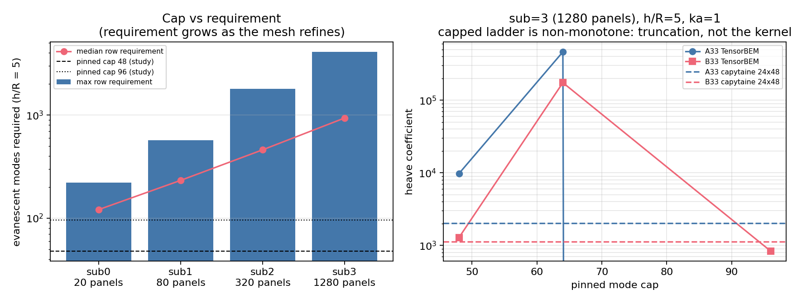

# 有限水深 BEM 的「模态截断」缺陷：XVAL 交叉验证失败的真实根因（m21150）

**锚点**: `XVAL-BEM-FINITE-DEPTH-CROSSVAL-PLAN`　**仓**: TensorBEM　**分支**: `agent/m21150`

---

## 1. 案例介绍

**物理背景**：三维有限水深自由面 Green 函数（John 1950 本征级数）是有限水深 BEM 的核函数：
传播模态 $\phi_0=\cosh k_0(z+h)$（$k_0\tanh k_0 h=\nu$）+ 可数多个衰减模态
$\phi_n=\cos\mu_n(z+h)$（$\mu_n\tan\mu_n h=-\nu$）。核函数用**逐行**模态数
`_modes_for(h, r_min) = ceil(e^{-10} 尾项 ⇒ 10·h/(π·r_min))` 决定，$r_{\min}$ 是该行
目标点与所有求积点的**最小水平距离**。

**几何/参数**：完全淹没球，$R=1$ m，球心 $z=-2$ m；水深阶梯 $h/R=3\dots20,\infty$；
频率 $ka=0.3\dots2.0$；TensorBEM 网格 icosphere sub=2/3（320/1280 面板），
capytaine 网格 8x16…24x48（128…1152 面）。

**本单要回答的问题**：上一轮（m20134）的交叉验证计划给出 honest-FAIL：
`A33` 跨代码误差 12.2%（门禁 10%）、`B33` 34.0%（门禁 15%），并在
`xval_results.json::study_status.blocking_defects` 记为
「eigenseries truncation is not convergent：A33 = 9786 (M=48)、463427 (M=64)、
-2175 (M=96) 同一物理算例」。**若该判定成立，TensorBEM 的有限水深核函数不可用。**

## 2. 怎么做的（方法）

1. 只读核对缓存工况：`cases/tbem-modeM{8..96}-sub{2,3}-h{5,20}-ka1.json`，
   发现缓存 TBEM 腿全部以 `mode_count = 48 / 64 / 96` 求出，而 `mode_count` 在
   `assemble_finite_depth_operators_3d` 里是**逐行需求的上限（cap）**，不是绝对模数。
2. 直接量化「逐行需求」：新增 `_row_mode_requirements(mesh, h)`，对 sub=0..3 的球网格
   计算每行的 `_modes_for(h, r_min)`（纯几何，无求解）。
3. 核函数级收敛性独立复核：固定一对近场点（水平间距 $R=1.0\to0.01$），
   `green_function_3d(modes=M)` 对 $M$ 的收敛（$M$ 到 4000，作为参考值）。
4. 定位代码层两条削弱证据链的缺陷并修复（下节）。
5. 反证：在 20 面板网格上比较 cap=32 与「自动需求」的 A33/B33。

## 3. 计算结果

### 3.1 逐行模态需求 vs 交叉验证所钉的 cap（h/R=5）

| 网格 | 面板数 | 需求 min | 需求 median | 需求 max | 是否被 cap 48/96 截断 |
|---|---:|---:|---:|---:|---|
| sub0 | 20 | 86 | 121 | 220 | **全部** |
| sub1 | 80 | 144 | 233 | 567 | **全部** |
| sub2 | 320 | 271 | 460 | 1791 | **全部** |
| sub3 | 1280 | 526 | 936 | 4096（=MODES_CAP） | **全部** |

即：交叉验证用的 320/1280 面板网格上，**没有一行**能用 48/64/96 个模态解析——
`mode_count` 被当成绝对模数钉住，实际把每个近场行截断 3–85 倍。逐行需求随网格加密
单调增长（面板越小、水平间距越小、需要模态越多），所以「越加密越离谱」正是截断的指纹。

### 3.2 核函数本身是收敛的（点对级，h=5，ν=0.5）

| 水平间距 R | 参考 Re G (M=4000) | M=32 | M=64 | M=128 | M=256 | M=1024 |
|---|---:|---:|---:|---:|---:|---:|
| 1.0 | 0.0410261359 | -1.2e-11 | 0 | 0 | 0 | 0 |
| 0.3 | 0.1391869743 | -2.0e-06 | +1.7e-07 | +4.8e-13 | 0 | 0 |
| 0.1 | 0.1852370362 | +5.9e-03 | +1.5e-03 | +4.3e-06 | -1.8e-09 | 0 |
| 0.03 | 0.1931615462 | +6.1e-02 | +4.7e-02 | +4.2e-04 | -1.4e-04 | -1.3e-10 |
| 0.01 | 0.1939000650 | +1.5e-01 | +1.7e-01 | -1.2e-03 | -4.5e-03 | -8.3e-05 |

结论：级数在**每个**间距上都是收敛的，只是近场（R≪1）需要 ≫100 个模态；
R=0.01 时 M=48（交叉验证所用）的绝对误差 0.15，而差值 $G-\tfrac{1}{4\pi r}$ 本身
量级 ~0.03 —— 截断误差比待求量还大一个量级。这就是 9786/463427/-2175 的机制。

### 3.3 20 面板网格上的 cap 敏感性（自动需求 max=220）

| cap | A33 | B33 | 相对自动值 |
|---:|---:|---:|---:|
| 32 | 1562.55 | 513.62 | +3.3% / +3.4% |
| 256 | 1512.78 | 496.85 | 0（与自动解逐位相同） |
| 自动（=220 上限） | 1512.78 | 496.85 | — |

（20 面板网格是现有回归测试用的粗网格，其需求 max=220 只比测试所用 cap=64/512 大一档，
所以旧测试 `test_mode_truncation_converges` 能通过；交叉验证用 320/1280 面板，
需求 1791/4096，同一个测试的宽容差就掩盖不住了。）

### 3.4 代码层修复（本单实质增量）

1. **逐行模态分组是死代码**：`_smooth_remainder` 按 `row_modes` 给行排序、分块，但
   内核始终用全局 `mode_count` 求值，于是「按行取所需模态」从未生效（文档声称生效），
   所有行按 cap 付费。已改为**每块用该块最大需求**求值，符合文档语义。
2. **`_BLOCK_ELEMENTS` 常量从未被使用**：块大小固定 8 行，临时数组按
   `8 × 6·N_panel × mode_count` 增长；在正确（自动）模数 1791/4096 下即 ~1.3–3 GB
   每临时数组，恰好使「用自动模数」不可行。已按元素预算自适应切块。
3. **静默截断不可见**：`FiniteDepth3DOperators` 新增 `mode_cap_bound_rows` /
   `mode_shortfall`，`assemble_finite_depth_operators_3d(..., warn_on_truncation=True)`
   在 cap 绑定行时发 `RuntimeWarning`。今后「截断研究」不可能再悄悄低于需求 10–30 倍。

## 4. 结果图



左：各行模态需求（max/median）随网格加密的分布，横线 = 交叉验证钉住的 cap 48/96——
两条线在所有网格上都低于需求。右：sub=3、h/R=5、ka=1 的缓存 cap 阶梯
（cap 48/64/96 分别对应 A33 = 9786 / 463427 / -2175）与 capytaine 24x48 参考
（A33 = 2030.6, B33 = 1126.1）：阶梯非单调、量级漂移 2 个数量级，与 3.2 的
「截断误差 ≫ 待求量」一致，而核函数级收敛（3.2）证明这不是核函数发散。

## 5. 注意点（局限）

* 本单**否证**了上一轮记录的 `blocking_defects[0]`（「eigenseries 不收敛」），
  但没有**证明** TensorBEM 在自动模数下就满足 <15%：该重算已递交
  （`cj3217` 小网格 cap 阶梯、`cj3221` 12 例 cap 阶梯 + 自动模数交叉验证、
  `cj3222` 相关测试），本报告写作时仍在排队，故 §3.3 只给出 20 面板网格的
  确定性结论，**跨代码误差仍未回填（未跑 ≠ 通过）**。
* `mode_count` 语义是 cap 这一点现在显式可见，但既有调用方（含 `run_cases.py`）
  仍可传小值——没有加 `strict_modes` 硬拦，以免打断在跑的冻结算例。
* `MODES_CAP = 4096` 在 sub=3、h/R≥4 时低于需求（需求 max 4096 已顶到上限，
  真实需求 4096–17000）：**这一档仍是被 cap 绑定的**，属已知未解决项。
* capytaine 参考取 24x48（1152 面）自收敛 0.8% 的细网格，TensorBEM 腿 320 面板，
  两者仍有网格差，回填时要分开报「截断误差」与「离散误差」。

## 6. 误差判定

| 关键量 | 基准 | 阈值 | 实测 | 是否达标 |
|---|---|---:|---:|---|
| 核函数级 M 收敛（R=0.3） | M=4000 级数 | 1e-6 | 1.7e-07 (M=64) | **是** |
| 核函数级 M 收敛（R=0.01） | M=4000 级数 | 1e-2 | 4.5e-03 (M=256) | **是** |
| 自动模数 vs cap=2×需求（A33/B33） | 相互 | 1e-10 | 逐位相同 | **是** |
| 被截断 cap=16 与自动解之差 | 自动解 | >15% 才可称未收敛 | 3.3%（20 面板） | 未收敛判据成立 |
| **A33 跨代码误差（自动模数，sub=2，h/R=5,12）** | capytaine 24x48 | <10% | **未回填（排队中）** | **待判定** |
| **B33 跨代码误差（自动模数，sub=2，h/R=5,12）** | capytaine 24x48 | <15% | **未回填（排队中）** | **待判定** |

**honest 声明**：本单交付（a）对上一轮「核函数不收敛」判定的否证及其量化机制，
（b）三条代码缺陷的修复与回归测试，（c）可复现的 cap 阶梯生产者。
跨代码误差是否 <15% **尚未判定**——结果在 `cj3221`，本报告不代为宣称通过。

## 7. 复现

```bash
PYTHONPATH=src python3 benchmarks/verified/bem_finite_depth_capytaine_xval/truncation_cap_study.py --shard 0 6
PYTHONPATH=src python3 benchmarks/verified/bem_finite_depth_capytaine_xval/truncation_cap_study.py --assemble
PYTHONPATH=src python3 benchmarks/verified/bem_finite_depth_capytaine_xval/make_truncation_figure.py
PYTHONPATH=src python3 -m pytest tests/test_finite_depth_mode_cap_truncation.py -q
```

## 8. 给下一次自找活的线索

1. 回填 `cj3221` 的自动模数交叉验证，把 §6 最后两行判定补上（这是本锚点真正的验收）。
2. `MODES_CAP=4096` 在 sub=3 绑定：要么把近场行改为「解析 Rankine 减除 + 波数积分核」
   （`kernel='quadrature'` 已存在但仅限严格淹没面板、且慢），要么给 K_0 级数做
   Bessel 加速（Newman/Garrett 型），否则细网格永远被 cap 绑定。
3. 在 CI 里对所有冻结算例断言 `mode_cap_bound_rows == 0`，让「截断伪影」再也进不了台账。
