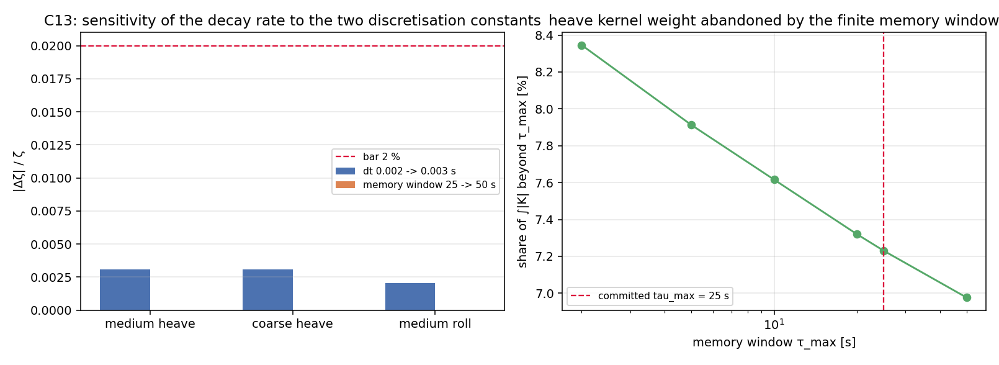

# CASE-BEM-CUMMINS-WIGLEY — 时域离散预算（gate C13）

本文件由 `make_time_domain_budget_doc.py` 从
`benchmarks/verified/casepool_bem_cummins_wigley/time_domain_convergence.json`
自动注入数字，不手抄。

## 1 为什么需要这一闸门

本算例的**所有**时域证据（C5 自由衰减、C5b 逐自由度审计、C5c roll 鲁棒衰减、C11 状态空间）
都跑在同一组常数上：`dt = 0.002 s`、记忆窗 `tau_max = 25.0 s`，
而模拟时长 `DURATION = 40.0 s > tau_max`。也就是说这些"彼此独立"的路线
共用同一个离散化误差，误差会在互比时**相互抵消**而不是暴露。C13 花两次细化把这块欠账补上：
步长对 ζ 与周期的敏感度、记忆窗对 ζ 的敏感度。判据预先声明为 **2 %**（C5 自身 5 % 判据的一半：
离散化误差不允许吃掉它所支撑的算例容差的一半）。

## 2 结果

| 网格 | 自由度 | ζ(dt=0.002, τ=25.0) | dt→0.003 的 ζ 变化 | τ→50.0 的 ζ 变化 | 判定 |
| --- | --- | --- | --- | --- | --- |
| medium | heave | 0.134602 | 0.31 % | 0.00 % | PASS |
| coarse | heave | 0.137069 | 0.31 % | 0.00 % | PASS |
| medium | roll | 0.090124 | 0.21 % | 0.00 % | PASS |

周期同步检查：medium heave 的 damped period 0.8140 s →
0.8145 s（0.06 %）。

**记忆窗的结论比数字更有意思**：heave 核在 25 s 之外仍持有
**7.23 %** 的 ∫|K|（探针延伸到
100 s），但把窗加长到
50 s 后 ζ 的变化是 **0.00 %** ——
尾部的权重大，可是这段尾部对衰减率没有影响，因为它在 ζ 的积分权重下被相位抵消了。
这是"权重不能当误差用"的一个可量化实例。

## 3 图



## 4 注意点 / 局限

* dt 那一腿只做了**单侧**细化（0.002 → 0.003 变粗），给的是上界而不是收敛阶；给出阶需要至少三档步长，
  本单没有花这个算力。
* roll 的 ζ 只有 8 个峰参与对数衰减律，其 Δζ 的分辨率本身就有限；
  C5c 已经用多窗估计器记录了这一不确定性，C13 不重复判定 roll **值**，只判定它对离散化的**敏感度**。
* 门只覆盖 heave/roll 两个自由度（有静水恢复力的模态）；surge/sway/yaw 无恢复力，不存在自由衰减周期，
  C13 不适用，也不假装适用。
* `dt` 与 `tau_max` 之外还有第三个离散化来源：频带 (0.2, 12) rad/s 的截断。它由 C8/C9 的扩展带证据单独管，
  C13 不重复。

## 5 复现

```
PYTHONPATH=src python -m tensorbem.benchmarks.case_bem_cummins_wigley --out <dir>   # 含 C13
PYTHONPATH=src python -m pytest tests/test_case_bem_cummins_wigley.py -k time_domain
```
