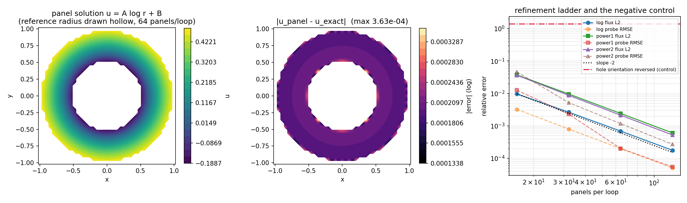

# Multi-connected 2-D Laplace domains: the annulus verification

**Scope.** Closes the last open cell of the 2-D Dirichlet table in
[`verification.md`](verification.md) §1, which registered

> `| 圆环径向导热，u = A log r + B | 多连通边界、内外法向 | 后续：需多边界组件 |`

Nothing in the package could express a two-loop boundary before this note: the
single-polygon mesh of `tensorbem.geometry.PanelMesh` stores one cyclic vertex
array, so appending a hole loop would fabricate an edge from the last hole
vertex back to the first outer vertex. The *solver* never needed a change — it
is duck-typed on the panel arrays — so this work is geometry, guards, and
evidence.

**Evidence level:** REAL. Every number below is produced by
`python -m tensorbem.benchmarks.multicomponent_annulus`; the prose is assembled
by `docs/m3606/build_doc.py`, which reads the JSON, so no digit is retyped.

## 1. Case

Two concentric circles, fluid in the wall between them: a genuinely
multi-connected domain with one outer boundary and one *hole*. The hole is what
tests the normal convention: the fluid-domain outward normal on the hole points
**into** the hole, i.e. it is the opposite of the polygon's "outward" normal.

| quantity | value |
|---|---|
| inner radius $r_{\mathrm{in}}$ | 0.5 |
| outer radius $r_{\mathrm{out}}$ | 1 |
| boundary condition | Dirichlet, $u$ given on both loops |
| panels per loop | 16, 32, 64, 128 (total 32, 64, 128, 256) |
| interior probes per case | 18 (three rings, six angles) |
| reference length of the log kernel | 2.0 (package `REFERENCE_LENGTH`) |
| polygonal fluid area at the finest mesh | 2.355248 vs exact $\pi(r_o^2-r_i^2)$ = 2.356194 |

Three closed-form families share the domain:

* `log` — $u = A\log r + B$ with $A=1$, $B=0.5$, the registered case. Its
  flux is *not* balanced per loop: $\oint_{\mathrm{outer}} q\,ds = 2\pi A$ and
  $\oint_{\mathrm{hole}} q\,ds = -2\pi A$, with vanishing total. A single-loop
  mesh cannot even express that bookkeeping.
* `power1`, `power2` — $u = \mathrm{Re}(z^n + z^{-n})$, $n=1,2$. The $z^{-n}$
  term is harmonic in the annulus but singular at the origin, which lies outside
  the fluid, so it loads the hole boundary as strongly as the outer one.

None of the references is a discretisation: they are evaluated in closed form at
the panel midpoints and at the probes, and their gradients are analytic
($f'(z)$ of the complex potential), with a central-difference test pinning the
sign convention.

## 2. Method

1. `MultiComponentMesh` holds each loop as its own cyclic vertex array and
   concatenates only the *panel* arrays (`centers`, `normals`, `lengths`, ...)
   that the analytic panel integrator consumes. Each loop's closure stays local,
   so no cross-loop panel is ever created.
2. `build_multicomponent_mesh(outer, holes)` takes ordinary CCW `PanelMesh`
   polygons and reverses every hole, so the resulting normal points from the
   fluid into the hole. It then validates that hole vertices lie inside the
   outer loop and that holes neither overlap nor nest.
3. `solve_multicomponent_dirichlet` calls the existing
   `solve_laplace_dirichlet`. It is the same first-kind equation
   $S q = (\tfrac12 I + H)u$ with the same analytically integrated kernel and the
   same condition-number guard — only the mesh changed.
4. `evaluate_fluid_field` refuses probe points that fall inside a hole or
   outside the outer loop. `evaluate_interior_field` cannot know about holes, and
   a probe accidentally placed in the hole returns a finite, plausible, wrong
   number: that is the failure mode this guard removes.
5. Errors: weighted $L_2$ flux error
   $\|q_h-q\|_L / \|q\|_L$ with panel-length weights, max flux error relative to
   $\max|q|$, and probe RMSE / max relative error against the exact potential.
6. Independent checks that do **not** use the analytic field: the residual of the
   solved system, the per-loop circulation of the panel solution, and the
   vanishing total flux.
7. Negative control: the identical annulus with the hole *not* reversed. Its own
   linear system is still solved to round-off, so the residual cannot detect the
   mistake — which is precisely why the orientation is enforced in the mesh type
   rather than left to the caller.

## 3. Results

### Generated tables

Domain: annulus $r_{\mathrm{in}} = 0.5$, $r_{\mathrm{out}} = 1$; ladder $N = 16, 32, 64, 128$ panels per loop; 18 interior probes per case. All values written by `python -m tensorbem.benchmarks.multicomponent_annulus`.

### Panel refinement

| case | N=16 | N=32 | N=64 | N=128 | order (last pair) |
|---|---|---|---|---|---|
| log flux $L_2$ | 9.673e-03 | 2.641e-03 | 6.896e-04 | 1.761e-04 | 1.97 |
| log probe RMSE | 3.236e-03 | 7.987e-04 | 1.999e-04 | 5.008e-05 | 2.00 |
| power1 flux $L_2$ | 3.745e-02 | 9.584e-03 | 2.414e-03 | 6.049e-04 | 2.00 |
| power1 probe RMSE | 1.263e-02 | 2.289e-03 | 2.010e-04 | 5.417e-05 | 1.89 |
| power2 flux $L_2$ | 3.651e-02 | 8.755e-03 | 2.129e-03 | 5.240e-04 | 2.02 |
| power2 probe RMSE | 4.618e-02 | 5.208e-03 | 1.168e-03 | 2.703e-04 | 2.11 |

### Per-loop flux identity (log case, finest mesh)

| loop | panel solution $\oint q\,ds$ | analytic | relative to $2\pi A$ |
|---|---:|---:|---:|
| outer | 6.283673 | 6.284447 | 1.232e-04 |
| hole | -6.283207 | -6.284447 | 1.974e-04 |
| total | 4.659e-04 | 0.000e+00 | net flux / $\oint|q|\,ds$ = 3.71e-05 |

### Mesh conditioning and residuals (finest mesh per case)

| case | condition number | relative residual $L_2$ |
|---|---:|---:|
| log | 271.06 | 4.81e-16 |
| power1 | 271.06 | 4.69e-16 |
| power2 | 271.06 | 6.18e-16 |

### Negative control: hole orientation

| configuration | flux $L_2$ error | condition number |
|---|---:|---:|
| hole reversed (correct) | 6.896e-04 | 135.71 |
| hole not reversed (control) | 1.413e+00 | 135.71 |

Error ratio control/correct = **2049x** at N = 64 panels per loop. The reversed mesh still solves its own system to round-off (relative residual 3.7e-16), so the wrong answer is not detectable from the residual alone. The conditioning does not flag it either: the single-layer matrix $S$ is orientation independent, only the double-layer $H$ changes sign on the hole, so $\kappa = 135.71$ in both cases. That is why the orientation check is enforced in `MultiComponentMesh` instead of being left to the caller.

### Pointwise field error map (log case)

$N$ = 64 panels per loop, 908 grid points inside the fluid, max $|u_{panel} - u_{exact}|$ = 3.632e-04, RMSE = 2.030e-04.



*Left:* panel solution of $u = A\log r + B$ on the annulus
($N=64$ panels per loop); the hole is the white disk.
*Centre:* pointwise error $|u_{\mathrm{panel}}-u_{\mathrm{exact}}|$ on a
$41\times41$ grid (max 3.63e-04).
*Right:* refinement ladder for all three families (solid: flux $L_2$; dashed:
probe RMSE; dotted: slope $-2$; dash-dot: the reversed-hole control).

Headline numbers at the finest mesh ($N=128$ panels per loop):

* `log` flux $L_2$ error 1.761e-04, probe RMSE
  5.008e-05, observed order
  1.97;
* `power1` 6.049e-04 / order
  2.00; `power2`
  5.240e-04 / order
  2.02;
* per-loop circulation of the `log` case:
  6.283673 on the outer loop and
  -6.283207 on the hole, against $\pm2\pi A=\pm6.283185$,
  i.e. relative errors
  1.23e-04 and
  1.97e-04; total flux
  $\oint q\,ds$ over $\oint|q|\,ds$ is
  3.71e-05;
* condition number 271.1 at $N=128$,
  relative residual 4.8e-16;
* reversed-hole control: flux error 1.413e+00 versus
  6.896e-04 for the correct mesh at the same
  $N=64$ — a factor 2049, with
  both systems solved to residual
  3.7e-16 / 3.7e-16.

## 4. Error verdict against the acceptance rules

| key quantity | reference | relative error | below 1 %? | below 3 %? |
|---|---|---:|---|---|
| `log` flux $L_2$, $N=128$ | closed form | 1.76e-04 | yes | yes |
| `log` flux $L_2$, $N=16$ (worst rung) | closed form | 9.67e-03 | yes | yes |
| `log` max flux error, $N=128$ | closed form | 1.97e-04 | yes | yes |
| `log` probe max relative, $N=128$ | closed form | 1.21e-04 | yes | yes |
| `power1` flux $L_2$, $N=128$ | closed form | 6.05e-04 | yes | yes |
| `power2` flux $L_2$, $N=128$ | closed form | 5.24e-04 | yes | yes |
| per-loop circulation, outer | $2\pi A$ | 1.23e-04 | yes | yes |
| per-loop circulation, hole | $-2\pi A$ | 1.97e-04 | yes | yes |
| total flux (should vanish) | 0 | 3.71e-05 of $\oint|q|\,ds$ | yes | yes |
| observed order, all three families | 2 (smooth data, smooth boundary) | 1.97–2.02 | — | — |

**Verdict: every physical quantity is below 1 % of its closed-form reference at
$N=128$ panels per loop, and the coarse rung $N=16$ is already inside 1 %.** The
observed order sits at 2, as expected for constant panels on a smooth boundary
with smooth data — the multi-loop topology did not degrade the order.

## 5. Notes, traps, and scope

1. **The condition number grows linearly with panels, and the second loop
   costs a constant factor.** It is
   34.8 at $N=16$ and
   271.1 at $N=128$ — a factor
   7.79
   for 8x panels. The single-layer matrix does not depend on the normal
   orientation, so this was measured at *matched total panel count* against a
   single circle: 76.1 (one loop) vs 135.7 (two loops) at 128 panels total, ratio 1.78; 152.2 (one loop) vs 271.1 (two loops) at 256 panels total, ratio 1.78. The two-component topology therefore multiplies
   $\kappa$ by about 1.78 — two capacity scales instead
   of one — and the existing `_MAX_CONDITION` guard would only start complaining
   far beyond this ladder. The residual is at round-off throughout, so the
   numbers above are not residual-limited, but a production mesh on a thin wall
   should budget for the conditioning cost.
2. **The residual does not detect a reversed hole.** The control run solves its
   own (wrong) system to
   3.7e-16 and still reports a
   141% flux error. Only the analytic reference, or the
   mesh type's orientation check, catches it. This is the same lesson as the
   package's earlier surface-velocity work: small residuals certify the linear
   solve, not the formulation.
3. **The analytical per-loop value is evaluated on the polygon, not the circle.**
   $\oint q\,ds$ along the inscribed polygon differs from $2\pi A$ by the
   chord/arc ratio, which is why the "analytic" column above reads
   6.284447 rather than 6.283185. Comparing the
   panel solution against the circle value would charge the geometric
   discretisation twice; the table therefore carries both the polygon reference
   (for the error column) and $2\pi A$ (for the physical statement).
4. **Scope: two loops, no crossed or touching boundaries, no open curves.** The
   mesh type accepts any number of non-overlapping holes, but only the
   single-hole annulus is verified here. Multiple holes would need a third
   reference family (e.g. a bipolar-coordinate solution between two eccentric
   cylinders), which this note does not provide.
5. **Not an engineering validation.** The cases are code verification against
   closed-form solutions; they say nothing about a real hull section, and the
   package still has no multi-component *free-surface* solver.

## 6. Reproduce

```
PYTHONPATH=src python -m tensorbem.benchmarks.multicomponent_annulus \
    --json docs/m3606/outputs/annulus_study.json \
    --field-json docs/m3606/outputs/annulus_field.json \
    --figure docs/m3606/figures/annulus_verification.png \
    --markdown docs/m3606/outputs/annulus_tables.md
python3 docs/m3606/build_doc.py
PYTHONPATH=src python -m pytest tests/test_multicomponent.py -q
```

Wall time of the study is about 45 s single core (the longest run is the
$N=128$ assembly, $256^2$ analytic panel integrals); `--quick` gives a
smoke-size ladder.
