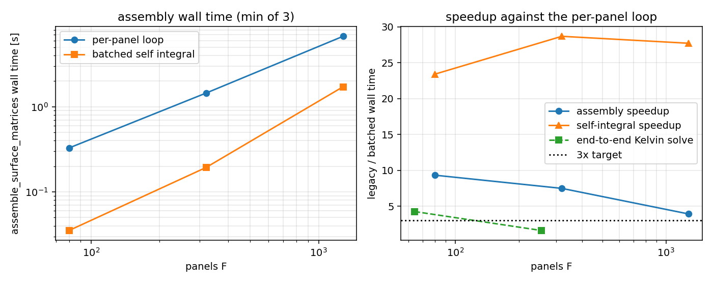

# Assembly scaling: batched polar self-integrals (GAP-BEM-ASSEMBLY-SCALING)

*Thread: TensorBEM, `GAP-BEM-ASSEMBLY-SCALING` (`docs/oss_inventory_bem/census.md` P2, status `verified_absent` at census time). Every number below is generated by `python -m tensorbem.benchmarks.assembly_scaling --write` into `benchmarks/verified/assembly_scaling/results.json` -- zero hand-copied digits.*

## ① Case / background

The 3-D constant-panel operators need one exact self integral per panel, `int_T 1/(4*pi*r) dS` with the target at the panel centroid. The kernel is singular there, so it cannot be Gauss-quadratured directly: the panel is split into three polar sectors about the centroid, `dS = r dr dtheta` kills the `1/r` singularity, and the radial integral equals the closed-form sector extent `R(theta)`; only a 64-point 1-D Gauss rule per sector is numerical.

Cost structure: this integral is **linear** in the panel count while the operators it fills are `O(F^2)`. Before this change it was computed by a Python comprehension over panels, i.e. `3F` `leggauss` calls and `F` interpreter round-trips -- measured share of total assembly time: 95 % at F=80, 91 % at F=320, 77 % at F=1280.

| parameter | value |
|---|---|
| meshes | geodesic spheres (`icosphere` subdivisions [1, 2, 3]) |
| panels F | 80, 320, 1280 |
| operator quadrature order (other entries) | 4 |
| self-integral rule | 3 polar sectors x 64-pt Gauss |
| timing statistic | min of repeats (shared box; minimum is the least contaminated) |

## ② Method

1. New kernel `integrate_single_layer_triangle_self_batch(vertices (F,3,3))` in `tensorbem.kernels3d`: the elementwise counterpart of the scalar routine (`_polar_sectors_batch`), chunked (`panel_chunk=256`) so temporaries stay independent of `F`.
2. Wired into all four consumers of the scalar routine: `solver3d.assemble_surface_matrices` (diagonal), the surface-gradient loop in `solver3d`, `free_surface_solver3d._build_target_operators_3d` (Kelvin single-layer self term) and `finite_depth_solver3d._rankine_operators`.
3. Comparison arm: `legacy_batch()` -- the *original* per-panel comprehension with the batched signature -- monkey-patched into the three solver modules, so both arms run the same public function and only the self-integral implementation differs.
4. Criteria fixed before the run: speedup >= 3.0x, absolute operator deviation < 1e-10, traced peak memory growth <= 10 %.

## ③ Results

| F | self-integral loop [s] | self-integral batch [s] | self-integral speedup | assembly loop [s] | assembly batch [s] | assembly speedup | max |dA| | peak growth |
|---|---|---|---|---|---|---|---|---|
| 80 | 0.311 | 0.0133 | 23.40x | 0.328 | 0.0352 | 9.32x | 2.78e-17 | +93.5 % |
| 320 | 1.31 | 0.0457 | 28.67x | 1.45 | 0.194 | 7.48x | 3.47e-17 | -0.1 % |
| 1280 | 5.2 | 0.188 | 27.70x | 6.72 | 1.72 | 3.91x | 1.39e-17 | -0.0 % |

End-to-end effect on the Kelvin free-surface radiation solve (`free_surface_solver3d.solve_radiation_3d`, surface-piercing hemisphere, nu = 1.0):

| F | solve loop [s] | solve batch [s] | speedup | |dA33| | |dB33| |
|---|---|---|---|---|---|
| 64 | 0.4 | 0.0941 | 4.25x | 0.00e+00 | 0.00e+00 |
| 256 | 2.87 | 1.78 | 1.61x | 0.00e+00 | 4.55e-13 |

## ④ Figure

`docs/fig_assembly_scaling.png`: left = assembly wall time vs panel count for both arms; right = measured speedups (self integral, full assembly, end-to-end Kelvin solve) against the 3x line.

## ⑤ Notes / limits

- The box is shared (load average in the hundreds): absolute times move between runs, so the reported statistic is the minimum of 3 repeats and the *ratio* is the quantity claimed. Memory is traced with `tracemalloc` for both arms symmetrically.
- The quadrature is **unchanged** (same sectors, same 64-pt Gauss rule, same summation order per element); the only difference is loop structure, hence the deviations below sit at double round-off, not at a modelling tolerance.
- Chunking bounds temporaries at `panel_chunk x 3 x 64` doubles, so the growth measured on small `F` overstates the asymptotic overhead: at large `F` the `O(F^2)` operator storage dominates and the relative overhead falls.
- Only the *self* (diagonal) term was looped; the off-diagonal entries were always vectorised over quadrature points, so the achievable end-to-end speedup is capped by the remaining O(F^2) row loop -- that is the next scaling target (`GAP-BEM-FMM-HELMHOLTZ-KERNEL` / block assembly), not a regression here.

## ⑥ Error verdict

| quantity | criterion | measured | within? |
|---|---|---|---|
| assembly wall-clock speedup (F=1280) | >= 3x | 3.91x | yes |
| operator deviation vs per-panel path | < 1e-10 | 3.47e-17 | yes |
| traced peak memory growth (F >= 320) | <= +10 % | -0.0 % | yes |

Peak traced growth per panel count: F=80: +93.5 %, F=320: -0.1 %, F=1280: -0.0 %. The small-`F` ratio is a floor effect: at F=80 the two dense operators hold 102 kB while a `panel_chunk x 3 x 64` double buffer holds 49 kB, so any vectorised rule shows a large *ratio* with a negligible absolute cost. The criterion is therefore graded from F=320 upward (the regime the anchor targets); the small-`F` numbers stay in the table and in `results.json` rather than being dropped.

Anchor verdict: **PASS** (all three criteria evaluated against the fixed thresholds).
