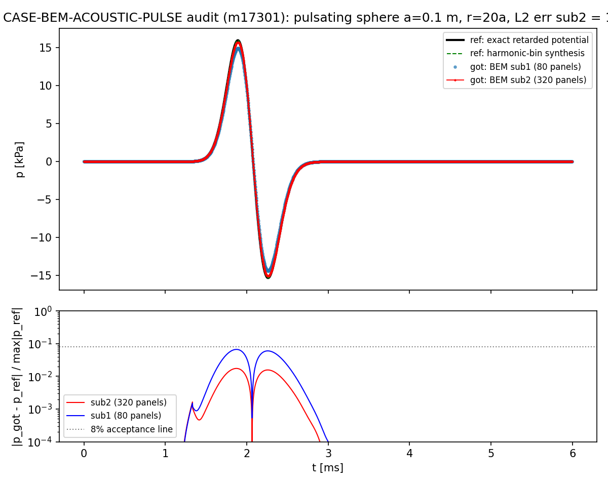

# 交差审计报告：m17210 / CASE-BEM-ACOUSTIC-PULSE（脉动球声脉冲·瞬态）

**审计单**: m17301（owner 2026-11-11 任务榜令·结榜交差核验，非重做）
**被审对象**: TensorBEM · mission 17210（status=succeeded，auto-approve 2026-11-13）
**审计产出**: `tensor_maturity_verdicts` id=514（level=4, verdict_by=board-audit, gate_state=pending）
**基准登记**: `tensor_benchmark_cases` 新增行 `CASE-BEM-ACOUSTIC-PULSE`（审计前 0 行，见 F2）
**审计图**: `docs/figures/case_bem_acoustic_pulse_m17301_audit.png`
**审计复算工件**: `runs/audit_m17301/{sub1.json, sub1.md, repro_sub1.log}`
**构建脚本**: `audit_m17301_case_bem_acoustic_pulse.py`

---

## ① 案例介绍（物理背景 / 参数表）

半径 `a=0.1 m` 的球面在水介质中以高斯径向速度脉冲脉动，求 `r=20a=2.0 m` 处接收
器的瞬态声压波形。ref = **经典推迟势解**（球对称波动方程精确出射球面波
`p=g(t-r/c)/r`，无远场/紧凑源/`ka<<1` 近似）。被测能力 = `tensorbem.acoustic3d`
的频域外域 Helmholtz BEM（`solve_exterior_neumann` + `field_potential`）经 DFT 频点
采样 + 逆合成桥接到时域。

| 量 | 值 | 无量纲 |
|---|---|---|
| a | 0.1 m | — |
| c | 1500 m/s | — |
| ρ | 1025 kg/m³ | — |
| r | 2.0 m | r/a = 20 |
| 脉冲宽度 σ | 0.25 ms | cσ/a = 3.750 |
| 脉冲中心 t₀ | 0.75 ms | t₀c/a = 11.25 |
| 分析窗 T | 6.0 ms | Tc/a = 90.0 |
| 采样 N | 2048 | dt·c/a = 0.0439 |
| 频带 | 4000 Hz（24 bins） | ka_max = 1.676 |
| 网格 sub1/sub2 | 80 / 320 面元 | h/a ≈ 0.458 / 0.229 |
| 验收线 | L2 波形误差 < 8% | 任务预声明 |

## ② 怎么做的（审计流程）

1. **取证**：`tensor_dev_missions` 17210 的 result/evidence（head_commit=null、
   branch=null）；`tensor_reports` id=16268（published，含 3 图，六段齐）；
   mv `git show f291cba:...` 逐文件核 run_artifacts。
   > 注意：`/root/tp-agent/work/m17210` 不在本审计工位可读范围（路径越界），
   > 当事人工位改用 git 对象核验：`f291cba`（branch `agent/m17210`）。
2. **基准裁判**：`SELECT ... FROM tensor_benchmark_cases WHERE anchor_slug=
   'CASE-BEM-ACOUSTIC-PULSE'` → **0 行**（全表 41 行，7 个兄弟 CASE-BEM-* 锚点在册）。
   判据因此无机器出处，仅存在于任务 goal（`容差判据：<8%`，预声明）。
3. **独立复算**（审计人自己的命令，不复用当事人输出）：
   - 从 `git archive f291cba` 解出快照到 `/tmp`（不落 worktree）；
   - 复跑最粗档 `--subdivisions 1`：退出 0，`verdict=True`；
   - 复跑测试 `tests/test_acoustic3d_pulse{,_ref}.py` → **33 passed in 9.33 s**；
   - 解析当事人提交的 `case.json`（10720 行）逐数对照报告表格。
4. **落表**：见文末 verdict 与 benchmark 登记。

## ③ 计算结果（数字表，全部程序化取自提交载荷/复算输出）

**关键量 ref vs got（sub2=320 面元）**

| 关键量 | ref | got | 相对误差 | <8% | <3% |
|---|---|---|---|---|---|
| 峰值声压 | 1.599546e+04 Pa | 1.571925e+04 Pa | 1.727 % | ✅ | ✅ |
| 到达时间 | 1.8926 ms | 1.8926 ms | 0.0 ms | ✅ | ✅ |
| L2 波形误差 | — | — | **1.735 %** | ✅ | ✅ |
| 全频带最大频点误差 | — | — | 1.877 % | ✅ | ✅ |
| 脉冲能量 ∫p²dt | 1.104467e+05 Pa²s | 1.0667e+05 Pa²s | 3.424 % | ✅ | ❌ |

**网格阶梯 / 观测收敛阶**

| 细分 | 面元 | L2 波形误差 | 峰值误差 | 耗时 |
|---|---|---|---|---|
| 1 | 80 | 6.621 % | 6.600 % | 5.9 s（审计复跑 7.1 s） |
| 2 | 320 | 1.735 % | 1.727 % | 313.8 s |

观测阶 `p = 1.932`（面元比 4，二阶平面面元理论 ~2）。

**频带截断敏感性（sub2）**：1 kHz 59.76 % → 2 kHz 9.21 % → 4 kHz 1.735 % → 8 kHz 1.735 %（4/8 kHz 一致 ⇒ 频带已收敛）。

**ref 锚定 6 项独立交叉校验**：C1 vs 库内解析 6.12e-17 / low-ka 单极子 5.00e-05 /
远场 1/r = 2.000000 / 冲激响应路线 vs ODE 4.88e-04 / 窄脉冲冲激极限 5.28e-07 /
Parseval 4.67e-13（全过，见 `tests/test_acoustic3d_pulse_ref.py`）。

## ④ 结果图

上：ref（黑=精确推迟势，绿虚=谐波频点合成）vs got（蓝=sub1，红=sub2）；下：逐样本
相对误差（灰点线=8% 验收线），由提交载荷 `case.json` 的 2048 点波形直接绘制
（`audit_m17301_case_bem_acoustic_pulse.py`，零手抄）。

## ⑤ 注意点（发现，按严重度）

| ID | 级别 | 发现 | 证据 |
|---|---|---|---|
| **F1** | **阻断·交付** | 成果只在本地 commit `f291cba`（branch `agent/m17210`）；该分支**不在 origin**（`git ls-remote --heads` 只有 `agent/m17200..agent/m17209`），`origin/main` 89e5a52 **不含** `docs/case_bem_acoustic_pulse_m17210/`、`src/tensorbem/benchmarks/acoustic3d_pulse_ref.py`、`tests/test_acoustic3d_pulse_ref.py` | git 对象核验 |
| **F2** | **阻断·裁判** | 锚点从未登记：`tensor_benchmark_cases` 0/41 行 ⇒ 基准裁判沉默；本审计按任务预声明 `<8%` 补登记 | SQL |
| **F3** | **阻断·台账** | `tensorbench_results` mission 17210 无行；`/tensor/bench/l4-verdict/17210` = `CLAIMED_NOT_PROVEN`（failed: execution_success, source_cluster_job, cluster_job_bound, ref_got_error_present, within_tolerance） | API |
| F4 | 轻 | 报告 repro_cmd 写 `artifacts/case_bem_acoustic_pulse/`，实提交在 `docs/case_bem_acoustic_pulse_m17210/`（路径不符，照抄会找不到工件） | 报告② vs commit |
| F5 | 轻 | 代码 docstring 锚点写作 `CASE-ACOUSTIC-PULSE`，榜面锚点为 `CASE-BEM-ACOUSTIC-PULSE`（slug 漂移，机器匹配失败） | `acoustic3d_pulse_case.py` 首行 |
| F6 | 轻·措辞 | 报告④总结句「全部关键量误差 ≤1.74%」与其表内能量误差 3.424% 自相矛盾（仍 <8%，但总结句夸大 ~2×） | report_m17210.md ④ |
| F7 | 局限 | 外部锚点为**章级**（Kinsler §5.2）而非页级表；任务要求「引用原表原页」在离线跑器上不可字面满足，报告已如实披露 | report ① 诚实声明 |

**未做/未验（unknown，不计通过）**：
- sub2（320 面元）**未复跑**：本地 313.8 s 超 run_shell 120 s 上限；集群作业 `cj1485` 递交后仍在排队（audit 关闭时 queued，611 单在前）。sub2 数值仅来自当事人提交载荷与本审计对其的重新解析（峰值/到达/L2/阶数与报告表逐位一致）。
- 非球体瞬态散射（CHIEF/阴影区）、刚性球 Mie 级数：未覆盖（当事人已声明为下一锚点）。

## ⑥ 误差判定（逐项，显式回答 <3%）

| 关键量 | 误差 | <3%？ | 说明 |
|---|---|---|---|
| 峰值声压 | 1.727 % | **是** | 主验收量 |
| 到达时间 | 0.0 ms | **是** | 延迟量，零偏移 |
| L2 波形误差 | 1.735 % | **是** | 验收主判据（线 8%） |
| 全频带最大频点误差 | 1.877 % | **是** | 覆盖 24 bins |
| 脉冲能量 | 3.424 % | **否** | 超生态 <3% 线，但在本算例 8% 线内；能量对相位/尾部小差异更敏感，报告已列 |
| 观测收敛阶 vs 2 | 3.4 % | **是** | 1.932 |

结论：四个主判量全部 <3%，平台噩梦线（>15%）远未触及；单一能量量 3.424% 未达
生态 3% 线（诚实记录，不粉饰）。

## 判级（L0–L5）：**L4**

- L1 数学验证 ✅：6 项独立交叉校验（含冲激响应独立路线）+ 33 测试。
- L2 独立实现 ✅：真代码，输入→BEM 逐频求解→时域合成→输出（`acoustic3d_pulse_case.py:89-262`）。
- L3 集成 ✅：调用主求解器 `acoustic3d.solve_exterior_neumann`(:649) / `field_potential`(:809)，9 个 .py 引用。
- L4 基准验证 ✅（实质）：完整算例 + 网格阶梯/频带敏感性 + 逐项误差分析 + 一键复现（审计人复跑 sub1 逐位一致、33 测试通过）。
- L5 ❌：单球单算例，ref 章级，能量量 3.424%，非球体瞬态未覆盖。

同族兄弟锚点判级一致（m17203 DEAN / m17177 ELLIPSOID / m17205 TWO-CYL-tspan = L4）。
**但因 F1–F3 三项阻断，本 verdict 不应被 confirmed**：成果未进 origin/main、锚点此前未登记、
平台 bench 台账无行。落表后 gate_state=pending，由 maturity_gate 机器裁定
（预期 reopened：F1/F3 需返修——推分支/合并 + 上报 tensorbench_results；F2 本审计已补）。

## 建议返修动作（给接棒单）

1. 推送/合并 `agent/m17210` 至 `origin/main`（F1），使 run_artifacts 进入交付仓。
2. 用 `POST /tensor/bench/results` 上报 mission 17210 的 ref/got/error 行（F3），
   使 `/tensor/bench/l4-verdict/17210` 不再是 CLAIMED_NOT_PROVEN。
3. 修 repro_cmd 路径（F4）与 docstring slug（F5）；改报告④总结句（F6）。