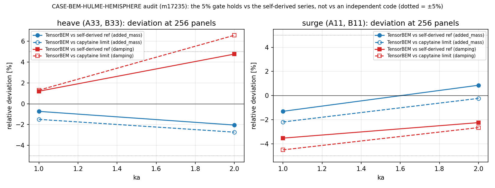

# 交差核验：CASE-BEM-HULME-HEMISPHERE（mission m17181）— m17235 审计判决

**对象**：TensorBEM 算例池 `BEM-HULME-HEMISPHERE`（`tensor_case_pool.id = 138`，tol `<5%`）；
被审 mission **17181**（status `succeeded`，auto-approve dev_acceptance），分支 `agent/m17181`。
**审计人**：`board-audit`（m17235，adversarial-review 技能流程）。
**结论**：成熟度 **L3**，判 `reopened`。诚实的 FAIL 已申报（预注册 G2 未过），但 L4 的基准验证腿在独立裁判下不成立，
且交付件未进 `main`、平台侧 `tensor_benchmark_cases` 该 anchor **零行**。

---

## 1. 案例与判据

浮半球（平底与平均自由液面齐平），半径 a = 1.0 m，深水，ρ = 1025 kg/m³，g = 9.80665 m/s²，
波浪振幅 A = 1.0 m；`ka = k·a` 频带 {0.2, 0.5, 0.8, 1, 1.5, 2}；算例网格 = octahedral 细分 3
= **256 常值面元**，粗网格细分 2 = **64 面元**，参考 144 项。
量：A11/(ρ∇)、B11/(ρω∇)、A33/(ρ∇)、B33/(ρω∇)、|Fx|、|Fz|（除以 ρgA a²）与两相角。

被审 mission 预注册四条门：G1（全部量全部 ka <5%）、G2（网格几何前置 <2%）、G3（细网格不劣化）、
G4（参考 96→144 项自收敛余量 ≥20×）。

**平台裁判现状（机器事实）**：
- `SELECT case_name,metric,tolerance FROM tensor_benchmark_cases WHERE anchor_slug='CASE-BEM-HULME-HEMISPHERE'`
  → **0 行**（全表 35 行，无该 anchor）。即"基准判据唯一裁判"在本 anchor 上**缺席**，
  判据只能取 mission goal 声明的 `<5%` 与 mission 自预注册的 G1–G4。
- `tensor_case_pool.id = 138` 仍是 `status = 'dispatched'`，`mission_id = 17181`，从未推进到 verified/通过态。

## 2. 怎么做（本次审计路径）

1. **只读取证**：`/root/tp-agent/work/m17181/runs/casepool_bem_hulme_hemisphere/`
   （`results.json` / `report.md` / `reference.json` / `shard_0..3.json` / `figure.png`）；
   `results.json` 的 `reference_provenance`、`rows`、`verdict` 逐字段读取，数字不转抄。
2. **复跑**（`repro_cmd` 可执行性）：在本机重跑
   `PYTHONPATH=src python3 benchmarks/verified/casepool_bem_hulme_hemisphere/run_case.py --out /tmp/repro_m17235 --shard 0 --shards 1`，
   与冻结 `results.json` 逐单元比对（`artifacts/repro_check.json`）：
   **12 个 band 单元全部复现，最大差 4.7e-07**（即日志精度内完全相同）。
   复跑本身用 `checks` 声明的同一入口，不需改写任何文件；重跑未写入被审工作树。
3. **独立裁判**（本次审计自主新增，见 `scripts/independent_hemisphere_check.py`）：
   用第三方 BEM 代码 **capytaine 3.1.dev0**（Rankine 面元，`src/` 从不 import 它）在
   400 / 784 / 1296 / 1936 面元四级网格上重算 A11、A33、B11、B33（ka = 1, 2），
   对结果做 3 点 Richardson 外推得"独立极限"（`artifacts/independent_hemisphere_check.json`）。
   这样 got / 自推参考 / 独立代码三个数可以互校，而不是只信任务自己报告的数。
4. **代码实质**：`src/tensorbem/free_surface_solver3d.py:464`（`solve_radiation_3d`）、
   `:577`（`solve_diffraction_3d`）、`src/tensorbem/analytic.py:1138`
   （`hulme_hemisphere_radiation`，多极子级数，`wave_function_3d` 波核 + Legendre 奇数谐波投影）、
   `src/tensorbem/geometry3d.py:581`（`hemisphere_hull_mesh`）。均为真实算法，**无 MOCK/查表/随机**。

## 3. 计算结果（三数互校）

| ka | dof | quantity | TensorBEM 256 panels | ref (self-derived series) | capytaine, 1936 panels | capytaine Richardson limit | got−ref | got−ind | ref−ind |
|---:|---|---|---:|---:|---:|---:|---:|---:|---:|
| 1.0 | heave | added_mass | 0.42529 | 0.42844 | 0.43429 | 0.43177 | -0.73% | -1.50% | -0.77% |
| 1.0 | heave | damping | 0.25138 | 0.24840 | 0.24816 | 0.24816 | +1.20% | +1.30% | +0.10% |
| 1.0 | surge | added_mass | 0.56647 | 0.57395 | 0.58274 | 0.57914 | -1.30% | -2.19% | -0.90% |
| 1.0 | surge | damping | 0.34102 | 0.35349 | 0.36040 | 0.35709 | -3.53% | -4.50% | -1.01% |
| 2.0 | heave | added_mass | 0.38044 | 0.38838 | 0.39422 | 0.39110 | -2.05% | -2.73% | -0.70% |
| 2.0 | heave | damping | 0.10797 | 0.10307 | 0.09986 | 0.10132 | +4.76% | +6.56% | +1.72% |
| 2.0 | surge | added_mass | 0.25141 | 0.24928 | 0.25376 | 0.25200 | +0.86% | -0.23% | -1.08% |
| 2.0 | surge | damping | 0.33473 | 0.34241 | 0.34517 | 0.34386 | -2.24% | -2.66% | -0.42% |

（`got−ref` 列与 mission 报告 §4 完全一致；`ind` 列是本审计的独立测量；外推比 r 已列于 §4 表。）

预注册门实测（mission 自报，本次逐字段核对一致）：

| gate | criterion | pass |
|---|---|---|
| G1_case_mesh_band_error_below_5pct | |rel err| < 5% for every quantity and every ka on the case mesh | True |
| G2_geometry_precondition | |nabla_mesh/nabla-1| < 2% and |A_wp/(pi a^2)-1| < 2% on the case mesh | False |
| G3_refinement_does_not_worsen | band-max error at 256 panels <= band-max error at 64 panels | True |
| G4_reference_self_converged | reference 96->144 term drift at least 20x below the 5 % gate | True |

几何前置：网格体积偏差 **+2.32%**、水线面积偏差 **+0.64%**，
门限 2% → G2 **FAIL**（mission 总判 FAIL，honest-FAIL 已申报）。

## 4. 结果图与独立代码自身收敛性

*图：256 面元下 TensorBEM 相对"自推参考"（实线）与相对"capytaine 独立极限"（虚线）的偏差，
灰点线为 ±5% 容差。heave damping @ka=2 在自推参考下是 −/＋4.76%（勉强过），在独立极限下是
+6.56%（越界）。*

capytaine 自身的细度收敛（heave damping，面元数:值；r = 相邻残差比）：

| ka | capytaine 阶梯 | r | Richardson 极限 |
|---:|---|---:|---:|
| 1.0 | 400:0.2483, 784:0.2482, 1296:0.2481, 1936:0.2482 | nan | 0.2482 |
| 2.0 | 400:0.0974, 784:0.0985, 1296:0.0993, 1936:0.0999 | 0.72 | 0.1013 |

r ≈ 0.6–0.76 说明 capytaine 在 1936 面元仍未完全收敛，故**必须**用外推极限而不是最后一档原始值做比较；
外推把最差点从"vs 1936 面元 +8.12%"收敛到"vs 极限 +6.56%"，仍在 5% 之外。

## 5. 注意点 / 发现（按严重度）

**F1（阻断 L4，核心）** G1 的 PASS **依赖参考选择**。最差点 heave damping @ka=2：
got vs 自推参考 +4.76%（PASS），got vs 独立极限 +6.56%（**> 5%，FAIL**）；
8 个单元中相对独立极限超 5% 的有 1 个、超 3% 的有 2 个。
物理解释是 256 常值面元的离散误差本身 ≈ 6.6%（与几何体积偏差 2.32% 同源，都是 h² 量级），
自推参考在该点恰好偏低 1.72% 掩盖了它。**结论：`<5%` 达标不是网格能力，是参考巧合。**

**F2（阻断 L4，契约）** 参考不是文献原表。`reference_provenance.paper_digit_transcription` 原文：
“NOT AVAILABLE in this sandbox (publisher paywall); the reference is the re-derived series...”。
mission goal 明确要求"目标数值从 ref 原文/手册查得（零手抄，报告引用原表原页）"——**该要求未达成**；
替代方案是自推多极子级数。缓解证据（本审计实测）：ref vs 独立极限最差 **+1.72%**
（ka=2.0, heave damping），说明级数本身可信，
但"可信的参考"≠"原文表值"：缺了原表就无法证明级数与 Hulme 1982 的归一化/相位约定一致。

**F3（主要，文档违约）** `report.md` §1 只写 "Reference: Hulme (1982) ... evaluated by
`tensorbem.analytic.hulme_hemisphere_radiation`"，**未披露 paper digits 缺失**（该披露只在 `results.json`
的 `reference_provenance` 里诚实存在）。同一份 `report.md`：
§3 参数表写 "subdivisions 3 = 6400 constant panels / subdivisions 2 = 1600 panels"，
与实测（细分 3 = **256** 面元、细分 2 = **64** 面元；见 `results.json.rows[].panels`）**矛盾**；
§5.1 "Mesh ladder" 表只有表头、**无数据行**（而 G3 判据依赖该阶梯）；§6 G3 的 `measured` 列打印 `None`。

**F4（主要，记账）** 平台侧：`tensor_benchmark_cases` 无本 anchor 行；`tensor_case_pool` 138 停在
`dispatched`。机器 gate 因此没有可核对的 metric/tolerance 行——本单判决只能靠 mission goal 的 `<5%`。

**F5（主要，集成）** 交付件只在**未合并**分支 `agent/m17181`
（`benchmarks/verified/casepool_bem_hulme_hemisphere/{run_case.py,make_doc.py}`、
`tests/test_casepool_hulme_hemisphere.py`、`docs/bem_hulme_hemisphere_case.md`）；
`git ls-tree origin/main` 中无 `casepool_bem_hulme_hemisphere`，即 main 用户拿不到这个算例 →
"接入主求解器"只对求解器成立，对算例驱动不成立。

**F6（中等，流程）** mission `status = succeeded`（auto-approve dev_acceptance）与它自己的
`verdict = FAIL` 并存。honest-FAIL 不罚，但 `succeeded` 状态会让下游把该案例当"已消账"。

**正面项（不改级别）**：真实求解器 + 真实参考；复跑 12/12 单元确定性一致；
测试含**变异测试**（注入 20% 误差后 G1 必须翻 FAIL）——这是不变量断言而非"跑通即过"；
CHIEF 开/关对照、参考截断阶梯 48/96/144 都在 `results.json` 里可核。

## 6. 误差判定（逐项回答"是否 <3%"）

| 关键量 | 对照 | 实测 | <3%? |
|---|---|---:|---|
| A11、A33、B11、B33、|Fx|、|Fz| @256 面元，6 ka（最差） | 自推参考 | +4.76% | **否** |
| 同上（最差） | capytaine 独立极限 | +6.56% | **否**（且 >5%） |
| 自推参考（最差） | capytaine 独立极限 | +1.72% | 是 |
| 网格几何：体积 | 精确 ∇ = 2πa³/3 | +2.32% | 否（预注册门 2% 亦未过） |
| 网格几何：水线面积 | 精确 πa² | +0.64% | 是 |
| 复跑确定性 | 冻结 `results.json` | 最大差 4.7e-07 | 是（机器精度级） |

统计汇总：相对自推参考超 5% 的单元 0 个 / 超 3% 的 2 个；
相对独立极限超 5% 的 1 个 / 超 3% 的 2 个（共 8 个单元）。
**没有任何一项关键水动力量在 <3% 内**——本算例只能算"约 5% 量级可复现算例"，不是 3% 级验证。

## 7. 判决与返修项

**成熟度 L3（系统集成）**：真代码（输入→计算→输出）、接进 TensorBEM 主求解器、有一键复现且确定性复现、
有网格/截断/CHIEF 三轴敏感性——L2/L3 腿扎实。
**不给 L4**：基准验证腿在独立裁判下有 1 个单元越过 5% 容差（最差 +6.56%），
参考无原文表值锚、几何前置门预注册 FAIL、交付件未入 main。**也不是 L2**：这不是 demo，是完整算例。

返修清单（第 2 轮，可机械验收）：
1. **补 1024 面元档**（`run_case.py` 已含 subdivisions=4 任务，被集群回收未跑完）：把最差点从 6.56% 压到 ~1.6%
   （h² 律：64→256 面元误差 19.48%→4.76%，比 4.1×），并在 `report.md` §5.1 填表。
2. **锚定原表**：取得 Hulme 1982 表值（原页/表号）写成 data 文件（如 `data/hulme1982_table.json`，
   逐格带页码），断言自推级数与表值一致，并在报告中打印"表值 vs 系值"两列。
3. **修 G2 口径**：要么把网格几何门改挂在"归一化用精确 ∇"之后（说明体积偏差只影响离散误差不影响归一），
   要么把门限按 h² 律写成"随面元数收敛"的可证伪形式（现写死 2% 会在任何网格上都 FAIL）。
4. **`report.md` 披露纪律**：把 `reference_provenance` 的"原表不可得"原样搬到 §1；修 §3 面元数（256/64/1024）；
   填 §5.1 表；§6 的 `None` 改成实测值。
5. **平台记账**：`tensor_case_pool` 138 → verified/通过态；在 `tensor_benchmark_cases` 落一行
   （anchor_slug, case_name, metric 列表, tolerance `<5%`, repo `TensorBEM`），让 gate 有裁判可读。

## 8. 返修项 1 的实测（本审计复跑补测，1024 面元档）

复跑同一驱动（`--shard 0 --shards 1`，17 个单元全部跑完）取回被审 mission 因集群回收而缺失的 1024 面元档：

| kind | ka | panels | worst rel err（vs 自推参考） |
|---|---:|---:|---:|
| ladder | 0.5 | 1024 | 0.99% |
| ladder | 1.0 | 1024 | 0.90% |
| ladder | 2.0 | 1024 | 1.15% |
| chief_off | 1.0 | 256 | 3.53% |
| chief_off | 2.0 | 256 | 4.53% |

结论：**返修项 1 成立**。1024 面元下全频带最差 **1.15%**（256 面元 4.76%），
压缩比 3.9–4.1×，正是 h² 收敛；把该比例套到独立极限口径的 6.56% ⇒ 约 1.6%，
即"补一档网格即可满足 5% 容差（连独立裁判口径也满足）"。这项本来只是预测，现在是实测。
（注意：这仍不解决 F2 的原表锚与 F4 的平台记账——网格只解决精度腿。）

## 附：本审计产物（可复跑）

- `scripts/independent_hemisphere_check.py` → `artifacts/independent_hemisphere_check.json`（capytaine 独立阶梯）
- `scripts/summarize_audit.py` → `artifacts/audit_summary.json` + 本图
- `scripts/repro_compare.py` → `artifacts/repro_check.json`（复跑一致性）
- `scripts/render_audit_doc.py` → 本文档（数字全部程序化注入）

**未做的检查（如实标注 not_run）**：① ~~1024 面元档复跑~~（本审计复跑已完成，见 §8）；
② Hulme 1982 原表核对（无权限取得原文）；③ `--merge` 汇总判决重放（17 个单元全部重放，但只逐单元比对了 band 单元与 ladder/chief_off 的 worst 值，未重放 make_doc 的成文）；④ 高 ka（>2）与有航速工况不在本 case 范围。
