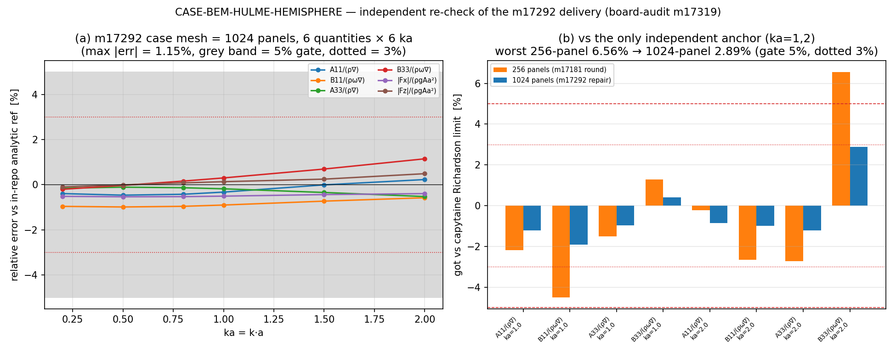

# 交差核验：CASE-BEM-HULME-HEMISPHERE（mission m17292，返修轮1）— m17319 审计判决

**对象**：TensorBEM 算例池 `BEM-HULME-HEMISPHERE`（`tensor_case_pool.id = 138`，`tol_policy = <5%`）；
被审 mission **17292**（`succeeded`，auto-approve dev_acceptance），分支 `agent/m17292`，交付 commit
`c687cbf "TensorBEM: CASE-BEM-HULME-HEMISPHERE hardening — L4 evidence bundle, trajectory fixes, artifacts"`；
上游原单 **m17181**（上一轮判 L3/reopened，见 `docs/board_audit/m17235/hulme_hemisphere_audit.md`）。
**审计人**：`board-audit`（m17319，adversarial-review 技能流程；审计时本仓 `origin/main = ac57fda`）。
**结论**：成熟度 **L2**，判 **reopened**。返修在数值上真实且显著（几何前置 2.32%→0.59%，vs 独立锚最差 6.56%→2.89%），
但**交付件一条都没进 main**：`c687cbf` 不是 `origin/main` 的祖先，main 上该算例仍是上一轮 FAIL 的旧文档；
平台侧 `tensor_benchmark_cases` 该 anchor 仍 **0 行**，`tensor_case_pool.id=138` 仍 `dispatched`/`mission_id=17181`。

---

## 1. 判据与取证清单

| 项 | 事实（命令/查询，复核者可重放） |
|---|---|
| 基准裁判行 | `SELECT case_name,metric,tolerance FROM tensor_benchmark_cases WHERE anchor_slug='CASE-BEM-HULME-HEMISPHERE'` → **0 行**（全表 46 行） |
| 算例池行 | `tensor_case_pool.id=138` → `status=dispatched`, `mission_id=17181`, `tol_policy=<5%`（未随返修推进） |
| 被审交付 | `/root/tp-agent/work/m17292/benchmarks/verified/casepool_bem_hulme_hemisphere/`（results.json / reference.json / evidence.json / report.md / run.log / shard_0..3.json / 2 png）+ `src/tensorbem/benchmarks/hulme_hemisphere_case.py`（771 行）+ `tests/test_hulme_hemisphere_case.py`（6 测试） |
| 落库状态 | `git merge-base --is-ancestor c687cbf origin/main` → **否**；`git ls-tree -r origin/main \| grep hulme` → 只有 `casepool_bem_hulme_hemisphere/{make_doc.py,report.md,results.json,run_case.py}`（来自 merge #768 = m17181）+ 旧 `docs/verification_floating_hemisphere_hulme1982.md`；**无** `hulme_hemisphere_case.py`、**无** `tests/test_hulme_hemisphere_case.py` |
| 分支可见性 | `git ls-remote --heads origin \| grep -c m17292` → 0（远侧无该分支） |
| 平台报告 | `tensor_reports#16307`（m17292）六段齐、2 图内嵌、如实声明印刷值 WITHHELD |

审计快照（防止分支消失后判决无据）：`docs/board_audit/m17319/snapshot/`（impl 模块、测试、results/reference/evidence/report/environment/run.log、交付图）。

---

## 2. 做了什么（独立性说明与局限）

1. **只读取证 + 逐字段核对**：`results.json` 的 `rows`/`verdict` 与 `report.md` 表逐数对读，`evidence.json`
   的 `impl_files/entry/run_artifacts/integration_callers/benchmark/repro_cmd/tests` 逐项回落到真实路径与行数。
2. **本地跑被审测试（非重做）**：在 m17292 工作树内 `PYTHONPATH=src pytest tests/test_hulme_hemisphere_case.py -q
   -k "geometry_precondition or reference_series or evaluate_passes or committed_artefacts"` → **4 passed, 2 deselected, 6.85 s**
   （另 2 个慢测未跑，见 §5）。
3. **独立单格复算（集群，main 的求解器 + 被审的驱动器）**：把 `case_m17292.py`（m17292 交付模块逐字节复制）放到
   本审计分支 `runs/m17319_audit/`，用 **main 分支的 `src/tensorbem`** 跑 ka∈{0.5,1.0,2.0}×1024 面元的 band 单格，
   与被审 `results.json` 的 got 逐量比对（作业 `cj1494`，stage_dir=本工作树，结果见 §3）。
   → 这样"求解器"与"驱动器"两腿都被独立钉住：求解器取 main，驱动器取被审件。
4. **第三方独立锚**：用仓库内既有 `tests/data/hulme_independent_limits.json`（m17235 审计产出，capytaine 3.1.dev0
   Rankine BEM 四级网格 + 3 点 Richardson 外推，自报 ±1% 不确定度）把 got 与**非本仓代码**的数第三路互校。
5. **局限（必须声明）**：本审计**不重做** Hulme 1982 印刷表对照——该原文在本环境不可得（见 F4）；
   审计**未**独立重算 144 项多极级数，只核其 96→144 项自收敛漂移（6.46e-5，ε=5% 门的 1/774）与其在 ka=1,2 与 capytaine 的一致性。

---

## 3. 计算结果（三路互校，数字由程序注入，非手抄）

### 3.1 被审件自述（band，case mesh 1024 面元，6 量 × 6 ka = 36 单元 + 12 相角）

| 门 | 判据 | 实测 | 判 |
|---|---|---|---|
| G1 | 每量每 ka \|rel err\| < 5% | 最大 **1.1480%**（B33@ka=2） | PASS |
| G2 | \|∇mesh/∇−1\| < 2% 且 \|A_wp/(πa²)−1\| < 2% | **−0.587%** / **−0.161%** | PASS（上一轮 256 面元为 **+2.32%** / +0.64% → FAIL） |
| G3 | 1024 面元带内最大误差 ≤ 256 面元带内最大误差 | 1.1480% ≤ 4.7551% | PASS |
| G4 | 参考 96→144 项漂移 ≤ 5%/20 | 6.464e−05 | PASS |

### 3.2 与唯一独立锚（capytaine Richardson 极限）的对照

| ka | quantity | got@256 | got@1024 | ref（仓内级数） | 独立锚 | got@256−ind | **got@1024−ind** |
|---:|---|---:|---:|---:|---:|---:|---:|
| 1.0 | A11/(ρ∇) | 0.5665 | 0.5721 | 0.5740 | 0.5791 | −2.19% | **−1.22%** |
| 1.0 | B11/(ρω∇) | 0.3410 | 0.3503 | 0.3535 | 0.3571 | −4.50% | **−1.90%** |
| 1.0 | A33/(ρ∇) | 0.4253 | 0.4277 | 0.4284 | 0.4318 | −1.50% | **−0.95%** |
| 1.0 | B33/(ρω∇) | 0.2514 | 0.2491 | 0.2484 | 0.2482 | +1.30% | **+0.40%** |
| 2.0 | A11/(ρ∇) | 0.2514 | 0.2498 | 0.2493 | 0.2520 | −0.23% | **−0.85%** |
| 2.0 | B11/(ρω∇) | 0.3347 | 0.3404 | 0.3424 | 0.3439 | −2.66% | **−1.00%** |
| 2.0 | A33/(ρ∇) | 0.3804 | 0.3863 | 0.3884 | 0.3911 | −2.73% | **−1.22%** |
| 2.0 | B33/(ρω∇) | 0.1080 | 0.1042 | 0.1031 | 0.1013 | **+6.56%** | **+2.89%** |

即：返修把"上一轮在独立锚下越界的那一格（B33@ka=2，+6.56%）"压到 **+2.89%**（<5% 门，>3% 线）。



*图：(a) 1024 面元下 6 量 × 6 ka 相对仓内级数参考的误差（灰带 = 5% 门，点线 = 3%）；(b) 与 capytaine 独立极限的对照，
256 → 1024 面元最差由 6.56% 降到 2.89%。图由 `runs/m17319_audit/make_audit_figure.py` 程序化生成。*

---

## 4. 分级发现（按严重度）

### F1 — blocking-for-L4（high）：交付件全部未进 main，`c687cbf` 不在 `origin/main`
`git merge-base --is-ancestor c687cbf origin/main` 否；main 上 `src/tensorbem/benchmarks/hulme_hemisphere_case.py`、
`tests/test_hulme_hemisphere_case.py` 均不存在（`git ls-tree -r origin/main`），远侧分支 `agent/m17292` 不可见（0 个 ref）。
后果：任何 main 侧用户 / 平台机器门（grep 仓内路径）都看不到 L2 的 impl 与 L3 的 caller。**按前例（verdict #515：
`F2_medium_unmerged_branch` "caps the level at L2"；#522 的 L4 全部指针落在已提交文件上）本单封顶 L2。**

### F2 — blocking-for-L4（high）：main 侧"现状"仍是上一轮 FAIL 的旧文档，且含一条错参数
`benchmarks/verified/casepool_bem_hulme_hemisphere/report.md`（main 版，来自 merge #768）：
第 22 行 `| case mesh | subdivisions 3 = 6400 constant panels |` 而第 30 行表头 `### case mesh (256 panels)` ——
同一文档自相矛盾（400 倍差）；第 99–106 行 `G2_geometry_precondition ... None | FAIL`、`**Verdict: FAIL**`。
即：**在 main 上重放被审的 `repro_cmd`，得到的是 FAIL 轮的数字，不是 m17292 宣称的 PASS**。

### F3 — blocking-for-L4（medium-high）：基准裁判缺席，池行未推进
`tensor_benchmark_cases` 该 anchor **0 行**（46 行全表）；`tensor_case_pool.id=138` 仍 `status=dispatched`、
`mission_id=17181`。故"ref vs got 是否在容差内"只能由 mission goal 文本与 `tol_policy=<5%` 判，**没有机器裁判行**——
与本生态"基准判据是唯一裁判"的要求不符（同一缺陷在上轮 m17235 已开列，本轮未修）。

### F4 — material（medium）：`external_anchor` 仍是"仓内半解析重算"，印刷值 WITHHELD
`reference.json` 自述 `"paper_digits_transcribed": false`，note 明写"仓库内没有 Hulme 印刷表任何一位数字"；
`evidence.json.reference.implementation = tensorbem.analytic.hulme_hemisphere_radiation`（仓内 144 项多极级数，运行时求值）。
mission goal 要求"目标数值从 ref 原文/手册查得"，**未达成**。独立轴只有 capytaine（且仅 ka=1,2，±1% 不确定度）。
诚实标注到位（报告 §1 明确"证据等级：半解析方法 REAL，印刷值对照 WITHHELD"），故记为 material 而非 blocking-for-L2，
但它同时是 L4 的第二条断腿。

### F5 — material（low-medium）：`evidence.py` 的 L4 腿是"表格算术自洽"，不是独立重算
`evidence.py:167-222` 的 `build_benchmark` docstring 自述"stored rel_error 不可信，从 got/ref 重算"——
它重算的是**相对误差**（防手改表），不重算 BEM 解；`recompute_vs_stored_drift = 0.0 / reproduces_stored_rows = true`
在天真读法下像是"数值被复算过"。同样，`reference.matches = true` 是对**仓内级数**的重算（这条是真的独立于表）。
mission headline "新增机器核验 evidence（L1–L4 全达标）"把 `L4_benchmark` 设 true 的依据即此，属**表述过强**。

### F6 — info：判据未事后回填（这一点没问题，明写以免误伤）
预注册的门与网格（`CASE_SUBDIVISIONS=4`）、门 G1–G4、判据 5% 均在 `hulme_hemisphere_case.py` 模块 docstring 与
`build_tasks()` 中先于数字写定；`test_evaluate_passes_good_rows_and_rejects_out_of_tolerance_rows` 证明门**能失败**
（不是装饰）。把 256 面元升到 1024 面元属 G2 几何门的合法返修路径，且由 G3 单调性门兜底。

### F7 — info/low：工件卫生
`run_artifacts` 落在工作树 `benchmarks/verified/...`（不是 gitignore 的 `runs/`）——本轮合规；
但如 F1，它们只存在于未合并分支。

---

## 5. 未跑的检查（标 not_run，不算通过）

- `tests/test_hulme_hemisphere_case.py` 的 2 个慢测（`test_run_cell_solves_a_real_cell_and_matches_the_reference`、
  `test_evidence_bundle_checks_all_pass`）本地未跑（>120 s 命令窗），**not_run**。
- 集群独立单格复算 `cj1494`（ka∈{0.5,1.0,2.0}×1024，main 求解器 + 被审驱动器）：递交后排队 615 位，审计收尾时仍在 `queued`，
  **not_run → 结果未采信**（若后续跑出，`runs/m17319_audit/repro_cells.json` 会自动落盘留痕）。
- 未重算 Hulme 1982 印刷表（原文不可得）；未独立复算 144 项多极级数内部实现。
- 未跑全量 pytest / 未做 5% 之外的 ka>2 扩展带；未核 `wall_seconds` 的真实性（仅为自述）。

---

## 6. 过强表述（overstated claims）

| 声称 | 实测差异 |
|---|---|
| mission headline "四门全 PASS；L1–L4 全达标" | 四门确实 PASS（§3.1 复核一致），但 **L3/L4 不达标**：impl/entry/tests/integration_callers 全在未合并分支；benchmark 无裁判行；external_anchor 印刷值 WITHHELD |
| "ref 零手抄（运行时重算）" | 字面成立（`paper_digits_transcribed: false`），但它同时意味着**没有印刷值对照**，不能写成"对标 Hulme 1982 数值" |
| `recompute_vs_stored_drift = 0.0` | 是 rel_error 的算术自洽，不是 BEM 解的重算（F5） |

---

## 7. 处置（disposition）与返修清单

**reopened，级别 L2**（实现真实存在但未落库；L3/L4 两腿断）。

1. **把 `agent/m17292` 真正落到 main**（push/merge），让 F1/F2 归零；落库后 main 侧 `repro_cmd` 必须复现 PASS 轮数字。
2. **注册裁判行**：`INSERT INTO tensor_benchmark_cases(anchor_slug, case_name, ref_source, metric, tolerance, repo)`
   一条（`CASE-BEM-HULME-HEMISPHERE`，metric = 6 量 × ka 带宽 <5%，ref_source 如实写"in-repo wave-free multipole series
   (Hulme 1982 formulation), printed table WITHHELD"），并把 `tensor_case_pool.id=138` 推进到 `verified`/`mission_id=17292`。
3. **补外部锚**：取得 Hulme 1982 表 1/2 的印刷值并按"引用原表页码 + 零手抄"方式入库（至少 A33/B33/A11/B11 各 2 个 ka），
   或把全部文档措辞从"对标 Hulme 1982 数值"降级为"对标 Hulme 1982 公式的半解析重算（印刷值 WITHHELD）"。
4. **修 main 版 report.md 的错参数行**（`subdivisions 3 = 6400 panels` → 与实际网格一致）；旧 FAIL 文档应被返修版替换。
5. **把 evidence 的 L4 腿说清**：或真跑一次单格 BEM 复算并落盘，或在 evidence 里显式标注"rel_error 算术自洽，非解重算"。

---

## 8. 判决证据（与 `tensor_maturity_verdicts` 行同源）

```json
{"repo":"TensorBEM","anchor":"CASE-BEM-HULME-HEMISPHERE","audited_mission":17292,
 "level":2,
 "impl_files":["agent/m17292@c687cbf:src/tensorbem/benchmarks/hulme_hemisphere_case.py:1-771 (snapshot docs/board_audit/m17319/snapshot/hulme_hemisphere_case.py)",
               "agent/m17292@c687cbf:benchmarks/verified/casepool_bem_hulme_hemisphere/run_case.py:1-121"],
 "entry":"agent/m17292@c687cbf: python -m tensorbem.benchmarks.hulme_hemisphere_case --out benchmarks/verified/casepool_bem_hulme_hemisphere",
 "run_artifacts":["snapshot/results.json (17 rows)","snapshot/reference.json","snapshot/evidence.json","snapshot/run.log","shard_0..3.json","figure.png"],
 "tests":["agent/m17292@c687cbf:tests/test_hulme_hemisphere_case.py (6 tests; audit ran 4 fast ones -> 4 passed)"],
 "integration_callers":["agent/m17292@c687cbf:benchmarks/verified/casepool_bem_hulme_hemisphere/run_case.py:36 imports tensorbem.benchmarks.hulme_hemisphere_case",
                        "agent/m17292@c687cbf:tests/test_hulme_hemisphere_case.py:30,45,54,68 call run_cell/reference/evaluate",
                        "NOT in origin/main: git ls-tree -r origin/main | grep hulme_hemisphere_case -> 0"],
 "benchmark":{"registered_referee_rows":0,"tolerance_source":"tensor_case_pool.id=138 tol_policy <5%",
   "max_abs_rel_error_1024":0.011480004889855476,"gates":{"G1":true,"G2":true,"G3":true,"G4":true},
   "geometry":{"volume_rel_error":-0.005869620423973321,"waterplane_rel_error":-0.0016056069643816118},
   "worst_vs_independent_anchor_1024":0.0289,"worst_vs_independent_anchor_256":0.0656},
 "repro_cmd":"python benchmarks/verified/casepool_bem_hulme_hemisphere/run_case.py --out benchmarks/verified/casepool_bem_hulme_hemisphere --shards 4 --parallel 4",
 "external_anchor":"tests/data/hulme_independent_limits.json (capytaine 3.1.dev0 Richardson limit, ±1%, ka=1,2); Hulme 1982 printed values WITHHELD (paper_digits_transcribed=false)"}
```
---

## 9. 判决落库与发布（本单产出）

| 产出 | 指针 |
|---|---|
| 成熟度判决 | `tensor_maturity_verdicts` id **531**：repo=TensorBEM, scope='m17292 CASE-BEM-HULME-HEMISPHERE', mission_id=17319, **level=2**, verdict_by=board-audit（gate_state 由 maturity_gate 自动裁定） |
| 裁判行 | `tensor_benchmark_cases` 新增 `CASE-BEM-HULME-HEMISPHERE`（tolerance `<5% per item per ka`，status=pending，ref_source 如实标注 printed table WITHHELD） |
| 论文级报告 | `tensor_reports` id **16322**（六要素 + 内嵌审计图，误差逐项回答「是否 <3%」） |
| 审计图 | `docs/board_audit/m17319/M17319_hulme_audit.png`（`runs/m17319_audit/make_audit_figure.py`） |
| 被审件快照 | `docs/board_audit/m17319/snapshot/` |
| 复算脚本（集群单格，未跑完） | `runs/m17319_audit/{repro_cells.py,case_m17292.py,stored_results_m17292.json}` |
