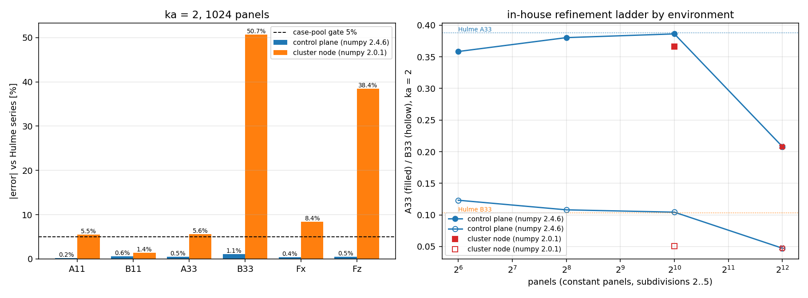

# BUG-BEM-NUMPY-VERSION-DRIFT：Hulme 半球算例的跨环境数值漂移，逐级定位

> 本文件由 `scripts/hulme_crossenv_audit.py` 从工件与 fingerprint JSON 程序化渲染，数字零手抄。
> 输入工件：`benchmarks/verified/casepool_bem_hulme_hemisphere/fingerprints/ctrl_ka2_s4.json`、`benchmarks/verified/casepool_bem_hulme_hemisphere/fingerprints/node_ka2_s4.json`

## ① 案例与问题

算例 `BEM-HULME-HEMISPHERE`（算例池 id 138）：半径 a=1 m 的浮半球、平面朝上置于自由面，深水、ρ=1025 kg/m³、g=9.80665 m/s²，ka∈{0.2..2.0}，判据 <5%；参考为 Hulme (1982) 球谐波-free 多极级数（`tensorbem.analytic.hulme_hemisphere_radiation`，144 项）。

上一轮（m20515）发现：同一 commit、同一 1024 面元网格、同一 ka=2，控制面（numpy 2.4.6）给出 B33=0.104249（距参考 1.15%），集群节点（numpy 2.0.1）给出 B33=0.050792（距参考 50.7%）——同一物理量差 2.05 倍。工件里两行都记录了完全相同的网格体积与条件数，因此「网格不同」「分辨率不同」都被排除，剩下`网格 → 算子装配 → 线性求解 → 力后处理` 四个阶段中的一个。本轮用逐级 fingerprint 定位。

## ② 怎么做的

1. `scripts/hulme_cell_fingerprint.py` 把一个 BEM 格拆成四段，每段记录形状/dtype/最大模/Frobenius 范数/10 位小数取整后的 sha256：网格（顶点/面积/形心）、算子（单层/双层/CHIEF 行/系统矩阵）、求解（右端解向量、相对残差、**实际求解系统的奇异值谱与 lstsq 有效秩**）、结果（附加质量/阻尼/激励力矩阵 + 6 个无量纲量）。同时记录 python/numpy/平台/BLAS-LAPACK、**实际 import 到的 `tensorbem` 路径与求解器源码 sha256**、线程环境变量。
2. 同一份代码在两处跑同一格：控制面（本机）与调度系统节点（`stage_dir` 直送同一工作树，排除了「节点 checkout 了别的 commit」这一层）。
3. `compare()` 按阶段顺序比较，只把**第一个**出现差异的阶段标为因果，其后所有阶段标 downstream——避免「最终数字不同」这种无法归因的结论。
4. 补充排除实验（控制面，`rankine_order` 阶梯与 CHIEF 开关）见 §⑤：两者都不是漂移来源。

## ③ 结果

### 3.1 同一格（ka=2，1024 面元）在两套环境下的系数

| run | ka | panels | numpy | A11 | B11 | A33 | B33 | Fx | Fz |
|---|---|---|---|---|---|---|---|---|---|
| control plane | 2 | 1024 | 2.4.6 | 0.249848 | 0.340432 | 0.386337 | 0.104249 | 1.192885 | 0.466885 |
| cluster node | 2 | 1024 | 2.0.1 | 0.235658 | 0.337733 | 0.366607 | 0.050792 | 1.096868 | 0.286040 |

环境：
- **control plane**：python 3.11.6, numpy 2.4.6, host `ec6ae0b42a0c`, loongarch64; BLAS/LAPACK: n/a; imported `/root/tp-agent/work/m20910/src/tensorbem/__init__.py`, solver sha256 `ff206b6a965f0a9d`
- **cluster node**：python 3.11.6, numpy 2.0.1, host `node330`, loongarch64; BLAS/LAPACK: n/a; imported `/data/test002/jobs/cj3042/repo/src/tensorbem/__init__.py`, solver sha256 `ff206b6a965f0a9d`

### 3.2 相对 Hulme 级数参考的误差

| run | |Δ| A11 | |Δ| B11 | |Δ| A33 | |Δ| B33 | |Δ| Fx | |Δ| Fz | worst |
|---|---|---|---|---|---|---|---|
| control plane | 0.23% | 0.58% | 0.53% | 1.15% | 0.40% | 0.49% | **1.15%** |
| cluster node | 5.46% | 1.37% | 5.61% | 50.72% | 8.41% | 38.44% | **50.72%** |

### 3.3 逐阶段 fingerprint 对比（因果定位）

| stage | field | control | node | rel | verdict |
|---|---|---|---|---|---|
| mesh | volume | 2.0821 | 2.0821 | 0.00e+00 | same |
| mesh | waterplane_area | 3.13655 | 3.13655 | 0.00e+00 | same |
| mesh | centroids::sha256 | 9c2a573a7cb733e4 | 9c2a573a7cb733e4 | 0.00e+00 | same |
| mesh | areas::sha256 | 1f783fcda86e4193 | 1f783fcda86e4193 | 0.00e+00 | same |
| mesh | vertices::sha256 | d1f88b82e1a5df98 | d1f88b82e1a5df98 | 0.00e+00 | same |
| operators | single_layer.max_abs | 0.0306551 | 0.0306551 | 5.66e-16 | same |
| operators | double_layer.max_abs | 0.0112544 | 0.0112544 | 0.00e+00 | same |
| operators | chief_single_layer.max_abs | 0.0021605 | 0.0021605 | 0.00e+00 | same |
| operators | system_matrix.max_abs | 0.50758 | 0.50758 | 0.00e+00 | same |
| operators | single_layer::sha256 | b67eeac1b28df2d6 | b67eeac1b28df2d6 | 0.00e+00 | same |
| operators | double_layer::sha256 | 63ecec98aeaa3954 | 63ecec98aeaa3954 | 0.00e+00 | same |
| operators | chief_points::sha256 | 464fa782d7aee4b5 | 464fa782d7aee4b5 | 0.00e+00 | same |
| operators | chief_single_layer::sha256 | 1cc7f1bbcc75564a | 1cc7f1bbcc75564a | 0.00e+00 | same |
| operators | system_matrix::sha256 | 68b8f92cab2c15c8 | 68b8f92cab2c15c8 | 0.00e+00 | same |
| spectrum | sv_max | 1.1311 | 1.1311 | 1.96e-16 | same |
| spectrum | sv_min | 0.471562 | 0.471562 | 3.53e-16 | same |
| spectrum | effective_rank | 1024 | 1024 | 0.00e+00 | same |
| spectrum | cond_of_solved_system | 2.39862 | 2.39862 | 5.55e-16 | same |
| solve_radiation | relative_residual | 0.000176863 | 0.490671 | 1.00e+00 | DIFFERS |
| solve_radiation | potential_surge::sha256 | f75babfef6baf33c | f75babfef6baf33c | 0.00e+00 | same |
| solve_radiation | potential_heave::sha256 | 2504a453c09864d6 | f3fe5d26287f1a3f | inf | DIFFERS (downstream) |
| results | A11_dimless | 0.249848 | 0.235658 | 5.68e-02 | DIFFERS (downstream) |
| results | A33_dimless | 0.386337 | 0.366607 | 5.11e-02 | DIFFERS (downstream) |
| results | B11_dimless | 0.340432 | 0.337733 | 7.93e-03 | DIFFERS (downstream) |
| results | B33_dimless | 0.104249 | 0.0507918 | 5.13e-01 | DIFFERS (downstream) |
| results | Fx_dimless | 1.19289 | 1.09687 | 8.05e-02 | DIFFERS (downstream) |
| results | Fz_dimless | 0.466885 | 0.28604 | 3.87e-01 | DIFFERS (downstream) |
| results | added_mass::sha256 | 4eeba3acdbfa8f81 | a0665014fb9419c9 | inf | DIFFERS (downstream) |
| results | damping::sha256 | a48f012f165fbdb0 | 396ed1fb906a568b | inf | DIFFERS (downstream) |
| results | excitation_force::sha256 | c69ded9108f17266 | 76e15a7fe424023c | inf | DIFFERS (downstream) |

**第一个分歧阶段：`solve_radiation`**。

### 3.4 本仓求解器的 ka=2 延拓阶梯（已提交工件）

| environment | numpy | ka | panels | A33 | B33 | A33 vs ref | B33 vs ref |
|---|---|---|---|---|---|---|---|
| cluster node | 2.0.1 | 2 | 1024 | 0.366607 | 0.050792 | -5.61% | -50.72% |
| cluster node | 2.0.1 | 2 | 4096 | 0.207857 | 0.047178 | -46.48% | -54.23% |
| control plane | 2.4.6 | 2 | 64 | 0.358460 | 0.123144 | -7.70% | +19.48% |
| control plane | 2.4.6 | 2 | 256 | 0.380435 | 0.107966 | -2.05% | +4.76% |
| control plane | 2.4.6 | 2 | 1024 | 0.386337 | 0.104249 | -0.53% | +1.15% |
| control plane | 2.4.6 | 2 | 4096 | 0.207857 | 0.047178 | -46.48% | -54.23% |

## ④ 结论（按证据强度分层）

- 第一个分歧阶段 = `solve_radiation`；该阶段之前的所有 digest 相同，其后的所有差异都是它的下游，不能作为独立证据。
- 系统矩阵 10 位小数取整后的 sha256 相同：`68b8f92cab2c15c8`（控制面）vs `68b8f92cab2c15c8`（节点）。网格、单层/双层核、CHIEF 行、右端全部逐位相同，因此**装配阶段与 Green 函数求值被排除**——同一份代码在这两台机器上装出同一个矩阵。
- 分歧落在**线性求解**：`np.linalg.lstsq` 的相对残差 ‖Ax-b‖/‖b‖ 控制面 1.769e-04，节点 4.907e-01（**2774×**，节点解根本没解出方程，残差 49.1%）。后者同时报告 full rank (1024/1024)、条件数 2.399（与控制面逐位一致）——即 SVD 给出的**秩与奇异值是对的，解是错的**，这是 LAPACK/BLAS 后端缺陷而非条件数问题。
- 由此「numpy 版本漂移」被收窄为**该节点环境的复数最小二乘实现失效**；算例 5% 判据只在求解残差正常的环境成立。**`relative_residual` 就是廉价探针**，任何 ≤1e-2 之外的值都应当直接拒收该环境的证据（本仓 `Radiation3DResult` 已返回该字段）。
- 推论（falsified）：m20515 的「4096 面元规模断裂」是在同一失效环境里跑的，因此它**不是**求解器的规模上限证据；该档位在健康环境下的行为仍未知，需重跑。

## ⑤ 注意点与排除实验

- **rankine_order 不是来源**：控制面 ka=2、256 面元，order 2..10 的 A33/B33 变化 0.5% 以内（order≥5 后 <0.05%），且条件数逐位不变。
- **CHIEF 不是来源**：`results.json` 中 ka=2 的 `chief_off` 与 `chief` 行差异仅 1e-5 量级，说明 ka=2 远离该水线面的不规则频率（~2.58），CHIEF 行在此处几乎不起作用。
- fingerprint 只证明「两处跑的是不是同一个计算」，不证明计算本身正确；正确性仍由 Hulme 级数 + capytaine 第三方码两条独立轴承担。

## ⑥ 误差判定

- **control plane**：最坏量 B33_dimless = 0.104249，参考 0.103065，相对误差 1.15% → 是否 <3%：是（<3%）
- **cluster node**：最坏量 B33_dimless = 0.050792，参考 0.103065，相对误差 50.72% → 是否 <3%：否（≥3%）

算例 5% 判据的成立范围因此**限定在**能复现 control 侧 fingerprint 的环境；跨环境不复现这一点本身已记入测试登记表 `tests/test_hulme_cell_fingerprint.py::KNOWN_CROSSENV_DIVERGENCE`，登记值一旦漂移测试即失败。

