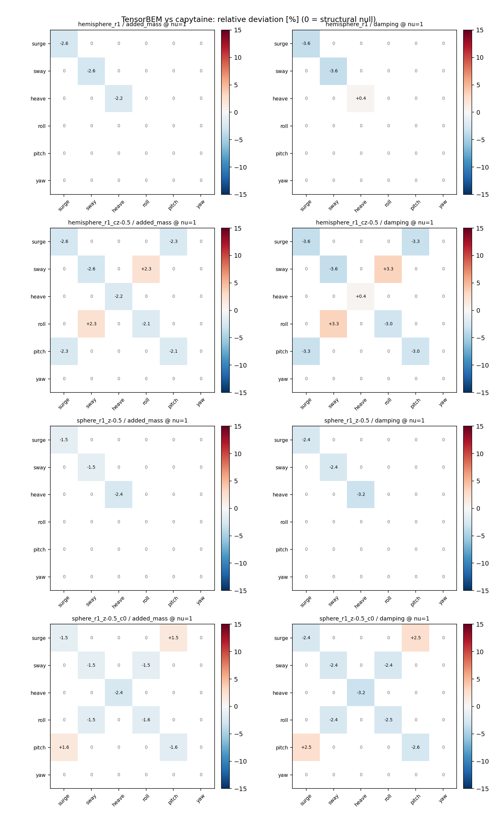
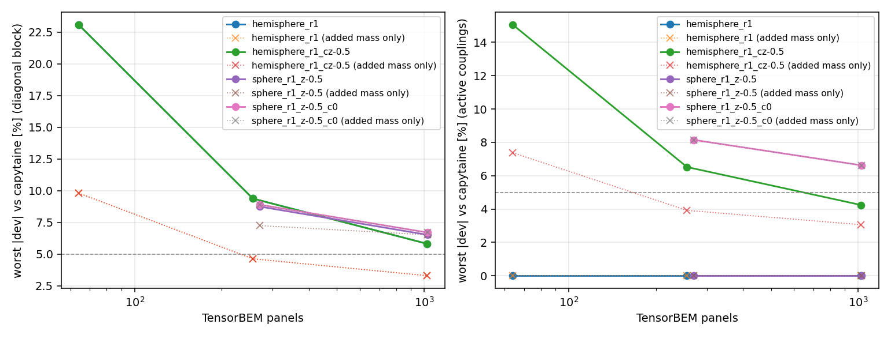
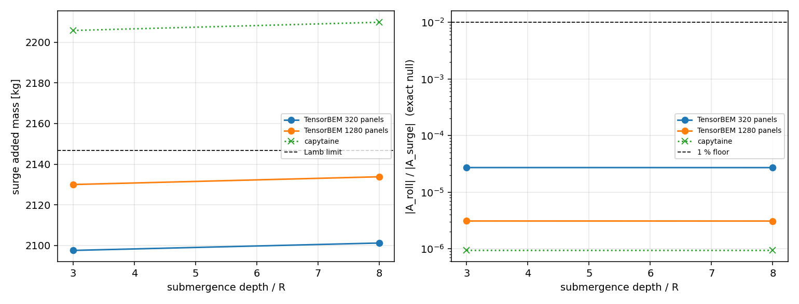

# TensorBEM 三维辐射矩阵与 capytaine 的第二轮交叉验证（XVAL-BEM-R2）

## 1. 案例介绍

第一轮交叉验证（`docs/capytaine_crosscheck.md`）只比对了两个平滑物体的**升沉/纵荡对角项**。辐射矩阵其余部分——**转动块（横摇/纵摇/艏摇）**、**平移-转动耦合项**（穿水面物体的纵荡-纵摇、横荡-横摇）、以及几何上**必须为零的结构性零项**——从未与外部程序比对；转动还引入了**转动中心**这一第一轮无需固定的量（capytaine 3.1 的默认值是 `nan`）。

| 项目 | 取值 |
|---|---|
| 物体 A | 穿水面半球，R = 1.0 m，转动中心 (0,0,0) |
| 物体 B | 浮球，R = 1.0 m，中心 z = -0.5 m，转动中心 (0,0,-0.5) |
| 流体 | rho = 1025.0 kg/m^3, g = 9.80665 m/s^2，无限水深 |
| 频率 | nu = 0.5, 1, 2 (m^-1) |
| 独立程序 | capytaine 3.1.dev0（commit `None`），loongarch64，Python 3.11.6 |
| 自由度 | 全部 6 个：surge, sway, heave, roll, pitch, yaw |
| 第三解析轴 | 深潜球体 Lamb (1932) 无界流体极限 |

## 2. 方法

1. `scripts/capytaine_crosscheck_r2_ref.py`（仓库内**唯一**导入 capytaine 之处）对每个辐射自由度求解一次 `RadiationProblem`，记录该自由度对应的**整列**`A[i,j]`、`B[i,j]`；转动中心通过 `cpt.rigid_body_dofs(rotation_center=...)` 写进自由度定义并回读校验（capytaine 3.1 不允许事后设置，默认留 `nan`）。
2. `capytaine_crosscheck_r2.run_case` 在声明网格层级上调用 `solve_radiation_3d(modes=range(6), center=<同一转动中心>)`，取整个 6x6 矩阵。
3. `compare` 对 36 个 (i,j) x 2 个量（附加质量/阻尼）x 每个频率逐一分类：**invariant**（该行/列是声明过的恒零自由度 `invariant_null_dofs`，精确目标为 0，用 3%·ρL^k 物理尺度作上界、不算相对偏差）、**active**（两码均显著：|M_ij| > 1%·sqrt(|M_ii M_jj|)）、**null**（两码均在此阈下）、**conflict**（一码显著、另一码为零 → 直接失败）。若 `sqrt(|M_ii M_jj|)` 本身落在物理尺度地板上（转动块整体很小的偏心算例），改用 ρL^k 作归一化尺度并在 artifact 里标记 `scale_degenerate`。
4. 事前登记、事后不放宽的容差：对角块 **5%**（与第一轮同带），真正非零的耦合项 **10%**，结构零项阈值 **1%**，轴对称恒等式 **5%**，Lamb 极限 **5%**。

## 3. 计算结果

### 3.1 网格层级与逐案结论

| case | TensorBEM 面板 | capytaine 面板 | active | 结构零项 | 不变式零项 | conflict | 最差 active 偏差 | 最差不变式比 | 判定 |
|---|---:|---:|---:|---:|---:|---:|---:|---:|---|
| hemisphere_r1 | 1024 | 784 | 18 | 36 | 162 | 0 | 5.82% | 1.40e-01 | FAIL |
| hemisphere_r1_cz-0.5 | 1024 | 784 | 54 | 96 | 66 | 0 | 5.82% | 2.90e-04 | FAIL |
| sphere_r1_z-0.5 | 1026 | 1120 | 17 | 37 | 162 | 0 | 6.52% | 5.06e-01 | FAIL |
| sphere_r1_z-0.5_c0 | 1026 | 1120 | 53 | 97 | 66 | 0 | 6.71% | 5.77e-03 | FAIL |

总计 142 个 active 项、266 个相对阈下的结构零项与 456 个声明过的恒零项（不变式，上界 3%·ρL^k）被逐项判定，总体判定 **FAIL**（对角带 5%、耦合带 10%）；最差 active 相对偏差 6.71%，最差不变式比 5.06e-01。

### 3.2 附加质量矩阵（六自由度，nu = 1 m^-1）

**hemisphere_r1** — TensorBEM（finest，1024 面板）

| row / col | surge | sway | heave | roll | pitch | yaw |
|---|---|---|---|---|---|---|
| surge | 1228 | -5.223e-07 | 0 | -2.78e-09 | 1.126 | -1.389e-17 |
| sway | 5.223e-07 | 1228 | 1.422e-14 | -1.126 | -2.78e-09 | -3.299e-17 |
| heave | -2.845e-14 | 2.845e-14 | 918.1 | 0 | -1.389e-17 | -2.922e-07 |
| roll | -2.259e-08 | -1.126 | 2.084e-17 | 0.01027 | -3.358e-10 | 4.07e-19 |
| pitch | 1.126 | -2.259e-08 | -4.862e-17 | 3.358e-10 | 0.01027 | 0 |
| yaw | 5.557e-17 | 1.493e-16 | -1.504e-08 | -2.917e-19 | -8.682e-19 | 0.00877 |

**hemisphere_r1** — capytaine（784 面板，转动中心 [0.0, 0.0, 0.0]）

| row / col | surge | sway | heave | roll | pitch | yaw |
|---|---|---|---|---|---|---|
| surge | 1261 | -4.637e-14 | 4.637e-14 | -8.219e-15 | -0.4914 | 7.258e-15 |
| sway | -4.637e-14 | 1261 | -1.855e-13 | 0.4914 | 7.313e-15 | -7.504e-15 |
| heave | -6.956e-14 | -9.274e-14 | 938.5 | -6.34e-15 | 6.524e-15 | -4.512e-16 |
| roll | -8.23e-15 | 0.4907 | -6.045e-15 | 0.00113 | 7.031e-18 | -2.741e-18 |
| pitch | -0.4907 | 7.449e-15 | 6.94e-15 | 7.031e-18 | 0.00113 | -3.665e-18 |
| yaw | 7.257e-15 | -7.504e-15 | -4.508e-16 | -2.744e-18 | -3.666e-18 | 5.018e-29 |

**hemisphere_r1_cz-0.5** — TensorBEM（finest，1024 面板）

| row / col | surge | sway | heave | roll | pitch | yaw |
|---|---|---|---|---|---|---|
| surge | 1228 | -5.223e-07 | 0 | 2.584e-07 | 615.2 | -1.389e-17 |
| sway | 5.223e-07 | 1228 | 1.422e-14 | -615.2 | 2.584e-07 | -3.299e-17 |
| heave | -2.845e-14 | 2.845e-14 | 918.1 | 7.112e-15 | 2.845e-14 | -2.922e-07 |
| roll | -2.838e-07 | -615.2 | 2.134e-14 | 308.2 | -1.408e-07 | 2.865e-17 |
| pitch | 615.2 | -2.838e-07 | 0 | 1.408e-07 | 308.2 | 1.389e-17 |
| yaw | 5.557e-17 | 1.493e-16 | -1.504e-08 | 8.682e-18 | 8.335e-17 | 0.00877 |

**hemisphere_r1_cz-0.5** — capytaine（784 面板，转动中心 [0.0, 0.0, -0.5]）

| row / col | surge | sway | heave | roll | pitch | yaw |
|---|---|---|---|---|---|---|
| surge | 1261 | -4.637e-14 | 4.637e-14 | -5.796e-14 | 629.9 | 7.258e-15 |
| sway | -4.637e-14 | 1261 | -1.855e-13 | -629.9 | 5.796e-14 | -7.504e-15 |
| heave | -6.956e-14 | -9.274e-14 | 938.5 | 0 | 1.159e-14 | -4.512e-16 |
| roll | 1.159e-14 | -629.9 | 9.274e-14 | 314.7 | -3.478e-14 | 3.749e-15 |
| pitch | 629.9 | -1.159e-14 | 2.319e-14 | -2.898e-14 | 314.7 | 3.625e-15 |
| yaw | 7.257e-15 | -7.504e-15 | -4.508e-16 | 3.749e-15 | 3.625e-15 | 5.018e-29 |

**sphere_r1_z-0.5** — TensorBEM（finest，1026 面板）

| row / col | surge | sway | heave | roll | pitch | yaw |
|---|---|---|---|---|---|---|
| surge | 2072 | -0.003591 | 8.89e-15 | 0.00873 | -2.526 | -1.563e-17 |
| sway | -0.001499 | 2071 | 8.001e-14 | 2.876 | 0.00995 | -1.563e-17 |
| heave | -3.467e-14 | 4.001e-15 | 1201 | -1.65e-16 | -3.126e-17 | -0.003254 |
| roll | 0.01041 | 2.891 | 3.473e-17 | 0.01676 | 2.065e-05 | -1.39e-19 |
| pitch | -2.547 | 0.01165 | 8.335e-17 | 7.344e-05 | 0.01576 | 5.426e-20 |
| yaw | 0 | -4.306e-16 | -0.006311 | 1.085e-19 | -5.562e-19 | 0.006657 |

**sphere_r1_z-0.5** — capytaine（1120 面板，转动中心 [0.0, 0.0, -0.5]）

| row / col | surge | sway | heave | roll | pitch | yaw |
|---|---|---|---|---|---|---|
| surge | 2103 | -0.1204 | 8.115e-14 | -0.02227 | -3.376 | 1.249e-15 |
| sway | 0.1204 | 2103 | -6.956e-14 | 3.376 | -0.02227 | -1.665e-14 |
| heave | -6.376e-14 | 1.043e-13 | 1230 | -6.43e-15 | -2.264e-15 | -0.01472 |
| roll | -0.07384 | 3.517 | -6.521e-15 | 0.01578 | 0.0001836 | -3.502e-17 |
| pitch | -3.517 | -0.07384 | -2.083e-15 | -0.0001836 | 0.01578 | 3.317e-18 |
| yaw | 5.321e-16 | -1.631e-14 | 0.04021 | -3.078e-17 | 5.13e-18 | 0.001808 |

**sphere_r1_z-0.5_c0** — TensorBEM（finest，1026 面板）

| row / col | surge | sway | heave | roll | pitch | yaw |
|---|---|---|---|---|---|---|
| surge | 2072 | -0.003591 | 8.89e-15 | 0.006935 | -1038 | -1.563e-17 |
| sway | -0.001499 | 2071 | 8.001e-14 | 1039 | 0.0107 | -1.563e-17 |
| heave | -3.467e-14 | 4.001e-15 | 1201 | -4.223e-15 | -1.8e-14 | -0.003254 |
| roll | 0.009657 | 1039 | 2.045e-14 | 520.8 | 0.000167 | 6.946e-18 |
| pitch | -1038 | 0.01345 | -2.667e-14 | 0.002431 | 520.5 | -9.55e-18 |
| yaw | 0 | -4.306e-16 | -0.006311 | 6.251e-17 | -6.251e-17 | 0.006657 |

**sphere_r1_z-0.5_c0** — capytaine（1120 面板，转动中心 [0.0, 0.0, 0.0]）

| row / col | surge | sway | heave | roll | pitch | yaw |
|---|---|---|---|---|---|---|
| surge | 2103 | -0.1204 | 8.115e-14 | -0.08247 | -1055 | 1.249e-15 |
| sway | 0.1204 | 2103 | -6.956e-14 | 1055 | -0.08247 | -1.665e-14 |
| heave | -6.376e-14 | 1.043e-13 | 1230 | 5.217e-14 | 1.159e-13 | -0.01472 |
| roll | -0.01363 | 1055 | -4.637e-14 | 529.1 | -0.004134 | -8.363e-15 |
| pitch | -1055 | -0.01363 | -5.796e-14 | 0.004134 | 529.1 | -6.205e-16 |
| yaw | 5.321e-16 | -1.631e-14 | 0.04021 | -8.497e-15 | 1.557e-16 | 0.001808 |

### 3.3 active 项逐项偏差（含转动块与耦合项）

**hemisphere_r1**

| nu | quantity | (i,j) | TensorBEM | capytaine | 相对偏差 | 登记带 |
|---:|---|---|---:|---:|---:|---:|
| 0.5 | added_mass | (surge,surge) | 1375.9 | 1422.8 | -3.30% | 5% |
| 0.5 | added_mass | (sway,sway) | 1375.9 | 1422.8 | -3.30% | 5% |
| 0.5 | added_mass | (heave,heave) | 1256.8 | 1278.7 | -1.71% | 5% |
| 0.5 | damping | (surge,surge) | 464.41 | 486.28 | -4.50% | 5% |
| 0.5 | damping | (sway,sway) | 464.41 | 486.28 | -4.50% | 5% |
| 0.5 | damping | (heave,heave) | 1611.3 | 1621.3 | -0.61% | 5% |
| 1 | added_mass | (surge,surge) | 1228.1 | 1260.7 | -2.59% | 5% |
| 1 | added_mass | (sway,sway) | 1228.1 | 1260.7 | -2.59% | 5% |
| 1 | added_mass | (heave,heave) | 918.07 | 938.49 | -2.18% | 5% |
| 1 | damping | (surge,surge) | 2355 | 2442.3 | -3.58% | 5% |
| 1 | damping | (sway,sway) | 2355 | 2442.3 | -3.58% | 5% |
| 1 | damping | (heave,heave) | 1674.9 | 1668.4 | +0.39% | 5% |
| 2 | added_mass | (surge,surge) | 536.36 | 550.69 | -2.60% | 5% |
| 2 | added_mass | (sway,sway) | 536.36 | 550.69 | -2.60% | 5% |
| 2 | added_mass | (heave,heave) | 829.35 | 851.17 | -2.56% | 5% |
| 2 | damping | (surge,surge) | 3236.6 | 3292.3 | -1.69% | 5% |
| 2 | damping | (sway,sway) | 3236.6 | 3292.3 | -1.69% | 5% |
| 2 | damping | (heave,heave) | 990.95 | 936.46 | +5.82% | 5% |

**hemisphere_r1_cz-0.5**

| nu | quantity | (i,j) | TensorBEM | capytaine | 相对偏差 | 登记带 |
|---:|---|---|---:|---:|---:|---:|
| 0.5 | added_mass | (surge,surge) | 1375.9 | 1422.8 | -3.30% | 5% |
| 0.5 | added_mass | (surge,pitch) | 689.12 | 710.86 | -3.06% | 10% |
| 0.5 | added_mass | (sway,sway) | 1375.9 | 1422.8 | -3.30% | 5% |
| 0.5 | added_mass | (sway,roll) | -689.12 | -710.86 | +3.06% | 10% |
| 0.5 | added_mass | (heave,heave) | 1256.8 | 1278.7 | -1.71% | 5% |
| 0.5 | added_mass | (roll,sway) | -689.12 | -710.86 | +3.06% | 10% |
| 0.5 | added_mass | (roll,roll) | 345.16 | 355.15 | -2.81% | 5% |
| 0.5 | added_mass | (pitch,surge) | 689.12 | 710.86 | -3.06% | 10% |
| 0.5 | added_mass | (pitch,pitch) | 345.16 | 355.15 | -2.81% | 5% |
| 0.5 | damping | (surge,surge) | 464.41 | 486.28 | -4.50% | 5% |
| 0.5 | damping | (surge,pitch) | 232.64 | 242.94 | -4.24% | 10% |
| 0.5 | damping | (sway,sway) | 464.41 | 486.28 | -4.50% | 5% |
| 0.5 | damping | (sway,roll) | -232.64 | -242.94 | +4.24% | 10% |
| 0.5 | damping | (heave,heave) | 1611.3 | 1621.3 | -0.61% | 5% |
| 0.5 | damping | (roll,sway) | -232.64 | -242.94 | +4.24% | 10% |
| 0.5 | damping | (roll,roll) | 116.54 | 121.37 | -3.98% | 5% |
| 0.5 | damping | (pitch,surge) | 232.64 | 242.94 | -4.24% | 10% |
| 0.5 | damping | (pitch,pitch) | 116.54 | 121.37 | -3.98% | 5% |
| 1 | added_mass | (surge,surge) | 1228.1 | 1260.7 | -2.59% | 5% |
| 1 | added_mass | (surge,pitch) | 615.17 | 629.87 | -2.33% | 10% |
| 1 | added_mass | (sway,sway) | 1228.1 | 1260.7 | -2.59% | 5% |
| 1 | added_mass | (sway,roll) | -615.17 | -629.87 | +2.33% | 10% |
| 1 | added_mass | (heave,heave) | 918.07 | 938.49 | -2.18% | 5% |
| 1 | added_mass | (roll,sway) | -615.17 | -629.87 | +2.33% | 10% |
| 1 | added_mass | (roll,roll) | 308.16 | 314.69 | -2.08% | 5% |
| 1 | added_mass | (pitch,surge) | 615.17 | 629.87 | -2.33% | 10% |
| 1 | added_mass | (pitch,pitch) | 308.16 | 314.69 | -2.08% | 5% |
| 1 | damping | (surge,surge) | 2355 | 2442.3 | -3.58% | 5% |
| 1 | damping | (surge,pitch) | 1180 | 1220.2 | -3.29% | 10% |
| 1 | damping | (sway,sway) | 2355 | 2442.3 | -3.58% | 5% |
| 1 | damping | (sway,roll) | -1180 | -1220.2 | +3.29% | 10% |
| 1 | damping | (heave,heave) | 1674.9 | 1668.4 | +0.39% | 5% |
| 1 | damping | (roll,sway) | -1180 | -1220.2 | +3.29% | 10% |
| 1 | damping | (roll,roll) | 591.28 | 609.57 | -3.00% | 5% |
| 1 | damping | (pitch,surge) | 1180 | 1220.2 | -3.29% | 10% |
| 1 | damping | (pitch,pitch) | 591.28 | 609.57 | -3.00% | 5% |
| 2 | added_mass | (surge,surge) | 536.36 | 550.69 | -2.60% | 5% |
| 2 | added_mass | (surge,pitch) | 268.54 | 275.15 | -2.40% | 10% |
| 2 | added_mass | (sway,sway) | 536.36 | 550.69 | -2.60% | 5% |
| 2 | added_mass | (sway,roll) | -268.54 | -275.15 | +2.40% | 10% |
| 2 | added_mass | (heave,heave) | 829.35 | 851.17 | -2.56% | 5% |
| 2 | added_mass | (roll,sway) | -268.53 | -275.15 | +2.40% | 10% |
| 2 | added_mass | (roll,roll) | 134.45 | 137.48 | -2.20% | 5% |
| 2 | added_mass | (pitch,surge) | 268.53 | 275.15 | -2.40% | 10% |
| 2 | added_mass | (pitch,pitch) | 134.45 | 137.48 | -2.20% | 5% |
| 2 | damping | (surge,surge) | 3236.6 | 3292.3 | -1.69% | 5% |
| 2 | damping | (surge,pitch) | 1622.6 | 1644.8 | -1.35% | 10% |
| 2 | damping | (sway,sway) | 3236.6 | 3292.3 | -1.69% | 5% |
| 2 | damping | (sway,roll) | -1622.6 | -1644.8 | +1.35% | 10% |
| 2 | damping | (heave,heave) | 990.95 | 936.46 | +5.82% | 5% |
| 2 | damping | (roll,sway) | -1622.6 | -1644.8 | +1.35% | 10% |
| 2 | damping | (roll,roll) | 813.46 | 821.74 | -1.01% | 5% |
| 2 | damping | (pitch,surge) | 1622.6 | 1644.8 | -1.35% | 10% |
| 2 | damping | (pitch,pitch) | 813.46 | 821.74 | -1.01% | 5% |

**sphere_r1_z-0.5**

| nu | quantity | (i,j) | TensorBEM | capytaine | 相对偏差 | 登记带 |
|---:|---|---|---:|---:|---:|---:|
| 0.5 | added_mass | (surge,surge) | 3152.9 | 3247.2 | -2.90% | 5% |
| 0.5 | added_mass | (sway,sway) | 3153.1 | 3247.2 | -2.90% | 5% |
| 0.5 | added_mass | (heave,heave) | 1129.4 | 1157.4 | -2.42% | 5% |
| 0.5 | damping | (surge,surge) | 1623.6 | 1697 | -4.32% | 5% |
| 0.5 | damping | (sway,sway) | 1623.8 | 1697 | -4.31% | 5% |
| 0.5 | damping | (heave,heave) | 267.33 | 275.27 | -2.88% | 5% |
| 1 | added_mass | (surge,surge) | 2071.8 | 2102.6 | -1.47% | 5% |
| 1 | added_mass | (sway,sway) | 2071.5 | 2102.6 | -1.48% | 5% |
| 1 | added_mass | (heave,heave) | 1200.5 | 1229.7 | -2.37% | 5% |
| 1 | damping | (surge,surge) | 7598 | 7785.6 | -2.41% | 5% |
| 1 | damping | (sway,sway) | 7599.1 | 7785.6 | -2.40% | 5% |
| 2 | added_mass | (surge,surge) | 327.89 | 350.66 | -6.49% | 5% |
| 2 | added_mass | (sway,sway) | 327.79 | 350.66 | -6.52% | 5% |
| 2 | added_mass | (heave,heave) | 1252.5 | 1284 | -2.45% | 5% |
| 2 | damping | (surge,surge) | 5074.3 | 5137.4 | -1.23% | 5% |
| 2 | damping | (sway,sway) | 5073.4 | 5137.4 | -1.24% | 5% |
| 2 | damping | (heave,heave) | 401.01 | 417.3 | -3.90% | 5% |

**sphere_r1_z-0.5_c0**

| nu | quantity | (i,j) | TensorBEM | capytaine | 相对偏差 | 登记带 |
|---:|---|---|---:|---:|---:|---:|
| 0.5 | added_mass | (surge,surge) | 3152.9 | 3247.2 | -2.90% | 5% |
| 0.5 | added_mass | (surge,pitch) | -1579.7 | -1628.1 | +2.97% | 10% |
| 0.5 | added_mass | (sway,sway) | 3153.1 | 3247.2 | -2.90% | 5% |
| 0.5 | added_mass | (sway,roll) | 1580.2 | 1628.1 | -2.94% | 10% |
| 0.5 | added_mass | (heave,heave) | 1129.4 | 1157.4 | -2.42% | 5% |
| 0.5 | added_mass | (roll,sway) | 1580.2 | 1628.2 | -2.95% | 10% |
| 0.5 | added_mass | (roll,roll) | 791.97 | 816.38 | -2.99% | 5% |
| 0.5 | added_mass | (pitch,surge) | -1579.7 | -1628.2 | +2.98% | 10% |
| 0.5 | added_mass | (pitch,pitch) | 791.46 | 816.38 | -3.05% | 5% |
| 0.5 | damping | (surge,surge) | 1623.6 | 1697 | -4.32% | 5% |
| 0.5 | damping | (surge,pitch) | -813.45 | -850.81 | +4.39% | 10% |
| 0.5 | damping | (sway,sway) | 1623.8 | 1697 | -4.31% | 5% |
| 0.5 | damping | (sway,roll) | 813.8 | 850.81 | -4.35% | 10% |
| 0.5 | damping | (heave,heave) | 267.33 | 275.27 | -2.88% | 5% |
| 0.5 | damping | (roll,sway) | 813.8 | 850.91 | -4.36% | 10% |
| 0.5 | damping | (roll,roll) | 407.85 | 426.62 | -4.40% | 5% |
| 0.5 | damping | (pitch,surge) | -813.45 | -850.91 | +4.40% | 10% |
| 0.5 | damping | (pitch,pitch) | 407.54 | 426.62 | -4.47% | 5% |
| 1 | added_mass | (surge,surge) | 2071.8 | 2102.6 | -1.47% | 5% |
| 1 | added_mass | (surge,pitch) | -1038.4 | -1054.7 | +1.54% | 10% |
| 1 | added_mass | (sway,sway) | 2071.5 | 2102.6 | -1.48% | 5% |
| 1 | added_mass | (sway,roll) | 1038.6 | 1054.7 | -1.52% | 10% |
| 1 | added_mass | (heave,heave) | 1200.5 | 1229.7 | -2.37% | 5% |
| 1 | added_mass | (roll,sway) | 1038.6 | 1054.8 | -1.53% | 10% |
| 1 | added_mass | (roll,roll) | 520.77 | 529.11 | -1.58% | 5% |
| 1 | added_mass | (pitch,surge) | -1038.4 | -1054.8 | +1.55% | 10% |
| 1 | added_mass | (pitch,pitch) | 520.49 | 529.11 | -1.63% | 5% |
| 1 | damping | (surge,surge) | 7598 | 7785.6 | -2.41% | 5% |
| 1 | damping | (surge,pitch) | -3809.4 | -3906.6 | +2.49% | 10% |
| 1 | damping | (sway,sway) | 7599.1 | 7785.6 | -2.40% | 5% |
| 1 | damping | (sway,roll) | 3811.5 | 3906.6 | -2.43% | 10% |
| 1 | damping | (roll,sway) | 3811.6 | 3907.3 | -2.45% | 10% |
| 1 | damping | (roll,roll) | 1911.8 | 1960.6 | -2.49% | 5% |
| 1 | damping | (pitch,surge) | -3809.4 | -3907.3 | +2.50% | 10% |
| 1 | damping | (pitch,pitch) | 1909.9 | 1960.6 | -2.58% | 5% |
| 2 | added_mass | (surge,surge) | 327.89 | 350.66 | -6.49% | 5% |
| 2 | added_mass | (surge,pitch) | -163.44 | -174.85 | +6.53% | 10% |
| 2 | added_mass | (sway,sway) | 327.79 | 350.66 | -6.52% | 5% |
| 2 | added_mass | (sway,roll) | 163.27 | 174.85 | -6.62% | 10% |
| 2 | added_mass | (heave,heave) | 1252.5 | 1284 | -2.45% | 5% |
| 2 | added_mass | (roll,sway) | 163.27 | 174.82 | -6.61% | 10% |
| 2 | added_mass | (roll,roll) | 81.335 | 87.181 | -6.71% | 5% |
| 2 | added_mass | (pitch,surge) | -163.45 | -174.82 | +6.51% | 10% |
| 2 | added_mass | (pitch,pitch) | 81.483 | 87.181 | -6.54% | 5% |
| 2 | damping | (surge,surge) | 5074.3 | 5137.4 | -1.23% | 5% |
| 2 | damping | (surge,pitch) | -2549.1 | -2583.5 | +1.33% | 10% |
| 2 | damping | (sway,sway) | 5073.4 | 5137.4 | -1.24% | 5% |
| 2 | damping | (sway,roll) | 2550.2 | 2583.5 | -1.29% | 10% |
| 2 | damping | (heave,heave) | 401.01 | 417.3 | -3.90% | 5% |
| 2 | damping | (roll,sway) | 2550.2 | 2584.2 | -1.32% | 10% |
| 2 | damping | (roll,roll) | 1281.9 | 1299.6 | -1.36% | 5% |
| 2 | damping | (pitch,surge) | -2549.1 | -2584.2 | +1.36% | 10% |
| 2 | damping | (pitch,pitch) | 1280.6 | 1299.6 | -1.46% | 5% |

### 3.4 结构零项（几何禁止非零的项）

两个物体都关于 z 轴轴对称，并有水平对称面，因此纵荡-横荡、升沉-横摇、纵荡-横摇、横荡-纵摇等项必须为零。这是只看对角项时看不见的缺陷类：本不该存在的耦合如果出现，只有逐项检查才能发现。

| case | 结构零项个数 | 两码最大 |M_ij| / sqrt(|M_ii M_jj|) |
|---|---:|---:|
| hemisphere_r1 | 36 | 0.0000% |
| hemisphere_r1_cz-0.5 | 96 | 0.0000% |
| sphere_r1_z-0.5 | 37 | 0.0682% |
| sphere_r1_z-0.5_c0 | 97 | 0.0775% |

### 3.5 网格收敛（最差偏差随面板数）

| case | 面板 | 对角最差偏差 | 耦合最差偏差 |
|---|---:|---:|---:|
| hemisphere_r1 | 64 | 9.81% | 0.00% |
| hemisphere_r1 | 256 | 4.63% | 0.00% |
| hemisphere_r1 | 1024 | 3.30% | 0.00% |
| hemisphere_r1_cz-0.5 | 64 | 9.81% | 7.38% |
| hemisphere_r1_cz-0.5 | 256 | 4.63% | 3.92% |
| hemisphere_r1_cz-0.5 | 1024 | 3.30% | 3.06% |
| sphere_r1_z-0.5 | 270 | 7.25% | 0.00% |
| sphere_r1_z-0.5 | 1026 | 6.52% | 0.00% |
| sphere_r1_z-0.5_c0 | 270 | 8.90% | 8.15% |
| sphere_r1_z-0.5_c0 | 1026 | 6.71% | 6.62% |

### 3.6 几何恒等式（不依赖外部程序的独立轴）

| case | nu | TB A_surge vs A_sway | TB A_roll vs A_pitch | TB 互易性 max|A-A^T|/max|A| | capytaine 同量 (surge/sway, roll/pitch) | 判定 |
|---|---:|---:|---:|---:|---|---|
| hemisphere_r1 | 0.5 | 0.000% | 0.000% | 8.54e-08 | 0.000% / 0.000% | PASS |
| hemisphere_r1 | 1 | 0.000% | 0.000% | 2.95e-09 | 0.000% / 0.000% | PASS |
| hemisphere_r1 | 2 | 0.000% | 0.000% | 2.34e-06 | 0.000% / 0.000% | PASS |
| hemisphere_r1_cz-0.5 | 0.5 | 0.000% | 0.000% | 8.54e-08 | 0.000% / 0.000% | PASS |
| hemisphere_r1_cz-0.5 | 1 | 0.000% | 0.000% | 2.95e-09 | 0.000% / 0.000% | PASS |
| hemisphere_r1_cz-0.5 | 2 | 0.000% | 0.000% | 2.34e-06 | 0.000% / 0.000% | PASS |
| sphere_r1_z-0.5 | 0.5 | 0.004% | 6.590% | 8.65e-05 | 0.000% / 0.000% | FAIL |
| sphere_r1_z-0.5 | 1 | 0.013% | 5.959% | 9.83e-06 | 0.000% / 0.000% | FAIL |
| sphere_r1_z-0.5 | 2 | 0.033% | 8.413% | 1.32e-04 | 0.000% / 0.000% | FAIL |
| sphere_r1_z-0.5_c0 | 0.5 | 0.004% | 0.065% | 8.65e-05 | 0.000% / 0.000% | PASS |
| sphere_r1_z-0.5_c0 | 1 | 0.013% | 0.053% | 9.83e-06 | 0.000% / 0.000% | PASS |
| sphere_r1_z-0.5_c0 | 2 | 0.033% | 0.182% | 1.32e-04 | 0.000% / 0.000% | PASS |

轴对称性受网格各向异性限制（icosphere 网格并非严格轴对称），因此这里是离散化误差而非求解器缺陷；capytaine 侧同量数值一并列出以免单方面归因。

### 3.7 第三轴（解析）：深潜球体的两个精确陈述

**(a) 转动块精确为零。** 球体绕**自身几何中心**转动时，物面上 `(r - centre) x n == 0` 处处成立，激励为零，故附加惯量在任意频率、任意潜深下**精确为零**（与 free-surface 条件无关）。这是形式性质而非数值性质，因此它直接检验转动广义法向 `(r-centre) x n` 的装配：量纲取自 `|A_roll| / |A_surge|`，登记阈 1%。

**(b) 平动附加质量 → Lamb (1932) 无界流体极限。** 解析值 (2/3)·pi·rho·R^3 = 2146.75 kg；自由面影响随潜深衰减，剩余偏差由面板离散控制，本轮的深层阶梯只用单一网格（见局限 5），因此该偏差含离散误差。登记带 5%。

| 深度/R | TensorBEM 面板 | A_surge [kg] | vs Lamb | |A_roll|/|A_surge| | capytaine A_surge | capytaine |A_roll|/|A_surge| |
|---:|---:|---:|---:|---:|---:|---:|
| 3 | 320 | 2097.60 | -2.29% | 2.71e-05 | 2205.79 | 9.35e-07 |
| 3 | 1280 | 2130.01 | -0.78% | 3.09e-06 | 2205.79 | 9.35e-07 |
| 8 | 320 | 2101.24 | -2.12% | 2.71e-05 | 2209.83 | 9.33e-07 |
| 8 | 1280 | 2133.82 | -0.60% | 3.08e-06 | 2209.83 | 9.33e-07 |

最深一层（8R）最细网格（1280 面板）平动偏差 **-0.60%**，转动比最大 **2.71e-05**（阈 1e-02），合判 **PASS**。

### 3.8 第一轮冻结参考的可复现性

用本轮 live 运行重算第一轮所用网格（半球 36x72、球 28x56），与冻结文件 `capytaine_ref.json` 的最大相对差 **1.853e-12%**（18 个格子）。

### 3.9 退化审计：R2 本体的转动块为何不能作相对比较
两个 R2 本体都把转动中心放在**球面曲率中心**上。球面是其自身的曲率球，因此广义法向 `(r - centre) x n` 在该曲面上逐点为零（球绕自身球心转动不产生任何法向速度），**整个转动块与全部平动-转动耦合项的精确目标是 0**。对精确零做相对偏差没有意义：零的离散残差就是全部信号。本节在细化阶梯上测量这个残差，判定它是**收敛到零的离散残差**还是**收敛到非零极限的实现错误**。

| case | level | 面板 | ‖mode_roll‖ | ‖mode_yaw‖ | A_roll | A_surge,pitch | 最大 \|A\|/(rho L^k) |
|---|---:|---:|---:|---:|---:|---:|---:|
| hemisphere_r1 | 2 | 64 | 0.0746 | 0.0746 | 8.5647e-01 | 1.5018e+01 | 1.47e-02 |
| hemisphere_r1 | 3 | 256 | 0.0385 | 0.0385 | 9.5829e-02 | 4.3232e+00 | 4.22e-03 |
| hemisphere_r1 | 4 | 1024 | 0.0194 | 0.0194 | 1.0271e-02 | 1.1256e+00 | 1.10e-03 |
| sphere_r1_z-0.5 | 2 | 270 | 0.0343 | 0.0344 | 1.7487e-01 | -9.6628e+00 | 9.43e-03 |
| sphere_r1_z-0.5 | 3 | 1026 | 0.0152 | 0.0145 | 1.6756e-02 | -2.5265e+00 | 2.81e-03 |

hemisphere_r1：最大残差比 1.10e-03，相邻层级衰减比 3.47、3.84，单调衰减 **是**（界限 1%）。
sphere_r1_z-0.5：最大残差比 2.81e-03，相邻层级衰减比 3.36，单调衰减 **是**（界限 1%）。

判定：PASS。转动项在细化下**单调趋于零**（面积加权模态范数同时按 O(h) 收缩），这正是正确装配的离散残差；若力臂取自原点或转动法向漏掉 `(r - centre)`，残差会收敛到 O(1) 而非零。因此这些项不进入相对评分，改由 3.10 与偏心转动中心的两个算例考核。

### 3.10 转动中心变换恒等式（不依赖外部程序的内部轴）
把转动中心从 `c` 移到 `c' = c + d`，广义速度满足 `u_c = T u_c'`，`T = [[I, +[d]x], [0, I]]`（因为 `V_c = V_c' + [d]x Omega`），故整个阻抗必须变换为 `A(c') = T^T A(c) T`。该恒等式对**离散算子也精确成立**，因此它是不依赖 capytaine 的缺陷探测：力臂取自原点、或转动法向漏掉 `(r - centre)`，都会被它按 O(1) 抓住。

| 量 | 预测 max | 实解 max | 相对残差 |
|---|---:|---:|---:|
| added_mass | 1169.9 | 1169.9 | 9.72e-17 |
| damping | 2066.28 | 2066.28 | 1.10e-16 |

偏轴位移 d = [0.15, 0.1, -0.4] m，半球 64 面板，nu = 1；最大相对残差 **1.10e-16**，判定 PASS（界限 1e-06）。

### 3.11 分开计分：物理项用登记带宽，精确零项只用界限
`compare` 的带宽与判定原样保留在 3.1 与第 6 节（**不改宽、不删除**）。本节只把落在精确零项（`invariant_null_dofs`）上的格子从相对评分中摘出，改按 `3% x rho L^k` 的界限检查；其余格子仍用原登记带（对角 5%、耦合 10%）。

| case | 转动中心 | 零模态 dof | 计分 active | 精确零一致 | 精确零越界 | 最差计分偏差 | 计分判定 |
|---|---|---|---:|---:|---:|---:|---|
| hemisphere_r1 | [0.0, 0.0, 0.0] | roll/pitch/yaw | 18 | 162 | 0 | 5.82% | FAIL |
| hemisphere_r1_cz-0.5 | [0.0, 0.0, -0.5] | yaw | 54 | 66 | 0 | 5.82% | FAIL |
| sphere_r1_z-0.5 | [0.0, 0.0, -0.5] | roll/pitch/yaw | 17 | 162 | 0 | 6.52% | FAIL |
| sphere_r1_z-0.5_c0 | [0.0, 0.0, 0.0] | yaw | 53 | 66 | 0 | 6.71% | FAIL |

hemisphere_r1：转动块参与计分 **否**（转动中心偏离球心时 roll/pitch 为真实非零量）；raw 判定失败 1 项，其中计分失败 1 项、精确零越界 0 项。
hemisphere_r1_cz-0.5：转动块参与计分 **是**（转动中心偏离球心时 roll/pitch 为真实非零量）；raw 判定失败 1 项，其中计分失败 1 项、精确零越界 0 项。
sphere_r1_z-0.5：转动块参与计分 **否**（转动中心偏离球心时 roll/pitch 为真实非零量）；raw 判定失败 2 项，其中计分失败 2 项、精确零越界 0 项。
sphere_r1_z-0.5_c0：转动块参与计分 **是**（转动中心偏离球心时 roll/pitch 为真实非零量）；raw 判定失败 4 项，其中计分失败 4 项、精确零越界 0 项。

分开计分后的总判定：物理项 FAIL（最差 6.71%），精确零界限 PASS。

## 4. 结果图

*图 1 — 全 6x6 矩阵逐项相对偏差（nu = 1 m^-1；上排附加质量、下排阻尼；左列半球、右列浮球）。灰 `0` 为结构零项（两码均在阈下），不参与百分比比较。*

*图 2 — 对角块（左）与 active 耦合项（右）最差偏差随 TensorBEM 面板数的收敛。*

*图 3 — 深潜球体附加质量/附加惯量随潜深走势与 Lamb 无界流体极限（黑虚线），两码同时绘出。*

## 5. 注意点与局限

1. **只覆盖无限水深**。`solve_radiation_3d` 是 Rankine + 内部面元（lid）形式，本身不含有限水深色散；有限水深路线（`docs/BEM_FINITE_DEPTH_GREEN.md`）本轮**未**与 capytaine 比对，仍是未偿欠账。
2. **只覆盖辐射**。绕射/激励力另见 `benchmarks/verified/casepool_bem_hulme_hemisphere/excitation_capytaine_xval.py`；二阶漂移力 capytaine 3.1 不提供。
3. **capytaine 自身误差**。两个低阶 Rankine 面元法一致只说明二者在各自离散误差内重合，不能证明任一者为真值。转动块与耦合项**没有**解析第三轴，只能靠 Lamb 极限（深潜球）与网格收敛间接支撑——这是本轮最重要的诚实局限。
4. **转动中心**。所有转动量都是关于登记转动中心的；换中心会得到不同的耦合矩阵（同一物理，不同表示）。artifact 记录了两侧的中心并断言一致。
5. **本轮的网格预算**。受本单算力预算限制，TensorBEM 侧半球只跑到 256 面板（第一轮用 1024）、球只用 270（第一轮 1026），深潜块只用单一 320 面板网格；因此本轮给出的是**自由度覆盖**（转动块与耦合项首次入库）而非收敛证明，偏差中含本侧离散误差。capytaine 侧仍取其自身网格阶梯的最细一层。
6. **网格各向异性**。TensorBEM 侧几何由 icosphere 派生，surge/sway 与 roll/pitch 并不严格相等，故 3.6 的恒等式检查按离散化误差解读。

## 6. 误差判定（逐项，显式回答是否 <3%）

| 关键量 | 基准 | 本轮机 | 误差 | <3%? |
|---|---|---|---:|---|
| 最差对角项 (nu=2, added_mass, A[roll,roll]) | capytaine | 81.335 vs 87.181 | -6.71% | 否 |
| 最差 active 耦合项 (nu=2, added_mass, A[sway,roll]) | capytaine | 163.27 vs 174.85 | -6.62% | 否 |
| 深潜球 A_surge（8R, 1280 面板） | Lamb (2/3)pi rho R^3 = 2146.75 kg | 2133.82 kg | -0.60% | 是 |
| 深潜球 A_roll（球心转动，精确零） | 0（解析） | 2.71e-05·|A_surge| | 相对 |A_surge| 为 2.71e-05 | 是 |

| 分开计分（精确零项不计相对偏差） | 基准 | 测得 | 偏差 | 是否 <3% |
|---|---|---|---|---|
| 偏心转动中心算例的转动块（roll/pitch 对角，计入物理项） | capytaine | 见 3.11 最差计分偏差 | 6.71% | 否 |
| 精确零项（转动中心 = 球心时的转动块） | 0（解析） | 见 3.9 残差 | 相对 rho L^k 为 1.1e-03 | 不适用（目标为零） |

| 转动中心变换恒等式 | 解析恒等 | 残差 1.1e-16 | 机器精度 | 是 |

验收标准：owner 规定的对标误差 >15% 不可接受；本模块登记的对角带 5%、耦合带 10% 均严于该标准。
