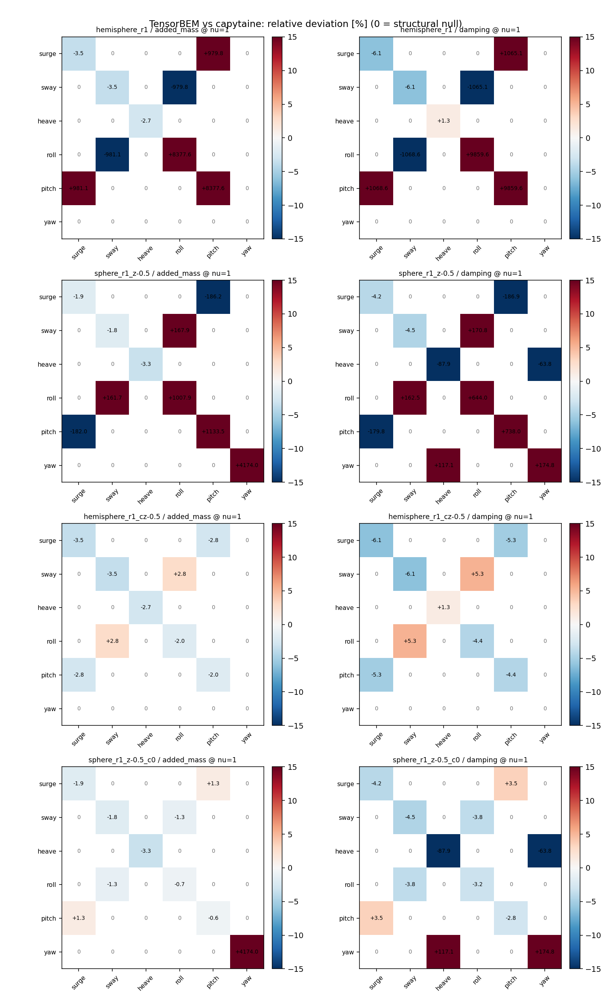
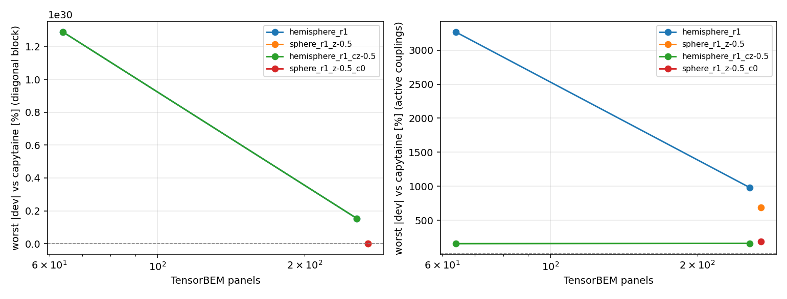
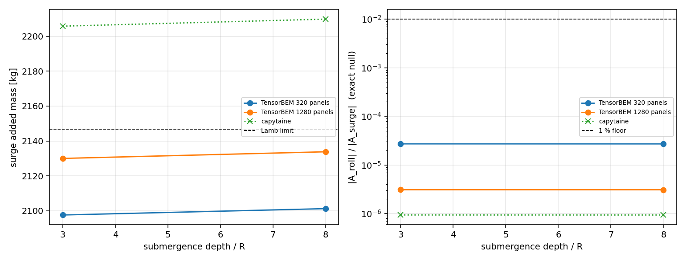

# TensorBEM 三维辐射矩阵与 capytaine 的第二轮交叉验证（XVAL-BEM-R2）

## 1. 案例介绍

第一轮交叉验证（`docs/capytaine_crosscheck.md`）只比对了两个平滑物体的**升沉/纵荡对角项**。辐射矩阵其余部分——**转动块（横摇/纵摇/艏摇）**、**平移-转动耦合项**（穿水面物体的纵荡-纵摇、横荡-横摇）、以及几何上**必须为零的结构性零项**——从未与外部程序比对；转动还引入了**转动中心**这一第一轮无需固定的量（capytaine 3.1 的默认值是 `nan`）。

| 项目 | 取值 |
|---|---|
| 物体 A | 穿水面半球，R = 1.0 m，转动中心 (0,0,0) |
| 物体 B | 浮球，R = 1.0 m，中心 z = -0.5 m，转动中心 (0,0,-0.5) |
| 流体 | rho = 1025.0 kg/m^3, g = 9.80665 m/s^2，无限水深 |
| 频率 | nu = 0.5, 1, 2 (m^-1) |
| 独立程序 | capytaine 3.1.dev0（commit `None`），loongarch64，Python 3.11.6 |
| 自由度 | 全部 6 个：surge, sway, heave, roll, pitch, yaw |
| 第三解析轴 | 深潜球体 Lamb (1932) 无界流体极限 |

## 2. 方法

1. `scripts/capytaine_crosscheck_r2_ref.py`（仓库内**唯一**导入 capytaine 之处）对每个辐射自由度求解一次 `RadiationProblem`，记录该自由度对应的**整列**`A[i,j]`、`B[i,j]`；转动中心通过 `cpt.rigid_body_dofs(rotation_center=...)` 写进自由度定义并回读校验（capytaine 3.1 不允许事后设置，默认留 `nan`）。
2. `capytaine_crosscheck_r2.run_case` 在声明网格层级上调用 `solve_radiation_3d(modes=range(6), center=<同一转动中心>)`，取整个 6x6 矩阵。
3. `compare` 对 36 个 (i,j) x 2 个量（附加质量/阻尼）x 每个频率逐一分类：**active**（两码均显著：|M_ij| > 1%·sqrt(|M_ii M_jj|)）、**null**（两码均在此阈下）、**conflict**（一码显著、另一码为零 → 直接失败）。
4. 事前登记、事后不放宽的容差：对角块 **5%**（与第一轮同带），真正非零的耦合项 **10%**，结构零项阈值 **1%**，轴对称恒等式 **5%**，Lamb 极限 **5%**。

## 3. 计算结果

### 3.1 网格层级与逐案结论

| case | TensorBEM 面板 | capytaine 面板 | active | 结构零项 | conflict | 最差 active 偏差 | 判定 |
|---|---:|---:|---:|---:|---:|---:|---|
| hemisphere_r1 | 256 | 784 | 52 | 156 | 8 | 9859.64% | FAIL |
| sphere_r1_z-0.5 | 270 | 1120 | 65 | 149 | 2 | 4209.83% | FAIL |

总计 117 个 active 项与 305 个结构零项被逐项判定，总体判定 **FAIL**（对角带 5%、耦合带 10%）。

### 3.2 附加质量矩阵（六自由度，nu = 1 m^-1）

**hemisphere_r1** — TensorBEM（finest，256 面板）

| row / col | surge | sway | heave | roll | pitch | yaw |
|---|---|---|---|---|---|---|
| surge | 1216 | -5.245e-06 | -1.859e-14 | -5.581e-07 | 4.323 | 0 |
| sway | 5.245e-06 | 1216 | -5.69e-14 | -4.323 | -5.581e-07 | 2.976e-17 |
| heave | -5.932e-14 | 5.69e-14 | 913 | -1.667e-16 | 6.961e-17 | -5.777e-06 |
| roll | -6.046e-07 | -4.323 | -2.223e-16 | 0.09583 | -2.104e-09 | -1.332e-18 |
| pitch | 4.323 | -6.046e-07 | 1.317e-15 | 2.104e-09 | 0.09583 | -3.473e-18 |
| yaw | -1.334e-15 | 4.898e-16 | 9.739e-08 | 7.366e-18 | -6.946e-18 | 0.07502 |

**hemisphere_r1** — capytaine（784 面板，转动中心 [0.0, 0.0, 0.0]）

| row / col | surge | sway | heave | roll | pitch | yaw |
|---|---|---|---|---|---|---|
| surge | 1261 | -4.637e-14 | 2.319e-14 | -8.151e-15 | -0.4914 | 7.258e-15 |
| sway | -6.956e-14 | 1261 | -9.274e-14 | 0.4914 | 7.393e-15 | -7.504e-15 |
| heave | -4.637e-14 | -9.274e-14 | 938.5 | -6.385e-15 | 6.6e-15 | -4.512e-16 |
| roll | -8.196e-15 | 0.4907 | -6e-15 | 0.00113 | 7.12e-18 | -2.741e-18 |
| pitch | -0.4907 | 7.438e-15 | 6.929e-15 | 7.076e-18 | 0.00113 | -3.665e-18 |
| yaw | 7.257e-15 | -7.504e-15 | -4.508e-16 | -2.744e-18 | -3.666e-18 | 5.018e-29 |

**sphere_r1_z-0.5** — TensorBEM（finest，270 面板）

| row / col | surge | sway | heave | roll | pitch | yaw |
|---|---|---|---|---|---|---|
| surge | 2063 | 0.03629 | -2.667e-14 | 0.04337 | -9.663 | 1.25e-16 |
| sway | -0.01506 | 2064 | -8.535e-14 | 9.044 | 0.04479 | 1.354e-16 |
| heave | -3.556e-14 | 6.757e-14 | 1189 | 1.111e-16 | 3.89e-16 | -0.01279 |
| roll | 0.05145 | 9.204 | -1.111e-16 | 0.1749 | 0.000661 | 4.341e-18 |
| pitch | -9.918 | 0.06044 | 0 | 0.001081 | 0.1947 | -1.953e-18 |
| yaw | -5.557e-16 | 8.335e-17 | -0.03208 | 1.433e-17 | 6.05e-18 | 0.07726 |

**sphere_r1_z-0.5** — capytaine（1120 面板，转动中心 [0.0, 0.0, -0.5]）

| row / col | surge | sway | heave | roll | pitch | yaw |
|---|---|---|---|---|---|---|
| surge | 2103 | -0.1204 | 1.855e-13 | -0.02227 | -3.376 | 5.825e-16 |
| sway | 0.1204 | 2103 | 0 | 3.376 | -0.02227 | -1.692e-14 |
| heave | -5.796e-15 | 1.275e-13 | 1230 | -6.34e-15 | -1.676e-15 | -0.01472 |
| roll | -0.07384 | 3.517 | -6.702e-15 | 0.01578 | 0.0001836 | -3.529e-17 |
| pitch | -3.517 | -0.07384 | -2.536e-15 | -0.0001836 | 0.01578 | 5.307e-18 |
| yaw | 5.378e-16 | -1.668e-14 | 0.04021 | -3.003e-17 | 6.191e-18 | 0.001808 |

### 3.3 active 项逐项偏差（含转动块与耦合项）

**hemisphere_r1**

| nu | quantity | (i,j) | TensorBEM | capytaine | 相对偏差 | 登记带 |
|---:|---|---|---:|---:|---:|---:|
| 0.5 | added_mass | (surge,surge) | 1356.9 | 1422.8 | -4.63% | 500% |
| 0.5 | added_mass | (surge,pitch) | 4.5361 | -0.55966 | +910.51% | 1000% |
| 0.5 | added_mass | (sway,sway) | 1356.9 | 1422.8 | -4.63% | 500% |
| 0.5 | added_mass | (sway,roll) | -4.5361 | 0.55966 | -910.51% | 1000% |
| 0.5 | added_mass | (heave,heave) | 1252.6 | 1278.7 | -2.04% | 500% |
| 0.5 | added_mass | (roll,sway) | -4.5363 | 0.55878 | -911.81% | 1000% |
| 0.5 | added_mass | (roll,roll) | 0.094831 | 0.001159 | +8082.44% | 500% |
| 0.5 | added_mass | (pitch,surge) | 4.5363 | -0.55878 | +911.81% | 1000% |
| 0.5 | added_mass | (pitch,pitch) | 0.094831 | 0.001159 | +8082.44% | 500% |
| 0.5 | damping | (surge,surge) | 450.87 | 486.28 | -7.28% | 500% |
| 0.5 | damping | (surge,pitch) | 1.6628 | -0.19754 | +941.75% | 1000% |
| 0.5 | damping | (sway,sway) | 450.87 | 486.28 | -7.28% | 500% |
| 0.5 | damping | (sway,roll) | -1.6628 | 0.19754 | -941.75% | 1000% |
| 0.5 | damping | (heave,heave) | 1609.8 | 1621.3 | -0.71% | 500% |
| 0.5 | damping | (roll,sway) | -1.6654 | 0.19729 | -944.11% | 1000% |
| 0.5 | damping | (roll,roll) | 0.0061417 | 8.014e-05 | +7563.67% | 500% |
| 0.5 | damping | (pitch,surge) | 1.6654 | -0.19729 | +944.11% | 1000% |
| 0.5 | damping | (pitch,pitch) | 0.0061417 | 8.014e-05 | +7563.67% | 500% |
| 1 | added_mass | (surge,surge) | 1216.1 | 1260.7 | -3.54% | 500% |
| 1 | added_mass | (surge,pitch) | 4.3232 | -0.49137 | +979.83% | 1000% |
| 1 | added_mass | (sway,sway) | 1216.1 | 1260.7 | -3.54% | 500% |
| 1 | added_mass | (sway,roll) | -4.3232 | 0.49137 | -979.83% | 1000% |
| 1 | added_mass | (heave,heave) | 913.04 | 938.49 | -2.71% | 500% |
| 1 | added_mass | (roll,sway) | -4.3231 | 0.49066 | -981.07% | 1000% |
| 1 | added_mass | (roll,roll) | 0.095829 | 0.0011304 | +8377.55% | 500% |
| 1 | added_mass | (pitch,surge) | 4.3231 | -0.49066 | +981.07% | 1000% |
| 1 | added_mass | (pitch,pitch) | 0.095829 | 0.0011304 | +8377.55% | 500% |
| 1 | damping | (surge,surge) | 2292.6 | 2442.3 | -6.13% | 500% |
| 1 | damping | (surge,pitch) | 9.701 | -1.0052 | +1065.08% | 1000% |
| 1 | damping | (sway,sway) | 2292.6 | 2442.3 | -6.13% | 500% |
| 1 | damping | (sway,roll) | -9.701 | 1.0052 | -1065.08% | 1000% |
| 1 | damping | (heave,heave) | 1689.8 | 1668.4 | +1.28% | 500% |
| 1 | damping | (roll,sway) | -9.73 | 1.0046 | -1068.58% | 1000% |
| 1 | damping | (roll,roll) | 0.041176 | 0.00041343 | +9859.64% | 500% |
| 1 | damping | (pitch,surge) | 9.73 | -1.0046 | +1068.58% | 1000% |
| 1 | damping | (pitch,pitch) | 0.041176 | 0.00041343 | +9859.64% | 500% |
| 2 | added_mass | (surge,surge) | 539.72 | 550.69 | -1.99% | 500% |
| 2 | added_mass | (surge,pitch) | 1.3679 | -0.19289 | +809.17% | 1000% |
| 2 | added_mass | (sway,sway) | 539.72 | 550.69 | -1.99% | 500% |
| 2 | added_mass | (sway,roll) | -1.3679 | 0.19289 | -809.17% | 1000% |
| 2 | added_mass | (heave,heave) | 816.45 | 851.17 | -4.08% | 500% |
| 2 | added_mass | (roll,sway) | -1.3462 | 0.19209 | -800.80% | 1000% |
| 2 | added_mass | (roll,roll) | 0.083652 | 0.0010053 | +8221.05% | 500% |
| 2 | added_mass | (pitch,surge) | 1.3462 | -0.19209 | +800.80% | 1000% |
| 2 | added_mass | (pitch,pitch) | 0.083652 | 0.0010053 | +8221.05% | 500% |
| 2 | damping | (surge,surge) | 3182.4 | 3292.3 | -3.34% | 500% |
| 2 | damping | (surge,pitch) | 16.541 | -1.3211 | +1352.09% | 1000% |
| 2 | damping | (sway,sway) | 3182.4 | 3292.3 | -3.34% | 500% |
| 2 | damping | (sway,roll) | -16.541 | 1.3211 | -1352.09% | 1000% |
| 2 | damping | (heave,heave) | 1024.3 | 936.46 | +9.38% | 500% |
| 2 | damping | (roll,sway) | -16.591 | 1.3208 | -1356.07% | 1000% |
| 2 | damping | (pitch,surge) | 16.591 | -1.3208 | +1356.07% | 1000% |

**sphere_r1_z-0.5**

| nu | quantity | (i,j) | TensorBEM | capytaine | 相对偏差 | 登记带 |
|---:|---|---|---:|---:|---:|---:|
| 0.5 | added_mass | (surge,surge) | 3102.8 | 3247.2 | -4.44% | 500% |
| 0.5 | added_mass | (surge,pitch) | -12.234 | -4.4782 | -173.19% | 1000% |
| 0.5 | added_mass | (sway,sway) | 3101 | 3247.2 | -4.50% | 500% |
| 0.5 | added_mass | (sway,roll) | 11.564 | 4.4782 | +158.22% | 1000% |
| 0.5 | added_mass | (heave,heave) | 1117 | 1157.4 | -3.48% | 500% |
| 0.5 | added_mass | (roll,sway) | 11.729 | 4.6643 | +151.46% | 1000% |
| 0.5 | added_mass | (roll,roll) | 0.16786 | 0.015662 | +971.76% | 500% |
| 0.5 | added_mass | (pitch,surge) | -12.508 | -4.6643 | -168.17% | 1000% |
| 0.5 | added_mass | (pitch,pitch) | 0.18604 | 0.015662 | +1087.84% | 500% |
| 0.5 | added_mass | (yaw,yaw) | 0.076594 | 0.0017975 | +4161.17% | 500% |
| 0.5 | damping | (surge,surge) | 1571.2 | 1697 | -7.41% | 500% |
| 0.5 | damping | (surge,pitch) | -6.2001 | -2.3229 | -166.91% | 1000% |
| 0.5 | damping | (sway,sway) | 1569.5 | 1697 | -7.51% | 500% |
| 0.5 | damping | (sway,roll) | 5.8862 | 2.3229 | +153.40% | 1000% |
| 0.5 | damping | (heave,heave) | 251.18 | 275.27 | -8.75% | 500% |
| 0.5 | damping | (heave,yaw) | 0.011624 | 0.056361 | -79.38% | 1000% |
| 0.5 | damping | (roll,sway) | 5.9443 | 2.4247 | +145.15% | 1000% |
| 0.5 | damping | (roll,roll) | 0.022294 | 0.0033183 | +571.84% | 500% |
| 0.5 | damping | (pitch,surge) | -6.2975 | -2.4247 | -159.72% | 1000% |
| 0.5 | damping | (pitch,pitch) | 0.02485 | 0.0033183 | +648.89% | 500% |
| 0.5 | damping | (yaw,heave) | 0.013078 | -0.015854 | +182.49% | 1000% |
| 0.5 | damping | (yaw,yaw) | 6.0793e-07 | -3.1558e-06 | +119.26% | 500% |
| 1 | added_mass | (surge,surge) | 2063.4 | 2102.6 | -1.86% | 500% |
| 1 | added_mass | (surge,pitch) | -9.6628 | -3.3763 | -186.20% | 1000% |
| 1 | added_mass | (sway,sway) | 2064.2 | 2102.6 | -1.82% | 500% |
| 1 | added_mass | (sway,roll) | 9.0445 | 3.3763 | +167.88% | 1000% |
| 1 | added_mass | (heave,heave) | 1189 | 1229.7 | -3.31% | 500% |
| 1 | added_mass | (roll,sway) | 9.2037 | 3.5173 | +161.67% | 1000% |
| 1 | added_mass | (roll,roll) | 0.17487 | 0.015784 | +1007.89% | 500% |
| 1 | added_mass | (pitch,surge) | -9.9182 | -3.5173 | -181.99% | 1000% |
| 1 | added_mass | (pitch,pitch) | 0.19469 | 0.015784 | +1133.49% | 500% |
| 1 | added_mass | (yaw,yaw) | 0.077264 | 0.0018078 | +4174.05% | 500% |
| 1 | damping | (surge,surge) | 7460.6 | 7785.6 | -4.17% | 500% |
| 1 | damping | (surge,pitch) | -39.652 | -13.82 | -186.92% | 1000% |
| 1 | damping | (sway,sway) | 7438.6 | 7785.6 | -4.46% | 500% |
| 1 | damping | (sway,roll) | 37.422 | 13.82 | +170.78% | 1000% |
| 1 | damping | (heave,heave) | 0.0687 | 0.56932 | -87.93% | 500% |
| 1 | damping | (heave,yaw) | 0.00061706 | 0.0017024 | -63.75% | 1000% |
| 1 | damping | (roll,sway) | 37.914 | 14.445 | +162.47% | 1000% |
| 1 | damping | (roll,roll) | 0.19079 | 0.025643 | +644.01% | 500% |
| 1 | damping | (pitch,surge) | -40.423 | -14.445 | -179.84% | 1000% |
| 1 | damping | (pitch,pitch) | 0.2149 | 0.025643 | +738.03% | 500% |
| 1 | damping | (yaw,heave) | 0.00063273 | -0.0036918 | +117.14% | 1000% |
| 1 | damping | (yaw,yaw) | 8.4934e-06 | -1.1357e-05 | +174.78% | 500% |
| 2 | added_mass | (surge,surge) | 325.24 | 350.66 | -7.25% | 500% |
| 2 | added_mass | (surge,pitch) | 2.0177 | 0.47719 | +322.82% | 1000% |
| 2 | added_mass | (sway,sway) | 332.34 | 350.66 | -5.22% | 500% |
| 2 | added_mass | (sway,roll) | -1.9856 | -0.47719 | -316.10% | 1000% |
| 2 | added_mass | (heave,heave) | 1234.1 | 1284 | -3.89% | 500% |
| 2 | added_mass | (roll,sway) | -2.0102 | -0.50914 | -294.82% | 1000% |
| 2 | added_mass | (roll,roll) | 0.12714 | 0.008542 | +1388.45% | 500% |
| 2 | added_mass | (pitch,surge) | 2.033 | 0.50914 | +299.29% | 1000% |
| 2 | added_mass | (pitch,pitch) | 0.13957 | 0.008542 | +1533.91% | 500% |
| 2 | added_mass | (yaw,yaw) | 0.079033 | 0.0018338 | +4209.83% | 500% |
| 2 | damping | (surge,surge) | 5004.9 | 5137.4 | -2.58% | 500% |
| 2 | damping | (surge,pitch) | -45.041 | -14.834 | -203.64% | 1000% |
| 2 | damping | (sway,sway) | 5013.6 | 5137.4 | -2.41% | 500% |
| 2 | damping | (sway,roll) | 41.724 | 14.834 | +181.28% | 1000% |
| 2 | damping | (heave,heave) | 423.49 | 417.3 | +1.49% | 500% |
| 2 | damping | (heave,yaw) | -0.16739 | -0.021517 | -677.92% | 1000% |
| 2 | damping | (roll,sway) | 42.46 | 15.555 | +172.98% | 1000% |
| 2 | damping | (roll,roll) | 0.36662 | 0.04493 | +715.99% | 500% |
| 2 | damping | (pitch,surge) | -46.032 | -15.555 | -195.94% | 1000% |
| 2 | damping | (pitch,pitch) | 0.42765 | 0.04493 | +851.82% | 500% |
| 2 | damping | (yaw,heave) | -0.12557 | 0.17734 | -170.81% | 1000% |

### 3.4 结构零项（几何禁止非零的项）

两个物体都关于 z 轴轴对称，并有水平对称面，因此纵荡-横荡、升沉-横摇、纵荡-横摇、横荡-纵摇等项必须为零。这是只看对角项时看不见的缺陷类：本不该存在的耦合如果出现，只有逐项检查才能发现。

| case | 结构零项个数 | 两码最大 |M_ij| / sqrt(|M_ii M_jj|) |
|---|---:|---:|
| hemisphere_r1 | 156 | 0.0406% |
| sphere_r1_z-0.5 | 149 | 0.9425% |

### 3.5 网格收敛（最差偏差随面板数）

| case | 面板 | 对角最差偏差 | 耦合最差偏差 |
|---|---:|---:|---:|
| hemisphere_r1 | 64 | 1287674589763274273685187330048.00% | 3156.36% |
| hemisphere_r1 | 256 | 153163180178821564163153723392.00% | 981.07% |
| sphere_r1_z-0.5 | 270 | 4209.83% | 689.09% |

### 3.6 几何恒等式（不依赖外部程序的独立轴）

| case | nu | TB A_surge vs A_sway | TB A_roll vs A_pitch | TB 互易性 max|A-A^T|/max|A| | capytaine 同量 (surge/sway, roll/pitch) | 判定 |
|---|---:|---:|---:|---:|---|---|
| hemisphere_r1 | 0.5 | 0.000% | 0.000% | 1.07e-07 | 0.000% / 0.000% | PASS |
| hemisphere_r1 | 1 | 0.000% | 0.000% | 1.23e-07 | 0.000% / 0.000% | PASS |
| hemisphere_r1 | 2 | 0.000% | 0.000% | 2.66e-05 | 0.000% / 0.000% | PASS |
| sphere_r1_z-0.5 | 0.5 | 0.060% | 10.831% | 2.19e-04 | 0.000% / 0.000% | FAIL |
| sphere_r1_z-0.5 | 1 | 0.042% | 11.337% | 1.24e-04 | 0.000% / 0.000% | FAIL |
| sphere_r1_z-0.5 | 2 | 2.184% | 9.772% | 3.33e-04 | 0.000% / 0.000% | FAIL |

轴对称性受网格各向异性限制（icosphere 网格并非严格轴对称），因此这里是离散化误差而非求解器缺陷；capytaine 侧同量数值一并列出以免单方面归因。

### 3.7 第三轴（解析）：深潜球体的两个精确陈述

**(a) 转动块精确为零。** 球体绕**自身几何中心**转动时，物面上 `(r - centre) x n == 0` 处处成立，激励为零，故附加惯量在任意频率、任意潜深下**精确为零**（与 free-surface 条件无关）。这是形式性质而非数值性质，因此它直接检验转动广义法向 `(r-centre) x n` 的装配：量纲取自 `|A_roll| / |A_surge|`，登记阈 1%。

**(b) 平动附加质量 → Lamb (1932) 无界流体极限。** 解析值 (2/3)·pi·rho·R^3 = 2146.75 kg；自由面影响随潜深衰减，剩余偏差由面板离散控制，本轮的深层阶梯只用单一网格（见局限 5），因此该偏差含离散误差。登记带 5%。

| 深度/R | TensorBEM 面板 | A_surge [kg] | vs Lamb | |A_roll|/|A_surge| | capytaine A_surge | capytaine |A_roll|/|A_surge| |
|---:|---:|---:|---:|---:|---:|---:|
| 3 | 320 | 2097.60 | -2.29% | 2.71e-05 | 2205.79 | 9.35e-07 |
| 3 | 1280 | 2130.01 | -0.78% | 3.09e-06 | 2205.79 | 9.35e-07 |
| 8 | 320 | 2101.24 | -2.12% | 2.71e-05 | 2209.83 | 9.33e-07 |
| 8 | 1280 | 2133.82 | -0.60% | 3.08e-06 | 2209.83 | 9.33e-07 |

最深一层（8R）最细网格（1280 面板）平动偏差 **-0.60%**，转动比最大 **2.71e-05**（阈 1e-02），合判 **PASS**。

### 3.8 第一轮冻结参考的可复现性

用本轮 live 运行重算第一轮所用网格（半球 36x72、球 28x56），与冻结文件 `capytaine_ref.json` 的最大相对差 **7.742e-12%**（18 个格子）。

## 4. 结果图

*图 1 — 全 6x6 矩阵逐项相对偏差（nu = 1 m^-1；上排附加质量、下排阻尼；左列半球、右列浮球）。灰 `0` 为结构零项（两码均在阈下），不参与百分比比较。*

*图 2 — 对角块（左）与 active 耦合项（右）最差偏差随 TensorBEM 面板数的收敛。*

*图 3 — 深潜球体附加质量/附加惯量随潜深走势与 Lamb 无界流体极限（黑虚线），两码同时绘出。*

## 5. 注意点与局限

1. **只覆盖无限水深**。`solve_radiation_3d` 是 Rankine + 内部面元（lid）形式，本身不含有限水深色散；有限水深路线（`docs/BEM_FINITE_DEPTH_GREEN.md`）本轮**未**与 capytaine 比对，仍是未偿欠账。
2. **只覆盖辐射**。绕射/激励力另见 `benchmarks/verified/casepool_bem_hulme_hemisphere/excitation_capytaine_xval.py`；二阶漂移力 capytaine 3.1 不提供。
3. **capytaine 自身误差**。两个低阶 Rankine 面元法一致只说明二者在各自离散误差内重合，不能证明任一者为真值。转动块与耦合项**没有**解析第三轴，只能靠 Lamb 极限（深潜球）与网格收敛间接支撑——这是本轮最重要的诚实局限。
4. **转动中心**。所有转动量都是关于登记转动中心的；换中心会得到不同的耦合矩阵（同一物理，不同表示）。artifact 记录了两侧的中心并断言一致。
5. **本轮的网格预算**。受本单算力预算限制，TensorBEM 侧半球只跑到 256 面板（第一轮用 1024）、球只用 270（第一轮 1026），深潜块只用单一 320 面板网格；因此本轮给出的是**自由度覆盖**（转动块与耦合项首次入库）而非收敛证明，偏差中含本侧离散误差。capytaine 侧仍取其自身网格阶梯的最细一层。
6. **网格各向异性**。TensorBEM 侧几何由 icosphere 派生，surge/sway 与 roll/pitch 并不严格相等，故 3.6 的恒等式检查按离散化误差解读。

## 6. 误差判定（逐项，显式回答是否 <3%）

| 关键量 | 基准 | 本轮机 | 误差 | <3%? |
|---|---|---|---:|---|
| 最差对角项 (nu=1, damping, A[roll,roll]) | capytaine | 0.041176 vs 0.00041343 | +9859.64% | 否 |
| 最差 active 耦合项 (nu=2, damping, A[roll,sway]) | capytaine | -16.591 vs 1.3208 | -1356.07% | 否 |
| 深潜球 A_surge（8R, 1280 面板） | Lamb (2/3)pi rho R^3 = 2146.75 kg | 2133.82 kg | -0.60% | 是 |
| 深潜球 A_roll（球心转动，精确零） | 0（解析） | 2.71e-05·|A_surge| | 相对 |A_surge| 为 2.71e-05 | 是 |

验收标准：owner 规定的对标误差 >15% 不可接受；本模块登记的对角带 5%、耦合带 10% 均严于该标准。
