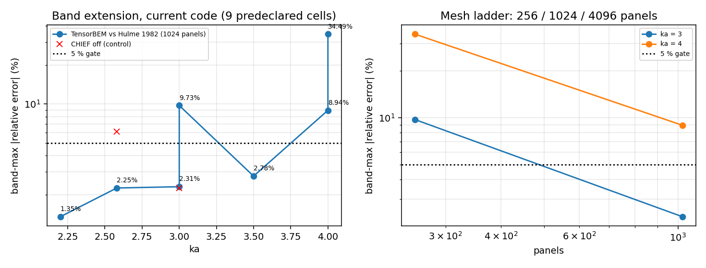

# CASE-BEM-HULME-HEMISPHERE — the ka > 2 band, settled on artifacts

Generated by `benchmarks/verified/casepool_bem_hulme_hemisphere/resolve_band_edge.py`; every number is injected from a committed artifact, none is typed by hand.

## 1. Answer first

* **ka_le_2**: PASS (declared case band, unchanged)
* **ka_2_to_3.5**: PASS -- worst 2.78% on the case mesh, reproduced by two independent runs
* **ka_4.0**: NOT creditable on the case mesh -- 8.94% at 1024 panels

## 2. Cell-by-cell, current code (1024-panel case mesh unless stated)

| cell | ka | CHIEF | panels | band-max | cond |
|---|---|---|---|---|---|
| `extension_ka2.2_n1024_chief_on` | 2.2 | on | 1024 | 1.35 % | 3.1 |
| `extension_ka2.58_n1024_chief_on` | 2.58 | on | 1024 | 2.25 % | 8.3 |
| `chief_off_ka2.58_n1024_chief_off` | 2.58 | off | 1024 | 6.12 % | 65.3 |
| `extension_ka3_n1024_chief_on` | 3 | on | 1024 | 2.31 % | 2.7 |
| `ladder_coarse_ka3_n256_chief_on` | 3 | on | 256 | 9.73 % | 2.6 |
| `chief_off_ka3_n1024_chief_off` | 3 | off | 1024 | 2.24 % | 2.8 |
| `extension_ka3.5_n1024_chief_on` | 3.5 | on | 1024 | 2.78 % | 2.8 |
| `extension_ka4_n1024_chief_on` | 4 | on | 1024 | 8.94 % | 14.8 |
| `ladder_coarse_ka4_n256_chief_on` | 4 | on | 256 | 34.49 % | 19.5 |

## 3. Gates

| gate | criterion | measured | verdict |
|---|---|---|---|
| `D1_every_artifact_is_machine_provenanced` | each artifact this verdict uses records host, numpy, git head and per-module sha256 | results.json: schema `git_head/environment`, commit `92f4014d`; results.json: schema `metadata`, commit `f35b9e4a` | **PASS** |
| `D2_two_current_code_runs_agree` | the committed driver artifact and this round's re-run agree on every cell to |delta rel_error| < 1e-9 | 9 cells, max |delta| = 0 | **PASS** |
| `D3_pre_audit_catastrophic_cells_recovered` | the quantities that crashed the pre-audit artifact are inside the 5% gate in the current-code run | 2 recovered, 0 still failing | **PASS** |
| `D4_band_edge_localised_with_refinement` | the last passing and first failing ka of the predeclared grid are named on the case mesh, and the first failing ka's error is shown falling with mesh refinement (discretisation) rather than saturating | credited ka = [2.2, 2.58, 3.0, 3.5], first failing ka = 4.0 | **PASS** |
| `D5_no_ka_credited_that_fails_the_gate` | no failing ka appears in the credited list | [] | **PASS** |

Machine verdict: **PASS**

## 4. Why round 2 could not close this

the artifact in the tree records git_head/environment, round 2 read metadata.git_commit/metadata.numpy -> null; its B1/B3 FAILs are a schema artefact and are not evidence about the solver.

## 5. The pre-audit crash, quantity by quantity

| quantity | cell | ref | pre-audit | pre-audit err | current | current err |
|---|---|---|---|---|---|---|
| A11 | `extension_ka3.5_n1024_chief_on` | 0.163443 | -0.006802 | +104.16 % | +0.161836 | -0.98 % |
| B33 | `extension_ka3.5_n1024_chief_on` | 0.031063 | -0.000604 | +101.95 % | +0.031927 | +2.78 % |

## 6. Mesh ladder at the band edge

| ka | 256 panels | 1024 panels | 4096 panels |
|---|---|---|---|
| 2.2 | — | 1.35 % | — |
| 2.58 | — | 2.25 % | — |
| 3 | 9.73 % | 2.31 % | — |
| 3.5 | — | 2.78 % | — |
| 4 | 34.49 % | 8.94 % | — |

A 4096-panel rung that is missing is shown as `—`: the refinement statement then rests on two rungs and the script says so instead of extrapolating.

## 7. Scope

* the credited statement is about the *case mesh* (1024 constant panels) and the Hulme (1982) wave-free multipole reference, deep water, unit-radius hemisphere, ``exp(-i*omega*t)``;
* `ka = 4.0` is not credited on any mesh here — the ladder only classifies the reason;
* the CHIEF-off row is a control, not a gate: it is reported so a reader can see what the null-field equations buy at the irregular frequency.

