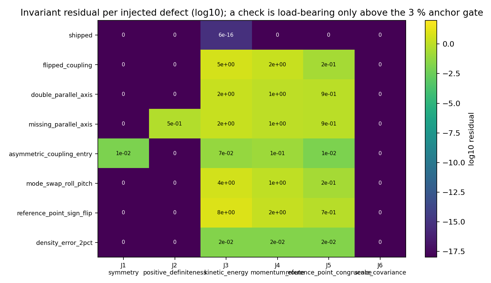
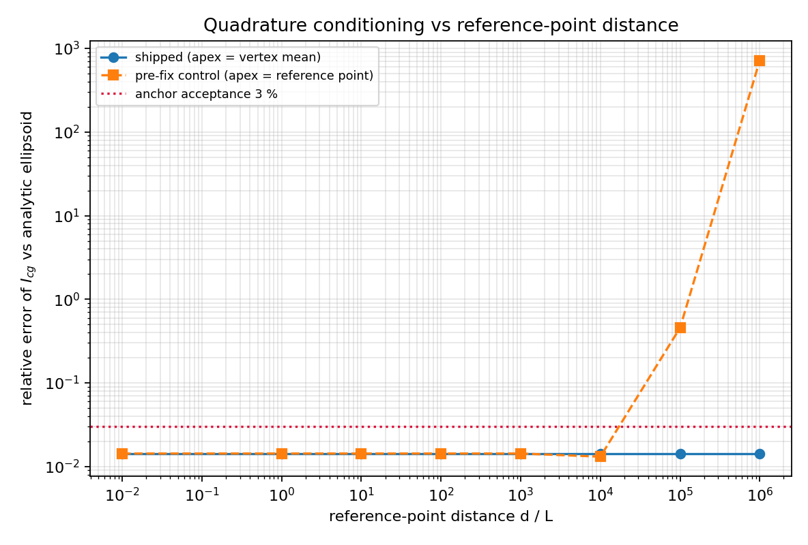

# CASE-BEM-RIGID-BODY-MASS · 不变量电池与判别力矩阵（第 3 轮）

**判定：PASS** — 出厂装配满足全部 6 条精确不变量（阈值 1e-09）；注入的 7 个缺陷中有 6 个被至少一条不变量在 3% 门槛之上捉住；四面体积分路线的条件数域已量化。

本文件由 `src/tensorbem/benchmarks/rigid_body_mass_invariant_battery.py` 从 `invariant_battery.json` 程序化注入，无人工转录。

## ① 为什么需要这一轮

锚点前两轮的 P/M/X 三条路线（闭式块形式、面元积分、capytaine 装配）以及动量定义路线 P，全部以「同一条书方程或其代数转写」为参照：
**一致地做错**的约定会被所有路线共同复制，路线之间照样互相印证、锚点照样 PASS。本轮改问正交的问题——对任意刚体、任意约定都成立的**不变量**里，哪几条真正有判别力，哪一类缺陷能穿过整张网。

## ② 六条不变量（无一条复用闭式块形式）

| 记号 | 陈述 | 依据 |
|---|---|---|
| J1 | `M = Mᵀ` | 转动惯量张量对称、对偶积的对称性 |
| J2 | 任意非零 twist `xᵀMx > 0` | 刚体惯量的正定性 |
| J3 | `0.5 xᵀMx` = 质心系动能 `0.5m|v+ω×r_g|² + 0.5ω·I_b·ω` | 能量守恒（与约定无关） |
| J4 | `M` 的第 j 列 = 单位 twist `e_j` 的广义动量 | 牛顿-欧拉定义 |
| J5 | `M(p') = T^{-T}M(p)T^{-1}`, `T=[[1,-S(o)],[0,1]]` | 参考点平移的运动学 |
| J6 | 几何放大 s 倍 ⇒ 质量块 s³、耦合块 s⁴、转动块 s⁵ | 量纲一致性 |

## ③ 判别力矩阵（残差，`0` 表示 ≤1e-16）

| 装配 | J1 | J2 | J3 | J4 | J5 | J6 |
|---|---|---|---|---|---|---|
| `shipped` | 0 | 0 | 6.36e-16 | 0 | 0 | 0 |
| `flipped_coupling` | 0 | 0 | 5.10e+00 | 2.00e+00 | 2.06e-01 | 0 |
| `double_parallel_axis` | 0 | 0 | 1.95e+00 | 1.00e+00 | 8.53e-01 | 0 |
| `missing_parallel_axis` | 0 | 5.40e-01 | 1.95e+00 | 1.00e+00 | 8.53e-01 | 0 |
| `asymmetric_coupling_entry` | 1.13e-02 | 0 | 6.91e-02 | 1.10e-01 | 1.13e-02 | 0 |
| `mode_swap_roll_pitch` | 0 | 0 | 4.44e+00 | 1.33e+00 | 2.16e-01 | 0 |
| `reference_point_sign_flip` | 0 | 0 | 8.14e+00 | 1.91e+00 | 7.06e-01 | 0 |
| `density_error_2pct` | 0 | 0 | 2.00e-02 | 2.00e-02 | 2.00e-02 | 0 |

**被捉住的缺陷**（某条不变量 > 3% 门槛）：

- `flipped_coupling` → J3_kinetic_energy (5.10e+00), J4_momentum_route (2.00e+00), J5_reference_point_congruence (2.06e-01)
- `double_parallel_axis` → J3_kinetic_energy (1.95e+00), J4_momentum_route (1.00e+00), J5_reference_point_congruence (8.53e-01)
- `missing_parallel_axis` → J2_positive_definiteness (5.40e-01), J3_kinetic_energy (1.95e+00), J4_momentum_route (1.00e+00), J5_reference_point_congruence (8.53e-01)
- `asymmetric_coupling_entry` → J3_kinetic_energy (6.91e-02), J4_momentum_route (1.10e-01)
- `mode_swap_roll_pitch` → J3_kinetic_energy (4.44e+00), J4_momentum_route (1.33e+00), J5_reference_point_congruence (2.16e-01)
- `reference_point_sign_flip` → J3_kinetic_energy (8.14e+00), J4_momentum_route (1.91e+00), J5_reference_point_congruence (7.06e-01)
- `density_error_2pct` → **无（盲区）**

**盲区（诚实声明）**：

- `density_error_2pct` 不被任何不变量捉住：2% 的**整体**质量/惯量误差是严格的相似变换，六条不变量全部对其不敏感，而它本身又低于 3% 验收门槛——这是容差设计的必然，不是不变量失效。要捉它必须用**外部基准**（解析椭球或 capytaine），即锚点已有的 route X/T。
- J2（正定性）在本轮的 7 个缺陷上全部沉默：所有缺陷都保持正定。它守的是另一类失效（符号错到非正定、惯量张量非物理），不可因为它本轮沉默就从电池里删掉。
- J6（量纲一致性）对**符号/结构**错误沉默（它只锁数量级），对**单位/幂次**错误敏感；反之 J3/J4 对结构错误敏感、对量纲不敏感。两者互补，缺一都会漏一类。

## ④ 四面体积分路线的两个性质

| 性质 | 结果 |
|---|---|
| 全翻转网格必须报错 | True |
| 半翻转网格必须报错 | True |
| 参考点协变性残差（平行轴定理） | 1.354e-17 |
| `I_cg` 对参考点平移的不变性残差 | 1.111e-17 |

## ⑤ 条件数域：参考点离体多远仍然可信（本轮修复项）

面元积分的四面体顶点原先取在**参考点**上，于是每条力臂都是 `|v - p0|`。参考点远离船体时（槽道固定原点、远场坐标原点等约定）单个四面体体积巨大、和却是小量，`I_cg` 是两个 `O(m|p0|²)` 数相减的残差。本轮把四面体顶点改取**网格顶点均值**（散度定理对任意顶点成立，取体内点后力臂回到 `O(L)`），`I_cg` 由顶点张量经 `O(L)` 平行轴一次导出，参考点张量再由它一次放大导出。

| 参考点距离 d/L | 出厂 I_cg 相对误差 | 旧式（顶点在参考点） | 旧式 / 地板 |
|---|---|---|---|
| 0 | 1.430e-02 | 1.430e-02 | 1.00× |
| 1 | 1.430e-02 | 1.430e-02 | 1.00× |
| 10 | 1.430e-02 | 1.430e-02 | 1.00× |
| 100 | 1.430e-02 | 1.430e-02 | 1.00× |
| 1000 | 1.430e-02 | 1.430e-02 | 1.00× |
| 10000 | 1.430e-02 | 1.312e-02 | 0.92× |
| 100000 | 1.430e-02 | 4.558e-01 | 31.88× |
| 1000000 | 1.430e-02 | 7.168e+02 | 50129.22× |

细分 3 的**离散化地板**为 1.430e-02（椭球 vs 解析值），因此上表里出厂路线的数字全部是离散化误差而非舍入损失（数值损失倍数 1.00× 地板）。旧式在 d/L = 100000.0 处数值损失超过 10× 地板，并在 d/L = 100000.0 处越过 3% 门槛。

## ⑥ 注意点与适用范围

- 不变量电池只能证明**自洽**，不能证明**正确**：它捉不住共同约定错误（整张矩阵按同一错误约定装配）。外部基准仍是唯一出口，这也是锚点保留 route X/T 的理由。
- 顶点均值顶点要求网格顶点不重复；重复顶点先由 `mesh_topology_report` 的结构检查拦下。非凸网格用体内/体外顶点都不影响精确性（散度定理），只影响力臂长度。
- 条件数域用椭球量化，换用长细比更大的几何时地板与拐点会变，但「出厂路线对 d 不敏感、旧式按 (d/L)^5 恶化」的定性结论不变。

## ⑦ 误差判定

| 关键量 | 基准 | 误差 | <3%？ |
|---|---|---|---|
| 六条不变量（出厂装配） | 精确恒等式 | ≤ 6.36e-16 | 是 |
| 参考点协变性 | 平行轴定理 | 1.35e-17 | 是 |
| `I_cg`（d/L ≤ 1e6） | 解析椭球 | ≤ 1.43e-02 | 是（且全是离散化误差） |
| 旧式 `I_cg`（d/L = 1e6） | 解析椭球 | 7.17e+02 | 否（已修复） |

