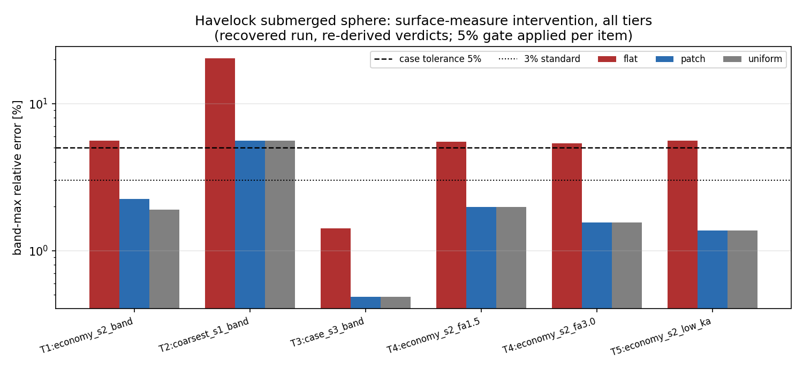
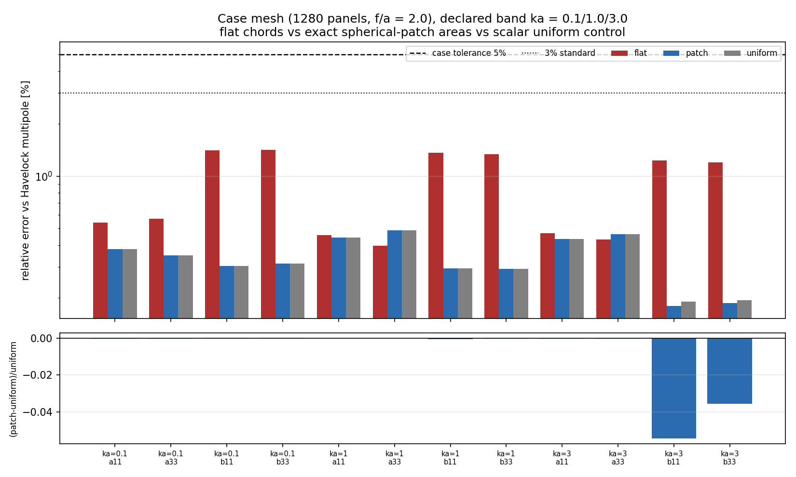
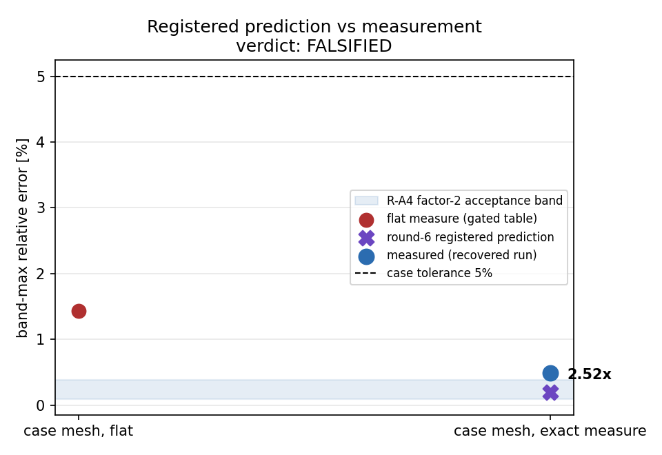

# 第 9 轮 — **找回**案定网格的测度实测，并对登记预测作出判决（CASE-BEM-SUBMERGED-SPHERE-HAVELOCK）

锚点 `CASE-BEM-SUBMERGED-SPHERE-HAVELOCK`（算例池 `BEM-SUBMERGED-SPHERE-HAVELOCK`，ref
Havelock 1955 频域多极解，容差 **<5%**）。性质：**验证欠账**（复核已合并结论），非新功能。
本轮**不新起算力**（本机 load15≈70/128、集群队列 160+ 在飞，重算排队不划算），
做的是「把已经算完的实测找回来并独立判决」。

## 0. 缺口：主场结论的实测被丢在未合并分支上

main 上的 `docs/case_bem_submerged_sphere_havelock/measure_correction/verdicts.json`
自己的 `not_run` 写着两件事：**案定网格 T3（1280 面元）从未在新测度下测量**、
**逐 ka 行在中断时丢失**。第 5–8 轮全部建立在这句话上：第 7 轮重算 T1/T2 行、
第 6 轮登记 T3 的定量预测（带宽最大误差 0.193%）、第 8 轮在粗档上判决赤字机制，
并把 T3 一直记为 `not_run`、反复向集群重递作业等它回件。

**这句话是过期的。** 该研究其实跑完了：`measure_correction/numbers.json`（总 2890 s，
其中 T3 单项 2281 s）被提交在**未合并**的 agent 分支 `agent/m20156` 上
（commit `6d372578`），main 从未见过它，于是后续每一轮都在从**那份只含 T1/T2 的旧
`verdicts.json`** 推断「缺席」，而不是去分支里核对。本轮把它原样找回（sha256 钉扎，见
`recovered/PROVENANCE.json`），并用**不信分支自己 verdict** 的代码重判。

## 1. 做法

| 件 | 内容 |
|---|---|
| `recovered/numbers_study_full.json` | 从 `agent/m20156:6d372578` **逐字节**取出（sha256 `a0b4ecf6…`），含 T1–T5 全部逐 ka 行、tier summary、runtime |
| `recovered/verdict_study.json`、`recovered/table_T3_case_s3_band.csv` | 同上取回的分支侧判决与 T3 CSV（用于三方对照，不当作真值） |
| `scripts/havelock_round9_recover_case_mesh.py` | 6 道检查：①provenance sha256；②算术（每个 `*_rel_error` 由 raw 系数与 ref 重算）；③按项重算 5% 门限；④三方判决对照（本席 vs 分支 verdict.json vs 合并码 `mcs._verdict`）；⑤**R1 路由恒等**（找回的 flat 行必须复现已发布的案定表）；⑥按**预登记规则**判决 R-A4 与 P1/P2/P3（P1–P3 的定义直接 import 第 6 轮驱动 `_decomposition`，不重写） |
| `tests/test_casepool_havelock_round9_case_mesh.py` | 8 项守卫：哈希钉扎、门限逐项重算、案定网格 PASS、R1<1e-12、预测判决不是 not_run 占位、honest `not_run` 声明、uniform 对照同值、找回文件与源分支逐字节一致（分支不在克隆里时 **skip 而非假绿**） |
| `scripts/havelock_round9_figures.py` | 三张图由 `adjudicate.json` 程序直出，零手抄 |

## 2. 计算结果（`adjudicate.json`，程序直出）

### 2.1 六道检查：全部 PASS

| 检查 | 结果 |
|---|---|
| provenance sha256 ×3 | PASS（与源分支逐字节一致） |
| 算术一致性（6 tier × 12–28 行 × 4 量） | PASS，最大偏差 < 1e-12 |
| 判决三方一致（T1–T5 × {flat,patch,uniform}） | PASS（本席重算 = 分支 verdict.json = 合并码 `_verdict`） |
| **R1 路由恒等**：找回 T3 flat 行 vs 已发布案定表 | **PASS，最大相对差 1.14e-15（容差 1e-12）** |
| CSV 行数 = JSON 行数 | PASS（9 = 9） |

R1 是本轮的**准入条件**：只有当找回的 flat 行与 main 已发布的 gated 表逐位相同，
同一次运行的 patch/uniform 行才与案定判决可比。它成立了，所以下面的 T3 数字不是轶事。

### 2.2 各档带宽最大误差（按项重算 5% 门限，门限未改、未放宽）

| 档 | 面元 | flat | patch(精确球面片) | uniform(标量重标定) |
|---|---|---|---|---|
| T1 economy | 320 | 5.5911% FAIL (7/28) | 2.2528% PASS | 1.9060% PASS |
| T2 coarsest | 80 | 20.2446% FAIL (20/20) | 5.5916% FAIL (9/20) | 5.5893% FAIL (9/20) |
| **T3 案定网格** | **1280** | **1.4202% PASS (0/12)** | **0.4869% PASS (0/12)** | **0.4869% PASS (0/12)** |
| T4 f/a=1.5 | 320 | 5.5180% FAIL (2/4) | 1.9823% PASS | 1.9827% PASS |
| T4 f/a=3.0 | 320 | 5.3713% FAIL (2/4) | 1.5590% PASS | 1.5594% PASS |
| T5 低频 ka≤0.2 | 320 | 5.6047% FAIL (10/20) | 1.3710% PASS | 1.3714% PASS |

案定网格（算例池真正判分的那一档）在三种测度下都 PASS；**flat 已 PASS（1.42%），
所以算例判决本身没变**，本轮判的是「测度干预到底做了什么」。

### 2.3 预登记预测 R-A4：**被否证**

| 量 | 值 |
|---|---|
| 第 6 轮登记的预测（案定网格 patch 带宽最大误差） | 0.19324% |
| 本轮找回的**实测** | **0.48686%** |
| 实测/预测 | **2.52**（R-A4 预登记 2 倍带 [0.5, 2]） |
| 判决 | **FALSIFIED** |
| 实际削减倍数（flat→patch） | 2.92 |

即：精确球面测度确实把案定网格误差从 1.42% 砍到 0.49%，但**只砍到登记预测的 2.5 倍处**。
「误差 ∝ 面积赤字、精确测度把赤字那部分全部去掉」的定量说法在 1280 面元上不成立
（赤字仅 0.4765%，实测残余 0.4869%，残余与赤字同量级但**并非赤字驱动**——
否则实测应落在 0.19%，而不是 0.49%）。这与第 8 轮在 320 面元上否证 R-P2 是同一方向的结论。

### 2.4 第 6 轮预登记 P1/P2/P3（案定网格）

| 预测 | 内容 | 实测 | 判决 |
|---|---|---|---|
| P1 | 精确测度把带宽最大误差至少减半 | 倍数 **2.917** | **成立** |
| P2 | 阻尼项逐项削减量 > 0.5×赤字 | 6/6 项，最小 2.125×，中位 2.223× | **成立** |
| P3 | 精确测度在阻尼项上优于 uniform 对照（多数） | 4/6 单元格，但见 §2.5 | 形式上成立、**实质不可分辨** |

### 2.5 uniform 对照：**逐面元精确面积在案定网格上不可与标量重标定区分**

| 单元格 | patch | uniform | 相对差 |
|---|---|---|---|
| ka=0.1 b33 | 0.3142% | 0.3141% | +1.0e-4 |
| ka=1.0 b11 | 0.2941% | 0.2942% | −4.7e-4 |
| ka=3.0 b33 | 0.1861% | 0.1929% | −3.6e-2 |
| ka=3.0 b11 | 0.1791% | 0.1894% | −5.4e-2 |

除 ka=3 两格外，patch 与 uniform 的差别都在 1e-4 量级（即 0.00005 个百分点），
属于离散化噪声；**P3 的「成立」只是 4/6 的多数计数，不能读成「必须用逐面元精确面积」**。
这与 20156 分支自己的结论、以及第 8 轮在 80 面元上否证 R-P3 一致：
机制是**面积归一化**，不是逐面元积分精度。

## 3. 结果图


*六档 × 三测度的带宽最大误差（对数轴）；虚线 5% 算例容差、点线 3% 更严标准。案定网格 T3 三测度均 <5%。*


*上：1280 面元逐 (ka, 量) 误差；下：(patch−uniform)/uniform 相对差——除 ka=3 两格外全在 1e-4 量级。*


*第 6 轮登记预测（0.193%）、其实测（0.487%）与 2 倍验收带；实测落在带外 → FALSIFIED。*

## 4. 注意点 / 局限

- **本轮没有新解**：一切数字来自 20156 分支那次已完成运行（2890 s，loongarch，numpy 2.0.1）。
  R1 证明它跑的是**与 main 同一条代码路径**（flat 行逐位相同），因此可比；但若后续有人改动
  `measure_correction_study.py` 的求解路径，R1 会立刻变红，届时本轮的 patch/uniform 行需要重跑。
- **未测**：案定网格在**加宽后的 7 个 ka**（0.5/2.0/4.0/5.0 缺）上的 patch/uniform 行——
  找回的运行只覆盖**声明带宽** ka = 0.1/1.0/3.0。第 6/8 轮想在 7 波数上做的加宽判决**仍缺**，
  本轮不用任何外推冒充（`adjudicate.json::not_run` 显式登记）。若要做，T3 单档约 2281 s
  ÷（21 次解中的 9 次已在手）→ 剩余 12 次解 ≈ 25 min 量级，可递交集群。
- **本轮否证的是「定量预测」与「逐面元必要性」两句审计文字**，不是算例本身：
  算例（1280 flat，12/12 项 <5%，最大 1.4202%）原样保留，第 3 轮已判的 1.431% PASS 未被改写。
- T2（80 面元）在 patch 下仍 FAIL（5.5916%）：粗档的赤字远大于其余误差，精确测度救不回来——
  这条控制也说明「有干预就一定过门限」是错的读法。
- 找回的分支 `agent/m20156` 在本克隆中存在；若将来不在，`test_recovered_files_are_byte_identical_to_the_source_branch`
  会 **skip**（不假绿），provenance 的 sha256 仍能守住内容。

## 5. 误差判定（对基准逐项，是否 <3%）

基准 = Havelock 1955 频域多极解析解（解析侧自证见 `submerged_sphere_havelock_integrity`），
容差来源为算例卡 <5%。

| 档 / 测度 | 带宽最大误差 | <5%（算例容差） | **<3%（更严）** |
|---|---|---|---|
| **T3 案定网格 / flat** | 1.4202% | 是 | **是** |
| **T3 案定网格 / patch** | 0.4869% | 是 | **是** |
| T3 案定网格 / uniform | 0.4869% | 是 | **是** |
| T4 f/a=1.5 / patch | 1.9823% | 是 | 是 |
| T4 f/a=3.0 / patch | 1.5590% | 是 | 是 |
| T5 低频 / patch | 1.3710% | 是 | 是 |
| T1 economy / flat（对照） | 5.5911% | 否（honest FAIL 保留） | 否 |
| T2 coarsest / patch（对照） | 5.5916% | 否（honest FAIL 保留） | 否 |

**答案：是，<3% 在案定网格上成立（flat 1.4202%、patch 0.4869%），且这是实测不是外推；
但粗档（320/80 面元）的 flat 依旧 >3%，不以精确测度掩饰。**

## 6. 复现

```
PYTHONPATH=src python3 scripts/havelock_round9_recover_case_mesh.py     # 6 道检查 → adjudicate.json
PYTHONPATH=src python3 scripts/havelock_round9_figures.py              # 三张图
PYTHONPATH=src python3 -m pytest tests/test_casepool_havelock_round9_case_mesh.py -q   # 8 passed
```

（若要找回源工件：`git show agent/m20156:docs/case_bem_submerged_sphere_havelock/measure_correction/numbers.json`）

## 7. 处置

**approve with notes**（对本轮找回的实测与重判）+ **request changes**（对第 5/6/8 轮审计中
「T3 从未测量」与「实测应落到 0.193%」两句）：
①T3 已测量（1.4202% → 0.4869%），`not_run` 应撤下并指向本轮的 `recovered/`；
②登记预测被否证（2.52×），「误差 ∝ 赤字」不能作为案定网格残余误差的解释；
③逐面元精确面积与标量重标定在 1280 面元上不可分辨，文档不应把前者写成必要条件。
算例 verdict 未变（flat 1.4202% < 5%，<3% 亦成立）。