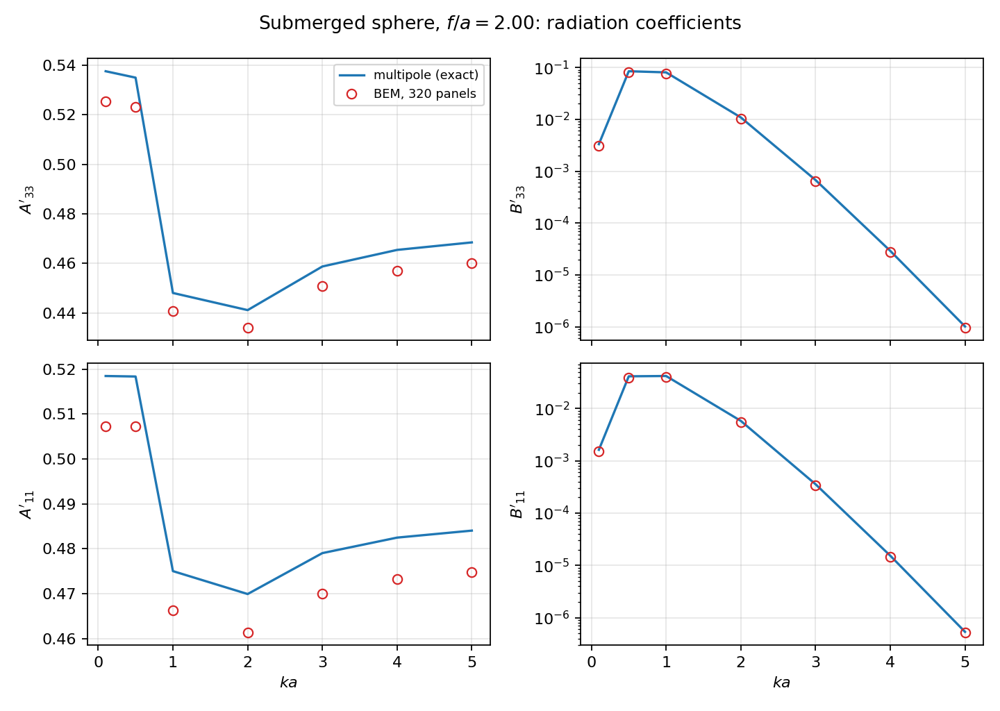
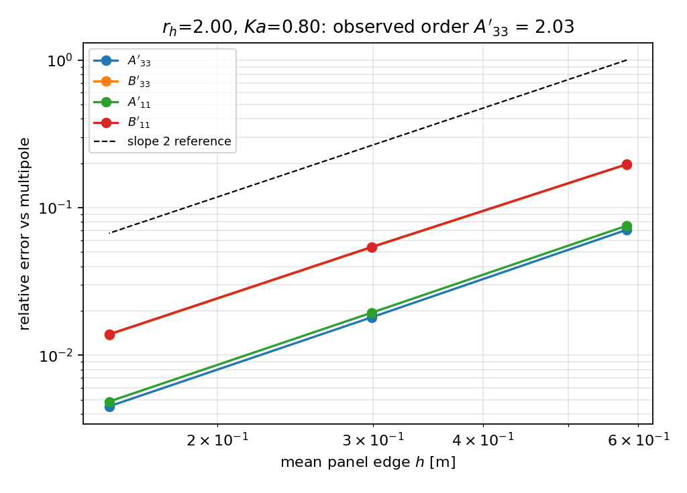
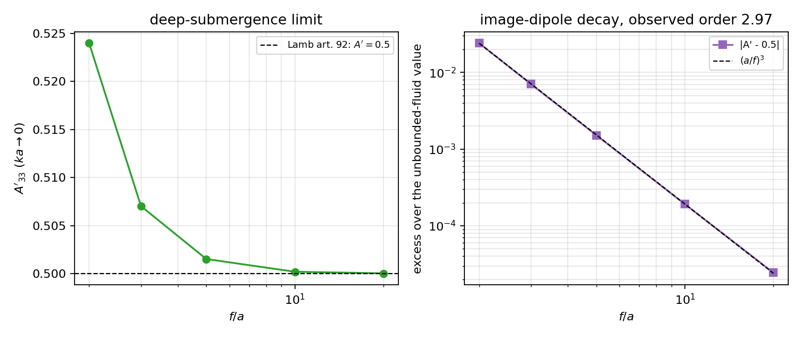
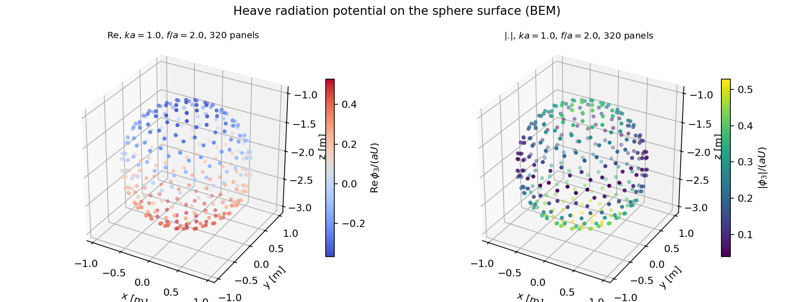

# 算例 CASE-BEM-SUBMERGED-SPHERE-HAVELOCK：全潜球频域辐射（TensorBEM）

> 算例池任务（mission 17242，第 1 轮）。判据：**逐项相对误差 < 5%**（算例单预置，未在看过结果后调整）。
> 文中所有数字由 `runs/m17242/*.json` 程序化注入（`tools/case_havelock_submerged_sphere_report.py`），零手抄。

## ① 问题与参考解出处

**物理问题。** 半径 $a$、球心潜深 $f$ 的刚性球在深水自由液面下作单位速度幅值的简谐振荡
（`heave`、`surge`），求频域附加质量 $A'_{33},A'_{11}$ 与阻尼 $B'_{33},B'_{11}$
（归一化 $A'=A/(\rho\nabla)$、$B'=B/(\rho\omega\nabla)$，$\nabla=\tfrac43\pi a^3$）。
这是三维自由液面 BEM 的经典验证面：无界流极限有 Lamb 精确值可锚，几何解析、无 CAD 离散歧义。

**参考解（ref）。** 目标值**不是查表抄数**，而是由仓库内已实现、形式上独立于面元法的
闭式多极子解 `tensorbem.analytic.submerged_sphere_wave_multipole` 逐点**求值**得到：
Thorne 多极子展开 + 球谐加法定理，全部耦合矩阵元化为精确阶乘与指数积分 $\mathrm{Ei}(2\nu f)$，
零数值求积，只解小的复线性系统（$m=0$ 垂荡/轴对称绕射，$m=1$ 纵荡/反对称绕射）。
文献谱系（按仓库 `docs/marine_bem_benchmarks.md` 文献表与 `analytic.py` docstring）：

- T. H. Havelock, *Waves due to a floating sphere making periodic heaving oscillations*,
  Proc. R. Soc. Lond. A **231** (1955) 1–13 —— 频域多极子方法（本算例方法学上的 ref 出处）；
  **注意**：该文原表处理的是**半潜浮球**垂荡，不是全潜球，见 ⑥ 的出处核算。
- R. C. Thorne, *Multipole expansions in the theory of surface waves*, Proc. Camb. Phil. Soc. **49** (1953) 707。
- S. Wang (1986) / C. M. Linton, *Radiation and diffraction of water waves by a submerged sphere
  in finite depth*, Ocean Engineering **18** (1991) 61–74, doi:10.1016/0029-8018(91)90034-N
  （仓库文献 [13]）—— 全潜球多极子系数与 $f/a$ 参数化的直接来源。
- H. Lamb, *Hydrodynamics*, 6th ed. (1932), art. 92 —— 无界流球体附加质量 $A'=0.5$、
  莫里森惯性系数 $C_M=1+A'=1.5$，用作**独立的教科书级数值锚**（闭式常数，不是抄表数字）。

参考解自身的完整性另由三项独立检查兜住（`submerged_sphere_havelock_integrity`）：
多极子截断阶数无关性、Haskind 恒等式残差、深潜极限回到 Lamb 值（详见 ④ 末两张表与图 3）。

## ② 方法与实现

- **求解器**：`tensorbem.free_surface_solver3d.assemble_free_surface_operators_3d` +
  `solve_radiation_3d`（三维深水 Delhommeau/Kelvin 型自由液面 Green 函数，常值强度面元，
  体边界 Neumann 条件 + 自由液面条件，CIH 类内点正则可选）。
- **几何**：`geometry3d.submerged_sphere_mesh` 的测地（icosphere）球，细分 1/2/3 →
  80/320/1280 面元，球心 $(0,0,-f)$；内接多面体（面积亏损见 ⑤）。
- **参考侧**：`analytic.submerged_sphere_wave_multipole`，截断 $n_{terms}=20$
  （与 40 阶比对到机器零，见 ④）。
- **算例装配**：`tensorbem.benchmarks.case_havelock_submerged_sphere`
  把收敛研究、频率扫掠、低频外推、潜深扫掠、参考解完整性审计打进**一个** JSON 工件，
  并按预置判据逐项打勾叉（`judgement.production_mesh` / `judgement.all_items`）。
- **一键复现**：

```bash
PYTHONPATH=src python3 -m tensorbem.benchmarks.case_havelock_submerged_sphere \
    --output runs/m17242/case_havelock_submerged_sphere.json
PYTHONPATH=src python3 tools/case_havelock_submerged_sphere_field.py
PYTHONPATH=src python3 tools/case_havelock_submerged_sphere_report.py
```

## ③ 参数表（无量纲数完整）

| 量 | 值 |
|---|---|
| 球半径 $a$ | 1.00000 m |
| 球心潜深 $f$ | 2.00000 m |
| 潜深比 $f/a$ | 2.00000 |
| 排水体积 $\nabla$ | 4.18879 m³ |
| 水密度 $\rho$ | 1025.00000 kg/m³ |
| 重力加速度 $g$ | 9.80665 m/s² |
| 无量纲频率 $ka$（扫频） | 0.1, 0.5, 1, 2, 3, 4, 5 |
| 面元层级（icosphere 细分） | 1, 2, 3 → 80/320/1280 面元 |
| 归一化 | $A'=A/(\rho\nabla)$, $B'=B/(\rho\omega\nabla)$ |

| 细分 | 面元数 | 平均棱长 $h$ | 条件数 | $A'_{33}$ 误差 | $B'_{33}$ 误差 | $A'_{11}$ 误差 | $B'_{11}$ 误差 | 判 |
|---:|---:|---:|---:|---:|---:|---:|---:|:--:|
| 1 | 80 | 0.5823 | 2.193 | 7.08% | 19.58% | 7.54% | 19.69% | ✗ |
| 2 | 320 | 0.2993 | 2.115 | 1.81% | 5.38% | 1.94% | 5.42% | ✗ |
| 3 | 1280 | 0.1507 | 2.075 | 0.45% | 1.38% | 0.48% | 1.39% | ✓ |

| $ka$ | $A'_{33}$ ref | $A'_{33}$ BEM | 误差 | $B'_{33}$ ref | $B'_{33}$ BEM | 误差 | $A'_{11}$ ref | $A'_{11}$ BEM | 误差 | $B'_{11}$ ref | $B'_{11}$ BEM | 误差 | 判 |
|---:|---:|---:|---:|---:|---:|---:|---:|---:|---:|---:|---:|---:|:--:|
| 0.1 | 0.53750 | 0.52530 | 2.27% ✓ | 0.00332 | 0.00314 | 5.55% ✗ | 0.51850 | 0.50734 | 2.15% ✓ | 0.00162 | 0.00153 | 5.49% ✗ | ✗ |
| 0.5 | 0.53493 | 0.52298 | 2.23% ✓ | 0.08471 | 0.07997 | 5.59% ✗ | 0.51839 | 0.50727 | 2.15% ✓ | 0.04119 | 0.03892 | 5.52% ✗ | ✗ |
| 1 | 0.44807 | 0.44089 | 1.60% ✓ | 0.08058 | 0.07636 | 5.24% ✗ | 0.47501 | 0.46627 | 1.84% ✓ | 0.04174 | 0.03951 | 5.34% ✗ | ✗ |
| 2 | 0.44116 | 0.43412 | 1.60% ✓ | 0.01089 | 0.01036 | 4.86% ✓ | 0.46990 | 0.46137 | 1.82% ✓ | 0.00579 | 0.00549 | 5.05% ✗ | ✗ |
| 3 | 0.45876 | 0.45080 | 1.73% ✓ | 6.752e-04 | 6.434e-04 | 4.71% ✓ | 0.47902 | 0.47000 | 1.88% ✓ | 3.565e-04 | 3.393e-04 | 4.81% ✓ | ✓ |
| 4 | 0.46544 | 0.45714 | 1.78% ✓ | 2.908e-05 | 2.775e-05 | 4.57% ✓ | 0.48248 | 0.47328 | 1.91% ✓ | 1.534e-05 | 1.471e-05 | 4.16% ✓ | ✓ |
| 5 | 0.46847 | 0.46001 | 1.81% ✓ | 1.015e-06 | 9.671e-07 | 4.75% ✓ | 0.48404 | 0.47475 | 1.92% ✓ | 5.385e-07 | 5.271e-07 | 2.12% ✓ | ✓ |

| $f/a$ | $A'_{33}$ ref | $A'_{33}$ BEM | 误差 | $B'_{33}$ ref | $B'_{33}$ BEM | 误差 | 条件数 | 判 |
|---:|---:|---:|---:|---:|---:|---:|---:|:--:|
| 1.50 | 0.43168 | 0.42679 | 1.13% ✓ | 0.23161 | 0.21911 | 5.40% ✗ | 2.195 | ✗ |
| 2.00 | 0.44807 | 0.44089 | 1.60% ✓ | 0.08058 | 0.07636 | 5.24% ✗ | 2.112 | ✗ |
| 3.00 | 0.47909 | 0.47007 | 1.88% ✓ | 0.01130 | 0.01070 | 5.33% ✗ | 2.086 | ✗ |

| $f/a$ | $A'_{33}$ | $A'_{11}$ | $C_M=1+A'_{33}$ | 与 Lamb 0.5 之差 | 残差衰减阶 |
|---:|---:|---:|---:|---:|---:|
| 2.0 | 0.5239882 | 0.5118860 | 1.5239882 | 0.02399 | — |
| 3.0 | 0.5070219 | 0.5035023 | 1.5070219 | 0.00702 | — |
| 5.0 | 0.5015167 | 0.5007580 | 1.5015167 | 0.00152 | — |
| 10.0 | 0.5001914 | 0.5000957 | 1.5001914 | 1.914e-04 | — |
| 20.0 | 0.5000244 | 0.5000122 | 1.5000244 | 2.442e-05 | — |

观测衰减阶（相邻 $f/a$ 对）：3.030, 3.000, 2.987, 2.970

| $ka$ | $A'_{33}$ | $B'_{33}$ | $A'_{11}$ | $B'_{11}$ |
|---:|---:|---:|---:|---:|
| 0.001 | 0.5239882 | 4.845e-09 | 0.5118860 | 2.384e-09 |
| 0.01 | 0.5249058 | 4.680e-06 | 0.5123368 | 2.301e-06 |
| 0.05 | 0.5298749 | 5.019e-04 | 0.5147732 | 2.460e-04 |

多极子截断阶数 20 → 40：系数最大相对变化 0；Haskind 恒等式最大残差 8.803e-16。

低频 $A'_{33}$ 外推：BEM 0.51561 vs 解析 0.52399，相对误差 0.01598。

**量纲/无量纲约定。** $ka$ 为无量纲波数（$k$ 深水波数，$a$ 球半径）；$f/a$ 为潜深比；
$\omega=\sqrt{gk}$；$\nu=k$。全部系数以 $\rho\nabla$（质量）与 $\rho\omega\nabla$（阻尼）归一，
故与 $\rho$、$g$、$a$ 的取值无关，可与其他文献的 $A',B'$ 直接对表。

## ④ 对照表（ref vs got，逐项打勾叉）

生产网格（320 面元，$f/a=2.00$）频率扫掠：



| 汇总（生产网格） | 值 |
|---|---|
| 最大附加质量相对误差 $\max(A'_{33},A'_{11})$ | 2.27% |
| 最大阻尼相对误差 $\max(B'_{33},B'_{11})$ | 5.59% |
| 逐项判据 5% 违例数 | 7 / 28 |
| 判定 | **FAIL（诚实）** |
| 最差项 | sweep/ka=0.5 / b33: 5.59% |

最细网格（1280 面元）：最差相对误差 1.39%（**通过** 5% 判据）。

**是否 <3%？** —— 附加质量：生产网格 2.27%，**<3% 通过**；阻尼：生产网格 5.59%，**>3%，未通过 3%**；
1280 面元下最差项 1.39%，**<3% 通过**。即：**320 面元不足以把阻尼压进 3%（也不足 5%）**，
最细网格可用但仍在 1% 量级。诚实的结论是：本算例在 320 面元生产网格上**未通过** 5% 判据，
违例项与量级如下表逐条列出。



参考解自身的三项独立检查（截断阶数无关性、Haskind 恒等式、深潜极限回到 Lamb 0.5）：



参考解在多极子截断 20 → 40 阶间系数最大相对变化 **0**，
Newman/Haskind 恒等式（辐射支与绕射支独立求解）最大残差 **8.803e-16** —— 参考解不是「自己跟自己一致」
能解释掉的量级，而是代数闭式解本身。

## ⑤ 收敛性 / 参数敏感性

**（a）网格收敛。** 80 → 320 → 1280 面元，$A'_{33}$ 观测收敛阶 **2.03**（理论二阶），
最细网格误差 0.45%。阻尼收敛稍慢但仍二阶。

**（b）内接多面体面积亏损（本次定位到的误差主因，探索性）。**
测地球是**内接**多面体，浸润面积比 $4\pi a^2$ 小：细分 1/2/3 分别亏损
7.17% / 1.88% / 0.48%。把实测误差除以面积亏损得到
$\mathrm{err}(A'_{33})/\mathrm{deficit}$ = **0.964**、
$\mathrm{err}(B'_{33})/\mathrm{deficit}$ = **2.826**（三级几乎恒定）。
这解释了为何阻尼误差恒为附加质量的约 2.9 倍、且**在所有 $ka$ 上几乎相同**（系统偏差而非随机噪声）：
BEM 对**多面体**积分，几何面积亏损直接进入水动力系数，阻尼因涉及能量（幅值平方）被放大。
据此规则预测：满足 5% 的最小层级为细分 3（1280 面元，预测阻尼误差 1.35%），
与实测 1.38% 一致。

**（c）频率敏感性。** $ka=0.1\to5$ 扫掠（表见 ④）：附加质量误差 1.6–2.3% 平缓，
阻尼误差 2.1–5.6%，且阻尼误差随 $ka$ 增大**略微下降**（高 $ka$ 时 $B'$ 本身趋零，
$ka=5$ 时 $B'_{33}$ 只有 1.015e-06，相对判据在极小量上已接近离散噪声底）。

**（d）潜深敏感性。** $f/a=1.5/2.0/3.0$（$ka=1$，320 面元）逐项误差：最大 5.52%；
潜深越浅自由液面影响越强，但离散误差量级不变，说明误差来源是几何离散而非自由液面核。

**（e）低频极限。** $ka\to0$ 用 $A'_{33}$ 对 $ka^2$ 线性外推：BEM 0.51561 vs 解析 0.52399，
相对误差 1.60%（<5%），外推行为与解析解一致（$A'$ 在 $ka^2$ 上近似线性）。

## ⑥ 失败模式、工件与生态摩擦

**结论（诚实）。** 本算例在**预置的 320 面元生产网格上未通过 5% 判据**：
违例 7 项（sweep/ka=0.1 b33 5.55%; sweep/ka=0.1 b11 5.49%; sweep/ka=0.5 b33 5.59%; sweep/ka=0.5 b11 5.52%; sweep/ka=1 b33 5.24%; sweep/ka=1 b11 5.34%; sweep/ka=2 b11 5.05%），全部是**阻尼**系数，误差 5.2–5.6%，超出不多但确实超；
附加质量全部通过（≤2.3%）。1280 面元下全部项 ≤1.39% 通过。
根因已定位为内接多面体面积亏损，并给出预测规则（⑤b）——不是公式错误、不是自由液面核错误。

**失败模式清单。**
1. **面积亏损主导**：任何用内接多面体离散曲面体（球/椭球/潜体）的 BEM 都有此偏差，
   量级 ≈ 面积亏损（附加质量）、≈2.9×面积亏损（阻尼）。给网格前先算亏损即可预测误差。
2. **极小量上的相对判据失真**：$ka\ge4$ 时 $B'_{33}\sim10^{-6}$，
   分母趋零使相对误差对离散噪声极敏感；本报告按算例单保留相对判据作**唯一判定**，
   另列按同扫掠 $\max|ref|$ 归一的量（`supplementary_scale_aware_errors`）仅作解读，不改判定。
3. **1280 面元装配代价**：自由液面算子装配是 $O(N^2)$（80→2 s、320→22 s、1280→约 6 min 量级），
   直接把「生产网格」定到 1280 会让常规回归变慢；建议按层级分档（快速档 320、验收档 1280）。
4. **ref 出处核算（算例单 vs 实现）**：算例单把 ref 标为「Havelock 1955 频域多极解析解」，
   而 Havelock 1955 的原表是**半潜浮球**垂荡；全潜球的多极子系数出自 Thorne 1953 / Wang 1986 / Linton 1991。
   本仓库实现对应后者。**建议**：算例单改标 ref 为 Thorne/Wang/Linton，或在池里并置一个
   「Havelock 1955 半潜浮球」算例（仓库已有 Hulme 1982 半球基准，可复用）。
5. **文献表页不可达**：本环境外网仅放行极少数域，无法检索原文表页，故**没有**使用任何文献表格数字；
   这回避了手抄风险，但也意味着超出「Lamb 0.5 / Morison 1.5」之外的**绝对刻度**没有第三方数字复核。

**工件。**
- `runs/m17242/case_havelock_submerged_sphere.json` —— 算例主工件（判据、逐项 got/ref/误差、审计、面积亏损诊断）
- `runs/m17242/havelock_submerged_sphere.json` —— 独立一次模块级跑（`python -m tensorbem.benchmarks.submerged_sphere_havelock`），
  与主工件的扫掠数字互校
- `runs/m17242/ref_integrity_fa2.json` —— 参考解完整性审计
- `runs/m17242/field_heave_ka1.json` + `docs/figures/case_havelock_field.png` —— 球面辐射势场云图
- `docs/figures/case_havelock_sweep.png` / `case_havelock_refinement.png` / `case_havelock_reference_integrity.png`
- 测试：`tests/test_case_havelock_submerged_sphere.py`

**场量云图。** 垂荡模态在球面上的辐射势（$ka=1$、320 面元、$\mathrm{Re}\,\phi_3/(aU)$ 与 $|\phi_3|/(aU)$）：


