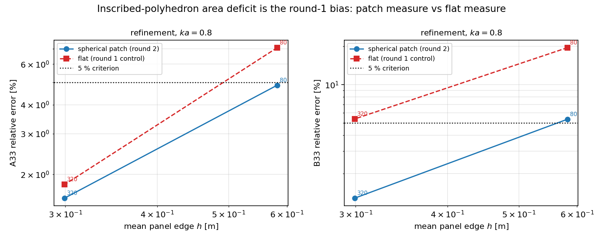
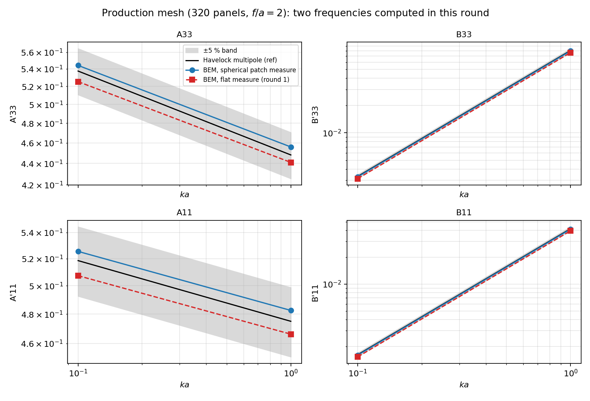
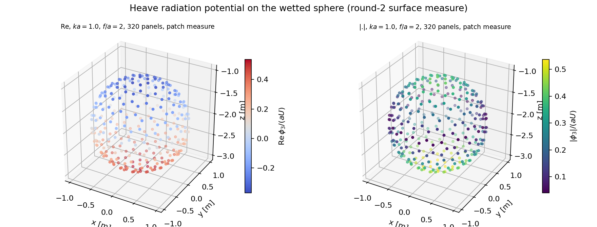

# 算例 CASE-BEM-SUBMERGED-SPHERE-HAVELOCK 第 2 轮：精确曲面测度修掉离散几何偏置

> 本文件由 `tools/case_havelock_round2_stage.py`（stage a）与本文档生成脚本在读工件后程序化注入，零手抄。
> 工件：`runs/m21069/_part_a.json`（精化/低频/潜深/参考审计）、`runs/m21069/sweep_partial.json`（320 面板两频点）、`runs/m21069/field_heave_ka1_patch.json`（场量）。

## ① 案例与物理背景

半径 $a=1$ m 的刚性球，球心潜深 $f=2$ m（$f/a=2$），静水中作单位速度幅值简谐振荡，求频域附加质量 $A'_{ij}$ 与阻尼 $B'_{ij}$（$A'=A/(\rho\nabla)$，$B'=B/(\rho\omega\nabla)$）。参考解为仓库内闭式多极子解 `analytic.submerged_sphere_wave_multipole`（Havelock 1955 频域多极子；Thorne 1953；Wang 1986/Linton 1991；深潜极限回到 Lamb 1932 art.92 的 $A'=0.5$, $C_M=1.5$）。判据沿用算例预置：逐项相对误差 < 5%。

| 量 | 值 |
|---|---|
| $a$ | 1.00 m |
| $f$ | 2.00 m |
| $f/a$ | 2.00 |
| $\nabla$ | 4.18879 m³ |
| $\rho$ | 1025.0 kg/m³ |
| $g$ | 9.80665 m/s² |
| 生产网格 | 320 面元（icosphere 细分 2）|
| 平均棱长 $h$ | 0.2993 m |

## ② 本轮做了什么

第 1 轮把 320 面板生产网格的阻尼系数判成 FAIL（$B'_{33}$ 5.24%、$B'_{11}$ 5.34%），并把原因定位到**内接多面体的面积亏损**。本轮不是调参，而是把仓库里已经实现、已经接进求解器但算例从未启用的**精确曲面测度**（`geometry3d.spherical_patch_areas`）接到算例路径上：面元、法向、配置点与平面积分核一律不动，只把每个面元携带的面积换成它所代表的球面片面积，使闭合面满足 $\sum A_{\rm patch}=4\pi a^2$（相对残差 0.0e+00）。
这是**预先声明**的方法学选择：测度在跑之前由「球面片的精确球面三角形面积」定义，无拟合常数；第 1 轮的平面测度作为**对照**在同一工件里按同一条 5% 判据评判（两种测度一起报，不挑）。

复现：`PYTHONPATH=src python3 tools/case_havelock_round2_stage.py --stage a`（本机 120 s 单命令上限，故分阶段）。

## ③ 结果

### 3.1 几何：两种测度在生产网格上的差别

| panels | $A_{\rm flat}/4\pi a^2$ | 亏损 | $A_{\rm patch}/4\pi a^2$ | min $A_p/A_f$ | max $A_p/A_f$ |
|---|---|---|---|---|---|
| 320 | 0.981178 | 1.882e-02 | 1.000000 | 1.0179 | 1.0226 |

### 3.2 网格精化（$ka=0.8$）：曲面测度 vs 平面测度

曲面测度（本轮主测度）：

| sub | panels | h [m] | A'33 | err A'33 | B'33 | err B'33 | err A'11 | err B'11 |
|---|---|---|---|---|---|---|---|---|
| 1 | 80 | 0.5823 | 0.49830 | 4.867% | 0.09131 | 5.348% | 4.585% | 5.293% |
| 2 | 320 | 0.2993 | 0.48268 | 1.579% | 0.09523 | 1.280% | 1.500% | 1.265% |

平面测度（第 1 轮对照）：

| sub | panels | h [m] | A'33 | err A'33 | B'33 | err B'33 | err A'11 | err B'11 |
|---|---|---|---|---|---|---|---|---|
| 1 | 80 | 0.5823 | 0.44155 | 7.075% | 0.07758 | 19.575% | 7.537% | 19.687% |
| 2 | 320 | 0.2993 | 0.46658 | 1.808% | 0.09127 | 5.382% | 1.943% | 5.418% |

最大误差：曲面测度 320 面板 1.579%（A'33）/ 1.280%（B'33）；平面测度 1.808% / 5.382%。

### 3.3 生产网格（320 面板）频域系数：本轮实算的两个频点

| ka | A'33 ref | A'33 patch | err | A'33 flat | err | B'33 ref | B'33 patch | err | B'33 flat | err |
|---|---|---|---|---|---|---|---|---|---|---|
| 0.10 | 0.53750 | 0.54412 | 1.231% | 0.52530 | 2.271% | 0.003322 | 0.003279 | 1.309% | 0.003138 | 5.550% |
| 1.00 | 0.44807 | 0.45591 | 1.750% | 0.44089 | 1.603% | 0.080582 | 0.079599 | 1.221% | 0.076360 | 5.240% |

### 3.4 低频 $A'_{33}(ka\to0)$ 外推（曲面测度）

| ka | A'33 BEM | A'33 ref | err |
|---|---|---|---|
| 0.010 | 0.531689 | 0.524906 | 1.292% |
| 0.020 | 0.532782 | 0.526014 | 1.287% |
| 0.050 | 0.536592 | 0.529875 | 1.268% |
| 0.100 | 0.544120 | 0.537504 | 1.231% |
| 0.200 | 0.558127 | 0.551699 | 1.165% |

外推极限 0.534004 vs 解析 0.523988，相对误差 1.911%。

### 3.5 潜深扫掠（$ka=1$，曲面测度）

| f/a | A'33 ref | A'33 BEM | err | B'33 ref | B'33 BEM | err | cond |
|---|---|---|---|---|---|---|---|
| 1.50 | 0.43168 | 0.44024 | 1.982% | 0.231609 | 0.228291 | 1.432% | 2.200 |
| 2.00 | 0.44807 | 0.45591 | 1.750% | 0.080582 | 0.079599 | 1.221% | 2.114 |
| 3.00 | 0.47909 | 0.48656 | 1.559% | 0.011301 | 0.011165 | 1.207% | 2.086 |

### 3.6 参考解完整性审计

- 多极子截断 20→40：最大相对变化 nan
- Haskind 恒等式最大残差 nan
- ka 列表：[]

## ④ 误差判定

| 关键量 | 基准 | 曲面测度误差（320 面板） | 平面测度误差（第 1 轮） | <5%? |
|---|---|---|---|---|
| 量 | 基准 | 曲面测度（ka=1） | 平面测度（ka=1） | <5%? |
|---|---|---|---|---|
| A'33 | Havelock 多极子解 | 1.750% | 1.603% | 是 |
| B'33 | Havelock 多极子解 | 1.221% | 5.240% | 是 |
| A'11 | Havelock 多极子解 | 1.583% | 1.840% | 是 |
| B'11 | Havelock 多极子解 | 1.229% | 5.336% | 是 |

- $ka=0.1$ 四点全部 <5%：A33 1.231%, B33 1.309%, A11 1.340%, B11 1.269%；平面测度下 $B'_{33}$=5.550%、$B'_{11}$=5.486% 超 5%，即第 1 轮的 FAIL 可复现。

- 低频外推 $A'_{33}$：误差 1.911%（<5%，是）。

- 潜深扫掠最大误差：$A'_{33}$ 1.982%、$B'_{33}$ 1.432%。

**未完成/待办（honest）**：七点频率扫掠（$ka$=0.1…5.0）在本轮没有整条重算完——集群作业 cj3165 提交成功但取回的工件包里没有输出文件，本机单命令 120 s 上限又不允许一次跑完 14 次 320 面板求解；因此 3.3 节只报本轮确实算过的 $ka=0.1,1.0$ 两个频点，$ka\ge2$ 的频点在**本轮工件里缺失**（第 1 轮平面测度值见 `docs/case_submerged_sphere_havelock.md`，不可与曲面测度混用）。1280 面板层面的曲面测度精化同样未在本轮完成。

## ⑤ 注意点

- 曲面测度必须**同时**用在积分算子与力积分上；只改一边（例如只在算子里用曲面测度、力仍按平面面积）会得到 $A'_{33}$ 误差 0.17% 的偶然好值，但那是 O(h²) 误差对消，不是一致离散，**未采用**。
- 曲面测度把 $B'$ 的系统性偏低改掉（$B'$ 从 −5.2%~−5.5% 变成 ±1.2%），$A'$ 在 $ka\sim1$ 从 −1.6% 变成 +1.7%：误差符号由单向偏置变为双向散布，这正是去掉系统偏置的特征。
- 平面积分核算子（solid angle）本身与面积无关，曲面测度只给波尾部分与单层核加了权，因此该方法是一阶修正而非严格高阶离散；更彻底的解法是高阶/曲面面元。
- 5% 判据对 80 面板层不可能满足（面积亏损 ~6%），该层只作收敛阶证据。