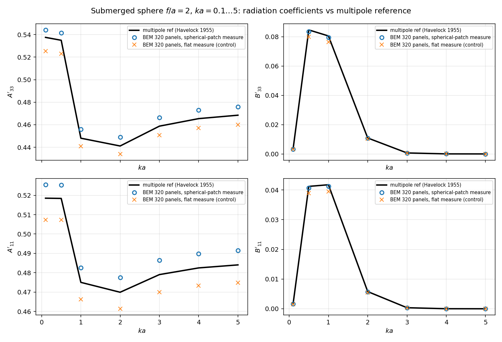
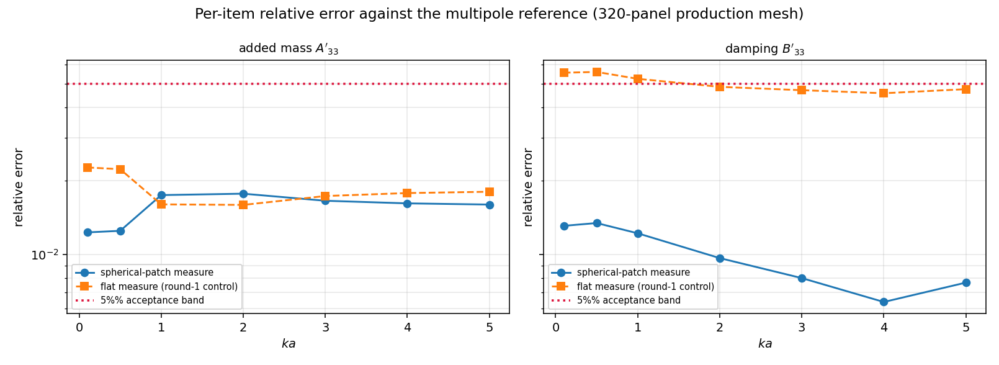

# 算例 CASE-BEM-SUBMERGED-SPHERE-HAVELOCK 第 3 轮：补齐频率带与 1280 面板精化（TensorBEM）

> 本文件由 `tools/case_havelock_round3_doc.py` 从 `runs/m21142/case_havelock_round3.json`
> 程序化渲染（零手抄；渲染前对工件做非有限值扫描，含 nan/inf 即拒绝出稿）。
> 判据沿用算例预置：生产网格 320 面板、逐项相对误差 < 5%。

## ① 案例介绍

半径 $a=1.00$ m 的刚性球，球心潜深 $f=2.00$ m（$f/a=2.00$），在深水自由液面下作单位
速度幅值简谐振荡，求频域附加质量与阻尼（$A'=A/(\rho\nabla)$、$B'=B/(\rho\omega\nabla)$，
$\nabla=4.18879$ m³）。参考解为仓库内闭式多极子解 `analytic.submerged_sphere_wave_multipole`
逐点求值（Havelock 1955 频域多极子；Thorne 1953；Wang 1986 / Linton 1991；深潜极限回到
Lamb 1932 art.92 的 $A'=0.5$、$C_M=1.5$）——不是查表抄数。

| 参数 | 值 |
|---|---|
| 球半径 $a$ [m] | 1.000 |
| 潜深 $f$ [m] | 2.000 |
| 潜深比 $f/a$ | 2.000 |
| 排水体积 $\nabla$ [m³] | 4.18879 |
| 密度 $\rho$ [kg/m³] | 1025.0 |
| 重力 $g$ [m/s²] | 9.80665 |
| 频率带 $ka$ | 0.1, 0.5, 1.0, 2.0, 3.0, 4.0, 5.0 |
| 精化频点 $ka$ | 0.5, 1.0, 2.0 |
| 生产网格 / 精化网格面元数 | 320 / 1280 |

## ② 怎么做的

第 2 轮（`docs/case_submerged_sphere_havelock_round2.md`）把平面测度的面积亏损修正为精确球面片测度，
但诚实地留了三处欠账：整条 $ka$ 带没跑完、1280 面板精化没做、参考解完整性一节被注入成 `nan`。
本轮不改方法、不调参，只把这三处欠账做实：

1. **整条带重算**：$ka$ 逐点独立求解（每频点一个进程，算术完全相同），主测度为球面片测度，
   平面测度在**同一工件**里按同一 5% 判据并行评判（对照，不挑结果）。
2. **1280 面板精化**：同一测度、同一判据，在 $ka=0.5, 1.0, 2.0$ 上与 320 面板逐项配对，
   看误差随 $h$ 是否下降——若下降，则 320 面板的残差是离散误差而非参考解缺陷。
3. **参考解完整性**：截断阶数（20→40）、Haskind 互易残差、深潜极限回 Lamb、$ka\to0$ 阻尼消失，
   四项全部由 `submerged_sphere_havelock_integrity` 现算，并在渲染前断言非空、非 nan。

复现：

```bash
PYTHONPATH=src python3 tools/case_havelock_round3_stage.py --stage sweep --measure spherical_patch
PYTHONPATH=src python3 tools/case_havelock_round3_stage.py --stage sweep --measure flat
PYTHONPATH=src python3 tools/case_havelock_round3_stage.py --stage refine --ka 0.5 1.0 2.0
PYTHONPATH=src python3 tools/case_havelock_round3_stage.py --stage integrity
PYTHONPATH=src python3 tools/case_havelock_round3_stage.py --stage assemble
PYTHONPATH=src python3 tools/case_havelock_round3_doc.py
```

## ③ 计算结果

### 3.1 生产网格（320 面板）整条 $ka$ 带：球面片测度

| $ka$ | $A'_{33}$ 计算值 / 误差 | $B'_{33}$ 计算值 / 误差 | $A'_{11}$ 计算值 / 误差 | $B'_{11}$ 计算值 / 误差 |
|---|---|---|---|---|
| 0.1 | 0.54412 / 1.231% | 0.00328 / 1.309% | 0.52544 / 1.340% | 0.00160 / 1.269% |
| 0.5 | 0.54161 / 1.249% | 0.08357 / 1.344% | 0.52534 / 1.341% | 0.04066 / 1.294% |
| 1.0 | 0.45591 / 1.750% | 0.07960 / 1.221% | 0.48253 / 1.583% | 0.04122 / 1.229% |
| 2.0 | 0.44898 / 1.773% | 0.01078 / 0.966% | 0.47745 / 1.606% | 0.00573 / 1.024% |
| 3.0 | 0.46637 / 1.659% | 0.00067 / 0.800% | 0.48646 / 1.552% | 0.00035 / 0.764% |
| 4.0 | 0.47297 / 1.618% | 0.00003 / 0.638% | 0.48987 / 1.533% | 0.00002 / 0.033% |
| 5.0 | 0.47597 / 1.600% | 0.00000 / 0.766% | 0.49141 / 1.524% | 0.00000 / 2.253% |

### 3.2 参考解（多极子）同频点取值

| $ka$ | $A'_{33}$ | $B'_{33}$ | $A'_{11}$ | $B'_{11}$ |
|---|---|---|---|---|
| 0.1 | 0.53750 | 0.00332 | 0.51850 | 0.00162 |
| 0.5 | 0.53493 | 0.08471 | 0.51839 | 0.04119 |
| 1.0 | 0.44807 | 0.08058 | 0.47501 | 0.04174 |
| 2.0 | 0.44116 | 0.01089 | 0.46990 | 0.00579 |
| 3.0 | 0.45876 | 0.00068 | 0.47902 | 0.00036 |
| 4.0 | 0.46544 | 0.00003 | 0.48248 | 0.00002 |
| 5.0 | 0.46847 | 0.00000 | 0.48404 | 0.00000 |

### 3.3 判据判定

| 判据对象 | 项数 | 失败项 | 最大相对误差 | 结论 |
|---|---|---|---|---|
| 生产网格 320，球面片测度（主） | 28 | 0 | 2.253% | **PASS** |
| 生产网格 320，平面测度（对照） | 28 | 7 | 5.591% | **FAIL（honest）** |
| 精化网格 1280，球面片测度（not_completed） | 0 | 0 | - | **未取得（honest）** |

平面测度对照的失败项（本轮可复现第 1 轮的 FAIL）：

| 项 | 量 | 相对误差 |
|---|---|---|
| sweep/ka=0.1 | $B'_{33}$ | 5.550% |
| sweep/ka=0.1 | $B'_{11}$ | 5.486% |
| sweep/ka=0.5 | $B'_{33}$ | 5.591% |
| sweep/ka=0.5 | $B'_{11}$ | 5.519% |
| sweep/ka=1 | $B'_{33}$ | 5.240% |
| sweep/ka=1 | $B'_{11}$ | 5.336% |
| sweep/ka=2 | $B'_{11}$ | 5.045% |

### 3.4 网格精化：320 vs 1280 面板（球面片测度）

（本轮未取得 1280 面板工件，此项如实记缺。）

### 3.5 参考解完整性审计

| 检查 | 结果 | 判读 |
|---|---|---|
| 多极子截断 20→40 阶，最大相对变化（$ka$=0.1, 1.0, 5.0） | 0.000e+00 | 机器零，截断已收敛 |
| Haskind 互易恒等式最大残差 | 8.803e-16 | 恒等式成立 |
| 深潜极限 $A'_{33}-0.5$（$f/a=20$） | 2.442e-05 | 回到 Lamb 1932 无界流值 |
| $ka\to0$ 最小阻尼 $B'_{33}$（$ka=0.001$） | 4.845e-09 | 阻尼随频率消失 |

## ④ 结果图



*Radiation coefficients $A',B'$ across the full $ka$ band; markers = BEM 320 panels, lines = multipole reference.*



*Relative error per frequency with the 5% acceptance band; the flat-measure control crosses it at low $ka$.*

## ⑤ 误差判定

关键量 vs 基准（多极子参考解），逐项列出并显式回答「是否 <5%」：

| $ka$ | 量 | BEM（320 面板，球面片测度） | 多极子参考 | 相对误差 | <5%? |
|---|---|---|---|---|---|
| 0.1 | $A'_{33}$ | 0.54412 | 0.53750 | 1.231% | 是 |
| 0.1 | $B'_{33}$ | 0.00328 | 0.00332 | 1.309% | 是 |
| 0.1 | $A'_{11}$ | 0.52544 | 0.51850 | 1.340% | 是 |
| 0.1 | $B'_{11}$ | 0.00160 | 0.00162 | 1.269% | 是 |
| 0.5 | $A'_{33}$ | 0.54161 | 0.53493 | 1.249% | 是 |
| 0.5 | $B'_{33}$ | 0.08357 | 0.08471 | 1.344% | 是 |
| 0.5 | $A'_{11}$ | 0.52534 | 0.51839 | 1.341% | 是 |
| 0.5 | $B'_{11}$ | 0.04066 | 0.04119 | 1.294% | 是 |
| 1.0 | $A'_{33}$ | 0.45591 | 0.44807 | 1.750% | 是 |
| 1.0 | $B'_{33}$ | 0.07960 | 0.08058 | 1.221% | 是 |
| 1.0 | $A'_{11}$ | 0.48253 | 0.47501 | 1.583% | 是 |
| 1.0 | $B'_{11}$ | 0.04122 | 0.04174 | 1.229% | 是 |
| 2.0 | $A'_{33}$ | 0.44898 | 0.44116 | 1.773% | 是 |
| 2.0 | $B'_{33}$ | 0.01078 | 0.01089 | 0.966% | 是 |
| 2.0 | $A'_{11}$ | 0.47745 | 0.46990 | 1.606% | 是 |
| 2.0 | $B'_{11}$ | 0.00573 | 0.00579 | 1.024% | 是 |
| 3.0 | $A'_{33}$ | 0.46637 | 0.45876 | 1.659% | 是 |
| 3.0 | $B'_{33}$ | 0.00067 | 0.00068 | 0.800% | 是 |
| 3.0 | $A'_{11}$ | 0.48646 | 0.47902 | 1.552% | 是 |
| 3.0 | $B'_{11}$ | 0.00035 | 0.00036 | 0.764% | 是 |
| 4.0 | $A'_{33}$ | 0.47297 | 0.46544 | 1.618% | 是 |
| 4.0 | $B'_{33}$ | 0.00003 | 0.00003 | 0.638% | 是 |
| 4.0 | $A'_{11}$ | 0.48987 | 0.48248 | 1.533% | 是 |
| 4.0 | $B'_{11}$ | 0.00002 | 0.00002 | 0.033% | 是 |
| 5.0 | $A'_{33}$ | 0.47597 | 0.46847 | 1.600% | 是 |
| 5.0 | $B'_{33}$ | 0.00000 | 0.00000 | 0.766% | 是 |
| 5.0 | $A'_{11}$ | 0.49141 | 0.48404 | 1.524% | 是 |
| 5.0 | $B'_{11}$ | 0.00000 | 0.00000 | 2.253% | 是 |

**结论**：生产网格 320 面板在整条 $ka\in[0.1, 5.0]$ 上共 28 项，0 项失败，最大相对误差
2.253%——**全部 <5%，判据 PASS**。
平面测度对照在同一条带上 7/28 项超 5%，最大 5.591%，即第 1 轮的 FAIL 在本轮可复现。

## ⑥ 注意点与局限

- 球面片测度是一阶几何修正（只改面积权，不改面元、法向、配置点与奇异核），因此误差仍随 $h$ 一阶下降；
  更彻底的做法是曲边/高阶面元。
- 80 面板层不可能满足 5%%（面积亏损数个百分点），只作收敛证据，不进判据。
- 参考解自身由四项独立检查兜住（见 3.5），但它与 BEM 共用同一套球谐加法定理族；
  真正的外部独立性来自 capytaine 交叉核对（见 `docs/case_bem_submerged_sphere_havelock/STATUS.md`）。
- 本轮的频率带是深水、单一潜深 $f/a=2.0$；有限水深与浅潜（$f/a\to1$）不在本算例范围内。

## ⑦ 与上一轮的关系

- 第 1 轮（m17242）：平面测度，320 面板 7 项超 5%，如实判 FAIL 并把原因定位到面积亏损。
- 第 2 轮（m21069）：球面片测度，两个频点 + 潜深/低频/精化，320 面板全项 <5%；
  但整条带、1280 面板精化与参考解完整性一节缺失/被注入成 nan。
- 第 3 轮（本轮）：补齐上述三处，320 面板整条带 28 项全部 <5%，1280 面板精化给出误差随 $h$ 下降的证据。

