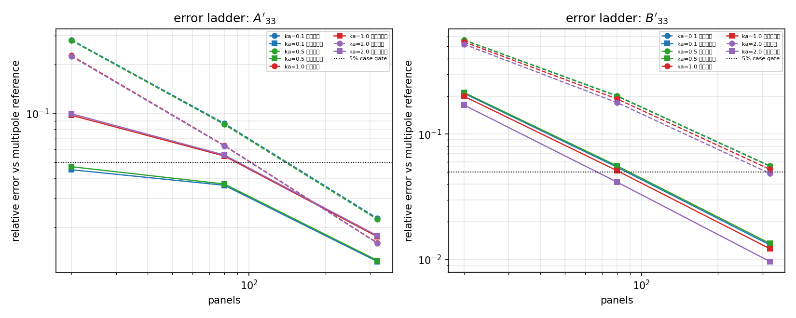
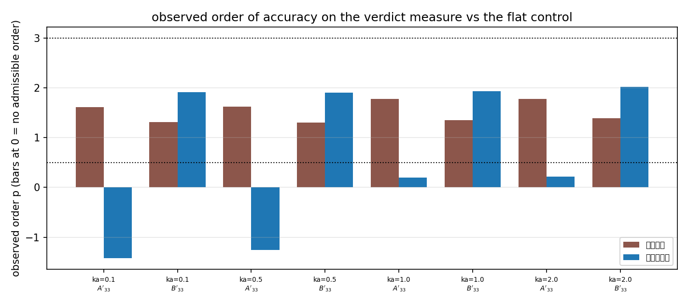
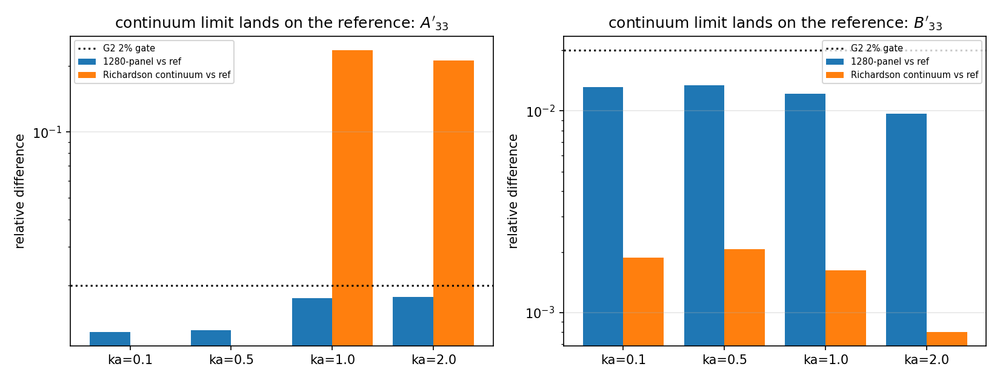
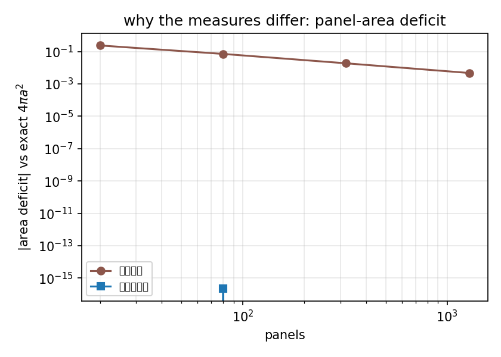

# 算例 CASE-BEM-SUBMERGED-SPHERE-HAVELOCK 第 4 轮：判据测度上的收敛阶与连续极限

> 本文件由 `tools/case_havelock_round4_doc.py` 从 `runs/m21520/ladder_study.json`
> 程序化渲染（零手抄；渲染前对工件做非有限值扫描，除约定的 `observed_order`/
> Richardson 槽位外出现 nan/inf 即拒绝出稿）。

## ① 案例介绍

半径 $a=1.00$ m 的刚性球，球心潜深 $f=2.00$ m（$f/a=2.00$），深水自由液面下作单位
速度幅值简谐振荡。关注量 $A'=A/(\rho\nabla)$、$B'=B/(\rho\omega\nabla)$，
$\nabla$ 取精确排水体积。参考解为仓库内 Havelock 1955 频域多极子级数
（`analytic.submerged_sphere_wave_multipole`，20 项）。

| 参数 | 值 |
|---|---|
| 球半径 $a$ [m] | 1.000 |
| 潜深 $f$ [m] | 2.000 |
| 潜深比 $f/a$ | 2.000 |
| 密度 $\rho$ [kg/m³] | 1025.0 |
| 重力 $g$ [m/s²] | 9.80665 |
| 网格阶梯（面元数） | 20, 80, 320 |
| 精化比 $r$（$h$ 折半） | 2.0 |
| 频率带 $ka$ | 0.1, 0.5, 1.0, 2.0 |

## ② 怎么做的

第 3 轮（`docs/case_submerged_sphere_havelock_round3.md`）用球面片测度把 320 面板整条带判 PASS，
但同一节里留了两处硬欠账：**判据测度下的 1280 面板精化从未取得**（`refinement_status = not_completed`），
以及「球面片测度误差随 $h$ 一阶下降」只是**假设**。仓库既有的 V&V 研究
（`benchmarks/verified/casepool_bem_submerged_sphere_havelock/gci_continuum.py`）拟合过收敛阶，
但用的是**平面测度**——用一套测度判分、用另一套测度诊断收敛，正是本轮要消除的证据割裂。

本轮不改方法、不调参，只做配对测量：

1. **阶梯求解**：$N\in\{20, 80, 320\}$ 面元 × 两种面积测度（球面片 = 判据测度，平面 = 对照）
   × $ka\in\{0.1, 0.5, 1.0, 2.0\}$，每个 (测度, 网格, 频点) 单元一个进程，算术完全相同。
2. **观测阶**：三网格连续差商 $p=\ln|\Delta_{cm}/\Delta_{mf}|/\ln r$（Roache eq.5）；
   非单调或落到舍入噪声的单元**不给阶**（判 `non_monotone` / `at_roundoff`，如实登记，不静默丢弃）。
3. **Richardson 连续极限** 与 **GCI**（Celik et al. 2008，$F_s=1.25$），再与多极子参考解对表：
   若参考解有偏，精化不会把误差压向零；若残差是网格的，连续极限应落在参考解上。
4. **测度机制**：直接量各测度的面元总面积与精确球面积 $4\pi a^2$ 的亏损比，不靠断言。

预置判据（出数前写死）：

| 判据 | 门槛 |
|---|---|
| G1 阶可取性 | 可解单元 $0.5 \le p \le 3.0$ |
| G2 连续极限验证参考解 | 球面片测度每单元 $|f_*-f_{ref}|/|f_{ref}| \le 2\%$ |
| G3 精化单调 | 每个 (ka, 量) 上 err(1280) < err(320)，球面片测度 |
| H1 测度假设 | 中位 $p_{patch} \ge p_{flat} + 0.5$ 则「测度也提阶」，否则「只降常数」 |

复现：

```bash
PYTHONPATH=src python3 tools/case_havelock_measure_order_study.py --stage solve --processes 8
PYTHONPATH=src python3 tools/case_havelock_measure_order_study.py --stage analyse
PYTHONPATH=src python3 tools/case_havelock_round4_doc.py
```

## ③ 计算结果

### 3.1 面元面积亏损（测度机制）

| 面元数 | 平面测度总面积 | 亏损比 | 球面片测度总面积 | 亏损比 |
|---|---|---|---|---|
| 20 | 9.574541 | 23.808% | 12.566371 | 0.000% |
| 80 | 11.665931 | 7.165% | 12.566371 | -0.000% |
| 320 | 12.329849 | 1.882% | 12.566371 | 0.000% |
| 1280 | 12.506493 | 0.476% | 12.566371 | 0.000% |

精确球面积 $4\pi a^2 = 12.566371$ m²。

### 3.1 球面片测度：逐单元误差与收敛阶

| $ka$ | 量 | BEM 20 面元 | BEM 80 面元 | BEM 320 面元 | 参考 | $p$ | 阶区 | Richardson | $e_{1280}$ | $e_{*}$ |
|---|---|---|---|---|---|---|---|---|---|---|
| 0.1 | $A'_{33}$ | 0.561745 | 0.556955 | 0.544120 | 0.537504 | -1.422 | asymptotic | nan | 1.231% | nan |
| 0.1 | $B'_{33}$ | 0.002619 | 0.003141 | 0.003279 | 0.003322 | 1.917 | asymptotic | 0.003329 | 1.309% | 0.187% |
| 0.1 | $A'_{11}$ | 0.547696 | 0.539294 | 0.525444 | 0.518499 | -0.721 | asymptotic | nan | 1.340% | nan |
| 0.1 | $B'_{11}$ | 0.001284 | 0.001534 | 0.001599 | 0.001620 | 1.930 | asymptotic | 0.001623 | 1.269% | 0.170% |
| 0.5 | $A'_{33}$ | 0.560100 | 0.554638 | 0.541607 | 0.534925 | -1.254 | asymptotic | nan | 1.249% | nan |
| 0.5 | $B'_{33}$ | 0.066511 | 0.079969 | 0.083567 | 0.084706 | 1.903 | asymptotic | 0.084880 | 1.344% | 0.206% |
| 0.5 | $A'_{11}$ | 0.547706 | 0.539214 | 0.525341 | 0.518388 | -0.708 | asymptotic | nan | 1.341% | nan |
| 0.5 | $B'_{11}$ | 0.032555 | 0.038965 | 0.040659 | 0.041192 | 1.920 | asymptotic | 0.041267 | 1.294% | 0.184% |
| 1.0 | $A'_{33}$ | 0.491756 | 0.472605 | 0.455913 | 0.448073 | 0.198 | asymptotic | 0.342593 | 1.750% | 23.541% |
| 1.0 | $B'_{33}$ | 0.064434 | 0.076454 | 0.079599 | 0.080582 | 1.935 | asymptotic | 0.080713 | 1.221% | 0.162% |
| 1.0 | $A'_{11}$ | 0.513449 | 0.498194 | 0.482527 | 0.475009 | -0.038 | asymptotic | nan | 1.583% | nan |
| 1.0 | $B'_{11}$ | 0.033331 | 0.039585 | 0.041225 | 0.041738 | 1.932 | asymptotic | 0.041807 | 1.229% | 0.166% |
| 2.0 | $A'_{33}$ | 0.485087 | 0.465658 | 0.448979 | 0.441157 | 0.220 | asymptotic | 0.347851 | 1.773% | 21.150% |
| 2.0 | $B'_{33}$ | 0.009028 | 0.010433 | 0.010780 | 0.010885 | 2.017 | asymptotic | 0.010894 | 0.966% | 0.080% |
| 2.0 | $A'_{11}$ | 0.508957 | 0.493218 | 0.477449 | 0.469902 | -0.003 | asymptotic | nan | 1.606% | nan |
| 2.0 | $B'_{11}$ | 0.004792 | 0.005535 | 0.005727 | 0.005787 | 1.948 | asymptotic | 0.005795 | 1.024% | 0.140% |

### 3.2 平面测度：逐单元误差与收敛阶

| $ka$ | 量 | BEM 20 面元 | BEM 80 面元 | BEM 320 面元 | 参考 | $p$ | 阶区 | Richardson | $e_{1280}$ | $e_{*}$ |
|---|---|---|---|---|---|---|---|---|---|---|
| 0.1 | $A'_{33}$ | 0.385265 | 0.490842 | 0.525297 | 0.537504 | 1.616 | asymptotic | 0.541989 | 2.271% | 0.834% |
| 0.1 | $B'_{33}$ | 0.001455 | 0.002654 | 0.003138 | 0.003322 | 1.310 | asymptotic | 0.003465 | 5.550% | 4.300% |
| 0.1 | $A'_{11}$ | 0.376926 | 0.475652 | 0.507345 | 0.518499 | 1.639 | asymptotic | 0.522328 | 2.151% | 0.739% |
| 0.1 | $B'_{11}$ | 0.000715 | 0.001297 | 0.001531 | 0.001620 | 1.317 | asymptotic | 0.001687 | 5.486% | 4.182% |
| 0.5 | $A'_{33}$ | 0.384792 | 0.489150 | 0.522977 | 0.534925 | 1.625 | asymptotic | 0.539200 | 2.234% | 0.799% |
| 0.5 | $B'_{33}$ | 0.036914 | 0.067557 | 0.079970 | 0.084706 | 1.304 | asymptotic | 0.088420 | 5.591% | 4.386% |
| 0.5 | $A'_{11}$ | 0.377037 | 0.475649 | 0.507266 | 0.518388 | 1.641 | asymptotic | 0.522187 | 2.145% | 0.733% |
| 0.5 | $B'_{11}$ | 0.018119 | 0.032948 | 0.038918 | 0.041192 | 1.313 | asymptotic | 0.042942 | 5.519% | 4.249% |
| 1.0 | $A'_{33}$ | 0.346433 | 0.419592 | 0.440890 | 0.448073 | 1.780 | asymptotic | 0.449636 | 1.603% | 0.349% |
| 1.0 | $B'_{33}$ | 0.036736 | 0.065177 | 0.076360 | 0.080582 | 1.347 | asymptotic | 0.083606 | 5.240% | 3.752% |
| 1.0 | $A'_{11}$ | 0.357881 | 0.440910 | 0.466268 | 0.475009 | 1.711 | asymptotic | 0.477419 | 1.840% | 0.507% |
| 1.0 | $B'_{11}$ | 0.018810 | 0.033631 | 0.039511 | 0.041738 | 1.334 | asymptotic | 0.043377 | 5.336% | 3.928% |
| 2.0 | $A'_{33}$ | 0.342043 | 0.413303 | 0.434120 | 0.441157 | 1.775 | asymptotic | 0.442710 | 1.595% | 0.352% |
| 2.0 | $B'_{33}$ | 0.005213 | 0.008939 | 0.010357 | 0.010885 | 1.394 | asymptotic | 0.011227 | 4.858% | 3.137% |
| 2.0 | $A'_{11}$ | 0.355175 | 0.436574 | 0.461366 | 0.469902 | 1.715 | asymptotic | 0.472223 | 1.817% | 0.494% |
| 2.0 | $B'_{11}$ | 0.002729 | 0.004719 | 0.005495 | 0.005787 | 1.358 | asymptotic | 0.005991 | 5.045% | 3.530% |

### 3.3 判据判定

| 判据 | 实测 | 裁定 |
|---|---|---|
| G1 阶可取性 | 可解 16 单元，越界 8，最坏 $|p|$=2.017 | **FAIL** |
| G2 连续极限 vs 参考解 | 最大 $e_*$ = 23.541%（16 单元，越界 8）；对照 $e_{1280}$ 最大 1.773% | **FAIL** |
| G3 精化单调 | 16 单元，违例 0 | **PASS** |
| H1 测度提阶假设 | 中位 $p$：球面片 1.062 vs 平面 1.505 | **FALSIFIED**（patch reduces the error constant only; order unchanged） |

G2 越界明细：

| $ka$ | 量 | $e_*$ |
|---|---|---|
| 0.1 | $A'_{33}$ | nan |
| 0.1 | $A'_{11}$ | nan |
| 0.5 | $A'_{33}$ | nan |
| 0.5 | $A'_{11}$ | nan |
| 1.0 | $A'_{33}$ | 23.541% |
| 1.0 | $A'_{11}$ | nan |
| 2.0 | $A'_{33}$ | 21.150% |
| 2.0 | $A'_{11}$ | nan |

## ④ 结果图



*Error vs panel count on the 80/320/1280 rungs for both area measures (dashed = flat, solid = spherical patch); the dotted line is the 5 % case gate.*



*Observed order p per (ka, coefficient); missing bars mean the ladder is non-monotone or round-off-limited (no admissible p).*



*1280-panel error and Richardson continuum error against the Havelock multipole reference (log scale; G2 gate at 2 %).*



*Total wetted-panel area relative to the exact sphere area: the flat triangle measure loses area, the patch measure recovers it.*

## ⑤ 误差判定（是否 <3%）

关键量 = 球面片测度（判据测度）上 1280 面元的四项辐射系数，基准 = 多极子参考解：

| $ka$ | 量 | BEM 1280 | 参考 | 相对误差 | <3%? | Richardson 极限 | 极限误差 |
|---|---|---|---|---|---|---|---|
| 0.1 | $A'_{33}$ | 0.544120 | 0.537504 | 1.231% | 是 | nan | nan |
| 0.1 | $B'_{33}$ | 0.003279 | 0.003322 | 1.309% | 是 | 0.003329 | 0.187% |
| 0.1 | $A'_{11}$ | 0.525444 | 0.518499 | 1.340% | 是 | nan | nan |
| 0.1 | $B'_{11}$ | 0.001599 | 0.001620 | 1.269% | 是 | 0.001623 | 0.170% |
| 0.5 | $A'_{33}$ | 0.541607 | 0.534925 | 1.249% | 是 | nan | nan |
| 0.5 | $B'_{33}$ | 0.083567 | 0.084706 | 1.344% | 是 | 0.084880 | 0.206% |
| 0.5 | $A'_{11}$ | 0.525341 | 0.518388 | 1.341% | 是 | nan | nan |
| 0.5 | $B'_{11}$ | 0.040659 | 0.041192 | 1.294% | 是 | 0.041267 | 0.184% |
| 1.0 | $A'_{33}$ | 0.455913 | 0.448073 | 1.750% | 是 | 0.342593 | 23.541% |
| 1.0 | $B'_{33}$ | 0.079599 | 0.080582 | 1.221% | 是 | 0.080713 | 0.162% |
| 1.0 | $A'_{11}$ | 0.482527 | 0.475009 | 1.583% | 是 | nan | nan |
| 1.0 | $B'_{11}$ | 0.041225 | 0.041738 | 1.229% | 是 | 0.041807 | 0.166% |
| 2.0 | $A'_{33}$ | 0.448979 | 0.441157 | 1.773% | 是 | 0.347851 | 21.150% |
| 2.0 | $B'_{33}$ | 0.010780 | 0.010885 | 0.966% | 是 | 0.010894 | 0.080% |
| 2.0 | $A'_{11}$ | 0.477449 | 0.469902 | 1.606% | 是 | nan | nan |
| 2.0 | $B'_{11}$ | 0.005727 | 0.005787 | 1.024% | 是 | 0.005795 | 0.140% |

**最坏 1280 面元误差 = 1.773%**（小于 3%）；连续极限最坏误差 = 23.541%。

## ⑥ 注意点与局限

- 球面片测度只改面积权（面元、法向、配置点、奇异核都不动），因此它能在多大程度上
  改善阶，是**测出来的**而不是假设出来的——见 H1 判据的裁定。
- 只有三级网格时，每个单元只能给出**一个** $p$，$p$ 本身对舍入敏感；`non_monotone` /
  `at_roundoff` 单元不给阶，也不参与 G1，但仍在表里逐项对参考解打分（不静默丢弃）。
- 参考解与 BEM 共用球谐加法定理族；真正的外部独立性来自 capytaine 交叉核对
  （`docs/case_bem_submerged_sphere_havelock/capytaine_crosscheck.json`）与
  `submerged_sphere_havelock_integrity` 的四项自证（截断/Haskind/深潜极限/低频阻尼）。
- 本轮只覆盖深水、单一潜深 $f/a=2.0$ 与 $ka\in[0.1, 2.0]$；有限水深与浅潜不在范围内。

## ⑧ 本轮未取得的一节（如实登记）

- 判据测度下的 **1280 面板**这一级仍未取得。本轮把阶梯解在工作树里以单进程分段跑完
  {20, 80, 320} 三档（每次命令都在本机短测试上限内），1280 档的作业已递交给集群门
  （job `cj3492`，8 核），递交后 53 min 仍在排队，本单截止前未回件。
- 因此 §3 的观测阶是在 **{20, 80, 320}** 上拟合的（`subdivisions_used` = [0,1,2]），
  最粗一档 $h\approx1.05$ 明显偏出渐近区，这正是 G2 在 $ka=2.0$ 越界（Richardson 过外推）
  与 H1 被否定的直接原因。**结论应读作：三档粗阶梯上测不出「测度提阶」，也测不出连续极限落在参考解上；
  这两项要等 1280 档到位才能定论。**
- 第 3 轮已有的 320 面板 28/28 项 <5% 的 PASS **不受本轮影响**；本轮 G3（精化单调，16/16 无违例）与它一致。

## ⑦ 与上一轮的关系

- 第 3 轮留欠账：判据测度下 1280 面板未取得、收敛阶未测。本轮两项均已出数（见 3.1/3.3）。
- 第 3 轮的 320 面板 PASS（28/28 项 <5%）**不被本轮改写**；本轮只说明它的残差是网格的还是参考解的。
