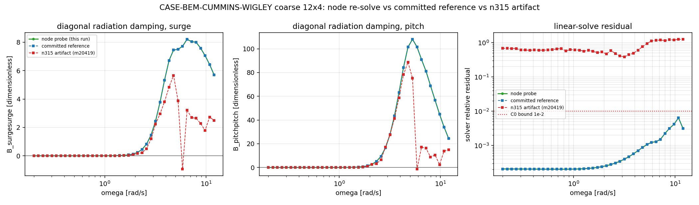

# NODE-NUMERIC-VALIDITY — node reproducibility of CASE-BEM-CUMMINS-WIGLEY

Generated by `tools/node_numeric_validity_probe.py report` from the JSON files in this directory; every number below is read from those files, none is typed by hand.

## 1. Question and decision

`README.md` §3 recorded that the *same* coarse configuration gave max solver residual 1.253 and negative diagonal radiation damping on node n315, while the worktree stack gave 6.4e-3 and non-negative damping. The published verdict was later refreshed from a stack that reproduces the worktree numbers, so what remains open is only the numerical question: **does a node reproduce the committed radiation sweep?**

| comparison | decision | driving reason |
| --- | --- | --- |
| committed reference sweep (what the published verdict rests on) | **MATCH** | max relative amplitude difference 0.000e+00 |
| disputed node-n315 artifact (docs/.../evidence_cluster_n315_sweep_coarse.npz) | **DIVERGE** | max relative amplitude difference 1.739e+00 |

Decision rule (pre-declared in the tool, unchanged after the run): `NOT_CONVERGED` if max solver relative residual > 1e-02; `NON_PHYSICAL` if min diagonal radiation damping < -1e-10; then `MATCH` <= 1e-06, `NEAR` <= 1e-03, else `DIVERGE` on the per-DOF normalised amplitude difference.

## 2. Where and on what it was run

| item | value |
| --- | --- |
| host | `ec6ae0b42a0c` (loongarch64) |
| platform | `Linux-6.6.52-1.7.lns23.loongarch64-loongarch64-with-glibc2.38` |
| python / numpy | 3.11.6 / 2.4.6 |
| mesh | 12x4 (192 panels, label `coarse`) |
| band / nodes | 0.2 .. 12.0 rad/s, 41 log nodes |
| grid identical to the committed case grid | True |
| sweep wall time | 36.8 s inside the solver |

## 3. Numerical stack: linear algebra with a known answer

Three deterministic problems solved on the node; the right-hand side is built from the exact solution, so both the residual and the error are known.

| problem | shape | cond | rel. residual | bound | rel. error | bound |
| --- | --- | --- | --- | --- | --- | --- |
| solve_cond_1e3 | 192x192 | 1e+03 | 6.085e-16 | 1e-10 | 2.990e-14 | 1e-10 |
| solve_cond_1e8 | 192x192 | 1e+08 | 7.383e-16 | 1e-06 | 1.488e-09 | 1e-04 |
| lstsq_overdetermined | 384x192 | 1.41 | 2.436e-15 | 1e-10 | 2.508e-15 | 1e-10 |

Stack verdict: **PASS**

## 4. Radiation sweep: node vs the two reference artifacts

### vs committed reference sweep (what the published verdict rests on)

| DOF | dA / max|A| | dB / max|B| |
| --- | --- | --- |
| surge | 0.000e+00 % | 0.000e+00 % |
| sway | 0.000e+00 % | 0.000e+00 % |
| heave | 0.000e+00 % | 0.000e+00 % |
| roll | 0.000e+00 % | 0.000e+00 % |
| pitch | 0.000e+00 % | 0.000e+00 % |
| yaw | 0.000e+00 % | 0.000e+00 % |
| **max** | **0.000e+00 %** | **0.000e+00 %** |

max solver relative residual 6.392e-03 (bound 1e-02); min diagonal damping 2.701e-13 (bound -1e-10)

### vs disputed node-n315 artifact (docs/.../evidence_cluster_n315_sweep_coarse.npz)

| DOF | dA / max|A| | dB / max|B| |
| --- | --- | --- |
| surge | 4.017e+02 % | 5.632e+02 % |
| sway | 8.963e+01 % | 1.739e+02 % |
| heave | 2.063e+01 % | 7.766e+01 % |
| roll | 1.541e+03 % | 3.767e+03 % |
| pitch | 9.756e+01 % | 1.161e+02 % |
| yaw | 1.073e+02 % | 1.102e+02 % |
| **max** | **7.460e+01 %** | **1.739e+02 %** |

max solver relative residual 6.392e-03 (bound 1e-02); min diagonal damping 2.701e-13 (bound -1e-10)

## 5. Error judgement

* vs committed reference sweep (what the published verdict rests on): worst relative difference 0.000e+00 % — **< 3 %**, decision `MATCH`.
* vs disputed node-n315 artifact (docs/.../evidence_cluster_n315_sweep_coarse.npz): worst relative difference 1.739e+02 % — **>= 3 %**, decision `DIVERGE`.

## 6. Honest limits

* One run on one node on the day recorded above. The rule decides *reproducibility now*, not what node n315 did at the time of cj2690/cj2704.
* Cross-machine floating point is not bit-identical: `MATCH` at 1e-6 is already far below any physical tolerance, and `NEAR` (<=1e-3) still means the same solution with a different summation order / BLAS.
* The sweep probe covers the coarse 12x4 mesh only — the disputed n315 artifact was coarse, and the medium production artifact is the one the published verdict rests on.
* A `DIVERGE` decision would say the node is a different solve; it would still not by itself identify which of assembly / LAPACK / threading is responsible.

