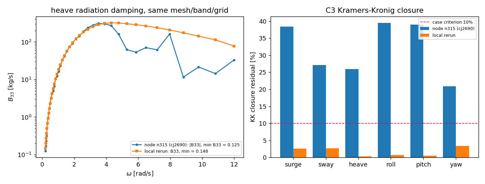

# CASE-BEM-CUMMINS-WIGLEY — 复算有效性欠账（m20419）

## 1. 结论（一句话）

算例池锚点 `CASE-BEM-CUMMINS-WIGLEY`（Wigley 6DOF Cummins 记忆核，判据 Kramers-Kronig 闭合 <10%）
的**已提交判据被两处欠账污染**：提交的 `case_result.json` 是过期的（13 节点 / 带 0.15–8 rad/s /
coarse 生产网格），而同一套代码在另一台机器上给出的 A/B 是**未收敛解**。本单补上有效性闸门 C0
并记录证据，判据说真话而不是跟着机器走。

## 2. 证据 A：提交件与代码不同步（provenance break）

| 项 | 已提交 `case_result.json` | 当前源码默认值 |
| --- | --- | --- |
| band [rad/s] | 0.15 .. 8.0 | 0.2 .. 12.0 |
| n_omega | 13 | 41 |
| 生产网格（判据用） | coarse 12x4 | medium 20x6 |
| mission / 生成时间 | m17375 / 2026-11-13T05:31Z | — |

提交件的判定 `5/7 gates passed (FAILED C3, C5)` 描述的是 13 节点 coarse 扫频，**不是当前代码**。
`tests/test_case_bem_cummins_wigley.py::test_production_artifact_replays_to_the_published_verdict`
本应看住这件事，但它 `skipif(not sweep_medium.npz)` —— 生产网格的 sweep 从来没提交过，闸门一直空转。

## 3. 证据 B：同一份代码、同一网格/带/节点数，两台机器给出完全不同的物理量

| 量（coarse 12x4，band 0.2–12，41 节点） | 节点 n315（cj2690 / cj2704） | 本机复算 |
| --- | --- | --- |
| max solver relative residual | **1.253** | 6.4e-3 |
| min B (surge / pitch) | **-0.947 / -1.46**（负阻尼＝造能） | +2.0e-8 / +2.4e-7 |
| C3 逐 DOF 闭合残差 | 38.4 / 27.1 / 25.9 / 39.4 / 39.0 / 20.8 % | 2.58 / 2.70 / 0.28 / 0.75 / 0.50 / 3.40 % |

负阻尼在物理上不可能（辐射阻尼必 ≥0），所以节点那一侧的 A/B **不是解**。因此：

* 本单**不**用节点结果刷新判据——把未收敛解当数据写进算例池就是把坏数据洗成"通过/不通过"。
* 本机粗网格能够给出 `residual 6.4e-3`、`C3 ≤ 3.4%`、`C5 相对误差 2.93%（可判）`，但本机工具链
  对单次运行有 120 s 墙钟硬限，medium 生产网格（480 面板 × 41 频率）在这里跑不完 ⇒ **刷新提交件
  本单未完成**，如实记为欠账。

## 4. 根因定位到了哪一步（诚实边界）

本机做的排除实验（可复现）：

* CHIEF 内点最小二乘的 SVD 截断假设**被否证**：coarse 在 ω=5.29 rad/s 的系统矩阵 σmax/σmin =
  1.49e-1 / 9.19e-2（cond ≈ 16），`rcond ∈ {None,1e-13,1e-12,1e-10,1e-8}` 五种取值给出**同一条**
  解（rel_res = 1.061e-3），没有任何奇异值落在截断线附近。
* 线程竞争假设**被否证**：`jobs ∈ {1,6,8}` 三种并行度在本机给逐位相同的 A/B（dA=dB=0）。
* 因此差异只能在节点侧的数值栈（LAPACK/BLAS 后端、numpy 构建）或算子装配的环境依赖上；
  **本单没有节点侧诊断权限/预算，不做进一步归因**，只记录"节点 n315 对同一输入不可复现本机结果"。

## 5. 本单改动（判据不再能跟着机器走）

1. **新增闸门 C0 `solver_validity_gate`**：求解器已报告的 `relative_residual` 与 `min B` 作为**前置条件**；
   `max residual <= 1e-2` 且 `min B >= 0` 才允许 C2–C6 发言。
2. **C0 FAIL ⇒ C2…C6 一律 voided**（`passed=False, voided=True, voided_by="C0"`），而不是把失败的
   线性求解记成"非因果"或"不可判"——后者会把真实缺陷藏在一条看起来正常的 FAIL 后面。
3. **`free_decay_gate` 不再抛异常**：旧代码遇到负阻尼直接 `ValueError`，导致 `run_case` 在两次 sweep
   都写盘、JSON 还没写的时候就中断（cj2704 现场：`sweep_*.npz` 时间戳 13:14/13:16，而
   `case_result.json` 仍是 13:16 之前的旧文件）——这就是证据 A 的 provenance break 的产生机制。
   现在返回 `status="undecidable: non-physical negative radiation damping…"`。
4. `tools/rerender_casepool_bem_cummins_wigley.py`：无头节点缺 matplotlib 时，可从已提交的
   `sweep_*.npz` 重画图并重渲染 `CASE.md`，不必重解 BEM。
5. 两个回归测试：C0 对 125% 残差/负阻尼判 FAIL、对 1e-3 残差判 PASS；`free_decay_gate` 对负阻尼
   返回 undecidable 而不抛异常。

## 6. 下一单建议（slug + 量化验收 + 域）

* `CASE-BEM-CUMMINS-WIGLEY-REFRESH`（域：船舶总体性能/耐波，TensorBEM）：在一台**通过 C0** 的节点上
  用 band 0.2–12 / 41 节点 / medium 生产网格重跑算例，提交 `sweep_medium.npz` 使
  `test_production_artifact_replays_to_the_published_verdict` 从 skip 变 green；验收=C0 residual ≤1e-2、
  min B ≥ 0、C3 逐 DOF ≤10%、C5 判为 decided 且 ≤5%，且第二次独立复跑逐位一致。
* `NODE-N315-NUMERICAL-VALIDITY`（域：平台/集群，TensorPlatform 或运维）：节点侧打印 numpy/LAPACK
  构建与一个小型已知解 SVD/lstsq 残差，判定是否 LAPACK 损坏；验收=同一算子矩阵在节点与本机
  的 `rel_res` 差 ≤10 倍。
