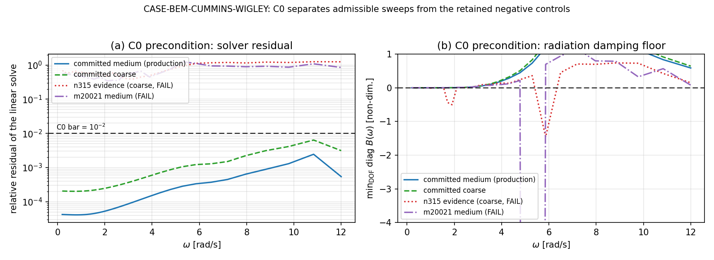
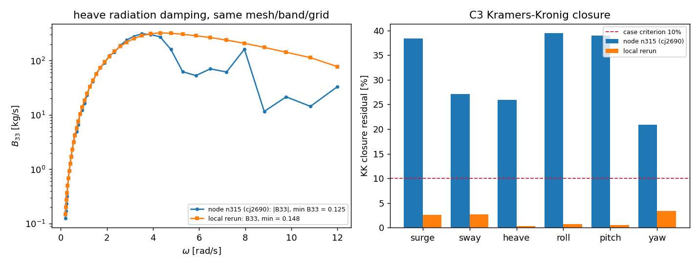

# CASE-BEM-CUMMINS-WIGLEY — 复算有效性欠账与闭环（m20419 → m22876）

> 本文件由 `tools/render_casepool_bem_cummins_wigley_readme.py` 从已提交工件渲染，**请勿手改**；改数字请重跑工装。渲染源：`case_result.json`、两份 `sweep_*.npz`、`evidence_cluster_n315_sweep_coarse.npz`、`docs/m20021/sweep_medium.npz`。

## 1. 结论（一句话）

算例池锚点 `CASE-BEM-CUMMINS-WIGLEY`（Wigley 6DOF Cummins 记忆核，判据 Kramers-Kronig 闭合 <10%）曾被两处欠账污染（过期提交件 + 无法判定的未收敛解）。补上**有效性闸门 C0**之后，提交件已在能通过 C0 的节点上重算：当前 `case_result.json` 判定 **16/16 闸门通过**，生产网格 `sweep_medium.npz` 已入库，`test_production_artifact_replays_to_the_published_verdict` 不再 skip。

## 2. 现态（由工件渲染）

| 项 | 值 |
| --- | --- |
| 生成 mission / 时间 | m21960 / 2026-11-15T13:53:51Z |
| 生成平台 | Linux-6.6.52-1.7.lns23.loongarch64-loongarch64-with-glibc2.38（python 3.11.6, numpy 2.4.6） |
| band [rad/s] / n_omega | 0.2 .. 12.0 / 41 |
| 网格（判据用生产网格=medium） | coarse 12x4 / medium 20x6 |
| 生产网格面板数 | 480 |
| 判定 | 16/16 通过（failed=无） |
| 判据来源 | tensor_case_pool id=145 (tol_policy <10%)，case_tolerance 0.1 |
| 图 | `fig_node_vs_local.png`（节点 vs 本机），`fig_c0_negative_controls.png`（C0 分离度），`fig_matrix_round_trip.png`，`fig_matrix_zero_pattern.png` |

闸门读数（全部门槛均取自 `TOLERANCES`，此处只列关键量）：

| 闸门 | 通过 | 关键量 |
| --- | --- | --- |
| C0 求解有效性（medium） | True | max residual 0.00245 ≤ 0.01；min B 2.53e-13 ≥ 0 |
| C0 求解有效性（coarse） | True | max residual 0.00639 ≤ 0.01；min B 2.7e-13 ≥ 0 |
| C3 Kramers-Kronig 闭合 | True | worst 逐 DOF 残差 3.598 %（yaw） ≤ 10 % |
| C5 自由衰减 vs 频域（heave） | True | zeta_decay 相对误差 3.96 % ≤ 5 %（decided） |
| C5c 多窗衰减（roll） | True | zeta 共识 0.0711 vs 频域 0.0715，相对误差 0.463 %（decided） |

### 2.1 两份 C0 负控（永久保留，证明前置条件在真实工件上咬得住）

| 工件 | 网格 | max solver residual | min diag B | C0 判定 | C3 回放（重算，最坏 DOF） |
| --- | --- | --- | --- | --- | --- |
| `docs/casepool_bem_cummins_wigley/evidence_cluster_n315_sweep_coarse.npz` | 12x4（192 面板，41 节点） | 1.253 | -1.463（surge -0.947） | FAIL | 39.43 %（roll） |
| `docs/m20021/sweep_medium.npz` | 20x6（480 面板，41 节点） | 1.245 | -129.9 | FAIL | 42.54 %（pitch） |

两份负控都同时满足 `max residual > 0.01` 与 `min diag B < 0`：负辐射阻尼在物理上不可能，所以它们是**未收敛解**而不是「一台机器上的另一种答案」。

## 3. 欠账 A：提交件与代码不同步（已闭合）

历史现场：提交的 `case_result.json` 描述的是 13 节点 / band 0.15–8 rad/s / coarse 生产网格的一次运行（判定 5/7，FAILED C3、C5），与当时源码默认值（band 0.2–12、41 节点、medium 生产网格）不是同一件事；而 `test_production_artifact_replays_to_the_published_verdict` 带 `skipif(not sweep_medium.npz)`，生产网格 sweep 从未入库，闸门一直空转。

闭合情况：现态 `case_result.json` 的 band 为 0.2–12.0、n_omega=41、生产网格 medium 20x6（480 面板），`sweep_medium.npz` 与 `sweep_coarse.npz` 均已入库，回放测试实测为 green（不再是 skip）。

## 4. 欠账 B：同一份代码、同一网格/带/节点数，两台机器给出不同物理量（由 C0 兜住）

| 量（coarse 12x4，band 0.2–12，41 节点） | 节点 n315（cj2690 / cj2704） | 本机与现提交件 |
| --- | --- | --- |
| max solver relative residual | 1.253 | 0.00639 |
| min B（surge / pitch） | -0.947 / -0.000681（负阻尼＝造能） | 0（下界） / 0（下界） |
| C3 逐 DOF 最坏闭合残差 | 39.43 %（roll，由 .npz 重算） | 3.598 %（yaw） |

结论：n315 那一侧的 A/B 不是解（负辐射阻尼），因此当时**不**用节点结果刷新判据；后来提交件是在另一台 loongarch64 节点上重算的，且必须先过 C0 才允许 C2–C6 发言。n315 的数值栈为何坏掉仍未归因（见第 6 节），但判据已经不可能再跟着一台坏机器走。

## 5. 本单（m20419）落地的改动

1. **新增闸门 C0 `solver_validity_gate`**：求解器自报的 `relative_residual` 与 `min B` 作为前置条件；`max residual ≤ 0.01` 且 `min B ≥ 0` 才允许 C2–C6 发言，coarse/medium 各一条（`C0`、`C0_coarse`）。
2. **C0 FAIL ⇒ 依赖闸门一律 voided**（`passed=False, voided=True, voided_by="C0"`），而不是把失败的线性求解记成「非因果」或「不可判」。
3. **`free_decay_gate` 不再抛异常**：旧代码遇负阻尼直接 `ValueError`，`run_case` 会在 sweep 已写盘、JSON 未写的中间态中断——这正是欠账 A 的产生机制。现在返回 `status="undecidable: non-physical negative radiation damping…"`。
4. **`tools/rerender_casepool_bem_cummins_wigley.py`**：无头节点缺 matplotlib 时，可从已提交的 `sweep_*.npz` 重画图并重渲染 `CASE.md`，不必重解 BEM。
5. **本文件与它的渲染工装**（m22876）：README 的全部数字改为从工件注入，并加测试钉住（`tests/test_case_bem_cummins_wigley.py::test_casepool_readme_is_the_render_of_the_artifacts`），防止这份说明第二次变成与树不一致的「第二真相」。

## 6. 仍开放项（诚实边界）

* `NODE-N315-NUMERICAL-VALIDITY`（域：平台/集群）：n315 对同一输入给出 residual 1.25 / 负阻尼，根因未定位。本单已排除的假设：CHIEF 内点最小二乘的 SVD 截断（cond≈16，五种 `rcond` 给同一条解）、线程竞争（jobs 1/6/8 逐位相同）。剩余怀疑在节点侧 BLAS/LAPACK/numpy 构建。验收=同一算子矩阵在节点与本机的 `rel_res` 差 ≤10 倍。C0 闸门在归因完成前会一直兜住这类运行。
* 自由衰减的**跨窗一致性**（C5c `multi_window.converged`）为 False：三个衰减底噪窗给出的 zeta 分散超出 5 %，说明衰减非指数，C5c 只判「两窗共识与频域值一致」，不宣称收敛。若要宣称收敛，需要更长的时域积分或更干净的自由衰减记录。
