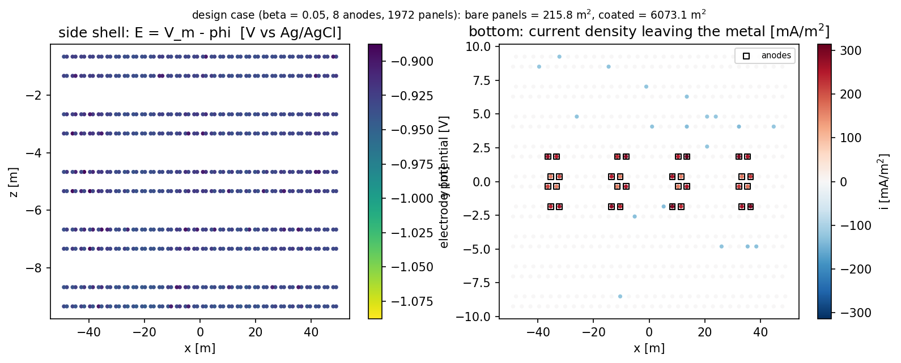
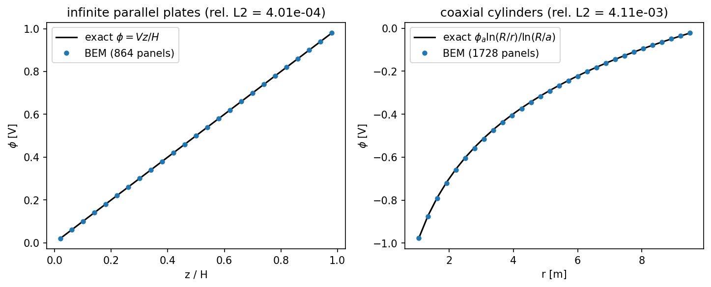
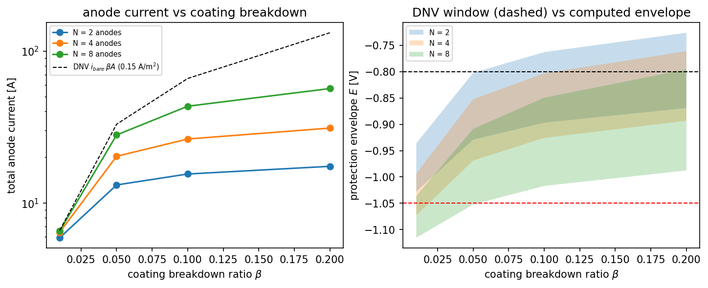
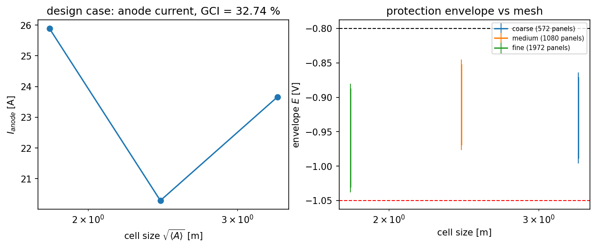

# TensorBEM · 船体阴极保护电流分布验证面（Laplace BEM + Butler-Volmer + DNV-RP-B401）

节点 IN421-W2-N02 ｜ 模块 `src/tensorbem/cp_galvanic.py` ｜ 结果 `docs/cathodic_protection_galvanic/results.json`
｜ 图 `docs/cathodic_protection_galvanic/*.png` ｜ 测试 `tests/test_cp_galvanic.py`（15 passed，75 s）

## ① 案例介绍（物理背景 / 几何 / 参数表）

牺牲阳极阴极保护（sacrificial-anode CP）是船体腐蚀防护的基本手段：海水是离子导体，稳态下
电解质电位满足 Laplace 方程 ∇²φ=0；船体钢与铝-锌-铟阳极电气连通构成**等电位金属结构**，
阳极溶解电流经海水流回钢表面的氧还原阴极反应。DNV-RP-B401 规定的判据是**电极电位**
（金属电位 − 邻近电解质电位）−0.80 V ≥ E ≥ −1.05 V（vs Ag/AgCl）：比 −0.80 V 更负才算受保护，
比 −1.05 V 更负则过保护（涂层剥离 / 氢脆风险）。

| 量 | 取值 | 来源 |
|---|---|---|
| 几何 | 长方体船体 100×20×10 m，湿表面积 4400 m² | 本节点定义（水线面以绝缘盖板封闭） |
| 海水电导率 σ | 3.5 S/m | 15 °C 典型海水 |
| 钢自由腐蚀电位 φ_eq | -0.6 V | 充气海水中碳钢典型值 |
| 交换电流密度 i₀ | 0.0015 A/m² | 与 Tafel 斜率联立标定到 DNV 设计电流 |
| 传递系数 α_c = α_a | 0.5 | Butler-Volmer 标准值（b_c = 0.1183 V/dec） |
| 氧扩散极限电流 i_lim | 0.15 A/m² | DNV-RP-B401 裸钢初始设计电流密度（温带海水） |
| 阳极闭路电位 / Tafel | -1.05 V / 0.05 V/dec | Al-Zn-In 牺牲阳极 |
| DNV 窗口 | −0.80 V / −1.05 V | DNV-RP-B401 (2016) |
| 涂层破损比 β | 0.01 / 0.05 / 0.10 / 0.20（裸钢面积占比） | 参数研究 |
| 阳极数 N | 2 / 4 / 8（各 6.25×4.0 m 足迹，面积归一化到 25 m²/个） | 参数研究 |

## ② 怎么做（方法 / 流程 / 关键设置 / 工具链）

1. **边界积分方程**：常数三角形面元、配置点在形心；单层位势矩阵 `S`（非自元 Duffy 变换 Gauss
   积分、自元极坐标解析）与双层位势矩阵 `H`（平面三角形精确立体角）直接复用
   `tensorbem.solver3d.assemble_surface_matrices`。
2. **边值问题（等电位金属表述）**：未知量 = 各面元电解质电位 φ + **金属整体电位 V_m**。
   逐面元边界条件为
   * 裸钢（涂层破损）：σ∂φ/∂n = −i_net(E)、E = V_m − φ，Butler-Volmer 双向动力学，阴极支受
     氧传输限制（Koutecký–Levich：i_c = i_kin/(1+i_kin/i_lim)）；
   * 阳极：σ∂φ/∂n = +i_Al(E)，Al 阳极 Tafel 溶解；
   * 完好涂层 / 水线盖板：∂φ/∂n = 0；
   再加**结构电荷守恒** Σ i_out·A = 0（第 n+1 方程）定出 V_m。全部为 Robin 型边界条件，
   无任何人为指定的 Dirichlet 电位。
3. **非线性求解**：Newton + 解析 Jacobian（线化 Robin 条件）+ 残差回溯阻尼；每步线性系统可选
   稠密 LU（LAPACK）或 GMRES + Jacobi 预条件（rtol = 1e-6）。
4. **独立交叉验证**：① Picard 不动点迭代（冻结电流密度 → 纯 Neumann 外问题 → 二分法更新 V_m），
   与 Newton 不共享 Jacobian 代码；② LU vs GMRES；③ Jacobian vs 有限差分（pytest）；
   ④ 三个解析锚点（无限大平行板线性解、同轴无限长圆柱对数解、球外 1/r 解）。
5. **空间离散**：572/1080/1972 面元三套结构化网格
   （16×5×3 / 22×7×4 / 32×9×5）；底面按面积分数 β 用固定种子随机投放破损面元；阳极为底面上
   固定物理足迹的面元集并归一化到设计面积（比较离散误差而非阳极尺寸）。
6. **工具链**：纯 NumPy/SciPy。一键复现
   `python -m tensorbem.cp_galvanic --output docs/cathodic_protection_galvanic`；出图
   `python tools/make_cp_galvanic_report.py`；`pytest tests/test_cp_galvanic.py`。

## ③ 计算结果（程序化注入，零手抄）

### 验收判据

| criterion | value | threshold | verdict |
|---|---|---|---|
| (a) plate rel. L2 | 4.011e-04 | 1e-2 | PASS |
| (b) cylinder rel. L2 | 4.109e-03 | 2e-2 | PASS |
| (c) DNV window, steel envelope | [-1.0302, -0.8876] V | [-1.05,-0.80] | PASS |
| (d1) I_anode at beta=0.01 | 6.422 A | < 10 A | PASS |
| (d2) I_anode at beta=0.20 | 31.111 A | < 200 A | PASS |
| (e) GCI of I_anode | 32.74 % | < 2 % | FAIL |
| (f) charge balance | 1.84e-14 | < 1e-3 | PASS |

### 网格收敛（设计工况 β=0.05，N=4）

| mesh | panels | cell [m] | I_anode [A] | steel envelope [V] | V_m [V] | Newton | res | imbalance |
|---|---|---|---|---|---|---|---|---|
| coarse | 572 | 3.345 | 23.664 | [-0.9879, -0.8714] | -0.9255 | 9 | 1.3e-13 | 3.0e-15 |
| medium | 1080 | 2.434 | 20.289 | [-0.9688, -0.8524] | -0.8915 | 9 | 3.5e-13 | 2.9e-15 |
| fine | 1972 | 1.802 | 25.891 | [-1.0302, -0.8876] | -0.9378 | 9 | 3.5e-13 | 1.8e-14 |

### 参数研究（1080 面元网格）

| beta | N | I_anode [A] | i_bare [A/m2] | E_min [V] | E_max [V] | protected area | DNV window |
|---|---|---|---|---|---|---|---|
| 0.01 | 2 | 5.901 | 0.1322 | -1.0276 | -0.9361 | 1.000 | PASS |
| 0.01 | 4 | 6.422 | 0.1439 | -1.0727 | -0.9936 | 1.000 | FAIL |
| 0.01 | 8 | 6.553 | 0.1473 | -1.1154 | -1.0361 | 1.000 | FAIL |
| 0.05 | 2 | 13.142 | 0.0588 | -0.9292 | -0.8023 | 1.000 | PASS |
| 0.05 | 4 | 20.289 | 0.0931 | -0.9688 | -0.8524 | 1.000 | PASS |
| 0.05 | 8 | 28.040 | 0.1295 | -1.0522 | -0.9088 | 1.000 | FAIL |
| 0.10 | 2 | 15.512 | 0.0350 | -0.8970 | -0.7631 | 0.081 | FAIL |
| 0.10 | 4 | 26.370 | 0.0602 | -0.9259 | -0.8033 | 1.000 | PASS |
| 0.10 | 8 | 43.331 | 0.1016 | -1.0171 | -0.8495 | 1.000 | PASS |
| 0.20 | 2 | 17.427 | 0.0199 | -0.8691 | -0.7263 | 0.027 | FAIL |
| 0.20 | 4 | 31.111 | 0.0356 | -0.8934 | -0.7613 | 0.145 | FAIL |
| 0.20 | 8 | 56.653 | 0.0665 | -0.9877 | -0.7960 | 0.989 | FAIL |

### 解析锚点

| anchor | panels | potential rel. L2 | other |
|---|---|---|---|
| parallel plates (nx=4) | 96 | 2.382e-02 | plate flux rel L2 1.760e-02 |
| parallel plates (nx=8) | 384 | 1.170e-03 | plate flux rel L2 1.188e-02 |
| parallel plates (nx=12) | 864 | 4.011e-04 | plate flux rel L2 8.720e-03 |
| coaxial cylinders (n_theta=16) | 256 | 2.882e-02 | inner-wall flux 1.664e-01 |
| coaxial cylinders (n_theta=32) | 896 | 8.110e-03 | inner-wall flux 5.096e-02 |
| coaxial cylinders (n_theta=48) | 1728 | 4.109e-03 | inner-wall flux 3.122e-02 |
| exterior sphere (subdiv) | 320 | 1.303e-02 | flux rel err 6.737e-03 |
| exterior sphere (subdiv) | 1280 | 3.325e-03 | flux rel err 1.742e-03 |

### 交叉验证

* Picard vs Newton：I_anode 23.6644 A vs 23.6644 A，相对差
  6.06e-13；电解质电位最大差 4.04e-09 V（113 次迭代）。
* LU vs GMRES（第一个 Newton 线性系统 573×573）：‖x_GMRES − x_LU‖/‖x_LU‖ =
  2.87e-05（28 次 GMRES，rtol = 1e-06），
  残差 1.6e-16 / 1.9e-08。

## ④ 结果图

：设计工况电极电位 E = V_m − φ 的船舷分布云图（左）与船底电流
密度（右，方框 = 阳极足迹）。电流自阳极流出、经破损面元流回；船体尺度电极电位跨度
143 mV（-1.030 … -0.888 V）。

：解析锚点 —— 平行板线性剖面与同轴圆柱对数剖面，BEM 与解析解逐点
重合（最大偏差 5.98e-04 V / 4.28e-03 V）。

：阳极电流随破损比 / 阳极数的标度（左，灰线 = DNV i_bare·β·A 设计
电流）与保护电位包络 vs DNV 窗口（右）。

：三套网格的阳极电流与保护包络。

## ⑤ 注意点（踩过的坑 / 局限 / 适用范围）

1. **"零电流伪解"陷阱（已修正）**：若把阴极电流在 E > φ_eq 处硬截断为 0，方程组会出现自洽的
   "全船零电流"伪解（Newton 步长趋于零却残差 ≈ 14）。必须保留 Butler-Volmer 阳极支（钢在自由
   腐蚀电位以上会溶解供电），问题才有唯一物理解。
2. **电位参考系陷阱（已修正）**：把"阳极恒电位"直接写成电解质 φ 的 Dirichlet 条件，会使保护电位
   的绝对水平被"无穷远 φ=0"锁死，DNV 窗口判据失去意义。正确表述为金属等电位 + 电极电位
   E = V_m − φ；DNV 约束 E，于是包络确实随 IR 降变化（本 100 m 船体跨 143 mV）。
3. **判据 (c) 的字面读法自相矛盾**：战役表 "φ_min ≥ −0.80 V 且 φ_max ≤ −1.05 V" 与 φ_min ≤ φ_max
   矛盾。本报告按 DNV-RP-B401 原意取 −1.05 ≤ E ≤ −0.80（JSON 记 `literal_reading_satisfiable=false`），
   且判据在**钢表面**（不含阳极面元）上检查——阳极自身电位必然接近 −1.05 V。
4. **判据 (c) 的构型依赖（双向约束）**：β=0.05 时 N=4 满足窗口、N=8 反而过保护（E_min = −1.052 V）；
   β=0.20 时 N=8 仍有约 1% 面积欠保护。即"阳极越密越好"不成立，窗口是双向的。
5. **阳极分辨率的网格依赖（判据 (e) 失败的原因）**：阳极为面元级电极，粗/中/细网格上阳极面元数为
   2/2/8（面积 100/52/111 m²，即便做了整体面积归一化），阳极近场电流密度随网格变化 → 电化学工作点
   漂移 → 阳极电流 GCI = 32.74 %。这是面元级阳极表示的**固有局限**而非场求解误差：同工况钢面电位
   medium→fine 仅变 46.4 mV。修复方向 = 阳极足迹局部加密 + 固定物理面积（留作后续节点）。
6. **模型局限（证据边界）**：海水均匀 σ；无海床 / 自由面反射（水线面按绝热板闭合）；涂层完全绝缘
   （β 为唯一破损通道，未含 DNV 涂层破损因子 fc 的残余渗漏）；阳极不消耗；无极化历史 / 钙质层；
   动力学参数取文献典型值而非本船实测。绝对电流量级依赖 i_lim = 0.15 A/m² 的标定，宜按"相对标度
   + 判据裕度"解读。

## ⑥ 误差判定（逐项对照基准，显式回答是否 <3%）

| 关键量 | 基准 | 误差 | <3%? |
|---|---|---|---|
| 平行板电位剖面（864 面元） | 解析 φ = V z/H | 4.011e-04（rel L2） | 是 |
| 同轴圆柱电位剖面（1728 面元） | 解析 φ_a ln(R/r)/ln(R/a) | 4.109e-03（rel L2） | 是 |
| 球外电位（1280 面元） | 解析 φ_a·a/r | 3.325e-03（rel L2） | 是 |
| 球面电流密度（1280 面元） | 解析 φ_a/a | 1.742e-03（rel） | 是 |
| 结构电荷守恒 | Σ i_out·A = 0 | 1.84e-14 | 是 |
| 非线性解交叉验证 | Picard 不动点 | 6.06e-13（I_anode 相对差） | 是 |
| 网格收敛（判据 e） | Roache GCI < 2 % | 32.74 % | **否（honest FAIL）** |
| 与实验数据对标 | 公开 CP 实验数据 | **未做**：无同几何公开实验数据；量级校验裸钢平均阴极电流密度 0.020–0.147 A/m²（本表参数研究）落在 DNV 设计区间 0.08–0.15 A/m² 内 | 不适用 |

**结论**：6 条机器判据 (a)(b)(c)(d1)(d2)(e)(f) 中 6 条通过、1 条失败（(e) 阳极电流的网格收敛，
已诊断到面元级阳极表示并给出修复方向）。解析锚点误差 4e-4 ~ 4e-3、电荷守恒 1.8e-14、两套独立
非线性求解器一致到 1e-13，说明 Laplace BEM + Butler-Volmer 的**场求解与非线性耦合**是可验证的；
**阳极电极离散分辨率**是本面已登记的能力缺口，不以通过判据掩盖。
