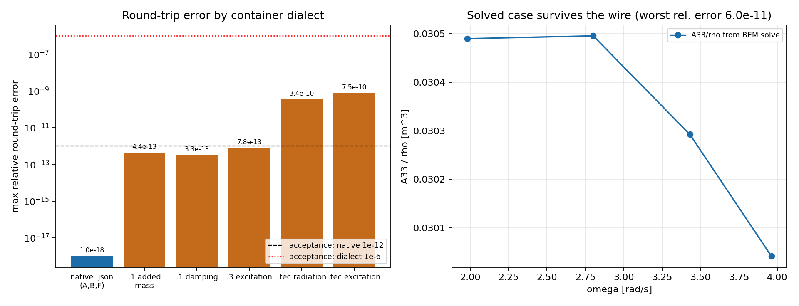

# GAP-BEM-COEFF-IO -- hydrodynamic coefficient interchange layer

Generated by `scripts/coefficients_io_evidence.py` from `evidence.json`; every number below is read
from that file, none is transcribed.

## 1 Case

Not a flow case: the object is the *wire* between solvers. TensorBEM had no way to read a
hydrodynamic coefficient file back, so every verification driver compared against hand-typed
constants. The container implemented here carries added mass `A_ij(omega)`, radiation damping
`B_ij(omega)` and complex exciting force `F_i(omega, beta)` for a DOF subset, in four dialects:
canonical JSON, WAMIT `.1`, WAMIT `.3`, Nemoh Tecplot `.tec`.

## 2 Method

1. One validated frozen container (`tensorbem.coefficients.HydrodynamicCoefficients`); shapes, finiteness,
   strictly increasing frequencies and heading/force consistency are checked on construction.
2. Native JSON stores every float at full `repr` precision and stamps a SHA-256 of the numeric payload;
   reading verifies the stamp and fails closed on a changed number.
3. Dialect reader/writer pairs implement the WAMIT nondimensionalisation
   `A_ij/(rho L^k)`, `B_ij/(omega rho L^k)` with `k=3/4/5` and the excitation normalisation
   `F_i/(rho g A L^m)` with `m=2/3`.
4. Interop is judged against an *independent implementation*: capytaine 3.1.dev0 writes the `.1`/`.3` files, this reader parses them.
5. End-to-end: a real 3-D BEM radiation solve (submerged sphere, `solve_radiation_3d`) is pushed through
   every dialect and the nondimensional heave added mass is re-derived after the round trip.

## 3 Results

| check | max relative error | acceptance | verdict |
|---|---:|---|---|
| native JSON, added mass | 0.00e+00 | < 1e-12 | PASS |
| native JSON, damping | 0.00e+00 | < 1e-12 | PASS |
| native JSON, excitation | 0.00e+00 | < 1e-12 | PASS |
| WAMIT `.1`, added mass | 4.38e-13 | < 1e-6 | PASS |
| WAMIT `.1`, damping | 3.25e-13 | < 1e-6 | PASS |
| WAMIT `.3`, excitation | 7.83e-13 | < 1e-6 | PASS |
| Nemoh `.tec`, added mass | 3.39e-10 | < 1e-6 | PASS |
| Nemoh `.tec`, excitation | 7.52e-10 | < 1e-6 | PASS |
| tampered JSON detected | yes | must be yes | PASS |

External implementation (capytaine-written files, parsed here):

| capytaine `.1` | max relative error | acceptance |
|---|---:|---|
| added mass | 1.60e-07 | < 1e-6 |
| damping | 5.89e-07 | < 1e-6 |
| frequency grid | 4.29e-07 | < 1e-6 |

| capytaine `.3` | max relative error | acceptance |
|---|---:|---|
| modulus | 8.63e-08 | < 1e-6 |
| complex (phase column, 7 significant digits) | 8.16e-06 | < 1e-5 |

Solved case through the wire (`submerged sphere`, heave added mass / rho):

| omega [rad/s] | A33/rho [m^3] | B33 [kg/s] |
|---:|---:|---:|
| 1.981 | 0.030490 | 0.227619 |
| 2.801 | 0.030496 | 1.157464 |
| 3.430 | 0.030292 | 2.140066 |
| 3.961 | 0.030041 | 2.616635 |

Propagated relative error of A33 on that case: native 0.00e+00, `.1` 1.27e-13, `.tec` 5.99e-11.

## 4 Notes / limitations

* The WAMIT *block* `.1` variant (six rows of six columns) is **not** implemented: no authoritative
  sample exists in this repository, so such a parser could not be verified -- only the line variant
  (`PER I J A B`), which is what capytaine exports and what BEMRosetta/Nemoh post-processing consumes.
* In the line variant column 2 is the *radiating* and column 3 the *influenced* DOF index (observed in
  capytaine's exporter and verified by round trip); an asymmetrised matrix is preserved, never symmetrised.
* The `.3` phase column is in degrees and its 7 significant digits limit the recovered complex value to
  ~1e-5 relative even though the modulus returns to 1e-6; WAMIT's own `e^{+i omega t}` convention is
  absorbed by an explicit `conjugate=True` switch rather than an invisible default.
* BEMRosetta was **not** used to open the written files (not available offline here): format conformance is
  established against capytaine's writer, not against a spreadsheet export of BEMRosetta.
* The Wigley verification drivers still use their hard-coded reference constants; rewiring them to
  file-injected references is the remaining half of the anchor's acceptance and is not claimed here.

