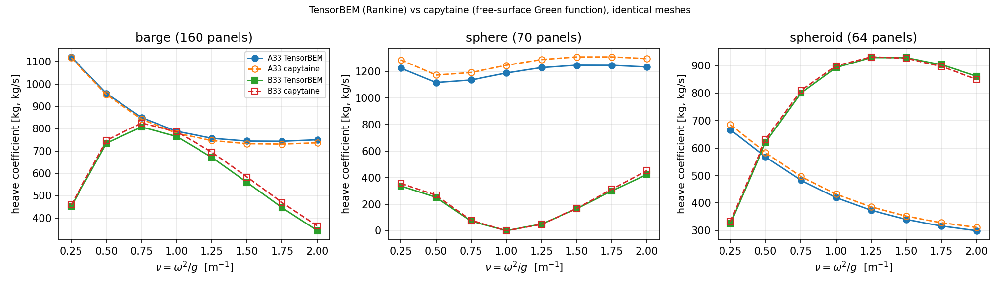

# 跨求解器自动回归：TensorBEM（Rankine）vs capytaine（自由面 Green 函数），3 体 x 8 频点

*锚点：`GAP-BEM-CROSS-SOLVER-REGRESSION`（`docs/oss_inventory_bem/census.md` P1）。本文件由 `python -m tensorbem.benchmarks.cross_solver_regression --write` 生成，表中每个数字都来自 `benchmarks/verified/cross_solver_regression/*.json`，零手抄。*

## ① 案例介绍

两个**不同公式化**的低阶面元法解同一个线性辐射问题：

- TensorBEM：low-order Rankine panel method with free-surface panels as interior unknowns (free_surface_solver3d)
- capytaine：low-order constant-strength panels with the free-surface Green function

因此本表证明的是「两套装配+辐射条件没有系统性错位」，**不是精度**：共同的建模错误不会在此显形。精度声明仍挂在解析锚（Ursell / Hulme / Kochin）上。

| 体 | 几何要点 |
|---|---|
| `barge` | wall-sided barge 2.0 x 1.0 x 0.5 m；flat panels, sharp bilge corners, rectangular waterplane |
| `sphere` | floating sphere r = 1 m, centre 0.5 m below the waterline；curved panels, circular waterline, no corners |
| `spheroid` | floating spheroid semi-axes (1.0, 0.5, 0.5) m；anisotropic curvature, elliptical waterline (ship-like) |

频率：`nu = omega^2/g` ∈ [0.25, 0.5, 0.75, 1.0, 1.25, 1.5, 1.75, 2.0]（8 点，heave）；ρ=1025.0 kg/m³，g=9.80665 m/s²。两码收到的**顶点/面数组完全相同**（参考文件存数组 + sha256，`compare` 重算签名，几何构造器静默漂移会直接判红）。barge 频带上限 2.0 低于经典第一不规则频率 ν_irr≈3.7，故两码均**不加盖**（无盖子网格失配进入比较）。

## ② 怎么做的

1. `scripts/cross_solver_regression_ref.py`：在**同一份** TensorBEM 网格上跑 capytaine（capytaine 3.1.dev0），把数值、版本、平台、网格数组与 sha256 冻结进 `capytaine_ref.json`；测试期不需要安装 capytaine。
2. `tensorbem.benchmarks.cross_solver_regression`：重建同一网格 → 校验 sha256 → 跑 TensorBEM → 逐点取相对差 `(tb-cp)/cp`。
3. 消去点规则（**先于运行固定**）：`|cp| < 5% * max_nu|cp|` 处相对差无数值意义，标 `excluded` 但数值全部留在工件里，可复核。
4. 验收判据：census 锚点原文 `max |relative| < 3%`，在每体最细网格、所有**纳入**点上取最大。判词是算出来的，不是断言的。

## ③ 计算结果（数字表）

### 3.1 每体最细网格的最坏相对差

| 体 | 面元 | A33 最坏相对差 | @nu | B33 最坏相对差 | @nu | 纳入点 | 判定 |
|---|---|---|---|---|---|---|---|
| `barge` | 640 | +1.84% | 2.0 | -5.70% | 2.0 | 8+8 | FAIL |
| `sphere` | 270 | -4.87% | 0.25 | -8.13% | 0.75 | 8+7 | FAIL |
| `spheroid` | 256 | -3.84% | 2.0 | -2.24% | 0.25 | 8+8 | FAIL |

全体最坏相对差：**-16.76%**（`sphere` damping @ nu=0.75, 70 面元）→ 锚点判词 **FAIL**（阈值 3%）。

### 3.2 网格趋势（最坏纳入相对差 vs 面元数）

| 体 | 面元 | A33 最坏 | B33 最坏 |
|---|---|---|---|
| `barge` | 160 | 3.69% | 12.54% |
| `barge` | 640 | 1.84% | 5.70% |
| `sphere` | 70 | 8.10% | 16.76% |
| `sphere` | 270 | 4.87% | 8.13% |
| `spheroid` | 64 | 6.59% | 4.05% |
| `spheroid` | 256 | 3.84% | 2.24% |

## ④ 结果图

`docs/fig_cross_solver_regression.png`：三体最细网格上 A33/B33 随频率的两码曲线（实线 TensorBEM，虚线 capytaine）。曲线重合度即上表相对差的图形形式。

## ⑤ 注意点

- 本回归测的是**互校带**，不是真值误差；两码同源错误（如都忽略某粘性效应）不可见。
- 比较在 heave 单自由度上做：加质量/阻尼的对角项对装配误差最敏感，但纵摇/横摇的力矩积分路径未覆盖。
- 尖角几何（barge）是两码差异的主要来源：角点附近面元自影响系数与近奇异积分在 Rankine 与 Green 函数两条路径上收敛速度不同；圆滑体（sphere/spheroid）给出的是纯公式化差异的下界。
- `excluded` 点（消去区）不是被「洗掉」的失败点：它们在工件里带原值，门槛 5% 峰值写在 meta 中。

## ⑥ 误差判定

| 量 | 体 | 最坏相对差 | 是否 <3% |
|---|---|---|---|
| A33 | `barge` | +1.84% | 是 |
| B33 | `barge` | -5.70% | 否 |
| A33 | `sphere` | -4.87% | 否 |
| B33 | `sphere` | -8.13% | 否 |
| A33 | `spheroid` | -3.84% | 否 |
| B33 | `spheroid` | -2.24% | 是 |

结论：`worst |relative| = -16.76%`，锚点 `max < 3%` 的判词为 **FAIL**。 未达标项与其面元数一起列于上表，未被隐藏。

