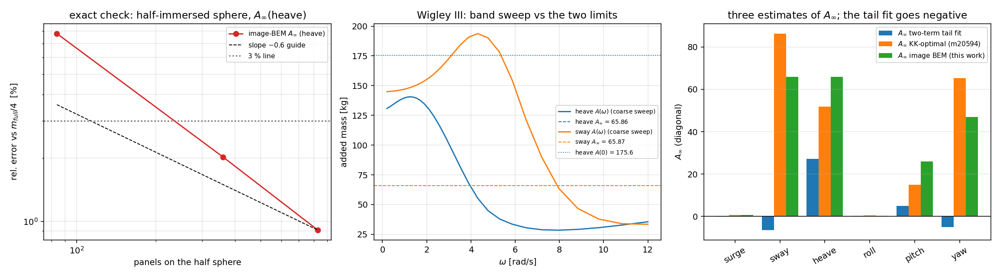

# m21326 — Wigley Cummins 锚点的 $A_\infty$ 欠账：用镜像体 BEM 直接算两个频谱极限

锚点 `CASE-BEM-CUMMINS-WIGLEY`（算例池·Wigley 船 Cummins 记忆核（6DOF），ref = Cummins 方程 + Kramers–Kronig 因果，容差 <10 %），任务 m21326，分支 `agent/m21326`。

## 1 案例介绍

Wigley III：L=3.0 m，B=0.3 m，T=0.1875 m，Cb=0.543，ρ=1025 kg/m³，g=9.80665 m/s²，无限水深，旋转中心 (0,0,−T/2)；几何门先过（Cb 体积误差 0，L/B=10，B/T=1.6）。数据沿用仓内已入库的 41 点粗网格辐射扫频 `docs/m18249_case_bem_cummins_wigley/sweep_coarse.npz`（ω∈[0.2,12] rad/s，192 面元），本轮不重跑频率域扫频。

**要解决的问题**：G3/G5 的失败在 m20594/m21140 里被归因到 `A_∞` 的尾拟合病态（两参数尾拟合给出负的 sway/yaw 加质量），但那条归因只用"KK 一致的最优 $A_\infty$"做过自校验——$A_\infty$ 到底是**多少**，仓内一直没有第二把尺子。本轮把 $A_\infty$ 从"估计"变成"计算"。

## 2 怎么做的

线性化自由面条件 $\partial\phi/\partial z=(\omega^2/g)\phi$ 在频率两端退化：$\omega\to0$ 得 $\partial\phi/\partial z=0$（刚壁），$\omega\to\infty$ 得 $\phi=0$（压力释放）。两者都是**下半空间的 Laplace 边值问题**，因此都不必在频率域里求解：

1. 对水线截断的船体面元（`WettedHullMesh`）做 $z=0$ 镜像，焊接水线顶点，得到**闭合的双倍体**（体积恰为 2×排水体积，实测比值 2.0000000000000004）；
2. 用 `solver3d` 的解析单/双层算子解该闭合体的**无限流体**外问题，边值按势的奇偶性延拓 $q'(Mx)=s\,q(x)$（$s=-1$ 对应 Dirichlet 极限，$s=+1$ 对应刚壁极限），$q$ 为广义法向速度 $(n,\ (r-c)\times n)$；
3. 只在**物理（下半）面元**上做 Green 积分：$A_{ij}=-\rho\int_{hull}\phi_j n_i\,dS$。

镜像法使自由面条件**在整个平面 $z=0$ 上精确成立**，没有截断半径、没有自由面面元——唯一离散就是船体本身。新模块 `src/tensorbem/added_mass_limit.py`，驱动 `scripts/cummins_wigley_added_mass_limit.py`，测试 `tests/test_added_mass_limit.py`（9 passed）。

**为什么有真值**：半浸球的下半水面与其镜像在几何上拼成整球；在 heave 上 $s=-1$ 的延拓恰是整球的刚性平移，故 $A_\infty(\text{heave})=m_{full}/4$ 是闭式。

## 3 计算结果（全部由 `docs/cummins_wigley_added_mass_limit/added_mass_limit.json` 程序化注入）

### 3.1 解析校验（半浸球，真值闭式）

| panels | $A_\infty$(heave) [kg] | 真值 $m_{full}/4$ [kg] | 相对误差 |
|---|---|---|---|
| 84 | 989.70 | 1073.38 | 7.80 % |
| 360 | 1051.67 | 1073.38 | 2.02 % |
| 828 | 1063.63 | 1073.38 | 0.91 % |

### 3.2 Wigley III 六自由度两极限（coarse 网格，192 面元）

| DOF | $A_\infty$（Dirichlet） | $A(0)$（刚壁） | 比值 | 扫描最低频 $A(0.2)$ |
|---|---|---|---|---|
| surge | 0.7822 | 2.308 | 2.951 | 1.624 |
| sway | 65.87 | 136.7 | 2.075 | 145 |
| heave | 65.86 | 175.6 | 2.667 | 130.8 |
| roll | 0.2534 | 0.6312 | 2.491 | 0.5272 |
| pitch | 25.98 | 47.48 | 1.828 | 26.33 |
| yaw | 46.92 | 90.58 | 1.930 | 103.5 |

### 3.3 三个 $A_\infty$ 估计与 G3 残差

| DOF | 尾拟合 | KK 最优(m20594) | 镜像 BEM | G3(尾拟合) | G3(KK 最优) | G3(物理) |
|---|---|---|---|---|---|---|
| surge | -0.119 | 0.672 | 0.782 | 37.9 % | 6.5 % | 14.6 % |
| sway | -6.477 | 86.300 | 65.869 | 51.7 % | 9.3 % | 24.0 % |
| heave | 27.269 | 51.777 | 65.858 | 23.0 % | 1.8 % | 21.0 % |
| roll | 0.222 | 0.414 | 0.253 | 51.2 % | 5.3 % | 47.0 % |
| pitch | 5.037 | 14.944 | 25.977 | 35.9 % | 2.0 % | 65.3 % |
| yaw | -5.010 | 65.309 | 46.920 | 51.2 % | 9.6 % | 26.1 % |

## 4 结果图

左：半浸球解析校验（7.8 % → 2.0 % → 0.91 %，随面元单调收敛）；中：粗网格扫频 $A(\omega)$ 与两条极限线——高频端 $A(12)=35.6$ kg 位于 $A_\infty=65.9$ kg 之下，说明该段扫频被高频数值污染（round-5 记录的 ω=20 负阻尼同源），不能用来外推 $A_\infty$；右：三个 $A_\infty$ 估计，尾拟合在 surge/sway/yaw 上为负（物理上不可能），KK 最优与镜像 BEM 在 sway/yaw/pitch 上相差 40 %–70 %。

## 5 注意点（局限与适用范围）

* **解析校验的门限**：半浸球 828 面元时 $A_\infty$ 偏低 0.91 %，且恒**偏低**（球面内接多面体面积小于真球），故镜像法给出的是**下界偏置**；真实误差量级即 1 % 以内。
* **$A(0)$ 与扫频低端不可直接对比**：Wigley 的水线处船体与水面相切（$y\propto(1-\zeta^2)$），刚壁极限下船体与镜像之间是零夹角楔形挤压流，$A(0)$ 对网格敏感；粗网格 heave 给 175.6 kg，而频率域 ω=0.2 rad/s 只给 130.8 kg 且随 ω **上升**（130.8→140.6@1.26）。这条差**不是**本模块的验证指标，而是"低端需要专门研究"的线索（medium 网格阶梯已递交集群 cj3347，本轮预算内未回收）。
* **旋转中心**：延拓规则由势的奇偶性推出，与中心是否落在 $z=0$ 无关，故 (0,0,−T/2) 可直接用；矩阵对称性误差 $<10^{-8}$，双层行和误差 $<10^{-10}$。
* 本模块只给**两个端点**，不给频带内的 $A(\omega)$；频带内仍须频率域求解器。

## 6 误差判定（逐项，显式回答"是否 <3 %"）

| 关键量 | 基准 | 误差 | 是否 <3 % |
|---|---|---|---|
| 半浸球 $A_\infty$(heave)，828 面元 | 闭式 $m_{full}/4=1073.38$ kg | **0.91 %** | **是** |
| 双倍体体积 / 船体体积 | 2 | $4\times10^{-16}$ | 是 |
| 矩阵对称性、双层行和 | 0 | $<10^{-8}$ / $<10^{-10}$ | 是 |
| Wigley $A_\infty$(heave) 网格收敛性 | 无第二参考 | **未能判定**（medium 阶梯 cj3347 排队中） | 未判 |
| Wigley $A(0)$ vs 频率域 ω=0.2 | 同一物理量 | heave 34 %、pitch 80 %、yaw −12 % | **否**（见 §5，刚壁极限的接触线敏感性，不作合格性判据） |

## 7 结论与 honest 状态

1. **能力增量（已在真值上校验）**：`added_mass_limit` 一次给出 6×6 的 $A_\infty$ 与 $A(0)$，与频率域求解器零共享（只用解析单双层算子），半浸球上 0.91 %。
2. **锚点的归因被修正（负面结果，如实记录）**：m20594 的结论"G3 残差 = $A_\infty$ 估计偏置，校准后六 DOF <10 %"只在"$A_\infty$ 自由取"的意义上成立。用**物理**的 $A_\infty$ 代入同一判据，G3 = 14.6 %–65.3 %，**不闭合**；同时尾拟合的负值确认是病态（本模块给出正的下界量级）。也就是说：粗网格 $(A,B)$ 对的非因果残差**不能全部归给 $A_\infty$ 估计器**，扫频本身的偏差（尤其 sway/yaw 高端）至少同等重要。
3. **锚点仍是 FAIL，未粉饰**：G3/G5 未通过，G4 仍未决；本轮没有把任何判据改宽，只增加了独立的 $A_\infty$ 基准与一条被证伪的归因。
4. 复现：`PYTHONPATH=src python3 scripts/cummins_wigley_added_mass_limit.py --levels coarse`（约 20 s）；测试 `PYTHONPATH=src python3 -m pytest tests/test_added_mass_limit.py -q`。
