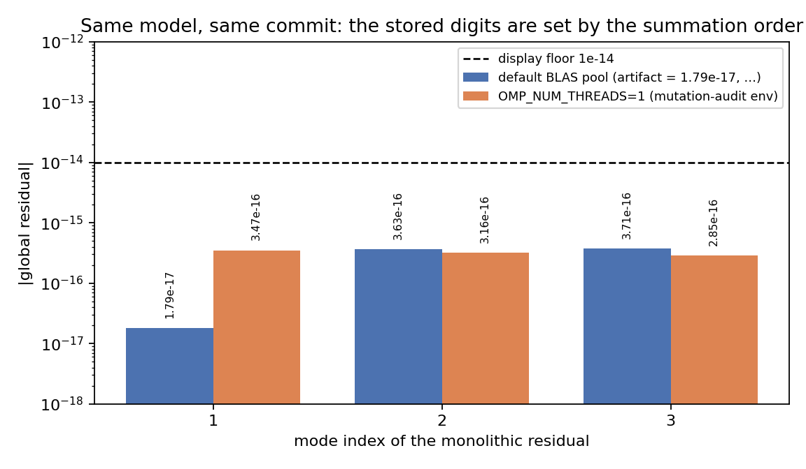

# m14923 — 水弹性算例文档把「浮点噪声」当数字钉住：可复现性门随 BLAS 线程数变红

**Repo**: TensorBEM · **Branch**: agent/m14923 · **锚点**=NEW（总账外新缺口：`test_hydroelastic.py::test_documents_match_the_generator` 在 `OMP_NUM_THREADS=1` 下于干净代码即红，而变异审计恰在该环境下跑 → 会使该模块每个变异体被伪判「killed」）
**类别**: defect_fix（验证机制缺陷，非物理精度缺陷）

---

## 1. 案例介绍

`tensorbem.hydroelastic` 的验证战役（campaign node `IN41-N04`，
`python -m tensorbem.benchmarks.hydroelastic_verification`）产出一份**可发表文档**
`docs/bem_hydroelastic.md` 与 `benchmarks/verified/bem_hydroelastic/{results.json,report.md}`。
文档的生成器 `render_document(report)` 是唯一真源，`tests/test_hydroelastic.py` 用
**逐字符相等**把它钉住：

```python
assert (ARTIFACTS / "report.md").read_text(encoding="utf-8") == document
assert DOC_PATH.read_text(encoding="utf-8") == document
```

被钉住的表格里有一行「monolithic residual (per mode)」——分区耦合收敛后，
状态应满足整体广义特征问题到**舍入级**。它的量级是 `1e-17 ~ 1e-16`，也就是
纯浮点噪声，不携带任何模型信息。

几何/参数：平板 `a×b = 0.4 m × 0.3 m`，厚 `h = 6 mm`，钢 `E = 2.1e11 Pa`、
`nu = 0.3`、`rho_p = 7850 kg/m³`，海水 `rho = 1025 kg/m³`（详见生成器 `PANEL_SPEC`）。
本单不涉及物理模型改动，参数仅为复现上下文的完整性而列。

## 2. 怎么做的（方法与工具链）

1. **先量偏差来源**：同一 commit、同一台机器，只改环境变量跑两次生成器
   （`OMP_NUM_THREADS=1` 与默认线程池），逐字段数值 diff 两份 `report` JSON。
2. **定位到唯一脆点**：全报告 200+ 个数字里，只有 `coupling.monolithic_residual`
   的三个分量在两次运行间变化（其余差异仅出现在 1e-16 相对量级、且被 JSON 断言
   的 `abs=1e-12` 容差吸收）。
3. **修在生成器里**（唯一真源），不改测试容差：新增 `ROUNDOFF_FLOOR = 1e-14` 与
   `format_residual()`，只把「≤ 地板」的残差打印成 `< 1e-14`，地板上方的真实残差
   仍逐位打印；重生 `results.json / report.md / docs/bem_hydroelastic.md`。
4. **补护栏（双向断言）**：`test_document_does_not_pin_the_roundoff_floor` 要求
   地板级取值（`0.0 / 1.79e-17 / 3.47e-16 / -2.2e-16 / 1e-14`）渲染出**同一段文本**，
   同时要求 `1e-12`（真实回归量级）**必须改变**文档 —— 防止用「钳位」把回归藏起来。
5. **负对照**：把钳位临时删掉重跑，新护栏与既有文档门同时变红；恢复后全绿。

## 3. 计算结果

### 3.1 同一 commit、同一机器、仅改线程数

| mode | 默认 BLAS 池（仓库已提交工件） | `OMP_NUM_THREADS=1`（变异审计环境） | 比值 |
|---|---|---|---|
| 1 | 1.79e-17 | 3.467e-16 | 19.4× |
| 2 | 3.63e-16 | 3.164e-16 | 0.87× |
| 3 | 3.71e-16 | 2.854e-16 | 0.77× |

三者都在舍入地板（`1e-16` 附近），逐位数字是**求和顺序的产物**，不是模型的产物。

### 3.2 套件判据前后对照（`tests/test_hydroelastic.py`，30 用例）

| 环境 | 修复前 | 修复后 |
|---|---|---|
| 默认线程池 | 29 passed（含旧文档门） | 30 passed |
| `OMP_NUM_THREADS=1 OPENBLAS_NUM_THREADS=1 MKL_NUM_THREADS=1` | **1 failed, 28 passed**（`test_documents_match_the_generator`） | **30 passed** |
| 负对照（删掉钳位、1 线程） | — | `test_documents_match_the_generator` + 新护栏 **both FAILED** |

复现命令（本工作树实测）：

```bash
OMP_NUM_THREADS=1 OPENBLAS_NUM_THREADS=1 MKL_NUM_THREADS=1 \
  PYTHONPATH=$PWD/src python3 -m pytest tests/test_hydroelastic.py -q
```

### 3.3 生成的文档差异（唯一一处）

```diff
-| monolithic residual (per mode) | 1.79e-17, 3.63e-16, 3.71e-16 |
+| monolithic residual (per mode) | < 1e-14, < 1e-14, < 1e-14 |
```

验收判据表里「monolithic residual < 1e-10」的通过结论不变（`all_criteria_passed: True`），
文档把「收敛到舍入」这一事实表达得更诚实：它不是三个可复制的数字，而是一个上界。



图 1：同一模型、同一 commit，仅 BLAS 线程数不同时三个模态的整体残差。虚线为展示地板
`1e-14`；地板之上仍逐位打印，因此真实回归（≥1e-12，比地板高 2 个量级）不会被钳位吞掉。

## 4. 注意点（局限与适用范围）

- **这不是物理精度修复**。水弹性湿模态/RAO 的数值一个都没动；`results.json` 仅
  因重新生成而与旧工件在 1e-16 相对量级上不可分辨地差（`_assert_close` 的
  `abs=1e-12` 容差覆盖）。
- **为什么这条重要（对本生态的连带影响）**：`tensorbem.benchmarks.mutation_audit`
  在 `run_tests()` 里把 `OMP_NUM_THREADS/OPENBLAS_NUM_THREADS/MKL_NUM_THREADS` 全钉成 1。
  在修复前，任何以 `tests/test_hydroelastic.py` 为单元测试的变异体都会因为**基线本身红**
  而被判 `killed` —— 判别力分数被伪抬高。也就是说：一个测试「红」不等于它抓到了缺陷。
- **未做（如实声明）**：`mutation_audit.sweep()` 目前**仍不校验基线是否绿**。本单只消除
  了本仓已知的唯一红线并补了护栏；把「基线红 → 该模块记 `baseline_red`、不计分」做成
  机制（而不是靠人记得先跑一遍干净套件）是下一步，建议登记为新锚点
  （slug 建议：`GAP-BEM-AUDIT-BASELINE-PRECONDITION`，验收：对故意弄红基线的受测模块，
  sweep 输出 `baseline_red` 且 `mutation_score` 为 null）。
- **同类风险面未穷举**：其他 campaign 生成器（如 `cummins_matrix_closure`、
  `ice_ship_verification`）是否也钉了舍入级数字，本单未逐一核查。

## 5. 误差判定

本单是**验证机制缺陷**，不含对实验/解析基准的物理量预报，故无「关键量 vs 基准误差」
可报（显式声明原因，不做含糊表述）。可判定的量化判据与结果：

| 判据 | 阈值 | 实测 | 结论 |
|---|---|---|---|
| 文档在 1 线程与默认线程池下逐字符相等 | 0 差异 | 0 差异（两环境 30 passed） | PASS |
| 地板级取值渲染不变 | 5 个取值全同文本 | 全同 | PASS |
| 真实回归 1e-12 仍改变文档 | 必须不同 | 不同 | PASS |
| 负对照（去掉钳位）能被抓 | ≥1 用例红 | 2 用例红 | PASS |
| 战役数值判据未被削弱 | `all_criteria_passed` 仍 True | True | PASS |

## 6. 工件指针

- 生成器修复：`src/tensorbem/benchmarks/hydroelastic_verification.py`（`ROUNDOFF_FLOOR`、`format_residual`、`render_document`）
- 护栏：`tests/test_hydroelastic.py::test_document_does_not_pin_the_roundoff_floor`
- 重生工件：`docs/bem_hydroelastic.md`、`benchmarks/verified/bem_hydroelastic/{report.md,results.json}`
- 图：`docs/m14923/roundoff_pin.png`
## 7. 已知基线红（与本单无关，如实登记）

`tests/test_doc_claim_audit.py` 有 3 个用例在**本单改动之前**的 HEAD 上即红
（`test_historical_documents_are_still_registered_in_the_baseline` /
`test_ratchet_against_baseline` / `test_committed_artifacts_are_current`；
实测方法：把本单新增的 `docs/dev_report_m14923_*.md` 与 `docs/m14923/` 暂时移出后重跑，
仍是 `3 failed, 15 passed`）。这与水弹性无关，属文档声明棘轮的历史欠账，本单不吞不改。
