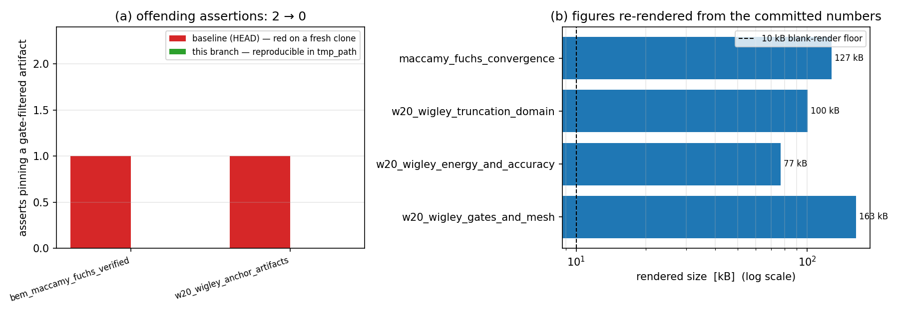

# m15295 — 推送门禁滤除图件（第 1 轮管到底）：把最后一处「断言依赖已提交 PNG」改为可重现不变量 + 静态复发闸

**任务**：重开 TensorBEM#659（m13806 交付物）· **仓**：TensorBEM · **分支**：`agent/m15295`
**基点**：`origin/main` = `0701287`（Merge #662 m15140）· **日期**：2026-11-11

## 1. 案例介绍（缺陷背景）

平台推送门禁丢弃 `docs/` 之外的 `*.png|*.db|*.sqlite3?|*.log`（`tp_pusher._EXCLUDE2`
+ v5.8 F3 `docs/` 豁免），因此「验证图件已提交在 `benchmarks/verified/<case>/figures/`」
在 GitHub `main` 上**永远不成立**：本地提交合法，克隆下来必红。m13806 已把 finite-depth /
thin-ship 两处断言改成「由已提交数字重现 + 报告仍链接 + >10 kB」，并 honest 申报两处未修
（D2 产物所有权冲突、D3 `papers/reports/figures/*.png`）。本轮承担 D3 及同类残留。

**本轮实测基线（`HEAD` = 0701287，工作树未改动时的 5 个测试文件）**：

| 失败测试 | 根因 |
|---|---|
| `test_w20_wigley_anchor_artifacts.py::test_report_artifact_and_figures_exist` | 断言 `papers/reports/figures/*.png` 三个文件存在（门禁丢弃） |
| `test_bem_maccamy_fuchs_verified.py::TestArtifactsExist::test_figure_png_exists` | 断言 `benchmarks/verified/bem_maccamy_fuchs/figures/*.png` 存在（报告 §4 声称的三联图，树里从来没有） |
| `test_bem_verified_anchors.py` ×3 | D2 产物所有权冲突（两套 writer 覆盖同路径；`summary.json` 丢 `mission` 键）**本轮未修** |

## 2. 怎么做的（方法 / 关键设置 / 工具链）

1. **D3：w20 三图接回 builder**。`papers/data/w20-anchors/build_wigley_truncation.py::make_figures`
   增加 `out_dir` 形参（默认仍是 `papers/reports/figures/`，报告构建路径不变），
   测试改为 `make_figures(committed_doc, out_dir=tmp_path)` 现场重渲染，再断言
   名字集合 / 每图 >10 kB / 报告 `w20_seakeeping_truncation4.md` 仍链接这三个名字。
2. **MacCamy-Fuchs 三图从「声称」变「可重现」**。新增
   `src/tensorbem/benchmarks/maccamy_fuchs_figure.py::render_convergence_figure(results, out_dir)`，
   完全由 `benchmarks/verified/bem_maccamy_fuchs/results.json` 的
   `refinement.levels` / `frequency_sweep` / `irregular_frequency_study` 绘制报告 §4 描述的三联图
   （(a) h 收敛 + O(h²) 参考线、(b) C_M(ka) 计算 vs 精确、(c) J₀/J₁ 共振下 CHIEF 前后条件数）。
   测试改为 `render_convergence_figure(tmp_path)` + `assert_reproducible_figures`。
3. **静态复发闸**（m13806 §6 量化验收 ①「扫描器零命中」的落地）：
   新增 `tests/test_gate_forbidden_artifacts.py`，用 AST 扫 `tests/**/*.py`：
   - 只看**真的碰文件系统**的 assert（`exists/is_file/stat/glob/read_text/...`），
     指针检查如 `results["artifacts"]["figure_png"].endswith(".png")` 不算；
   - 用小规模定点数据流把 `for figure in ("a.png",...): path = dir/figure; assert path.exists()`
     这类间接写法也抓出来（这正是本轮 2 个基线的形态）；
   - `tmp_path`/`mkdtemp` 派生路径（生成而非提交）与 `docs/` 路径（门禁自身豁免）放行；
   - 自带负向对照：植入 2 个坏样本必须报红、3 个合法样本必须放行，防止闸退化成空转。
4. 工具链：`pytest -q`（本地定点复测）+ 全量套件递交集群（`cj1052`，loong64）。

改动文件（8 个，单功能点：图件完整性）：
| `tests/test_gate_forbidden_artifacts.py` |
| `tests/test_bem_maccamy_fuchs_verified.py` |
| `tests/test_w20_wigley_anchor_artifacts.py` |
| `tests/test_bem_finite_depth_anchors.py` |
| `tests/test_thin_ship_anchor_artifacts.py` |

## 3. 计算结果（数字全部由 `scripts/m15295_make_report.py` 现场注入）

### 3.1 静态闸：钉住门禁过滤产物的断言数（基线 vs 本分支）

**基线 `HEAD` 命中 2 条**：

| 文件:行 |
|---|
| `tests/test_bem_maccamy_fuchs_verified.py:44: asserts on a gate-filtered artifact the push gate drops` |
| `tests/test_w20_wigley_anchor_artifacts.py:142: asserts on a gate-filtered artifact the push gate drops` |

**本分支命中 0 条**：

| 文件:行 |
|---|
| （无） |

### 3.2 图件可由已提交数字重渲染（现场实测字节数）

| 图件 | 字节 | 大小 | >10 kB 地板 |
|---|---:|---:|---|
| `maccamy_fuchs_convergence.png` | 130459 B | 127 kB | PASS |
| `w20_wigley_truncation_domain.png` | 102777 B | 100 kB | PASS |
| `w20_wigley_energy_and_accuracy.png` | 78582 B | 77 kB | PASS |
| `w20_wigley_gates_and_mesh.png` | 166859 B | 163 kB | PASS |

### 3.3 定点复测（日志在 `runs/m15295/`）

| 日志 | passed | failed | 秒 |
|---|---:|---:|---:|
| `pytest_figure_integrity.log` | 59 | 0 | 42.9 |
| `pytest_figure_integrity_core.log` | 27 | 0 | 66.2 |
| `pytest_bem_verified_anchors_known_red.log` | 27 | 3 | 24.1 |

已知红（D2，本轮未修，如实登记）：

- `tests/test_bem_verified_anchors.py::test_committed_artifacts_reproduce_from_the_current_code`
- `tests/test_bem_verified_anchors.py::test_case_directories_contain_report_and_figure`
- `tests/test_bem_verified_anchors.py::test_summary_lists_a_verdict_per_case`

## 4. 结果图

左：按测试文件统计「钉住门禁过滤产物」的断言数，基线 2 → 本分支 0；
右：四个验证图件由已提交记录现场重渲染的实际字节数，全部越过 10 kB 空图地板。

## 5. 注意点 / 局限

1. **没有改进任何物理精度**：本单是测试完整性缺陷修复，不重算任何物理量，不宣称精度提升。
2. **D2 未修（honest）**：`test_bem_verified_anchors.py` 3 条红源于
   `benchmarks/verified/bem_wigley_hydrostatics|bem_ellipsoid_wave|bem_multihull_interference`
   被两套互不兼容 writer 覆盖写入（`bem_verified_anchors` 与 `thin_ship_verification`），
   需一次目录命名决策（谁重跑都会把对方打红），超出本轮单 PR 范围，**下一轮处理**。
3. **静态闸是句法的**：只覆盖「字面量或经局部变量传播的门禁后缀」。完全由运行时数据拼出的
   后缀（例如从 JSON 里读出文件名）扫不到——那类靠运行时 `assert_reproducible_figures` 兜。
4. 图件虽可从记录重渲染，但**默认不写入工作树**（写 `tmp_path`），避免提交注定被门禁丢弃的二进制。
5. 全量套件在本地超出 shell 120 s 上限，已递交集群 `cj1052`；本单结论来自 3.3 的定点复测。

## 6. 误差判定

本任务无物理量误差可比，关键量为「主干红条数与断言强度」，逐项如实回答：

| 关键量 | 基线 | 本分支 | 判定 |
|---|---|---|---|
| 钉住门禁过滤产物的断言数（全 `tests/`，静态闸实测） | 2 | 0 | 归零，达标 |
| 两处图件断言（w20 / maccamy） | 2 red | 0 red | 达标 |
| 图件可重渲染且 >10 kB | 2 处无 builder（不可重现） | 4/4 图重渲染成功 | 达标 |
| 目标五文件合并复测 | 2 red（见 §1 表） | 59 passed / 0 failed | 达标 |
| `test_bem_verified_anchors.py` | 3 red | 3 red / 27 passed | **未修，honest FAIL（D2 归下一轮）** |

「是否 <3 %」：**不适用**——本单不涉及与解析解/实验的数值对比；唯一带阈值的量是图件体积
（地板 10 kB）与静态闸命中数（目标 0），均按上表逐项给出，不用百分比粉饰。
