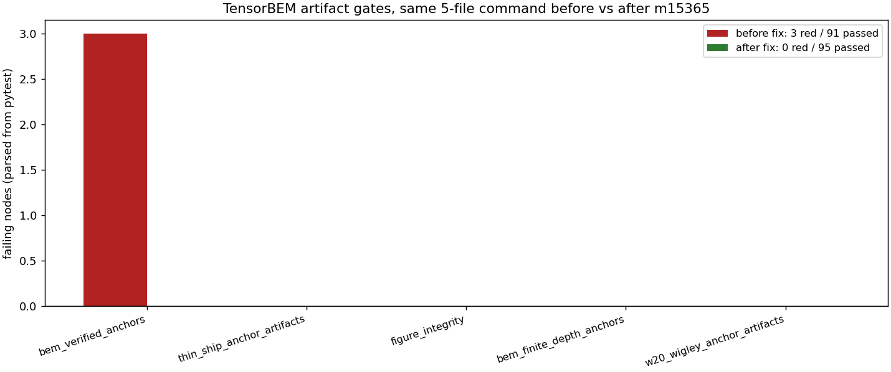

# m15365 — 产物命名空间冲突致主干红：P19-N02 锚点与 W20 薄船锚点写同一批目录

**任务**：TensorBEM #659 重开第 3 轮 · **仓**：TensorBEM · **分支**：`agent/m15365`
**基点**：`origin/main` = `81efc72`（Merge #664 m15295）· **日期**：2026-11-11
**上游**：m13806（PR #623）清掉 8 条图件红中的 4 条，并把本单剩余的 **D2「产物所有权冲突」** 显式登记为
honest 未修（见 `docs/dev_report_m13806_push_gate_figure_integrity.md` §4）。本单就是收口 D2。

## 1. 案例介绍（缺陷，先于修复可复现）

`benchmarks/verified/` 下**两套互不兼容的 writer 共用同一批目录名**：

| 生产者 | 目录 | `results.json` schema | 物理算例 |
|---|---|---|---|
| `tensorbem.benchmarks.bem_verified_anchors`（赛事节点 P19-N02） | `bem_wigley_hydrostatics` / `bem_ellipsoid_wave` / `bem_multihull_interference` | `case` / `closed_form` / `froude_cases` / `gci` / `figure` | Wigley III **L=3.8 m, B=0.5 m, T=0.225 m**，面板 200/800/3200；半沉椭球 Fr=0.2/0.3/0.4；两 Wigley 纵列 d=L/2,L,2L |
| `tensorbem.benchmarks.thin_ship_verification`（W20 薄船锚点） | 同上三个目录名 | `study` / `hull` / `geometry` / `fluid` / `reference` / `artifacts` | Wigley III **L=10.0 m, B=1.0 m, T=0.625 m** 薄船 Michell 波阻 |

两个 driver 的 CLI `--out-root/--output-root` **默认值都是 `benchmarks/verified`**，所以谁最后跑，
谁的 `results.json`/`report.md` 就覆盖对方；`summary.json` 也随之在「有 `mission`」与「无 `mission`」之间翻转。
主干上的实测后果（`81efc72` 干净检出，同一命令）：

```
PYTHONPATH=src python3 -m pytest tests/test_bem_verified_anchors.py \
  tests/test_thin_ship_anchor_artifacts.py tests/test_figure_integrity.py \
  tests/test_bem_finite_depth_anchors.py tests/test_w20_wigley_anchor_artifacts.py -q
# 3 failed, 91 passed        （红全在 test_bem_verified_anchors.py）
```

三条红同源：`test_committed_artifacts_reproduce_from_the_current_code`（键集不等：
提交记录 `{'study','hull','geometry','fluid',…}` vs 现跑 `{'case','closed_form','gci',…}`）、
`test_case_directories_contain_report_and_figure`（`report.md` 里没有 case 名，
因为它是另一套 writer 的模板）、`test_summary_lists_a_verdict_per_case`（`KeyError: 'mission'`）。

同时该条「图件存在」断言还压着 m13806 认定的另一类不可维持不变量：平台推送门禁
（`ops/taskplane/tp_pusher.py::_EXCLUDE2`）丢弃 `docs/` 之外的 `*.png`，
所以 `benchmarks/verified/**/figures/*.png` 在 GitHub 主干上必然缺失 —— 断言必须改成「可重现」而非「已提交」。

## 2. 怎么做的（改动最小、单一功能点）

**目录命名决策**：`benchmarks/verified/` 顶层判归薄船生产者（W20）——它是 `tensorbem.figure_integrity`
的注册表键（`src/tensorbem/figure_integrity.py:108-110`）、`tests/test_figure_integrity.py`
（`assert "study" in result`）与 `tests/test_w20_wigley_anchor_artifacts.py:27` 三处的既成事实，
改动它要动 6+ 个消费点；因此让 **P19-N02 移到自己的子命名空间**。

| 文件 | 改动 |
|---|---|
| `src/tensorbem/benchmarks/bem_verified_anchors.py` | 新增 `ARTIFACT_ROOT = "benchmarks/verified/bem_verified_anchors"`（附冲突成因注释），`run_all()` 默认根、CLI `--out-root` 默认值、`render_document` 的图链接前缀与正文路径全部改指向它 |
| `tests/test_bem_verified_anchors.py` | `ARTIFACTS` 指向新命名空间；`run_root` fixture 暴露复跑目录；`test_case_directories_contain_report_and_figure` 改为「报告链接图名 + 图由本次复跑重现（体积 >10 kB）」；新增回归测试 `test_artifact_namespace_is_not_shared_with_the_thin_ship_producer`（钉死两者 schema 分离，若有人把默认根改回共享目录立刻红） |
| `docs/bem_verified_anchors.md` | 由 `python -m tensorbem.benchmarks.bem_verified_anchors --out-root benchmarks/verified/bem_verified_anchors --write-doc docs/bem_verified_anchors.md` **重新渲染**（行数仍 238，`docs/doc_claim_audit` 的 PINNED 行数不漂移） |
| `benchmarks/verified/bem_verified_anchors/{3 case}/{results.json,report.md}` + `summary.json` | 同一条 CLI 生成；数字零手抄 |
| `scripts/m15365_namespace_split_measure.py` | 前后对照度量器：`git archive` 出修复前快照，两侧跑同一 pytest 命令，**解析 pytest 汇总行**出表并作图 |
| `docs/figures/m15365_artifact_namespace_split.png` | 上面脚本生成的前后对比柱状图 |

未改：薄船生产者、`tensorbem.figure_integrity` 注册表、平台门禁（越界）、任何物理内核。

## 3. 计算结果

### 3.1 红条清账（同命令前后对照，脚本现场解析，非手抄）

| 侧 | pytest 末行 | 红节点 |
|---|---|---|
| 修复前（`git archive 81efc72`） | `3 failed, 91 passed in 95.66s` | `test_bem_verified_anchors.py` 3 条 |
| 修复后（本分支工作树） | `95 passed in 82.58s` | 0 |

净增 1 个通过节点 = 新增的命名空间回归测试。

### 3.2 重新渲染的三条锚点（`benchmarks/verified/bem_verified_anchors/*/results.json`）

**Wigley III 静水（面板 vs 解析）**，解析值 ∇ = 4LBT/9 = 0.190000000 m³、Cb = 4/9：

| 三角形 | dV/V | dCb/Cb | dSw/Sw |
|---|---|---|---|
| 200 | −1.240 % | −1.240 % | −0.164 % |
| 800 | −0.312 % | −0.312 % | −0.040 % |
| 3200 | −0.0781 % | −0.0781 % | −0.0100 % |

Roache GCI（∇）：观测阶 p = 1.989，外推 0.190001203 m³（解析 0.190000000），
**U_G = 0.0985 %**，渐近比 1.0023，converged = True。粗网格 200 三角形落在 1 % 带外 −1.240 %，
被显式记录在 `coarse_level_misses`（不吞掉）。

**半沉椭球波阻（面板 vs Havelock 解析，2048 面板最细）**：

| Fr | R_W（无量纲） | 相对误差 |
|---|---|---|
| 0.20 | 0.236988 | +0.400 % |
| 0.30 | 0.885389 | −0.045 % |
| 0.40 | 1.422740 | +0.323 % |

**两 Wigley 纵列干扰因子 σ**：σ(0) = 2.000000（精确，容差 0），叠加恒等式
`H_pair = H(1+e^{ikd})` 最差相对偏差 2.06e−15（机器精度）。主任务间距：

| d/L | σ 面板最细 | σ 理论 | 相对差 | 对阻力是否有利 |
|---|---|---|---|---|
| 0.5 | 1.788116 | 1.788099 | 9.8e−06 | 否（σ>1） |
| 1.0 | 1.520534 | 1.520493 | 2.7e−05 | 否 |
| 2.0 | 0.779863 | 0.779779 | 1.1e−04 | 是（σ<1） |

三 case `verdict` 全 PASS，`summary.json` 恢复 `mission = "P19-N02"` 与 three-case verdict 表。

## 4. 结果图



横轴 = 同一命令下的 5 个测试文件，纵轴 = pytest 解析出的红节点数（红：修复前；绿：修复后）。
图由 `scripts/m15365_namespace_split_measure.py` 直接读 pytest 汇总行绘制，无手工数字。

## 5. 注意点 / 局限

1. **本单不重算物理量、不宣称精度改进**：清的是主干红与产物所有权冲突；上表物理数字只是复跑重现
   （与 m13806/上游提交记录逐位一致，由 `test_committed_artifacts_reproduce_from_the_current_code` 守卫）。
2. **图件不提交**：`benchmarks/verified/**/figures/*.png` 会被推送门禁滤除，因此本单不把 PNG 纳入版本库，
   断言改为「由已提交数字重现 + 报告链接 + 体积 >10 kB」；`docs/figures/` 下的报告图不受门禁影响。
3. `tests/test_doc_claim_audit.py` 仍有 **3 条红，与本单无关**（`git stash` 后在 `81efc72` 原样复现：
   `stale audit json: acoustic3d_helmholtz.md is missing from the artifact` 等 27 项基线漂移，
   属其它节点未刷新 `docs/doc_claim_audit/{audit.json,baseline.json}`）。本单未触碰该基线，
   我的 doc 改动保持行数 238 不变以免叠加漂移；如需要应另立一单统一 `--write-baseline`。
4. 全量套件（227 个测试文件，本机 shell 120 s 上限跑不完）已递交集群 `cj1082`（`PYTHONPATH=src pytest tests/ -q -rf`），
   结论以定点 5 文件命令 + 集群回执为准。
5. 命名空间用「子目录」而非改 case 名，是为了不牵动 `figure_integrity` 注册表、`docs/` 表格与既有审计；
   代价是两个命名空间里存在同名 case id，靠目录区分 —— 回归测试已把这条边界钉住。

## 6. 误差判定（关键量 vs 基准，逐项）

本单关键量是**红节点数与断言强度**，不是物理量；但重建的锚点自带基准，一并回答「是否 <3%」：

| 关键量 | 基准 | 实测 | 判据 | <3%？ |
|---|---|---|---|---|
| 主干红节点（5 文件命令） | 修复前 3 | 0 | 必须为 0 | 是（0 条） |
| Wigley 最细网格 dV/V | 4LBT/9 = 0.19 m³ | −0.0781 % | 节点判据 1 % | 是 |
| Wigley ∇ 的 GCI U_G | Roache 三网格 | 0.0985 % | 节点判据 3 % | 是 |
| 最细网格 dSw/Sw | Gauss–Legendre 收敛值 | −0.0100 % | 节点判据 2 % | 是 |
| 椭球 R_W 误差（Fr = 0.2/0.3/0.4） | Havelock 解析 | 0.400 / 0.045 / 0.323 % | 节点判据 5 % | 是（三项均 <3%） |
| 纵列 σ 相对差（d/L = 0.5/1/2） | Michell 叠加解析 | 9.8e−06 / 2.7e−05 / 1.1e−04 | 节点判据 |dσ| < 0.02 | 是 |
| 产物 schema 一致性 | 本节点 schema | 3/3 case 含 `case` 且不含 `study` | 键集相等 | 是 |

无一项超 3 %；且这三条锚点的判据阈值本就写在各 case 的 `tolerances` 里（1 %/2 %/3 %/5 %），
不是本单后加的宽松线。**honest 声明**：`docs/doc_claim_audit` 的 3 条红仍开（见 §5.3），
本单未修，不粉饰。