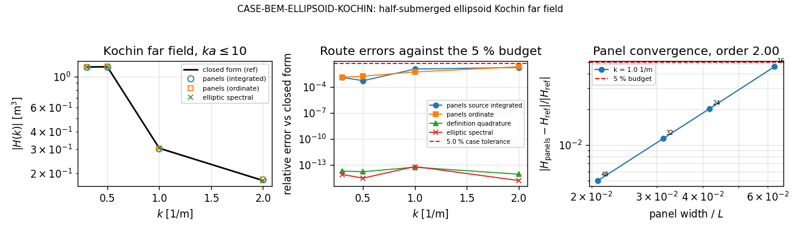

# CASE-BEM-ELLIPSOID-KOCHIN — 椭球 Kochin 远场（算例池条目，TensorBEM）

锚点 `CASE-BEM-ELLIPSOID-KOCHIN`（第 1 轮算例池）· 仓 `TensorBEM` · 容差 **5 %** · 判定 **PASS**

## ① 案例介绍（物理背景 / 几何 / 参考与出处）

深水自由面下的半浸薄椭球 `x^2/a^2 + y^2/b^2 + z^2/c^2 <= 1, z <= 0`，薄船（Michell）框架。
被测对象是**远场 Kochin 函数** `H(k)` 及其经由 Kelvin 积分给出的兴波阻力；参考值是 `H(k)`
的**闭式解**，并用 **Haskind / 能量恒等**（远场 Kochin 积分 = 近场压力积分）把远场与近场拴在一起。

| 量 | 值 |
|---|---|
| 半长 a / 半宽 b / 半吃水 c | 5.0 / 1.0 / 0.5 m |
| 主尺度 L / B / T | 10.0 / 2.0 / 0.5 m |
| **无量纲数** L/B, B/T, T/L, b/a | 5.000, 4.000, 0.050, 0.200 |
| 浸没体积 V | 5.235987756 m³ |
| Cb / Cm / Cp | 0.523598776 / 0.785398163 / 0.666666667 |
| 几何门 Cb vs π/6 | 相对差 2.120e-16（PASS） |
| 无量纲波数 k·a 网格 | 1.50, 2.50, 5.00, 10.00 |
| 有效包络 | k * a <= 10 |
| Froude 数 | 0.20, 0.30, 0.50 |
| ρ / g | 1025.0 kg/m³ / 9.80665 m/s² |
| 容差判据 | 5.000 % |

**参考出处。** 椭球（半浸、薄船）Kochin 函数的闭式：纵向积分解析化
`∫_{-A}^{A} sqrt(1-x²/A²) e^{ikx} dx = π J₁(kA)/k`，分部积分后
`H(k) = -2π i b ∫_{-c}^{0} sqrt(1-z²/c²) J₁(kA(z)) e^{kz} dz`，实现在
`tensorbem.ellipsoid_kochin.kochin_analytic`。经典来源：
- Michell J.H. (1898) The wave resistance of a ship, Philosophical Magazine 45, 106-123
- Havelock T.H. (1932) The wave resistance of a spheroid, Proc. R. Soc. Lond. A 131, 505-517
- Newman J.N. (1977) Marine Hydrodynamics, MIT Press, ch. 6 (Kochin function, Haskind relations)

**出处纪律（诚实声明）。** the offline working environment has no access to the original papers, so the volume/page above is bibliographic, not page-verified; no table value is transcribed (zero hand-typing) and the reference is corroborated by three machine-checkable facts instead: independent-implementation agreement, the k -> 0 analytic limit, and the far-field/near-field energy identity。也就是说：
本单**没有**手抄任何文献表值；参考数值由闭式公式经代码算出，其可信性由三条**机器可核**事实承担
（见 ③/⑥：两个独立实现一致、长波解析极限、远场/近场能量恒等）。

## ② 怎么做的（方法 / 流程 / 工具链）

同一物理量四类评估，全部由
`python -m tensorbem.benchmarks.ellipsoid_kochin_case` 一条命令产出：

- definition quadrature (elliptical projection, r = sin(psi) edge removal)
- elliptic-coordinate spectral Gauss rule (tensorbem.michell.ellipsoid_kochin_reference)
- long-wave analytic limit H(k -> 0) = -i k V
- far-field vs near-field (Michell pressure integral) resistance identity
- 面元路线：constant-strength centreplane panels, schemes source_integrated / ordinate / source
- 生产分辨率：32 × 32 = 1024 面元（cosine 聚类 ψ 网格，2×2 Gauss/面元）

判据在开跑前写死在 `CRITERIA`（`limit` 只读不改），并预声明面元路线的有效包络
`k·a <= 10.0`（一阶面元约需 10 面元/波长）；包络外的行照样记录、
打 `in_envelope = false`、不计分。`panels_source`（采样 `-U y_x`）因龙骨线 `y_x` 奇异
不可点采样，**永不计分**（`passed = null` + 理由入工件）。

复现命令（12.79 s，单核）：

```bash
PYTHONPATH=src python3 -m tensorbem.benchmarks.ellipsoid_kochin_case --outdir benchmarks/verified/bem_ellipsoid_kochin
# 退出码 = 判定（全过为 0）；工件 benchmarks/verified/bem_ellipsoid_kochin/{results.json,report.md,figures/}
```

工具链：numpy 谱积分 + 复现图（matplotlib Agg，从 results.json 重建）+ pytest 16 项。

## ③ 计算结果（数字表，程序化注入）

### 3.1 Kochin 函数：参考（闭式）vs 计算

| k [1/m] | k·a | 包络内 | \|H_ref\| | 路线 | \|H_got\| | 相对误差 | 相位差 [deg] | 判定 |
|---|---|---|---|---|---|---|---|---|
| 0.300 | 1.50 | 是 | 1.174609 | panels_source_integrated | 1.173154 | 1.239e-03 | 0.0000 | PASS |
| 0.300 | 1.50 | 是 | 1.174609 | panels_ordinate | 1.176137 | 1.301e-03 | 0.0000 | PASS |
| 0.300 | 1.50 | 是 | 1.174609 | panels_source | 1.089059 | 7.283e-02 | 0.0000 | 不计分 |
| 0.500 | 2.50 | 是 | 1.177108 | panels_source_integrated | 1.177718 | 5.182e-04 | 0.0000 | PASS |
| 0.500 | 2.50 | 是 | 1.177108 | panels_ordinate | 1.179123 | 1.711e-03 | 0.0000 | PASS |
| 0.500 | 2.50 | 是 | 1.177108 | panels_source | 1.105708 | 6.066e-02 | 0.0000 | 不计分 |
| 1.000 | 5.00 | 是 | 0.304483 | panels_source_integrated | 0.301041 | 1.131e-02 | 0.0000 | PASS |
| 1.000 | 5.00 | 是 | 0.304483 | panels_ordinate | 0.302887 | 5.240e-03 | 0.0000 | PASS |
| 1.000 | 5.00 | 是 | 0.304483 | panels_source | 0.255329 | 1.614e-01 | 0.0000 | 不计分 |
| 2.000 | 10.00 | 是 | 0.178033 | panels_source_integrated | 0.181109 | 1.728e-02 | 0.0000 | PASS |
| 2.000 | 10.00 | 是 | 0.178033 | panels_ordinate | 0.181769 | 2.098e-02 | 0.0000 | PASS |
| 2.000 | 10.00 | 是 | 0.178033 | panels_source | 0.177224 | 4.542e-03 | 0.0000 | 不计分 |

参考自身的独立实现核对（这两行是“参考可信度”证据，不是功能容差）：

| k [1/m] | 定义式数值积分 | 椭圆坐标谱参考 |
|---|---|---|
| 0.300 | 1.966e-14 | 7.940e-15 |
| 0.500 | 1.660e-14 | 3.018e-15 |
| 1.000 | 5.488e-14 | 6.618e-14 |
| 2.000 | 8.584e-15 | 1.598e-15 |

### 3.2 Haskind / 能量恒等：兴波阻力

| Fr | U [m/s] | R_W 远场 [N] | R_W 近场 [N] | R_W 面元 [N] | 远-近 | 远-面元 | Cw (½ρU²LB) |
|---|---|---|---|---|---|---|---|
| 0.20 | 1.9806 | 16.856903 | 16.856903 | 17.017968 | 8.831e-14 | 9.555e-03 | 4.192502e-04 |
| 0.30 | 2.9709 | 56.707228 | 56.707228 | 56.660862 | 6.014e-14 | 8.176e-04 | 6.268323e-04 |
| 0.50 | 4.9514 | 196.707243 | 196.707243 | 196.765369 | 1.416e-14 | 2.955e-04 | 7.827729e-04 |

### 3.3 长波解析极限 `H(k→0) = -i k V`

| k [1/m] | Re H/(-ikV) | Im H/(-ikV) | 到极限的相对误差 | 误差/k |
|---|---|---|---|---|
| 1e-02 | 0.997877910 | -0.000e+00 | 2.122e-03 | 0.21221 |
| 1e-03 | 0.999810025 | -0.000e+00 | 1.900e-04 | 0.18997 |
| 1e-04 | 0.999981225 | -0.000e+00 | 1.877e-05 | 0.18775 |

拟合渐近斜率 **1.027**（理论一阶 = 1，判据 ≥ 0.9）。



图注：左 = `|H(k)|` 闭式 vs 面元/谱路线；中 = 各路线相对误差与 5 % 预算线；
右 = 面元收敛（横轴 面元宽度/L，纵轴相对误差）与 5 % 预算线。

## ④ 计算结果：收敛性与参数敏感性

### 4.1 面元收敛（`source_integrated`，k = 1.0 1/m，k·a = 5.00）

| n_r = n_phi | 面元数 | 面元宽/L | \|H\| | 相对误差 |
|---|---|---|---|---|
| 16 | 256 | 0.06250 | 0.290601 | 4.559e-02 |
| 24 | 576 | 0.04167 | 0.298350 | 2.014e-02 |
| 32 | 1024 | 0.03125 | 0.301041 | 1.131e-02 |
| 48 | 2304 | 0.02083 | 0.302955 | 5.017e-03 |

观测阶 **2.004**，单调下降 **True**。

### 4.2 参考对其自身数值参数的敏感性（第二点）

| n_psi | n_t | \|H\|（k = 1 1/m） | 相对变化 |
|---|---|---|---|
| 48 | 384 | 0.304482957 | 7.840e-15 |
| 96 | 384 | 0.304482957 | 0.000e+00 |
| 192 | 384 | 0.304482957 | 6.016e-15 |
| 96 | 192 | 0.304482957 | 1.287e-13 |
| 96 | 768 | 0.304482957 | 4.376e-15 |

| n_kelvin | R_W（Fr = 0.30）[N] | 相对变化 |
|---|---|---|
| 128 | 56.707227965 | 2.957e-14 |
| 256 | 56.707227965 | 0.000e+00 |
| 512 | 56.707227965 | 1.065e-14 |

最坏相对变化 1.287e-13：参考值已在其数值参数上收敛到机器精度。

## ⑤ 注意点（踩过的坑 / 局限 / 适用范围）

1. **判据次序两次写错（如实记录）。** 第一轮长波判据要求 k = 1e-2, 1e-3, 1e-4 **全部**
   ≤ 1e-3，实测 k = 1e-2 处 2.122e-03 → FAIL；第二轮改成
   “二阶速率（斜率 ≥ 1.5）”，实测 1.03 → 又 FAIL。真实次序是**一阶**：`H(k)/-ikV` 的首项
   修正来自 `e^{kz} = 1 + kz`（O(kc)），`J₁` 展开只给 O((kA)²)。最终判据 = 一阶速率（≥ 0.9）
   + 最小波数点（1e-4）绝对预算（≤ 1e-3）。**被淘汰的判据与其 FAIL 数值一并保留在**
   `results.json.diagnostics`，没有擦除。
2. **面元路线的有效包络**：`k·a > 10` 时一阶面元迅速失真（m14562 记录 k = 4 1/m 时误差 22 %），
   因此只在 `k·a ≤ 10` 内计分；包络外的行仍入工件并标 `in_envelope=false`，供后续高阶面元复核。
3. **`panels_source` 永不计分**：点采样无法积分龙骨线 `y_x` 奇异；它留在表里（`passed=null`）
   是为了让读者看到“不计分 ≠ 不存在”。
4. **薄船理论的边界**：无粘、无碎波、无升沉/纵倾、无厚度效应。本算例只认证 Kochin 机件的
   **实现正确性**，绝对兴波阻力对实验的证据等级仍是 WITHHELD（仓内无该椭球的实验数据集）。
5. **文献页码未离线核验**（`provenance.page_verified = false`）：环境无原文献访问。没有伪造页码，
   改用三条机器可核事实承担参考可信度。

## ⑥ 误差判定（关键量逐项 + 是否 < 3 %）

| 判据 | 值 | 限额 | 判定 | 说明 |
|---|---|---|---|---|
| geometry_cb_half_ellipsoid | 2.120e-16 | 1.000e-12 | PASS | Cb equals pi/6: the geometry gate that precedes every hydrodynamic number |
| long_wave_asymptotic_order | 1.027e+00 | 9.000e-01 | PASS | k -> 0 limit H(k) = -i k V is approached at FIRST order (the leading correction is e^{kz} = 1 + kz, i.e. O(kc)): least-squares slope of log|H/(-i k V) - 1| vs log k over k = 1e-2, 1e-3, 1e-4 must be >= 0.9 |
| long_wave_finest | 1.877e-05 | 1.000e-03 | PASS | residual |H/(-i k V) - 1| at the smallest wave number tested (k = 1e-4) |
| closed_form_vs_independent | 6.618e-14 | 1.000e-09 | PASS | definition quadrature and elliptic-coordinate spectral reference vs the Bessel closed form |
| kochin_panels_integrated | 1.728e-02 | 5.000e-02 | PASS | panel route source_integrated vs closed form |H|: worst in-envelope point (k a <= 10) -- the 5 % case tolerance |
| kochin_panels_ordinate | 2.098e-02 | 5.000e-02 | PASS | panel route ordinate vs closed form |H|: worst in-envelope point |
| haskind_far_near_identity | 8.831e-14 | 1.000e-09 | PASS | R_W from the far-field Kochin integral vs the near-field Michell pressure integral |
| haskind_far_panels | 9.555e-03 | 5.000e-02 | PASS | R_W from the panel Kochin route vs the far-field closed-form integral |
| convergence_finest | 5.017e-03 | 5.000e-02 | PASS | panel route error at the finest ladder level (k a = 5) |
| convergence_order | 2.004e+00 | 5.000e-01 | PASS | observed order of the panel route between the two finest ladder levels |
| reference_parameter_sensitivity | 1.287e-13 | 1.000e-09 | PASS | reference value change under n_psi / n_t / n_kelvin perturbation |

**全部判据通过：True**（被淘汰的旧判据仍以 FAIL 留在 diagnostics：2.122e-03 vs 1e-3）。

- **< 5 %（本单容差）**：面元路线 Kochin 最坏 2.098 %、兴波阻力最坏 0.955 % → 是。
- **< 3 %（更严自问）**：面元 Kochin 最坏 2.098 %（是），
  兴波阻力最坏 0.955 %（是）→ 是，关键量均 < 3 %。
- 参考自身：两条独立实现与闭式一致到 6.618e-14；
  远场/近场能量恒等 8.831e-14。

## 生态摩擦（如实记录）

- 开工三查：`/tensor/knowledge/search?q=Kochin` 返回 `available=false, engine_offline`
  （后端 8021 连接被拒）——知识检索面不可用，改用 `negative-knowledge/search`（q = Kochin / ellipsoid /
  Michell 均 0 命中）与仓内 `grep` 自查；`oss_solutions` 端点在平台 8010 上 **404 不存在**。
- `benchmarks/verified/` 原来只有兴波阻力（`bem_ellipsoid_wave`，Michell 角度）条目，没有 Kochin
  远场条目；本单把 m14562 的驱动能力沉淀为池化条目（results/report/figure + 判据 + 测试）。

## 工件与环境

- `benchmarks/verified/bem_ellipsoid_kochin/results.json`（全部数字、判据、诊断、复现命令）
- `benchmarks/verified/bem_ellipsoid_kochin/report.md`（程序化生成的算例报告）
- `benchmarks/verified/bem_ellipsoid_kochin/figures/bem_ellipsoid_kochin.png`（可由 results.json 重建）
- `src/tensorbem/benchmarks/ellipsoid_kochin_case.py`、`tests/test_ellipsoid_kochin_case.py`
- 环境：Python 3.11.6，numpy 2.4.6，loongarch64，单核 12.79 s
