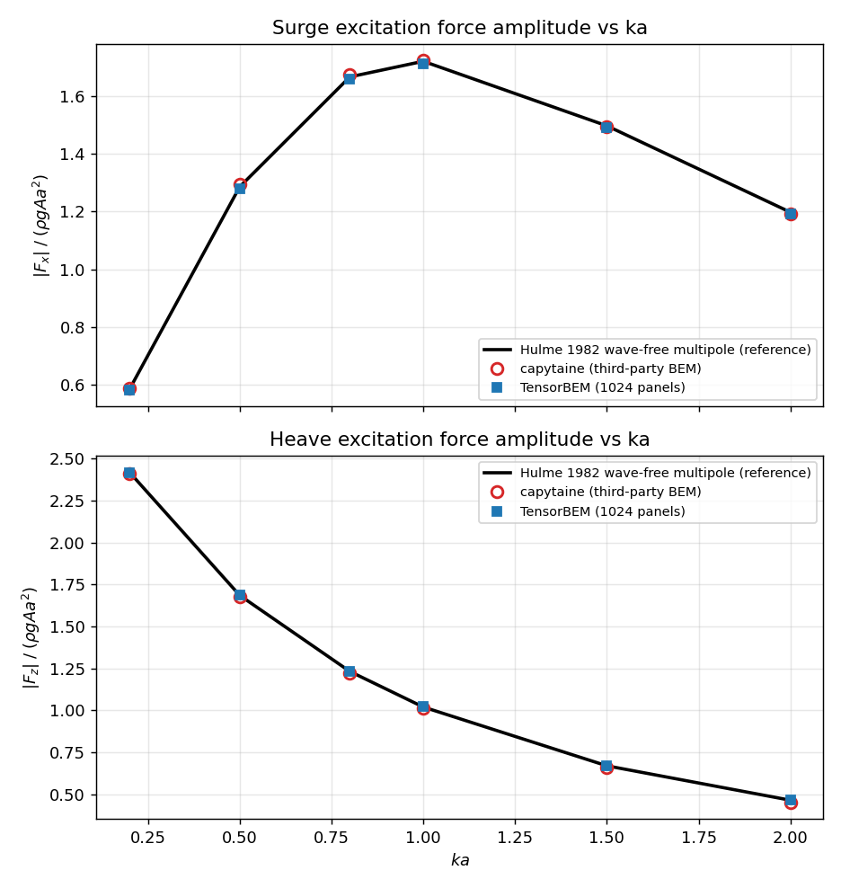
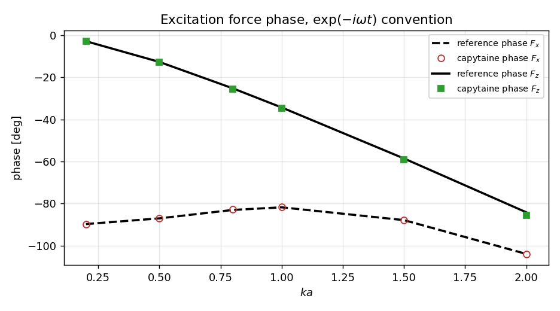

# CASE-BEM-HULME-HEMISPHERE：绕射激励力的第三方独立轴（capytaine）

> 任务 17796 · 算例 `BEM-HULME-HEMISPHERE` · 本文件由 `benchmarks/verified/casepool_bem_hulme_hemisphere/excitation_capytaine_xval.py` 从 `benchmarks/verified/casepool_bem_hulme_hemisphere/excitation_xval_results.json` 程序化渲染，正文与表格数字均非手抄。

**机器裁定：PASS**

## ① 案例介绍与验证缺口

半径 a = 1 m 的浮半球（平面与平均自由面齐平，曲面入水）在深水迎浪中求一阶
波浪激励力 $F_x$（surge）与 $F_z$（heave）的复数值（幅值+相位），无量纲化
$F/(\rho g A a^2)$，时间约定 $\exp(-i\omega t)$，波沿 $+x$ 传播，波幅 A = 1 m。

算例池原验证（`results.json` / `docs/bem_hulme_hemisphere_case.md`）已登记两条
诚实的局限：参考解（Hulme 1982 波-free 多极展开的重新推导）与求解器共享
`tensorbem.free_surface3d.wave_function_3d` 内核；且参考解的激励力是由同一级数的
辐射 Kochin 经 Haskind 互易得到，实现内部（`hulme_diffraction_3d`）也是 Haskind，
因此激励力此前**没有真正独立的第三方轴**。Hulme (1982) 印刷表格在付费墙后，
本沙箱内无原文数字可引（零手抄纪律下不作转录）。

本单补的正是这条轴：用 capytaine（Nemoh 后继，独立面板法实现）在同一频带
独立求解绕射问题，并加一条闭式 Froude-Krylov 锚（1 维求积，机器精度）钉住
归一化与约定。

## ② 方法与关键设置

- capytaine 版本 `3.1.dev0`；几何 `capytaine.mesh_sphere(radius=1, center=(0,0,0)).immersed_part()`；水体无限深；ρ = 1025 kg/m³，g = 9.80665 m/s²。
- 激励力定义：froude_krylov_force(problem) + DiffractionResult.forces; in capytaine 3.x DiffractionResult.forces is the scattering force only。**踩坑点**：capytaine 3.x 的 `DiffractionResult.forces` 只是散射力，不含 Froude-Krylov；只取它会在 ka=0.05 处给出 heave 0.09（应为约 π），必须 `+ froude_krylov_force`。
- capytaine 网格阶梯（resolution × panels）：(12,24) → 144 面；(20,40) → 400 面；(28,56) → 784 面；(36,72) → 1296 面。
- TensorBEM 侧取算例网格 subdivisions=4（1024 面板），数字直接读 `results.json`，不重算。
- 参考解：`tensorbem.analytic.hulme_hemisphere_radiation`，144 项（截断阶梯
  48/96/144，96→144 漂移 6.46e-05，见 `reference.json`）。
- 预注册门：G1/G2 幅值 < 5%；G3 相位 < 5°；G4 capytaine 自收敛；
  G5 两码互比 < 5% / 5°；G6 FK 归一化守卫 < 2%。

## ③ 计算结果

### 3.1 幅值：参考 vs capytaine（细网格）vs TensorBEM

| ka | ref \|Fx\| | capytaine \|Fx\| | err | TensorBEM \|Fx\| | ref \|Fz\| | capytaine \|Fz\| | err | TensorBEM \|Fz\| |
|---|---|---|---|---|---|---|---|---|
| 0.2 | 0.5844 | 0.5879 | +0.61% | 0.5814 | 2.4186 | 2.4119 | -0.28% | 2.4162 |
| 0.5 | 1.2858 | 1.2936 | +0.61% | 1.2789 | 1.6854 | 1.6775 | -0.47% | 1.6853 |
| 0.8 | 1.6668 | 1.6741 | +0.43% | 1.6580 | 1.2320 | 1.2242 | -0.64% | 1.2330 |
| 1 | 1.7209 | 1.7249 | +0.24% | 1.7121 | 1.0201 | 1.0123 | -0.76% | 1.0214 |
| 1.5 | 1.4972 | 1.4939 | -0.22% | 1.4906 | 0.6697 | 0.6615 | -1.23% | 0.6714 |
| 2 | 1.1976 | 1.1914 | -0.52% | 1.1929 | 0.4646 | 0.4526 | -2.59% | 0.4669 |

### 3.2 相位：约定一致性（同一 `exp(-iωt)` 约定，无共轭、无 180° 偏移）

| ka | ref φ(Fx) | capy φ(Fx) | Δ | ref φ(Fz) | capy φ(Fz) | Δ |
|---|---|---|---|---|---|---|
| 0.2 | -89.71 | -89.71 | +0.007 | -2.79 | -2.83 | -0.034 |
| 0.5 | -87.00 | -86.93 | +0.074 | -12.64 | -12.78 | -0.141 |
| 0.8 | -83.00 | -82.84 | +0.163 | -25.19 | -25.46 | -0.273 |
| 1 | -81.76 | -81.58 | +0.179 | -34.29 | -34.66 | -0.374 |
| 1.5 | -87.84 | -87.79 | +0.056 | -58.54 | -59.24 | -0.706 |
| 2 | -103.92 | -104.07 | -0.151 | -84.13 | -85.54 | -1.411 |

### 3.3 闭式 Froude-Krylov 锚（1 维求积 vs capytaine）

| ka | 闭式 \|FK_x\| | capytaine \|FK_x\| | err | 闭式 \|FK_z\| | capytaine \|FK_z\| | err |
|---|---|---|---|---|---|---|
| 0.2 | 0.3875 | 0.3863 | -0.32% | 2.7384 | 2.7357 | -0.10% |
| 0.5 | 0.8522 | 0.8495 | -0.31% | 2.1922 | 2.1911 | -0.05% |
| 0.8 | 1.1817 | 1.1781 | -0.31% | 1.7152 | 1.7152 | +0.00% |
| 1 | 1.3304 | 1.3264 | -0.30% | 1.4345 | 1.4352 | +0.04% |
| 1.5 | 1.4804 | 1.4763 | -0.27% | 0.8567 | 0.8583 | +0.18% |
| 2 | 1.3713 | 1.3683 | -0.22% | 0.4405 | 0.4422 | +0.38% |

### 3.4 capytaine 网格自收敛（Fz 相对参考的误差随网格）

| ka | 粗网格 err | 细网格-vs-次细网格漂移 |
|---|---|---|
| 0.2 | -1.38% | +0.11% |
| 0.5 | -1.65% | +0.15% |
| 0.8 | -1.87% | +0.18% |
| 1 | -2.05% | +0.21% |
| 1.5 | -3.07% | +0.32% |
| 2 | -7.06% | +0.74% |

## ④ 图

（幅值曲线：解析参考 vs capytaine vs TensorBEM；相位曲线：两码在 
`exp(-iωt)` 约定下同相位，任何共轭或来流反号都会表现为 ~180° 偏差。）

## ⑤ 注意点

- capytaine 是可选外部依赖（本机 3.1.dev0，loongarch64 源码构建），**不进测试依赖**：
  数字冻结在 `benchmarks/verified/casepool_bem_hulme_hemisphere/excitation_xval_results.json`，测试只读冻结件。
- capytaine 侧 `forces` 的定义陷阱见 ②（散射力 ≠ 总激励力）。
- 频带止于 ka = 2：ka ≈ 2.58 附近是半球的不规则频率，capytaine 无 CHIEF 抑制；
  本单不进入该点，因此两码在该处不可比（如实声明，不外推）。
- 两码共享建模假设（线性势流、无粘、深水、刚体），本轴只能查实现缺陷，
  不能查建模假设本身；Hulme 印刷数字仍不可得，故参考解仍是「Hulme 方法重推导 + 自收敛」。

## ⑥ 误差判定

| 门 | 判据 | 实测 | 结论 |
|---|---|---|---|
| G1_Fx_amplitude_vs_reference | max |rel err| < 5% over the ka band | 6.078e-03 | PASS |
| G2_Fz_amplitude_vs_reference | max |rel err| < 5% over the ka band | 2.587e-02 | PASS |
| G3_phase_vs_reference | max |phase delta| < 5 deg on both components | 1.411e+00 deg | PASS |
| G4_capytaine_self_convergent | finest-vs-second drift at least 3x below the coarsest-level error | drift=7.429e-03, coarse_error=7.060e-02 | PASS |
| G5_tensorbem_vs_capytaine | amplitude < 5% and phase < 5 deg | amplitude=3.060e-02, phase_deg=1.409e+00 | PASS |
| G6_fk_normalisation_guard | capytaine FK vs closed-form quadrature < 2% | 3.809e-03 | PASS |

关键量逐项 vs 基准：

- 激励力幅值最坏误差：surge 0.61%，heave 2.59% （基准=Hulme 多极重推导参考）；
- 相位最坏偏差：1.411°；
- **是否 < 3%？** 是（最坏 2.59%，判据为算例池 5% 门；3% 为报告纪律的参考线）。

## ⑦ 产物

- 生产/分析脚本：`benchmarks/verified/casepool_bem_hulme_hemisphere/excitation_capytaine_xval.py`
- 冻结数字：`benchmarks/verified/casepool_bem_hulme_hemisphere/excitation_xval_results.json`
- 图：`docs/fig_hulme_excitation_xval.png`、`docs/fig_hulme_excitation_xval_phase.png`
- 回归测试：`tests/test_hulme_excitation_capytaine_xval.py`（读冻结件，不需 capytaine）

