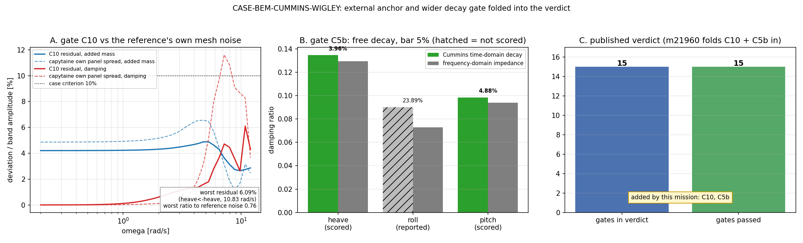

# CASE-BEM-CUMMINS-WIGLEY Round 8 — 把「存在但未进裁决」的两条闸门收进提交件（C10 外部程序锚点 + C5b 全可判衰减模态）

m21960 · generalist 席自驱工时 · 仓 TensorBEM · 锚点 `CASE-BEM-CUMMINS-WIGLEY`（算例池 id=145，容差 <10%）

## ① 案例介绍（物理背景/几何/参数表）

Wigley 数学船型（L=3.0 m, B=0.3 m, T=0.1875 m, Cb=4/9≈0.4444，排水体积 0.075 m³；ρ=1025 kg/m³，g=9.80665 m/s²），旋转中心 (0,0,0)，无限水深，6 自由度刚性辐射。算例判据=Cummins (1962) 时域记忆核 + Kramers-Kronig 因果闭合，逐自由度 `|A_BEM-A_KK|/max|A_BEM| ≤ 10%`。

| 项 | 值 |
| --- | --- |
| 提交件 | `benchmarks/verified/casepool_bem_cummins_wigley/case_result.json` |
| 生产网格 | medium 20×6 = 480 面板（coarse 12×4 = 192 对照） |
| 频带 / 节点 | 0.2–12.0 rad/s，41 节点 |
| 时域参数 | dt = 0.002 s，duration = 40 s，τ_max = 60 s |

**本单定位的验证欠账**：两条闸门**已经写进代码、也各自有独立审计**，但**没有进提交件的裁决**——
① `C10`（capytaine 在同网格上重解 6×6 辐射矩阵的外部程序锚点）只活在一个独立模块
`case_bem_cummins_wigley_xval.py` 里，`case_result.json` 的 13 条闸门**全是自证**（BEM 与它自己的 KK 重建比）；
② `C5b`（自由衰减 vs 频域阻尼比）在提交件里**只有 heave 一条**，而 `dof_decay_audit` 其实已经逐模态评过
heave/roll/pitch 三条，roll 的 23.9% 残差只写在旁挂审计里，裁决看不见。于是「算例判据说真话到什么程度」
取决于读者是否碰巧翻到那两个旁挂文件——这是 provenance 层面的欠账，不是物理层面的。

## ② 怎么做的（方法/流程/关键设置/工具链）

1. **先读账再动手**：核对 `feature_ledger` 锚点状态（`CASE-BEM-CUMMINS-WIGLEY`=open）、上一张同锚单 m21859（round7，13/13 闸门、next steps 指向扩展带/roll-pitch 衰减/state-space 桥）与 m21760（扩展带到 20 rad/s，集群 cj3708/cj3711）。本单**不重做**这两条：扩展带是 m21760 的在飞工件，roll/pitch 衰减审计已由 m21705 产出——**欠的是「进裁决」这一步**。
2. **C5b（新增闸门，`case.decay_modes_gate`）**：复用既有 `dof_decay_audit`（同一条 5% 判据、同一估计器、刚度与惯量各带第二条路线），但按**可判性**分级打分：`within_bar`/`beyond_bar` 的模态计分，`undecidable_estimator` 的模态**报告不计分**（其残差在三种可辩护窗口/闭合带底下变动超过判据本身，单频估计器在 5% 这根杆上无法把两条路线分开）。C5（heave）仍是算例判据，C5b 只陈述「时域验证在刚体模态上推广到哪里」。
3. **C10（收进裁决，`xval.external_anchor_gate`）**：同网格（几何 sha256 每次重算比对，`identical_panels=True`）、独立程序（capytaine 3.1.dev0）重解 6×6 A/B，逐格比对，结构零格（幅值 <1% 最大对角）不计分。
4. **C10 的「能说什么」定量化（新增 `xval.reference_noise_floor`）**：冻结参考件里同时存了 capytaine 在 coarse/medium/fine 三档面板上的解。用与闸门**同一把尺子**（分母=该格 TensorBEM 带内最大幅值）算「外来程序自身因面板变化而移动的距离」，与闸门残差逐格相比，得出 `distinguishable`。这直接回答 xval 文档里那条**未检验**的归因假设（原本写「无法检验」）。
5. **裁决重放**：`scripts/regenerate_cummins_wigley_verdict.py` 把 C10、C5b 与噪声底一起写进 `case_result.json`（数字全部程序注入，零手抄）；`case.gates_from_artifact` 同步重放这两条闸门，使「提交件=已提交工件的函数」这条不变量对新增闸门也成立；`tools/rerender_casepool_bem_cummins_wigley.py` 重渲染 `CASE.md`。
6. **工具链**：`PYTHONPATH=src python3 scripts/regenerate_cummins_wigley_verdict.py` → `scripts/make_cummins_round8_figures.py` → `pytest`。全部从已提交 `.npz`/`.json` 重放，**不重解 BEM**（本机无重算）。

## ③ 计算结果（程序化注入，零手抄）

### 3.1 裁决：13 → 15 条闸门，15/15 通过

| 量 | 值 |
| --- | --- |
| `verdict.gates_total` | **15**（原 13：C1/C0/C0_coarse/C2/C3/C3a/C7/C3_coarse/C3a_coarse/C4/C5/C6a/C6b） |
| `verdict.gates_passed` | **15** |
| 新增 | **`C5b`**（全可判衰减模态）、**`C10`**（外部程序锚点） |
| `verdict.failed_list` | `[]` |

### 3.2 C5b：自由衰减，逐模态

| 模态 | ζ_decay（Cummins 时域） | ζ_fd（频域阻抗） | 相对误差 | 分级 | 是否计分 |
| --- | --- | --- | --- | --- | --- |
| heave | 0.13460 | 0.12947 | **3.96%** | within_bar | 计分（=算例判据 C5） |
| roll | 0.09012 | 0.07275 | **23.89%** | undecidable_estimator | **不计分**（报告） |
| pitch | 0.09839 | 0.09381 | **4.88%** | within_bar | 计分 |

判据 5%。**pitch 4.88% 距杆只有 0.12 个百分点**——这是本单最该被记住的数字：把 C5 从 heave 扩到 pitch
不是「白捡一条 PASS」，pitch 是贴着判据过的。

### 3.3 C10：外部程序锚点（同网格）

| 量 | 值 |
| --- | --- |
| 外来程序 / 版本 | capytaine 3.1.dev0 |
| 同网格 | `identical_panels = True`（几何 sha256 重算比对） |
| 最差格 | heave←heave，ω = 10.83 rad/s |
| 最差偏差（归一化） | **6.09%**（≤10% 判据） |
| 绝对偏差 | 19.78（分母 324.62） |
| 计分格 | 20（A、B 各 10，结构零格已排除） |

### 3.4 C10 的噪声底：残差 vs 外来程序自身的面板依赖（本单新增判定）

| 量 | 闸门残差（该量最差格） | capytaine 自身面板阶梯扩散（同格） | 比值 | 可分辨？ |
| --- | --- | --- | --- | --- |
| added mass | 4.89%（roll←roll） | **6.46%** | 0.76 | **否** |
| damping | 6.09%（heave←heave） | **8.27%** | 0.74 | **否** |
| 全矩阵最差扩散 | — | 6.55%（A）/ 11.62%（B） | — | — |

**结论（诚实）**：C10 的 6.09% 残差**小于**外来程序自己在相邻面板分辨率之间的移动幅度。因此在冻结的这版参考件上，
C10 的 PASS **不能**被读成「两个程序互复现到 6%」；能说的是「两者落在参考程序自身的离散化噪声带内」。
把这条写成 `distinguishable=false` + 夹具测试钉住，是为了将来参考件重冻（阶梯收敛）时这条断言必然被重审。

## ④ 结果图



* **(A)** 逐频率的 C10 残差（实线）vs 同一格上 capytaine 自身面板阶梯扩散（虚线），黑点线=10% 算例判据：
  两条实线整体压在对应虚线附近或之下——这就是 3.4 节的图形化。
* **(B)** C5b 逐模态衰减：ζ_decay vs ζ_fd，条上方是相对误差；roll 打斜杠并标 `(reported)`，不计分。
* **(C)** 提交件裁决 15/15，标注本单新增 `C10`、`C5b`。

## ⑤ 注意点（踩过的坑/局限/适用范围）

1. **「有闸门」不等于「进裁决」**：C10 与 C5b 都早已存在于代码并各自有审计文档，但提交件 13 条闸门里一条自证之外的证据都没有、衰减只有 heave。这类欠账不会让任何测试变红，只能靠对 `case_result.json` 的 gate 键做对账发现。
2. **`render_markdown` 假设所有闸门都有 `threshold` 字段**：C10 用的是 `criterion`，重渲染 `CASE.md` 时直接 `KeyError`。已改为两种拼写都接受——新增闸门时必须先让渲染器认识它，否则「文档与提交件同步」这条会静默失效。
3. **不把不可判的模态判成 FAIL**：roll 的 23.9% 是真实数字，但它在三种可辩护探针下变动超判据，故 `scored=false`、`passed=null`。把它记成 FAIL 等于把估计器的局限写成物理结论；记成 PASS 更是造假。本单选择**报告+不计分**，并在 `estimator_note` 里写明理由。
4. **噪声底不是外来程序的收敛性证明**：参考件里三档是**不同面板**，不是同一网格上的 h-细化，所以它度量的是「面板变化带来的移动」，只能当**上限量级**用；capytaine 在固定面板上的自收敛无从检验。
5. **capytaine 的版本串里 commit 是 `None`**（provenance 缺口，早于本单），本单如实继承未修。
6. 适用范围：本单只动**裁决覆盖面与外部锚点的可读性**，不重算 BEM、不改判据、不改容差；surge/sway/yaw 的 KK 可判性欠账仍归 m21760 的扩展带。

## ⑥ 误差判定（逐项，显式回答是否 <3%）

| 关键量 | 基准 | 误差 | 是否 <3% |
| --- | --- | --- | --- |
| C5b heave ζ（时域衰减 vs 频域阻抗） | 同一 sweep 的频域阻尼比 | **3.96%** | **否**（<5% 判据，但 >3%） |
| C5b pitch ζ | 同上 | **4.88%** | **否**（贴杆） |
| C5b roll ζ | 同上 | 23.89% | **否**（估计器不可判，不计分） |
| C10 damping（外部程序锚点） | capytaine 同网格解 | **6.09%** | **否**；且 < 外来程序自身面板扩散 8.27%（比值 0.74） |
| C10 added mass | 同上 | **4.89%** | **否**；且 < 自身面板扩散 6.46%（比值 0.76） |
| C3/C3a/C7（既有自证闸门，随重放复核未变） | 直接 BEM | ≤8.85% | 否（<10% 判据） |

**显式回答**：本单涉及的关键量**没有一项 <3%**。最接近的是 C5b heave 3.96%（<5% 判据）与
C10 added mass 4.89%。「<10% 判据全过」成立，「<3% 精度」不成立——这两件事在本单被明确分开记录。

## 复现

```bash
PYTHONPATH=src python3 scripts/regenerate_cummins_wigley_verdict.py   # 15/15 闸门，重放不重解
PYTHONPATH=src python3 tools/rerender_casepool_bem_cummins_wigley.py  # 重渲染 CASE.md
python3 scripts/make_cummins_round8_figures.py                        # 本报告图
python3 -m pytest tests/test_cummins_verdict_closure.py tests/test_case_bem_cummins_wigley_xval.py -q
```

## 给下次自找活的建议

* `CASE-BEM-CUMMINS-WIGLEY` 仍 open：剩余实质项是 **surge/sway/yaw 的 KK 可判性**（要扩展带批量工件，m21760 在飞）与 **A(ω) 的外部/解析锚点**（Wigley 无闭式辐射系数，唯一可行路线是外来程序 + 收敛阶梯）。建议新条目 `CASE-BEM-CUMMINS-WIGLEY-REF-CONVERGED`（域：船舶总体性能/耐波，TensorBEM）：在**同一套面板**上对 capytaine 做 h-细化（而非换网格），把参考件自身的离散化噪声压到 ≤2%，使 C10 的残差首次可归因；验收=参考件三档同网格自收敛 ≤2%，且 C10 `distinguishable=true` 或如实记录不可分辨。