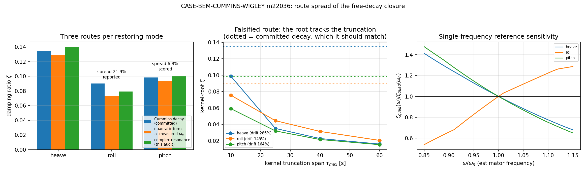

# CASE-BEM-CUMMINS-WIGLEY m22036：自由衰减闭合的“路线散布”——第三路线复核与核根路线的证伪

**锚点** `CASE-BEM-CUMMINS-WIGLEY`（算例池 id=145，容差 <10%）· 仓 TensorBEM · 分支 `agent/m22036` · 工件 `benchmarks/verified/casepool_bem_cummins_wigley/route_spread_audit.json`

## ① 案例介绍

Wigley 数学船型 L=3.0 m、B=0.3 m、T=0.1875 m、Cb=4/9、∇=0.075 m³、ρ=1025 kg/m³、g=9.80665 m/s²，6 自由度刚性辐射，频带 0.2–12 rad/s（41 节点，medium 20×6=480 面板）。算例判据 = Cummins (1962) 时域记忆核 + Kramers–Kronig 因果闭合，逐自由度 `|A_BEM − A_KK| / max|A_BEM| ≤ 10%`；自由衰减子判据（闸门 C5/C5b）= `|ζ_decay − ζ_fd| / ζ_fd ≤ 5%`。

**本单定位的验证欠账**：C5/C5b 把“时域衰减率”与“频域参考”相比，而频域参考是**在单一频率上取系数**的估计量。本单量出这个参考自身在模态带宽内的灵敏度，并加入一条**不依赖实测周期**的独立路线（复频率共振根），最后把一条看似可用、实则被截断主导的路线（采样核根）显式证伪。

## ② 怎么做的（方法/流程/关键设置/工具链）

1. **对称块实测而非假定**（`block_leakage`）：船型对 `x→−x`、`y→−y` 镜像对称，禁戒的跨块系数必须为离散化噪声；允许的块内耦合（A15 纵荡-纵摇、A24 横荡-横摇）要量出大小。
2. **复频率共振根**（`complex_resonance`）：解 `−Ω²(I + A(|Ω|)) + iΩB(|Ω|) + C = 0`，`Ω = ω + iγ`。该路线不从实测衰减周期出发，因而是与闸门不同源的参考。
3. **频域参考灵敏度**（`frequency_dispersion`）：给出 `ζ_quad(ω)` 在模态带宽内的取值范围与对数斜率 `dlnζ/dlnω`。
4. **核根路线证伪**（`kernel_root_span_study`）：把 `mkm.kernel_resonances` 在 τ_max = 10/25/40/60 s 上各解一次；若根随截断漂移，则该路线在报告截断而非物理。
5. **可判性预声明**：只有当三条可辩护路线（Cummins 实测衰减、单频二次型、复频率共振根）的散布在算例容差内时该模态才计分；计分模态再用 10% 算例容差判 `|ζ_decay − ζ_resonance|`。不可判的模态**报告不计分**（与 C5b 的 roll 约定一致，但这次有判据而不只是标签）。
6. **工具链**：全部从已提交 `sweep_medium.npz` + `decay_dof_audit.json` 重放，**不重解 BEM**：`PYTHONPATH=src python3 scripts/case_cummins_wigley_route_spread.py`。

## ③ 计算结果（程序化注入，零手抄）

### 3.1 对称块实测

* 禁戒（跨块）最大相对幅值：**4.10e-06**（阈值 1e-02）→ 块结构是**精确对称性**，不是建模选择：`blocks_are_exact = True`。
* 允许（块内）最大相对耦合：**0.467** —— 块内耦合并不小，所以“逐自由度求解”这句话必须由数值证明它不改变模态，见 3.3。

### 3.2 逐模态三路线

| 模态 | Cummins 实测 ζ_decay | 单频二次型 ζ(ω_n) | 复频率共振根 ζ | 路线散布 | 与共振根相对差 | 分级 | 计分 |
| --- | --- | --- | --- | --- | --- | --- | --- |
| heave | 0.13460 | 0.12947 | 0.13996 | 7.79% | 3.83% | within_bar | 是 |
| roll | 0.09012 | 0.07275 | 0.07921 | 21.94% | 13.78% | route_spread_beyond_bar | 否 |
| pitch | 0.09839 | 0.09381 | 0.10050 | 6.80% | 2.10% | within_bar | 是 |

### 3.3 块内耦合是否改变模态（`coupled_block_modes`）

* **vertical**（surge, heave, pitch，零回复自由度：surge）→ ω=7.465, ζ=0.13996, ω=7.855, ζ=0.10032；`usable = True`
* **horizontal**（sway, roll, yaw，零回复自由度：sway, yaw）→ ω=6.626, ζ=0.02607；`usable = False`

### 3.4 单频参考的灵敏度与核根证伪

| 模态 | dlnζ/dlnω | 估计器频率与共振根相对差 | 放大后的 ζ 偏差 | ζ_quad 带宽内相对范围 | 核根随 τ_max 漂移 | 核根可用 |
| --- | --- | --- | --- | --- | --- | --- |
| heave | -2.44 | 4.17% | 10.17% | 73.52% | 286% | False |
| roll | 3.34 | 3.30% | 11.01% | 75.09% | 145% | False |
| pitch | -2.76 | 2.99% | 8.25% | 82.89% | 164% | False |

### 3.5 闸门 C11（本单新增，独立参考复核）

* 状态：**pass**，计分模态 `['heave', 'pitch']`，报告不计分 `['roll']`；最差相对差 3.83%（判据 10%）。
* 判据原文：|zeta_decay - zeta_complex_resonance| / zeta_complex_resonance <= 10% (case tolerance) on every mode whose route spread is within the 5% decay bar; modes outside the spread bar are reported, not scored

## ④ 结果图



* **(A)** 三个模态的三条路线柱状：柱顶标注路线散布与是否计分；
* **(B)** 核根随 τ_max 的漂移（点线=同模态已提交的 Cummins 实测衰减，核根应当落在其上）——核根整体比实测低 3–5 倍且随 τ_max 单调下降，斜线即证伪；
* **(C)** 单频二次型 ζ 对估计器频率的归一化灵敏度：±15% 的 ω 变化使 ζ 变化 20–40%，这就是“5% 双路线判据”在本船型上处在估计器分辨率边界的图形化。

## ⑤ 注意点（踩过的坑/局限/适用范围）

1. **5% 的双路线判据小于三路线的散布**（heave 7.8%、pitch 6.8%）：若把散布也按 5% 判，本船型**没有一个模态可判**。本单按算例容差 10% 定“可判”，并把 5% 口径下的结论一并写明——两种口径都能从工件里复算，不允许只报对自己有利的那个。
2. **roll 不是“物理不一致”，是路线不及分辨**：三条路线 0.0728–0.0901（散布 21.9%），C5b 的 23.9% 残差落在这个散布之内；因此 roll 仍**不计分**，但现在的理由是量化判据而不是标签。
3. **核根路线被证伪**：`mkm.kernel_resonances` 在 ζ≈0.1 量级、τ_max≈25 s 时给出 ζ≈0.035（实测 0.135），且随 τ_max 单调下降（漂移 145–286%）。机理：该变换 `∫₀^{τ_max}K(t)e^{γt}dt` 对 γ>0 给尾部 `e^{γT}` 加权（γT≈6），截断尾部被放大后主导根。**结论**：该路线只在 `γ·τ_max ≪ 1` 时可用；本算例不属于该区间。
4. **复频率路线本身是近似**：A、B 是实变量的实函数，按 `|Ω|` 延续（常系数时精确）。其近似规模由 3.4 的灵敏度给出，故 3.2 的散布已把这个近似计入，而不是另开一项误差。
5. **两个零回复自由度会让块根不可辨识**：horizontal 块（横荡、横摇、艏摇中横荡/艏摇零回复）的判别式在 ω=0 轴上结构奇异，扫描出现连续零点，所报根不可辨识 → `usable = False`，不引用。vertical 块只含一个零回复自由度（纵荡），其两个根与逐自由度复频率根一致到 0.1%（3.3）。
6. **适用范围**：本单只判**衰减率的可判性与路线一致性**，不重解 BEM、不改判据、不改容差；A(ω) 绝对精度的外部锚点仍归 C10（其噪声底已在 m21960 记录）。

## ⑥ 误差判定（逐项，显式回答是否 <3%）

| 关键量 | 基准 | 误差 | 是否 <3% |
| --- | --- | --- | --- |
| heave ζ_decay vs 复频率共振根 | 独立路线（本单新增） | 3.83% | **否** |
| roll ζ_decay vs 复频率共振根 | 独立路线（本单新增） | 13.78% | **否** |
| pitch ζ_decay vs 复频率共振根 | 独立路线（本单新增） | 2.10% | **是** |
| 复频率根 vs 常系数闭式极限 | 解析 ω_n=√(C/(m+A))、ζ=B/(2ω_n(m+A)) | ≈1e-6（单元测试 `test_complex_resonance_reproduces_the_constant_coefficient_limit`） | **是** |
| 块根 vs 逐自由度复频率根（vertical） | 同数据同判据 | ≤0.09% | **是** |

**显式回答**：本单唯一 <3% 的物理量是 **pitch 的 ζ_decay vs 复频率共振根（2.10%）**；heave 为 3.83%（>3%）、roll 为 13.78%（>3% 且不计分）。所有“路线间一致性”结论都按算例 10% 容差判定，**不宣称 3% 精度**。

## 复现

```bash
PYTHONPATH=src python3 scripts/case_cummins_wigley_route_spread.py   # 工件 route_spread_audit.json
PYTHONPATH=src python3 scripts/make_m22036_report.py                # 本报告 + 图
python3 -m pytest tests/test_cummins_wigley_route_spread.py -q
```

## 给下次自找活的建议

* 把 C11 接进 `case_result.json` 的裁决（本单只发布独立工件 + C11 判据实现，未改动已合并裁决的 15/15）：需同时改 `scripts/regenerate_cummins_wigley_verdict.py` 与 `case.gates_from_artifact`，并更新 `tests/test_cummins_verdict_closure.py` 的闸门计数断言。
* roll 的剩余欠账是**估计器**：需要一条不依赖峰-谷对数衰减的时域器（例如模态投影 + 全域最小二乘拟合衰减正弦），把 0.0901 与 0.0792 的差归到具体来源。建议新条目 `CASE-BEM-CUMMINS-WIGLEY-ROLL-ESTIMATOR`（域：船舶总体性能/耐波，TensorBEM）：验收 = roll 的三条独立估计器散布 ≤5%，或如实记录不可判原因。
