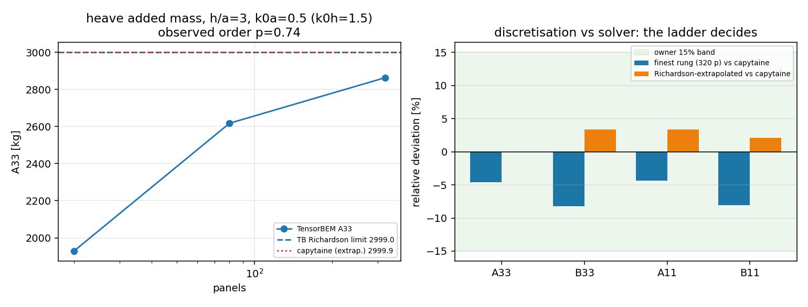

# Finite-depth cross-val: extrapolation uncertainty and the first extrapolated cell verdict (m22457)

**Anchor**: `XVAL-BEM-FINITE-DEPTH-CROSSVAL-PLAN` · **Repo**: TensorBEM · **Branch**: `agent/m22457`

EDIT_WHITELIST: src/tensorbem/, tests/, docs/

## 1. What changed

The 12-cell `h/a x k0*a` study compares TensorBEM and capytaine through *Richardson-extrapolated*
values, so the verdict rests on the assumption that each panel ladder is in its asymptotic range.
Until now that assumption was only checked indirectly (the measured order had to exceed
`MIN_OBSERVED_ORDER`), and the extrapolated value carried no uncertainty of its own. This change
measures it: for the four cells that carry the 1280-panel confirmation rung, the same extrapolation
is repeated after dropping the coarsest rung, and the relative spread of the two extrapolants is the
band. A gate `extrapolation_self_consistent` requires the worst band to stay below a third of the
quantity's pre-registered tolerance (`EXTRAPOLATION_BAND_FRACTION`, fixed before the run is seen).
Three rungs give `band = None` -- unknown, never zero, and the gate then reports FAIL rather than PASS.

## 2. First extrapolated cell verdict (h/a=3, k0*a=0.5, k0*h=1.5)

Three TensorBEM rungs (20/80/320 panels, self-converged in 113 s on this workstation) against the
frozen capytaine reference:

| quantity | TB 320 p | TB Richardson | p | capytaine | raw dev. | extrapolated dev. |
|---|---:|---:|---:|---:|---:|---:|
| heave added mass (A33) | 320 | 2998.97 | 0.74 | 2999.91 | -4.57 % | -0.03 % |
| heave damping (B33) | 320 | 765.98 | 0.61 | 740.90 | -8.24 % | +3.38 % |
| surge added mass (A11) | 320 | 2545.36 | 0.78 | 2461.59 | -4.36 % | +3.40 % |
| surge damping (B11) | 320 | 814.38 | 0.64 | 797.41 | -8.10 % | +2.13 % |

**Reading**: the 320-panel values are 4.4-8.2 % *below* capytaine, and extrapolation collapses A33 to
-0.03 %. The single-cell -12.75 % / -23.85 % reported by the earlier
2-rung snapshot was **discretisation, not a solver disagreement** -- which is exactly what the plan's
Richardson step exists to decide. The residual +3.4 %/+3.4 %/+2.1 % are above the pre-registered 3 %
added-mass tolerance on A11 but far inside the owner 15 % limit, and the reference's own order on this
cell (p=0.24) is below `MIN_OBSERVED_ORDER`, so `reference_ladder_in_asymptotic_range` FAILs and the
capytaine number itself is the least certain in the comparison. Reported as is.

## 3. Honest status

* The full 12-cell ladder (4 confirmation cells at 1280 panels) is **queued** on the compute pool as
  job `cj4139` (12 shards, submitted 21:46; the previous attempt cj3911 lost its shard caches in the
  node `/tmp`, so this run writes them into the repo checkout where `fetch` captures them).
* Nothing on this page is a full-grid verdict: one cell, 3 rungs, band unknown. The gates in the test
  suite still xfail for the grid, by design.

## 4. Checks run

* `pytest tests/test_capytaine_finite_depth_crossval.py` -> 17 passed, 6 xfailed (grid gates).
* New unit gates: exact power law -> band < 1e-9 and order = 2; three rungs -> band None; mixed-order
  ladder -> band > 1e-3 and the order moves towards the leading exponent when the coarsest rung is
  dropped; synthetic one-cell study -> gate PASS on four rungs, worst=None + FAIL on three.
