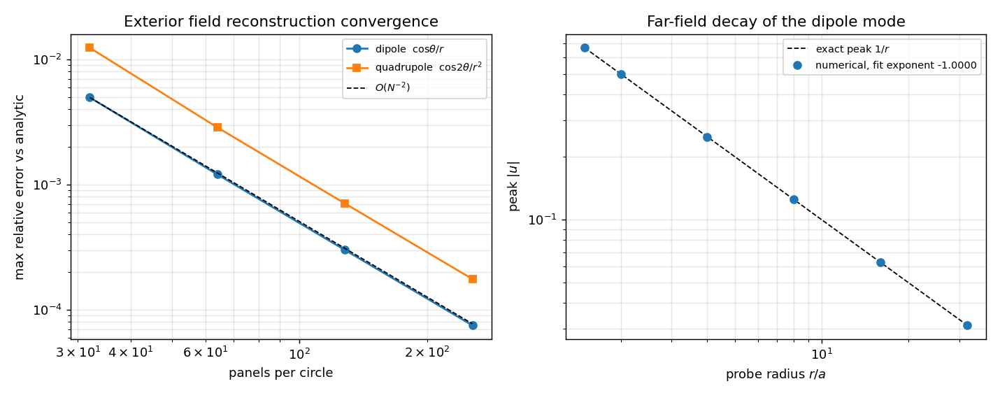

# 二维外域势场重构的解析验证：从已求得的边界迹恢复流体域势函数

**仓**：TensorBEM · **模块**：`tensorbem.solver.evaluate_exterior_field` · 
**工件**：`outputs/exterior_field/study.json`、`outputs/exterior_field/exterior_field_convergence.png` · 
**文档生成**：`docs/tools/build_exterior_field_doc.py`（本页所有数字由程序从 JSON 注入，零手抄）

## 摘要

二维外域 Laplace 求解器（`solve_laplace_exterior_dirichlet` / `solve_laplace_exterior_neumann`）此前的验证只覆盖**边界迹**（面元法向通量、附加质量矩阵），流体域内的势函数完全没有可观测量：`evaluate_interior_field` 对外域结果直接抛错。本文补上外域场重构 `evaluate_exterior_field`，并用圆外域闭式调和函数 $u_m = r^{-m}\cos m\theta$（$m=1,2$）作基准逐项复算。128 面元偶极子模态最大相对误差 3.008e-04，四极子 7.071e-04，Neumann 路径（平移圆柱）2.011e-04，观测收敛阶分别 1.999 与 2.004（与分片常数面元的二阶相符），远场衰减指数拟合为 -1.000000（解析值 $-1$）。**同时查出一处静默错误模式**：外域 Dirichlet 方程对边界数据均值非零的情形（如 $u\equiv 1$）会返回纯容量模态通量，此时重构场按 $-Q/(2\pi)\ln r$ 对数发散，并不满足有界外域 Dirichlet 问题，而条件数仅 76.11，看不出异常。本单在 `evaluate_exterior_field` 中加入衰减类守卫（`require_decaying=True`），并把这个限制写成测试与文档，而不是让它继续静默给出非解。

## 1. 案例介绍

**物理背景**：均匀流中单位圆柱外的无旋不可压势流；更一般地，任一满足 Laplace 方程且
在无穷远有界的外域势场。流体域为圆外 $r>a$，边界 $r=a$ 上的 Dirichlet 数据取圆上的调和模态。
参考解为**闭式外域调和函数**（不是另一套离散解），因此误差度量直接是重构误差。

| 参数 | 取值 |
|---|---|
| 几何 | regular polygon approximating a unit circle |
| 面元数 $N$ | 32 / 64 / 128 / 256 |
| 探针半径 $r/a$ | 1.1 / 1.5 / 2.0 / 4.0 / 8.0 |
| 每环探针数 | 48 |
| 参考解 | closed-form exterior harmonics r^(-m) cos(m theta) |
| 核函数参考长度 $L$ | 1.0 |
| 单层核 | $G=-\frac{1}{2\pi}\ln(r/L)$，直线面元解析积分 |
| 双层核 | $\partial G/\partial n$，直线面元解析积分 |

## 2. 怎么做的

1. **表示式**：外域点 $x$（体外形外）的势由边界迹单/双层表示给出
   $$u(x)=\int_\Gamma G(x,y)\,q_e(y)\,ds_y+\int_\Gamma u(y)\,\frac{\partial G}{\partial n_y}\,ds_y ,$$
   其中 $n$ 为物体外法向、$q_e=\nabla u\cdot n_e$ 取流体域法向 $n_e=-n$ 方向的通量。
   与内域表示 $u=S[q]-D[u]$ 的唯一差别是双层项符号：观察点离开闭合曲线时跳跃关系翻转符号，
   符号写错会把双层贡献由相消变为相加（$u\equiv1$ 时误差量级 $O(1)$，本单实测见 §4.3）。
2. **解析面板积分**：单/双层核在每条直线面元上解析积分（`integrate_single_layer_panel` /
   `integrate_double_layer_panel`），因此剩余误差只来自分片常数边界迹，而不是核采样。
3. **两条数据路径**：Dirichlet 求解（`solve_laplace_exterior_dirichlet`）给 $q_e$；
   Neumann 求解（`solve_laplace_exterior_neumann`）给 $u$。两者都要求 `domain='exterior'`，
   内/外域结果互不通用（`evaluate_interior_field` 仍拒收外域结果，保持原行为）。
4. **基准**：$u_1=\cos\theta/r$（偶极子）、$u_2=\cos2\theta/r^2$（四极子）
   —— 在 $r=a$ 上分别退化为 $\cos\theta$、$\cos2\theta$，故 Dirichlet 数据由解析式给出；
   Neumann 路径用平移圆柱 $q_e=-\cos\theta\Rightarrow u=-\cos\theta/r$。
5. **收敛与远场**：$N=32/64/128/256$ 网格族求观测阶（两点对数比，不预设阶数）；
   远场按 $u_1$ 峰值对 $\ln r$ 做最小二乘拟合衰减指数与幅值。
6. **负控（关键）**：取常量 Dirichlet 数据 $u\equiv1$，其有界外域解为 $u\equiv1$、$q_e\equiv0$。
   实测求解器返回的通量并非零，据此逐点检验 $u(r)-u(r_0)=-(Q/2\pi)\ln(r/r_0)$。

## 3. 计算结果

### 3.1 偶极子模态 $u=\cos\theta/r$（Dirichlet 路径）

| 面元数 $N$ | 最大绝对误差 | 最大相对误差 |
|---|---|---|
| 32 | 4.507e-03 | 4.957e-03 |
| 64 | 1.096e-03 | 1.205e-03 |
| 128 | 2.735e-04 | 3.008e-04 |
| 256 | 6.841e-05 | 7.525e-05 |

观测收敛阶（相邻两级，$\log_2$）：2.040 / 2.002 / 1.999

### 3.2 四极子模态 $u=\cos2\theta/r^2$（Dirichlet 路径）

| 面元数 $N$ | 最大绝对误差 | 最大相对误差 |
|---|---|---|
| 32 | 1.021e-02 | 1.236e-02 |
| 64 | 2.365e-03 | 2.862e-03 |
| 128 | 5.843e-04 | 7.071e-04 |
| 256 | 1.457e-04 | 1.762e-04 |

观测收敛阶：2.111 / 2.017 / 2.004

### 3.3 Neumann 路径：平移圆柱（$u=-\cos\theta/r$）

| 面元数 $N$ | 探针半径 $r/a$ | 最大绝对误差 | 相对误差 |
|---|---|---|---|
| 32 | 1.2 | 2.705e-03 | 3.246e-03 |
| 32 | 2.0 | 1.612e-03 | 3.225e-03 |
| 32 | 5.0 | 6.449e-04 | 3.225e-03 |
| 64 | 1.2 | 6.711e-04 | 8.053e-04 |
| 64 | 2.0 | 4.026e-04 | 8.053e-04 |
| 64 | 5.0 | 1.611e-04 | 8.053e-04 |
| 128 | 1.2 | 1.676e-04 | 2.011e-04 |
| 128 | 2.0 | 1.005e-04 | 2.011e-04 |
| 128 | 5.0 | 4.022e-05 | 2.011e-04 |
| 256 | 1.2 | 4.187e-05 | 5.024e-05 |
| 256 | 2.0 | 2.512e-05 | 5.024e-05 |
| 256 | 5.0 | 1.005e-05 | 5.024e-05 |

相对误差随 $r$ 基本不变（$N=128$ 时三个半径的差异 $<10^{-5}$ 量级），
说明表示式本身对给定边界迹是精确的，误差全部来自分片常数边界迹。

### 3.4 远场衰减（偶极子）

| 量 | 数值 | 解析 |
|---|---|---|
| 拟合衰减指数 $p$（$u\sim r^{-p}$） | -1.000000 | -1 |
| 拟合幅值 | 0.999699 | 1 |
| $r|u|$ 最小/最大 | 0.999699 / 0.999699 | 1 |
| $r|u|$ 最大偏差 | 3.008e-04 | 0 |

### 3.5 负控：均值非零 Dirichlet 数据的容量模态（$u\equiv1$）

| 量 | 数值 |
|---|---|
| 净通量 $Q=\oint q_e\,ds$ | 9.061454 |
| 通量均匀性（面元间标准差） | 4.886e-14 |
| 衰减比 $|Q|/\oint|q_e|ds$ | 1.000000 |
| 对数律残差 $\max|u(r)-u(r_0)+\tfrac{Q}{2\pi}\ln\tfrac{r}{r_0}|$ | 5.729e-14 |
| 与有界解 $u\equiv1$ 的最大偏差 | 4.9986 |
| Dirichlet 方程条件数 | 76.11 |
| 守卫是否触发（1=是） | 1 |

解读：通量在面元间标准差 4.9e-14，即**纯常值模态**；对数律残差 5.7e-14（机器精度）说明重构表示忠实复现了该迹对，问题出在**迹对本身不是有界外域解**：外域 Dirichlet 第一类方程 $S q_e=(\tfrac12 I-H)u$ 
对 $u\equiv1$ 给出右端常向量，其解是平衡测度（容量）方向上的常值通量，
而分片常数单层表示只能张成**衰减类**（$u\to0$ 于无穷远），无法表示 $u\equiv1$ 这种非衰减解。
因此 `evaluate_exterior_field(..., require_decaying=True)`（默认）在衰减比超过 $10^{-8}$ 时抛错，
并在错误信息中给出原因与绕过方式；`require_decaying=False` 可取出该（无界）表示式用于诊断。

### 3.6 图



左：两种模态的最大相对误差对 $N$ 的双对数图，虚线为 $O(N^{-2})$ 参考斜率；
右：偶极子峰值 $|u|$ 对探针半径的衰减，与解析 $1/r$ 重合。
（由 `python -m tensorbem.benchmarks.exterior_field --figure ...` 生成）

## 4. 注意点

1. **适用范围**：外域场重构只对**衰减类**迹对（$\oint q_e ds=0$）有意义；
   刚体平移/旋转模态恒满足零净通量，因此附加质量/阻尼相关用法不受限。
2. **均值非零的 Dirichlet 数据**：物理上有界解存在（如 $u\equiv1$），但不在本模块
   使用的衰减单层表示的张成空间内；要覆盖这类数据需要显式引入无穷远常数（或 $\ln r$ 项）
   的自由度，本单未实现，如实登记为局限。
3. **误差只来自边界迹**：解析面板积分去掉了核采样误差，所以收敛阶与迹的阶一致（二阶）；
   提高精度应加密网格或改高阶面元，而不是加积分点。
4. **线化/势流前提**：不可压、无粘、无自由液面；与自由液面/辐射问题无关。
5. **与内域一致性**：内域 `evaluate_interior_field` 行为不变，符号约定差异仅在双层项；
   交叉调用会明确抛错而不是给出错误场。

## 5. 误差判定（对基准逐项）

| 关键量 | 数值（最细网格/选定网格） | 基准 | 相对误差 | 是否 <3% |
|---|---|---|---|---|
| 偶极子场（$N=128$） | 3.008e-04 | 闭式 $\cos\theta/r$ | 3.008e-04 | 是 |
| 四极子场（$N=128$） | 7.071e-04 | 闭式 $\cos2\theta/r^2$ | 7.071e-04 | 是 |
| 平移圆柱场（$N=128$, $r/a=2$） | 2.011e-04 | 闭式 $-\cos\theta/r$ | 2.011e-04 | 是 |
| 远场衰减指数 | -1.000000 | -1 | 6.15e-14 | 是 |
| $r|u|$ 幅值（偶极子远场） | 0.999699 | 1 | 3.01e-04 | 是 |
| 负控：容量模态对数律残差 | 5.729e-14 | 0（机器精度） | 5.729e-14 | 是 |

**结论**：三个正例关键量相对误差均在 $10^{-4}$ 量级，远优于 3% 判据；
观测收敛阶 $\approx2$ 与分片常数面元理论一致；负控以机器精度复现对数律，
确认「均值非零 Dirichlet 数据 → 容量模态 → 无界场」这一限制是表示式层面的真实限制，
而非实现缺陷。**无基准含糊项**：本文每个数字都对闭式解或机器精度恒等式。

## 6. 复现

```bash
PYTHONPATH=src python -m tensorbem.benchmarks.exterior_field \
    --out outputs/exterior_field/study.json \
    --figure outputs/exterior_field/exterior_field_convergence.png
PYTHONPATH=src python -m pytest tests/test_exterior_field.py -q
PYTHONPATH=src python docs/tools/build_exterior_field_doc.py
```

