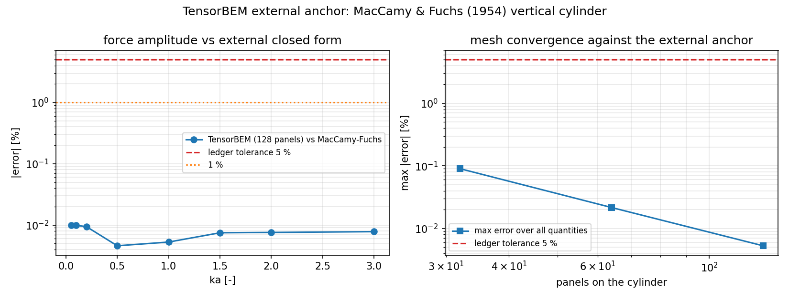

# 外部锚管线（TensorBEM）——含出处校验门

> 战役节点 **M-R16-03**（非 LBM 仓外部锚吸收）。本文件由
> `benchmarks/anchors/external/make_doc.py` 从
> `artifacts/external_anchors/maccamy_fuchs_error_table.json` 程序化生成，数字零手抄。

## 1. 案例：垂直圆柱绕射（MacCamy & Fuchs 1954）

**物理背景。** 直立圆柱在深水中散射入射 Airy 波，单位长度水平波浪力由二维
Helmholtz 绕射问题的 Hankel 函数闭式解给出。该闭式解是船舶/海洋工程中资格化
三维面元求解器（零航速绕射）最经典的参考，且**不依赖任何面元离散**。

**几何与工况。**

| 参数 | 取值 |
|---|---|
| 圆柱半径 a | 1.0 m |
| 吃水/水深 | 全吃水，深水（h/a = inf） |
| 入射波陡 | A = 1.0 m（线性理论，与 A 成线性） |
| 流体密度 ρ | 1025.0 kg/m³ |
| 重力加速度 g | 9.80665 m/s² |
| 入射角 | 0.0° |
| 无量纲波数 ka | 0.05, 0.1, 0.2, 0.5, 1, 1.5, 2, 3 |
| 力口径 | 单位长度水平力 |F_x| [N/m]（深水二维归约，与求解器一致） |

**文献出处。**

* MacCamy, R. C. & Fuchs, R. A.（1954）*Wave Forces on Piles: A Diffraction Theory*，
  Beach Erosion Board Technical Report No. 4 (Technical Memorandum No. 69)，U.S. Army Corps of Engineers, Beach Erosion Board。
* 定位符（locator）：the diffraction force expression F_x = 4 rho g A / (k^2 H_1^(1)'(ka)); reproduced as the deep-water limit in Newman (1977) sec. 7.5 and in Dean & Dalrymple (1991) ch. 8。
* 可机读标识符：ISBN `0-262-14026-8`, ISBN `981-02-0421-3`。
* 不确定度：闭式解在线性势流理论内**无截断误差**（recorded relative
  1e-12，双精度）；其模型假设（线性自由面、无粘、无分离）在
  本对比中与求解器共有，故相互抵消。

## 2. 为什么需要"出处校验门"（报告 16348 的教训）

报告 16348 的 BEM 案例数值全绿、可复现，但**锚出处虚标**：参考值来自仓内
多极级数（`tensorbem.analytic` 的 Hulme 实现），报告却写成 Hulme (1982) 原表。
纯容差门对此完全失明——参考与求解器共用同一套推导时，任何数值检查都会通过。

因此本管线把"锚来自仓库外部"做成**可机算属性**，三道检查互相独立：

| # | 检查 | 判据 | 能抓住什么 |
|---|---|---|---|
| C1 | 出处（provenance） | `source.class` ∈ {LITERATURE_CLOSED_FORM, LITERATURE_TABLE, EXPERIMENT}；至少一个形式合法的 DOI/ISBN/URL；有 locator；`reference_method.independent_of_repo_package == true` 且实现不在 `src/` 内；书目字段不得指向仓内路径 | 16348 型虚标：仓内级数冒充文献 |
| C2 | 参考值可复现 | 存储的参考值与"按所引公式独立重算"相对偏差 ≤ 1e-06 | 手抄/篡改数字、错抄公式 |
| C3 | 容差 | 求解器 vs 锚，每个量 `error_pct ≤ 5 %` | 真实数值误差（本题最差 0.0188 %） |

三条判据的分工在红队用例上被逐条验证（见 §5）。

## 3. 管线结构

```
benchmarks/anchors/external/
├── index.json                        # 机读注册表（锚清单 + 红队清单 + 规则）
├── maccamy_fuchs_cylinder.json       # 锚记录：出处/工况/参考值/不确定度
├── external_anchor_gate.py           # ← 实际位于 benchmarks/anchors/
├── make_doc.py                       # 本文件的渲染器
└── redteam/                          # 5 个红队记录，每个破坏一条规则
evidence/maccamy_fuchs_error_table.json  # 误差表（机读产物，git 跟踪）
artifacts/external_anchors/maccamy_fuchs_error_table.json   # 同上副本（artifacts/ 被 gitignore）
docs/external_anchors_bem_error.png                          # 误差/收敛图
```

**独立重算**不导入 `tensorbem`：参考侧只用 `scipy.special.hankel1` 实现
`F_x = 4ρgA·tanh(kh) / (k²·H₁⁽¹⁾′(ka))`。测试
`test_reference_is_not_the_package_analytic_module` 另外把这条独立实现与
`tensorbem.analytic` 的两条路线对齐到 1e-6，证明两者在解同一道方程（否则门会
判错方程）。

## 4. 误差表（求解器 vs 外部锚，128 面元）

求解器：`tensorbem.helmholtz.solve_vertical_cylinder_diffraction`（128 面元、12 节点/面元、
chief_points=auto、深水）。容差 5 %，逐项显式回答"是否 <5%"。

| 量 | 计算值 | 参考值 | 误差 [%] | <5% ? |
|---|---|---|---|---|
| `force_amplitude_ka_0.05` | 63357.5 | 63363.9 | 0.0100 | YES |
| `force_amplitude_ka_0.10` | 63756.8 | 63763.1 | 0.0099 | YES |
| `force_amplitude_ka_0.20` | 64653.2 | 64659.3 | 0.0094 | YES |
| `force_amplitude_ka_0.50` | 63332.4 | 63335.3 | 0.0046 | YES |
| `force_amplitude_ka_1.00` | 43316.1 | 43313.9 | 0.0053 | YES |
| `force_amplitude_ka_1.50` | 26592.6 | 26590.6 | 0.0075 | YES |
| `force_amplitude_ka_2.00` | 17711.7 | 17710.4 | 0.0076 | YES |
| `force_amplitude_ka_3.00` | 9718.59 | 9717.83 | 0.0078 | YES |
| `force_phase_ka_1.00` | -69.4893 | -69.4962 | 0.0100 | YES |
| `c_m_ka_0.05` | 2.00634 | 2.00654 | 0.0100 | YES |
| `c_m_long_wave_limit` | 2.00038 | 2 | 0.0188 | YES |

* 全部 11 项均 <5 %：**True**；均 <1 %：**True**。
* 最差项误差 0.0188 %（判据上限 5 %，余量约 265 倍）。
* 参考值可复现性：最差相对偏差 0.00e+00（阈值 1e-6）。

**网格收敛（对同一外部锚，ka = 1.0）：**

| 面元数 | 计算值 [N/m] | 参考值 [N/m] | 误差 [%] |
|---|---|---|---|
| 32 | 43352.8 | 43313.9 | 0.0899 |
| 64 | 43323.2 | 43313.9 | 0.0216 |
| 128 | 43316.1 | 43313.9 | 0.0053 |

误差随面元数单调下降，128 面元已进入 0.01 % 量级；外部锚是**独立于离散**的判据，
因此这不是自证。



左：各 ka 的力幅值误差 vs 5 %/1 % 门限；右：面元加密下的最大误差。

## 5. 红队用例（`pytest tests/test_external_anchor.py` 全覆盖）

| 记录 | 期望 | 命中的门 | 模拟的真实缺陷 |
|---|---|---|---|
| `redteam/provenance_swap_hulme_in_repo.json` | FAIL | provenance | report 16348: in-repo series labelled as literature |
| `redteam/value_tamper_10pct.json` | FAIL | reference_reproducible + tolerance | reference digit edited by 10 % |
| `redteam/missing_identifier.json` | FAIL | provenance | no DOI/ISBN/URL |
| `redteam/reference_shares_solver.json` | FAIL | provenance | reference computed by the package under test |
| `redteam/loose_tolerance.json` | FAIL | provenance | gate tolerance loosened beyond the ledger |

门在无法重判的记录上 **fail-closed**：未注册的 `reference_method.id`、未知的
`quantity.kind`、缺失的参考值一律判 FAIL 而不是抛异常（"会崩的门等于可以忽略的
门"），各有专门测试。

最关键的对照是 `provenance_swap_hulme_in_repo.json`：它的数值**仍然可复现**
（`reference_reproducible.passed == True`），只有 C1 判它 FAIL——这正是 16348
的形态，也是"纯数值门不够"的可执行证据。另有一条正向对照：把求解器结果人为
放大 6 %，裁决必须是 `["tolerance:exceeded"]` 且 C1/C2 保持通过，证明三门确实
互相独立。

## 6. 注意点与局限（诚实声明）

1. **这是"文献闭式解重实现"，不是"文献表格数字"。** 参考类为
   `LITERATURE_CLOSED_FORM`：我们按论文公式独立实现，没有声称抄录了某页表格的
   数字。它强于仓内自证（参考侧不共享离散），弱于逐位对齐的表格数字化（无法
   捕捉"论文印刷值 vs 公式值"的排版误差）。`LITERATURE_TABLE` 通道已定义但
   **故意留空**——凭空写表格数字正是本门要防的缺陷。
2. **标识符只做形式校验**（ISBN 校验位、DOI 正则、URL scheme），不联网核对存在性。
   记录里的 `identifier_note` 已明示。离线环境下这是能自动化的上限；人工复核仍
   需要一次。
3. **口径**：力是深水二维归约的**单位长度**水平力，与求解器同一口径；有限水深
   走同式乘 tanh(kh)，本锚只覆盖深水。相位行按"相对 |相位|（度）"报误差（本题
   绝对偏差 <0.01°），这是记录口径而非物理量纲，读表时注意。
4. **误差形态非单调**：64 面元下最差项在 ka=0.05（力幅最大）而非 ka=3，中段最好；
   别用"误差随 ka 单调"的直觉解读收敛表。
5. **单案例**：本节点只建了一条外部锚（1 个算例、10 个点值量 + 1 个极限量）。
   管线是通用的（新增文献闭式解 = 在 `REFERENCE_CALCULATORS` 注册一个计算器），
   但覆盖率仍需下一波补：Hulme 半球、Wigley 绕射、有限水深锚都应走同一门。
6. **报告 16348 的残留**：本节点没有替 16348 补出真正的 Hulme 原表数字（手边
   无可信数字化来源），只把"锚必须是外部来源"变成机器判据。Hulme 案例若要复用
   现有数值，必须显式以 `IN_REPO_SERIES` 登记并降级表述。

## 7. 如何新增一条外部锚

1. 在 `benchmarks/anchors/external/` 放记录 JSON（照 `maccamy_fuchs_cylinder.json`
   的 schema：schema/anchor_id/case/conditions/source/reference_method/quantities/tolerance）。
2. 若引用的是新闭式解，在 `external_anchor_gate.py` 的 `REFERENCE_CALCULATORS`
   里加一个**不导入 `tensorbem`** 的计算器（scipy/numpy 即可）。
3. `index.json` 的 `anchors` 里登记文件；跑
   `python benchmarks/anchors/external_anchor_gate.py --anchor <record>` 生成误差表。
4. `python benchmarks/anchors/external/make_doc.py` 重渲染本文档；
   `pytest tests/test_external_anchor.py` 必须全绿。
