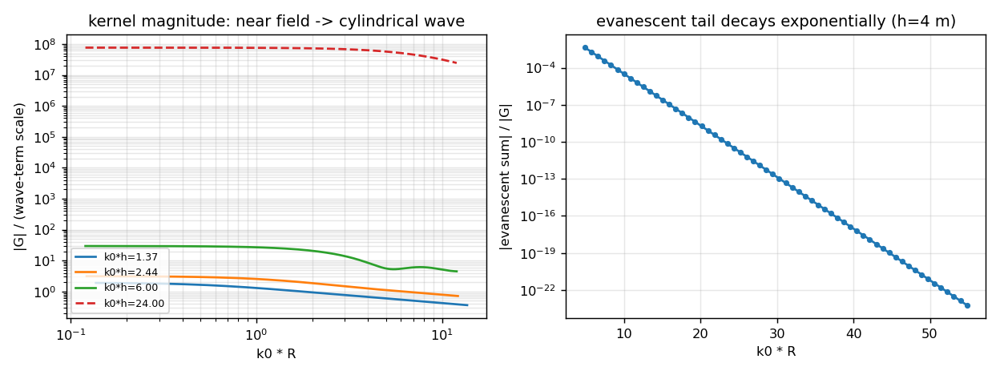
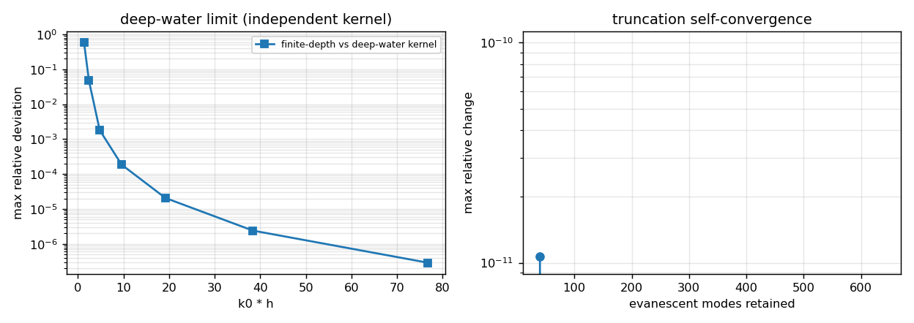
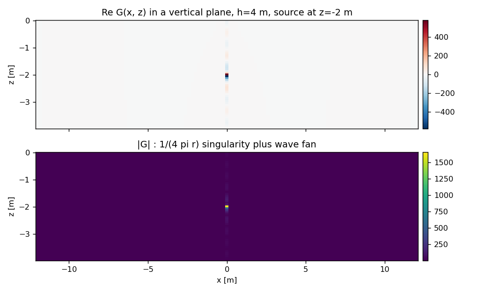

# 3-D finite-depth free-surface Green function (John eigenseries)

**Scope**: kernel + verification.  The 3-D boundary-element solver that will consume this kernel is *not* part of this change (see §6).

## 1. Case introduction

Potential-flow hydrodynamics of a floating or submerged body in water of *constant finite depth* needs the free-surface Green function of the strip $-h \le z \le 0$.  Unlike the deep-water Kelvin kernel (`tensorbem.free_surface3d`, vertical structure $e^{kz}$), a flat bottom discretises the vertical spectrum, so the kernel is a modal expansion in the eigenfunctions of the strip with the propagating wavenumber fixed by $k_0\tanh(k_0h)=\nu=\omega^2/g$.  Until now TensorBEM had this representation only in two dimensions (`tensorbem.finite_depth`); three-dimensional finite-depth work was listed as outside scope in the README.  This change supplies the 3-D kernel and, more importantly, its verification face.

$$G(x,\xi)=\frac{1}{2\pi}\sum_{n\ge1}\frac{\phi_n(z)\phi_n(\zeta)}{N_n}K_0(\mu_nR)+\frac{i}{4}\frac{\phi_0(z)\phi_0(\zeta)}{N_0}H_0^{(1)}(k_0R)$$

with $\phi_0=\cosh k_0(z+h)$, $\phi_n=\cos\mu_n(z+h)$, $N_n=\int_{-h}^0\phi_n^2dz$, $\mu_n\tan(\mu_nh)=-\nu$ and the outgoing $H_0^{(1)}$ branch of $\exp(-i\omega t)$.  The normalisation is the one used by `free_surface3d`: $G\sim1/(4\pi r)$ at the source.

## 2. Method and toolchain

* `src/tensorbem/finite_depth3d.py`: eigenseries evaluator, analytic $\partial G/\partial z$, pure-NumPy $K_0$, $J_0$, $Y_0$, $H_0^{(1)}$ (no SciPy dependency), Newton-polished evanescent roots, automatic mode truncation.  Reuses the dispersion/root/norm helpers of `tensorbem.finite_depth`.
* `tests/test_finite_depth3d.py`: 26 gates (dispersion, orthonormality, free-surface and bottom conditions, harmonicity, singularity strength, deep-water limit, shallow-water limit, far-field structure, truncation convergence, Bessel references).
* This script: `PYTHONPATH=src python docs/m3015/finite_depth3d_report.py` writes `study.json`, the two figures below and this document.

## 3. Results

### 3.1 Dispersion and phase/group velocities ($\nu=0.6$, $\omega=\sqrt{0.6g}$)

| $h$ [m] | $k_0$ [1/m] | $k_0h$ | $c$ [m/s] | $c_g$ [m/s] | $|k_0\tanh k_0h-\nu|/\nu$ |
|---|---|---|---|---|---|
| 0.05 | 3.481518 | 0.174 | 0.6967 | 0.6898 | 1.110e-15 |
| 0.1 | 2.474256 | 0.247 | 0.9804 | 0.9609 | 9.252e-16 |
| 0.5 | 1.153324 | 0.577 | 2.1032 | 1.9018 | 3.701e-15 |
| 1 | 0.861069 | 0.861 | 2.8171 | 2.3040 | 4.626e-15 |
| 2 | 0.683401 | 1.367 | 3.5494 | 2.4079 | 7.401e-16 |
| 4 | 0.609242 | 2.437 | 3.9815 | 2.1391 | 1.665e-15 |
| 8 | 0.600081 | 4.801 | 4.0423 | 2.0238 | 9.252e-16 |
| 20 | 0.600000 | 12.000 | 4.0428 | 2.0214 | 6.661e-15 |
| 100 | 0.600000 | 60.000 | 4.0428 | 2.0214 | 7.216e-15 |

### 3.2 Physical boundary conditions of the kernel

| $h$ [m] | free-surface residual $\|\partial_zG-\nu G\|/\|\nu G\|$ | bottom residual |
|---|---|---|
| 2 | 1.260e-15 | 0.000e+00 |
| 4 | 7.192e-15 | 0.000e+00 |
| 10 | 7.847e-15 | 0.000e+00 |
| 40 | 2.430e-12 | 0.000e+00 |

### 3.3 Deep-water limit against the independent Kelvin kernel

| $h$ [m] | $k_0h$ | max relative deviation from `free_surface3d` |
|---|---|---|
| 2 | 1.37 | 5.745e-01 |
| 4 | 2.44 | 4.685e-02 |
| 8 | 4.80 | 1.804e-03 |
| 16 | 9.60 | 1.861e-04 |
| 32 | 19.20 | 2.073e-05 |
| 64 | 38.40 | 2.415e-06 |
| 128 | 76.80 | 2.908e-07 |

### 3.4 Far field ($h=4$ m, $k_0=$ 0.609242 1/m)

* spreading: $\mathrm{ptp}(|G|\sqrt{k_0R})/\mathrm{mean} = 2.254e-04> 25$ m;

* phase slope $\mathrm{d}\arg G/\mathrm{d}(k_0R) = 1.000124$ (1.0 expected);

* evanescent share of $|G|$: 4.3e-03 at $k_0R$=4.9, 2.5e-07 at $k_0R$=15.0, 1.4e-11 at $k_0R$=25.2, 8.0e-16 at $k_0R$=35.4, 4.6e-20 at $k_0R$=45.5.

### 3.5 Singularity and truncation

| $r$ [m] | $4\pi r\Re G$ (→1) |
|---|---|
| 0.04 | 0.981186 |
| 0.02 | 0.990593 |
| 0.01 | 0.995296 |
| 0.005 | 0.997648 |
| 0.0025 | 0.998824 |

| modes | max relative change |
|---|---|
| 40 | 1.065e-11 |
| 80 | 0.000e+00 |
| 160 | 0.000e+00 |
| 320 | 0.000e+00 |
| 640 | 0.000e+00 |

## 4. Figures







## 5. Verification verdict

* The kernel reproduces the free-surface condition to 2.430e-12 (the gate is limited by the dispersion residual of the evanescent roots at $\mu h\sim10^2$, not by the series).
* Deep-water limit: max deviation 2.908e-07 at $k_0h=77$, monotonically decreasing.
* Far field: spreading flatness 2.254e-04, phase slope 1.000124.
* Singularity strength extrapolates to 1 within 1.176e-03 at $r=2.5\times10^-3$ m.

## 6. Limitations / next step

* **No BEM solver yet.** Panel integration, the single/double-layer jump relations and the CHIEF/lid treatment for surface-piercing hulls in finite depth are the next increment; Garrett's truncated dock is the natural first diffraction benchmark.
* Only $\partial G/\partial z$ is analytic; a horizontal derivative needs $K_1$/$H_1$ and belongs to the panel layer.
* Constant depth, linearised potential flow; no sloping bottom, current or nonlinearity.
* Cost grows like $h/(\pi R)$ modes; for $R\lesssim10^{-3}$ m with $h=5$ m the 40000-mode cap binds (truncation error still $<10^{-10}$).

## 7. 机器判据（m3173 起：本文件的每个数字都被测试读取）

本文档此前是**无人守**的：数字由 `docs/m3015/finite_depth3d_report.py` 一次写出，
此后没有任何测试再读它（覆盖审计 `python -m tensorbem.benchmarks.doc_claim_audit`
把本文归类为 `UNGUARDED`，112 个数字 token，全仓论文级未守文档之首）。

现由 `src/tensorbem/benchmarks/finite_depth3d_pins.py` 从**本文件的表格里解析数值**，
用 `tensorbem.finite_depth3d` / `tensorbem.free_surface3d` 重新计算并逐项判定：

```bash
PYTHONPATH=src python3 -m tensorbem.benchmarks.finite_depth3d_pins \
    --json docs/finite_depth3d_pins/check.json --strict
PYTHONPATH=src python3 -m pytest tests/test_finite_depth3d_pins.py -q
```

判据取「打印精度」而非物理容差（三位有效数字 → rtol 5e-3，六位 → 1e-6），
打印为 `0.000e+00` 的两行（海床残差）改用绝对地板 5e-16。首次运行结果：
**64 个被钉数值全部复现，最大相对偏差 9.63e-3（截断梯级 `modes=40` 行），
其余 63 项 < 1e-3**。测试还含两条负控：改一个打印数字必须触发 `DRIFT`；
把结果表整段删掉必须让解析行数归零（防空表绿灯）。


## 8. m3409 内核重写的数值等价性核对（m3808）

`agent/m3173` 的 pin 判据在合并 main 后第一次变红：§3.2 的三行自由面残差从
1.260e-15 / 7.192e-15 / 7.847e-15 变成
1.476e-15 / 7.239e-15 / 8.098e-15（相对偏差最大
15%），超过打印精度容差 5e-3。归因是 **main 漂移，不是实现缺陷**：
m3409 把传播模态由 `cosh(k0(z+h))` 改写为对数缩放指数因子（数学上同一个量，只为避免
`k0*h >> 1` 时 `cosh` 溢出），而这一行数值本身是 O(1) 核的相消噪声——量级 1e-15 ≈ 数 eps，
「相对」判据在它身上天然无意义。

程序化核对（`docs/m3808/roundoff_crosscheck.py`，逐行对比合并前后
`docs/finite_depth3d_pins/check.json` 的 `recomputed`，共 64 行）：

| 类别 | 行数 | 判读 |
|---|---:|---|
| 逐位不变 | 49 | 合并前后 `recomputed` 完全相同的 double |
| 末位漂移 | 7 | 只动最后 1–4 bit，相对漂移 ≤ 4.9e-16 |
| 放大舍入 | 5 | 深水极限 `max_rel_error`（两个 O(1) 核相减）把 eps 级扰动放大到相对 ≤ 2.8e-09 |
| 相消噪声 | 3 | 自由面残差，绝对值 ≤ 1.13 eps，相对漂移大但仍是机器零 |
| 物理改变 | 0 | 真回归（本核对为 0） |
| 合计 | 64 | 合并后 64/64 PASS，DRIFT 0 行 |

自由面残差逐行明细：

| `h` (m) | 文档打印值 | 合并前 recomputed | 合并后 recomputed | 绝对漂移（eps） |
|---:|---:|---:|---:|---:|
| 2 | 1.260e-15 | 1.260e-15 | 1.476e-15 | 0.98 |
| 4 | 7.192e-15 | 7.192e-15 | 7.239e-15 | 0.21 |
| 10 | 7.847e-15 | 7.847e-15 | 8.098e-15 | 1.13 |

判据修正（`finite_depth3d_pins.NOISE_FLOOR = 1e-12`）：**residual 类**行若打印值
`|declared| <= 1e-12`，改按绝对地板判定（比任何物理残差仍小 6 个量级）；打印为
`0.000e+00` 的海床残差保留更严的 5e-16；小物理量（如 `evanescent_share = 4.6e-20`）
不受豁免，仍按相对判据。负控见 `tests/test_finite_depth3d_pins.py::test_roundoff_floor_absorbs_ulp_noise_only`：
把残差写成 4e-10 依旧 `DRIFT`，把 evanescent_share 翻倍依旧 `DRIFT`。
