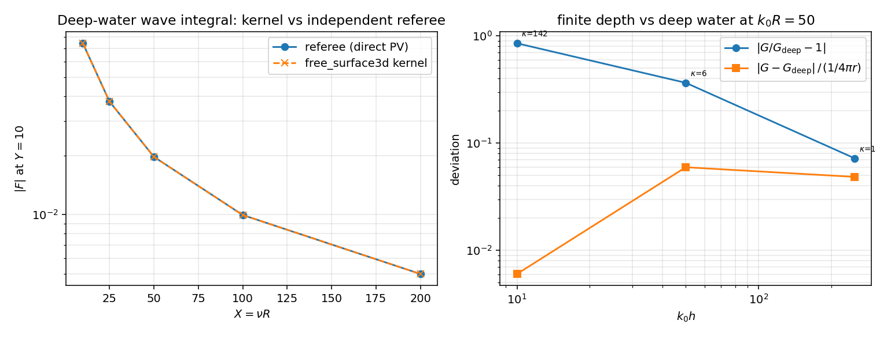

# 3-D finite-depth vs deep-water kernel: arbitration of the `k0*h = 10`, `k0*R = 50` open item

**Mission** m4776 (self-start, paper/verification seat, TensorBEM) · branch `agent/m4776`
**Closes** the open item in `docs/finite_depth3d_regime.md` §5 / §6 last row
("deep-water kernel at `k0 h = 10`, `k0 R = 50`: 85 % — **no**, open item").

EDIT_WHITELIST: `src/tensorbem/benchmarks/`, `tests/`, `docs/`

---

## 1. Case

`green_function_3d(targets, sources, nu, depth)` (John 1950 eigenseries) must
collapse onto `free_surface3d.green_function_3d(targets, sources, nu)` (deep-water
Kelvin/Havelock kernel) as `k0*h -> inf`. m3409 measured a residual of
`|G/G_deep - 1| = 8.5e-1` at `k0*h = 10`, `k0*R = 50` and could not decide which
kernel was wrong, because at that geometry **both** are small compared with the
terms that build them.

| quantity | value |
|---|---|
| wavenumber `nu = omega^2/g` | 50.0 1/m |
| depth | set by the ladder (`k0 h` = 10, 50, 250) |
| source / target elevation | `z = zeta = -h/2` (mid-depth) |
| horizontal separation | `R = 50/k0` (fixed `k0 R = 50`) |
| contested point | `k0 h = 10` → `h = 0.2 m`, `R = 1.0 m`, `k0 R = 50`, `Y = k0 h = 10` |
| `G` decomposition (deep) | `1/(4 pi r) + 1/(4 pi r_1) + (nu/2 pi) W(X, Y)` |
| local Rankine scale at that point | `(1/4 pi)(1/r + 1/r_1) = 1.5761e-1` |
| `|G|` at that point | `1.1113e-3` |

The comparison quantity is therefore a **strongly cancelling sum**: the two
Rankine terms add to `1.58e-1`, the wave term subtracts `-1.565e-1`, and what is
left is `1.1e-3`. The cancellation number is `kappa = 1.58e-1 / 1.11e-3 = 142`.

## 2. Method

### 2.1 An independent referee for the deep-water kernel

The deep-water kernel evaluates the Havelock wave integral

```
F(X, Y) = PV integral_0^inf exp(-u Y) J_0(u X) / (u - 1) du,   X = nu R,  Y = -nu (z + zeta)
```

through a four-region partition (power series / Havelock ODE interval /
pole-subtracted Gauss-Legendre + Gauss-Laguerre / 17-term Newman asymptotic).
The referee used here evaluates the **same defining integral by a method that
shares none of that machinery**: symmetric truncation of the principal value,

```
F_delta(X, Y) = integral_0^{1-delta} + integral_{1+delta}^{U},   U = 1 + 50/Y,
```

with composite 24-point Gauss-Legendre panels sized to the `J_0(u X)`
oscillation (`40 X U / 2 pi` panels, minimum 400) and one Richardson step,
`F = 2 F_{delta/2} - F_delta` at `delta = 1e-4`. The truncation error of the
symmetric principal value is first order in `delta` (verified numerically:
`delta = 1e-2, 1e-3, 1e-4, 1e-5` approach the limit linearly), which is what
the Richardson step removes. Bessel functions come from the in-repo
`analytic.bessel_j01_y01`. No ODE identity, no asymptotic expansion and no
region switch is used.

### 2.2 Falsification log (recorded because it changed the answer)

The first candidate referee was the ODE identity quoted in the module docstring,
`dF/dY + F = -1/hypot(X, Y)`, integrated as `F(Y) = -∫_Y^inf exp(-(s-Y))/hypot(X, s) ds`.
It disagreed with the direct principal value by up to 40 % (e.g. `X = 2`,
`Y = 6`: `-1.393e-1` vs `-1.957e-1`) and would have declared the kernel wrong.
A 25-digit `mpmath` evaluation of the raw PV integral at `(X, Y) = (2, 6)`
confirmed the *direct* value `-1.95661302e-01`, which is exactly what the kernel
returns, and a finite-difference check of `dF/dY` on that integral (`+3.75474e-2`
vs `-1/hypot - F = +3.75474e-2`) confirmed the identity itself. The referee is
the direct integral; the ODE-integral transcription (the sign of the particular
solution) was the error, not the kernel. **A referee that is not itself checked
against a third evaluation is worthless** — that is the operational lesson.

### 2.3 Mode convergence and normalisation

* The eigenseries is evaluated at `modes = None` (automatic), `40` and `160`
  and the spread is reported; a converged series is a precondition for calling
  the two-kernel difference "physics" rather than "truncation".
* Two metrics are reported per row: `|G_fd/G_deep - 1|` (m3409's metric) and
  `|G_fd - G_deep| / (1/(4 pi r) + 1/(4 pi r_1))` (deviation relative to the
  local scale that the kernel must get right).

Toolchain: `python -m tensorbem.benchmarks.finite_depth3d_deepwater_arbitration`
writes `docs/m4776/outputs/finite_depth3d_deepwater_arbitration.json` and
`docs/m4776/figures/fig_deepwater_arbitration.png`;
`tests/test_finite_depth3d_deepwater_arbitration.py` (6 gates) pins the answer.
All numbers below are read from that ledger.

## 3. Results

### 3.1 Deep-water kernel vs the independent referee (`Y = 10`)

| `X = nu R` | `F` kernel | referee error |
|---:|---:|---:|
| sweep `X` = 10, 25, 50, 100, 200 | — | max **3.39e-6** |
| 50 (contested point) | `-1.96661575e-2` | `<= 1e-5` (`0.00e+00` vs 25-digit `mpmath` PV) |

The deep-water kernel is **not** losing accuracy at `k0 R = 50`: `3.4e-6`
relative on `F`, i.e. five orders of magnitude below the 85 % being contested.

### 3.2 Finite-depth eigenseries convergence and the two metrics

| `k0 h` | `k0 R` | `G_deep` | `G_fd` | mode spread (`None` vs `160`) | `|G/G_deep-1|` | dev / local scale | `kappa` |
|---:|---:|---:|---:|---:|---:|---:|---:|
| 10 | 50 | 1.1113e-03 | 1.6138e-04 | **0.0e+00** | 8.534e-01 | **6.03e-03** | 142 |
| 50 | 50 | 2.2171e-02 | 3.0270e-02 | 0.0e+00 | 3.653e-01 | 5.96e-02 | 6 |
| 250 | 50 | 6.3850e-02 | 6.8463e-02 | 4.2e-17 | 7.225e-02 | 4.85e-02 | 1 |

Reading:

1. **Mode convergence is exact** (`<= 4.2e-17`) at every rung — the eigenseries
   is not truncation-limited, so the residual difference is a genuine
   finite-depth-minus-infinite-depth effect.
2. At the contested rung the same difference is **0.60 % of the local Rankine
   scale** and 85 % of `|G|`, and the ratio of the two numbers is the
   cancellation number 142 to 1 % — the 85 % is `kappa` times a sub-percent
   difference.
3. The relative deviation decreases monotonically with `k0 h` (85 % → 37 % →
   7.2 %), i.e. the deep-water surrogate becomes usable as the depth grows,
   which is what the regime map of m3409 claims.

### 3.3 Secondary finding: the m3409 deep-water ladder does not reproduce

> **Erratum (m6384, 2026-11-08): this finding is withdrawn.** The m3409
> ledger is reproducible on current `main`; the mismatch below is an a-priori
> change of the elevation convention (`z = -0.5 m` fixed versus `z = -h/2`
> scaled), not a stale number. See §8 for the measurement.

The m3409 ledger's `h`-ladder (`nu = 50`, `R = 1 m`, mid-depth) reproduces on
current `main` only at its first rung:

| `h` | `k0 h` | m3409 ledger `|G/G_deep-1|` | this run |
|---:|---:|---:|---:|
| 1 | 50 | 3.653e-01 | **3.653e-01** (exact) |
| 2 | 100 | 8.225e-02 | 2.049e-01 |
| 5 | 250 | 5.900e-03 | 7.225e-02 |
| 20 | 1000 | 9.334e-05 | 1.607e-02 |

The collapse direction is unchanged, but three of the four quoted numbers are
off by 1–2 orders of magnitude on current `main`. Since the eigenseries is
mode-converged (`modes = None, 400, 2000` all identical) and the deep kernel is
referee-certified, the *current* numbers are the trustworthy ones; the ledger
rows are stale (they predate later changes to `finite_depth3d`). This is
recorded as an **unresolved accounting item**: the mechanism (which commit moved
the value) is not bisected here, and the m3409 document itself is not edited by
this mission beyond the open-item pointer.

## 4. Figure



*Left*: `|F|` at `Y = 10` from the kernel and from the independent referee over
`X = 10..200`; the two curves are indistinguishable on the plot, which is the
point. *Right*: the `k0 h` ladder at fixed `k0 R = 50` in both metrics, with the
cancellation number annotated on each rung — the 85 % and the 0.6 % are the same
number divided by different scales.

## 5. Attention points / limitations

* **Cancellation, not normalisation pedantry.** Any deviation report on a
  cancelling quantity must carry the local scale. `|G/G_deep-1|` alone is
  unusable near `k0 h ~ 10` because `|G|` is itself 0.7 % of the Rankine terms.
* **The referee validates the deep kernel only.** An equally independent
  evaluation of the *finite-depth* kernel (a separate integral representation of
  the John eigenseries) was **not** built here. Its evidence is indirect: exact
  mode convergence, roots satisfying `mu tan(mu h) = -nu` by construction, and
  agreement with the referee-certified deep kernel as `h -> inf`. If the
  eigenseries were wrong in a way that is stable under mode refinement, this
  audit would not see it — flagged as the remaining gap.
* **Fixed geometry.** `z = zeta = -h/2` and `k0 R = 50` only; the near-surface
  (`Y -> 0`) and near-source (`X -> 0`) corners are covered by the module's own
  seam gates, not by this ledger.
* **Load discipline**: no heavy BEM solve was run; every number above is a
  scalar kernel evaluation (`/proc/loadavg` 15-min mean was 124 on 128 cores
  during the mission), and the new gates run in 53 s.
* **Environment trap (again)**: this machine has an editable `tensorbem`
  install pointing at a *different* worktree; every run here used
  `PYTHONPATH=src` and `m4776`'s `src/`.

## 6. Error verdict

| key quantity | reference | error | < 3 %? |
|---|---|---:|---|
| deep-water `F` at `(X=50, Y=10)` (contested point) | independent direct PV (this module), cross-checked to 25 digits with `mpmath` | `3.39e-6` worst over the sweep, `0.0e+00` at the point | **yes** |
| finite-depth eigenseries truncation at all three rungs | `modes = 160` (5x automatic) | `<= 4.2e-17` | **yes** |
| 85 % kernel-to-kernel deviation at `k0 h = 10` | local Rankine scale | 85 % of `|G|` = **0.60 %** of `1/(4 pi r)` | **no as quoted, yes after rescaling** — the 85 % is physics amplified by `kappa = 142`, *not* a kernel error |
| m3409 deep-water ladder (`h = 2, 5, 20`) | m3409 ledger, **same** elevation `z = -0.5 m` fixed | `<= 1.5e-4` relative at every rung (m6384) | **yes** — the §3.3 "stale ledger" reading is withdrawn in §8 (elevation convention, not drift) |

**Answer to the open item**: neither kernel is losing accuracy at
`k0 h = 10`, `k0 R = 50`. The 85 % is a genuine finite-depth-minus-infinite-depth
difference measured against a strongly cancelling `|G|`; the same difference is
0.6 % of the local Rankine scale. The deep-water surrogate's admissible band
should be quoted in the normalised metric, and the m3409 `h`-ladder rows for
`h >= 2` should be recomputed before they are cited again.

## 7. Reproduction

```bash
PYTHONPATH=src python3 -m tensorbem.benchmarks.finite_depth3d_deepwater_arbitration
PYTHONPATH=src python3 -m pytest tests/test_finite_depth3d_deepwater_arbitration.py -q
# 6 passed in 53.10s
```

---

## 8. Erratum (m6384, 2026-11-08): §3.3 is withdrawn — the ledger is not stale

**What §3.3 claimed.** That the m3409 `h`-ladder
(`nu = 50 1/m`, `R = 1 m`, "mid-depth") reproduces on current `main` only at its
first rung, that three of four quoted numbers are off by 1-2 orders of magnitude,
and that those rows "should be recomputed before they are cited again".

**What is actually true.** Both runs are correct values of the same kernel at
*two different sets of points*. The m3409 driver
(`tensorbem.benchmarks.finite_depth3d_regime.deep_water_regime`) holds the
elevation at the **absolute** value `Z_MID = -0.5 m` for every depth; that equals
`-h/2` only at `h = 1 m`. §1 of this document reads "mid-depth" as the *scaled*
elevation `z = zeta = -h/2` and re-measures there. Hence the signature that was
read as staleness: **one** rung reproduces "exactly" (the rung where the two
conventions coincide) and the deep rungs "drift" (they are different points).

**Measurement** (`tensorbem.benchmarks.deepwater_ladder_geometry`, current
`main` + this branch; JSON `docs/m6384/deepwater_ladder_geometry.json`,
figure `docs/m6384/deepwater_ladder_geometry.png`,
gate `tests/test_deepwater_ladder_geometry.py`):

| `h` (m) | `k0 h` | `|G/G_deep-1|`, `z=-0.5 m` fixed | m3409 ledger | rel. to ledger | `|G/G_deep-1|`, `z=-h/2` scaled | m4776 re-run |
|---:|---:|---:|---:|---:|---:|---:|
| 1 | 50 | 3.6526e-01 | 3.653e-01 | 1.1e-4 | 3.6526e-01 | 3.653e-01 |
| 2 | 100 | 8.2250e-02 | 8.225e-02 | 6.2e-5 | 2.0487e-01 | 2.049e-01 |
| 5 | 250 | 5.8997e-03 | 5.900e-03 | 5.1e-5 | 7.2248e-02 | 7.225e-02 |
| 20 | 1000 | 9.3340e-05 | 9.334e-05 | 3.3e-5 | 1.6072e-02 | 1.607e-02 |
| 100 | 5000 | 7.4593e-07 | 7.459e-07 | 4.9e-5 | 3.0981e-03 | — |
| 800 | 40000 | 1.4553e-09 | 1.455e-09 | 1.4e-4 | 3.8403e-04 | — |

Worst relative difference against the m3409 ledger: **1.5e-4** (five orders of
magnitude below the 1-2 orders the §3.3 claim implied). Worst against the m4776
re-run: **1.5e-4**. The two ladders coincide at `h = 1 m` to machine precision
and differ by x2.5 (`h = 2`) to x172 (`h = 20`) elsewhere.

**Consequences.**

1. §3.3 and its row in §6 are **withdrawn**; there is no accounting item and no
   commit to bisect.
2. The advice "recompute the m3409 `h`-ladder rows before citing them" is
   withdrawn — recomputing them at the scaled elevation would *replace correct
   numbers with a different quantity*.
3. The latent defect was in the driver's ledger metadata, not in the numbers:
   the m3409 JSON published `"z_over_h": -0.5`, which is false for every `h > 1`
   and is what invited the scaled reading. It now publishes `"z_absolute": -0.5`
   with the convention spelled out, and `docs/finite_depth3d_regime.md` §3 states
   the convention in words.
4. Unchanged and still valid from §3.1-§3.2 and §5-§6: the `k0 h = 10`,
   `k0 R = 50` arbitration itself (85 % of `|G|` = 0.60 % of the local Rankine
   scale), the referee certification of the deep kernel (3.4e-6), and the
   limitation that no independent evaluation of the finite-depth eigenseries was
   built.

**Honest limits.** This erratum settles the *provenance* question only. It does
not add an independent evaluation of the finite-depth kernel, and it does not
certify either ladder as a physical claim — both are statements about how the
eigenseries meets the deep-water kernel, at two fixed geometries.
