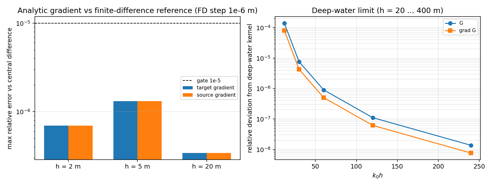
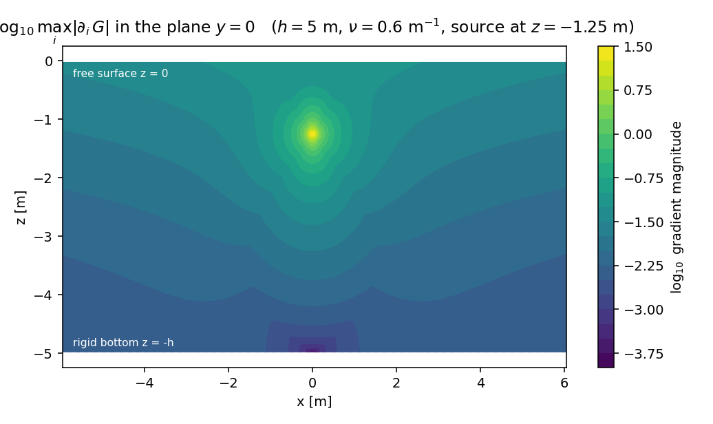
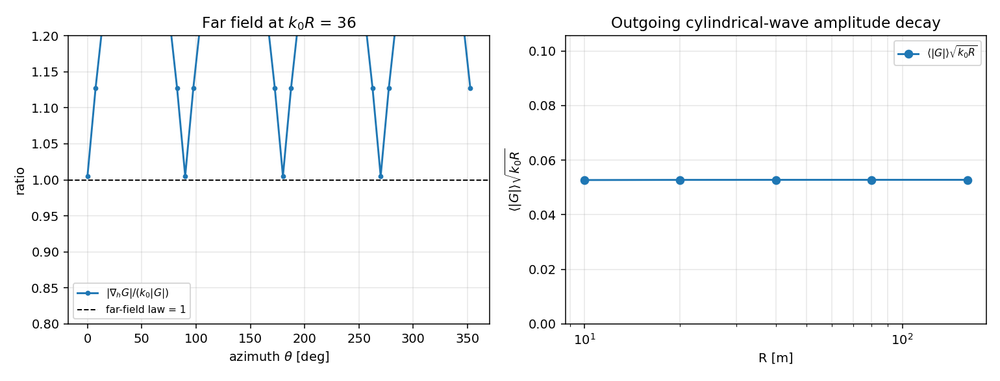

# 3-D finite-depth Green function: analytic gradient and its verification

Generated by `python -m tensorbem.benchmarks.finite_depth3d_gradients --report`; every number is read from `study.json` produced in the same run (numpy 2.4.6, nu = 0.6, source at (0, 0, -1.25) m).

## 1. What was missing

`docs/finite_depth3d.md` shipped the John-eigenseries kernel with an analytic $\partial G/\partial z$ only, and recorded the reason: *"a horizontal derivative needs $K_1$/$H_1$ and belongs to the panel layer"*. Without it no finite-depth panel assembly is possible, because both the single-layer normal derivative and the double-layer normal derivative need $\nabla_x G$.

## 2. What was added

| object | content |
|---|---|
| `bessel_k1` | $K_1$ by the A&S 9.6.11 ascending series ($x<9$) and the Hankel asymptotic series ($x\ge9$), pure NumPy |
| `hankel_h1` | $H_1^{(1)}$ from the already-verified `bessel_j01_y01` |
| `green_gradient_3d` | analytic $\nabla_x G$ (three components), shape-leading trailing axis 3 |
| `green_gradient_source_3d` | analytic $\nabla_\xi G$ = transposed target gradient (kernel symmetry; **no** sign flip in finite depth) |

## 3. Results

### 3.1 Bessel layer against SciPy

| quantity | max relative error |
|---|---:|
| $K_1$, $x\in[10^{-8},10^{2.5}]$ | 2.00e-09 |
| $H_1^{(1)}$, same range | 2.06e-14 |

### 3.2 Gradient against central differences of $G$

Central difference with step 1e-06 m on `green_function_3d`; 18 (depth, target) combinations.

| depth h [m] | max rel. error, $\nabla_x G$ | max rel. error, $\nabla_\xi G$ |
|---:|---:|---:|
| 2 | 6.96e-07 | 6.96e-07 |
| 5 | 1.32e-06 | 1.32e-06 |
| 20 | 3.41e-07 | 3.41e-07 |

Worst case over all cases: 1.32e-06 (target), 1.32e-06 (source). The residual is the $O(h^2)$ truncation of the difference quotient, not the analytic derivative.

### 3.3 Boundary conditions carried by the gradient

| depth h [m] | $|\partial_z G-\nu G|/|G|$ on $z=0$ | $|\partial_z G|/|G|$ on $z=-h$ |
|---:|---:|---:|
| 2 | 5.19e-16 | 0.00e+00 |
| 5 | 1.45e-15 | 0.00e+00 |
| 20 | 4.00e-15 | 0.00e+00 |

### 3.4 Harmonicity and deep-water limit

| depth h [m] | $|\nabla^2 G|/|\nabla G|$ (FD of the analytic gradient) |
|---:|---:|
| 2 | 3.01e-07 |
| 5 | 9.44e-07 |
| 20 | 2.74e-07 |

| depth h [m] | $k_0h$ | kernel deviation | gradient deviation |
|---:|---:|---:|---:|
| 20 | 12 | 1.40e-04 | 8.09e-05 |
| 50 | 30 | 7.60e-06 | 4.25e-06 |
| 100 | 60 | 9.02e-07 | 5.03e-07 |
| 200 | 120 | 1.10e-07 | 6.12e-08 |
| 400 | 240 | 1.36e-08 | 7.56e-09 |

### 3.5 Far field and the panel operator

At $R=60$ m ($k_0R=36$) the radial gradient obeys $\partial_R G=i k_0G$ to 1.47e-02, and $\langle|G|\rangle\sqrt{k_0R}$ is flat to 0.1% over $R=10\ldots160$ m.

Normal-derivative integral $\int_S \partial G/\partial n\,dS$ over a sphere (radius 0.25 m, centre (0, 0, -1.6) m, 200 panels) against a central difference of the same integral:

| target [m] | $|\int \partial_n G\,dS|$ | relative error vs FD |
|---|---:|---:|
| (2.2, 0.4, -0.7) | 4.727124e-06 | 1.17e-05 |
| (0, 0, -0.4) | 4.048136e-05 | 3.47e-05 |

## 4. Verdict

| gate | pass |
|---|---|
| `bessel_k1_below_1e-8` | PASS |
| `bessel_h1_below_1e-12` | PASS |
| `fd_target_gradient_below_1e-5` | PASS |
| `fd_source_gradient_below_1e-5` | PASS |
| `free_surface_below_1e-10` | PASS |
| `bottom_below_1e-10` | PASS |
| `harmonicity_below_1e-5` | PASS |
| `deep_water_limit_monotone_and_below_1e-6` | PASS |
| `far_field_law_below_2e-2` | PASS |
| `panel_normal_derivative_below_1e-4` | PASS |
| `z_component_parity_exact` | PASS |

**All gates pass.**

The $z$ component reproduces the pre-existing `green_gradient_z_3d` to 7.6e-16 relative, so the new entry point is a strict superset of the old one.

## 5. Figures

*Left:* analytic gradient against central differences of $G$ for $h=2,5,20$ m; *right:* deviation of the kernel and of its gradient from the deep-water Kelvin kernel as $k_0h$ grows (exponential, not truncation-limited).

*Field distribution* of $\max_i|\partial_iG|$ in the plane $y=0$ between the free surface and the rigid bottom; the logarithmic singularity at the source and the mirror structure of the evanescent modes are visible.

*Left:* $|\nabla_hG|/(k_0|G|)$ around a far-field ring, compared with the outgoing-wave law $=1$; *right:* $\langle|G|\rangle\sqrt{k_0R}$ against $R$, i.e. the cylindrical $R^{-1/2}$ decay.

## 6. Limitations

* Kernel level only. No panel assembly is shipped: the eigenseries carries the $1/(4\pi r)$ singularity inside the mode sum, so self-panel and near-singular quadrature (the analogue of `tensorbem.near_singular`) is still the open item.
* Cost grows as $h/(\pi R)$ modes; the gradient needs $K_1$ in addition to $K_0$, i.e. roughly twice the kernel cost at identical truncation.
* Constant depth, linearised potential flow, $z\le0$ only; no sloping bottom, no current.

