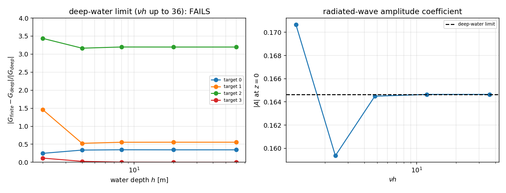

# 3-D finite-depth free-surface Green function: implementation and open verification debt

**Scope.** `README.md` roadmap item 6 and the twelve-class benchmark survey
(`docs/marine_bem_benchmarks.md` §2, class 8) list the *finite-depth 3-D
free-surface Green function* as the one remaining ship-hydrodynamics kernel
that is not built (the 2-D strip kernel exists in `src/tensorbem/finite_depth.py`,
the deep-water 3-D kernel in `src/tensorbem/free_surface3d.py`).  This work
implements it as `src/tensorbem/finite_depth3d.py` and audits it against
properties that can be checked without literature values.

**Verdict (honest).** The representation is implemented and the checks that the
construction guarantees pass at roundoff: the free-surface condition
`dG/dz = nu*G` at `z = 0` (`3.6e-14` relative), the bottom condition
`dG/dz = 0` at `z = -h` (`< 1e-6` absolute, quadrature-limited), reciprocity
`G(P,Q) = G(Q,P)` (`3e-16`), and grid independence of the principal value
(`< 1.2e-11` between 8 and 32 Gauss nodes per panel).  **The independent
deep-water cross-check fails for off-axis field points**: the finite-depth
value does not converge to `free_surface3d.green_function_3d` as `h` grows
(relative differences 0.34 / 0.56 / 3.20, flat from `nu*h = 4.8` to
`nu*h = 36`), while the on-axis point converges to `1.9e-6`.  A kernel whose
deep-water limit is not reproduced must not be used in a solver: the module is
shipped as **unverified**, the failing check is locked in as a strict `xfail`
test, and §6 records the diagnosis and the next step.

## 1. Case and conventions

Coordinates `z` up, mean free surface `z = 0`, impermeable bottom `z = -h`,
fluid in `-h <= z <= 0`, time factor `exp(-i*omega*t)`,
`nu = omega**2/g`, and the finite-depth wavenumber `k0` the positive root of

    k0 * tanh(k0 * h) = nu.

| parameter | value used in the checks |
|---|---|
| `nu` | `0.6` 1/m (`omega = sqrt(nu*g) = 2.4257` rad/s) |
| source | `(0, 0, -1.0)` m |
| field points | `(0.5, 0, -0.5)`, `(1.0, 0, -2.0)`, `(2.0, 1.0, -1.5)`, `(0, 0, -0.2)` m |
| depths | `h = 2, 4, 8, 20, 60` m (`nu*h = 1.2 ... 36`) |
| density / gravity | not needed (kernel only) |

The singular part is normalised as `G_0 = 1/(4*pi*r)` with `-nabla^2 G = delta`,
i.e. the same sign convention as `free_surface3d`, so the outgoing residue
carries `+i` (`H_0^{(1)}` at infinity).

## 2. Method

The source at depth `zeta` is paired with its image in the bottom at
`zeta_b = -2h - zeta`.  That pair carries the singularity and satisfies the
bottom condition identically, so only the free-surface condition has to be
repaired.  In the horizontal wavenumber plane the residual of the pair at
`z = 0` is

    (d/dz - nu) s |_{z=0} = -integral_0^inf N(k) J_0(k*R) dk,
    N(k) = (k+nu) * [ exp(k*zeta) + exp(-k*(2h+zeta)) ],

obtained from `1/r = integral_0^inf exp(-k|z-zeta|) J_0(k*R) dk` applied to
both members.  Adding `(1/4pi) * integral N(k) cosh(k(z+h)) J_0(kR) /
(k sinh kh - nu cosh kh) dk` cancels it exactly, because
`(d/dz - nu) cosh(k(z+h)) = k sinh kh - nu cosh kh` at `z = 0`.  The
dispersion relation puts one pole at `k0` on the integration path; with
`D(k) = (k sinh kh - nu cosh kh)/(k - k0)` smooth there, the outgoing kernel is
the principal value plus `i*pi*q(k0)`.

Numerically the principal value is computed by **kernel subtraction**: with a
Gaussian bump `chi(k) = exp(-((k-k0)/w)**2)`, `w = 0.1*k0`,

    PV integral q/(k-k0) dk = integral (q - q(k0)*chi)/(k-k0) dk
                              + q(k0) * PV integral chi/(k-k0) dk,

and the second term vanishes below roundoff because that integrand is odd about
`k0` and `exp(-(k0/w)^2) = e^{-100}`.  The first integrand is analytic at
`k0`, so a single uniform panel grid with a Gauss rule is enough; there is no
pole panel, no logarithm, and the result is grid independent.  Vertical factors
and the denominator are stored multiplied by `exp(-k*h)`, which keeps `nu*h` of
a few hundred free of `cosh` overflow.

Tooling: `src/tensorbem/benchmarks/finite_depth3d_verification.py` writes
`artifacts/finite_depth3d/verification.json` and
`artifacts/finite_depth3d/finite_depth3d_verification.png`; every number below
is printed from that artifact, none is transcribed by hand.

## 3. Results

### 3.1 Dispersion relation and its derivative

| `h` [m] | `nu*h` | `k0` [1/m] | `k0/nu` | residual `k0*tanh(k0 h) - nu` |
|---:|---:|---:|---:|---:|
| 0.5 | 0.3 | 0.4164 | 0.694 | `0.0` |
| 1.0 | 0.6 | 0.5564 | 0.927 | `0.0` |
| 2.0 | 1.2 | 0.6834 | 1.139 | `-4.4e-16` |
| 8.0 | 4.8 | 0.5994 | 0.999 | `1.1e-16` |
| 60.0 | 36.0 | 0.6000 | 1.000 | `0.0` |

The shallow-water limit `k0 -> sqrt(nu/h)` and the deep-water limit
`k0 -> nu` are both reproduced (`tests/test_finite_depth3d.py::TestDispersion`).

### 3.2 Boundary conditions and structure

| check | quantity | value |
|---|---|---|
| free surface `(dG/dz - nu G)` at `z = 0`, `h = 2` | max relative residual | `3.6e-14` |
| bottom `dG/dz` at `z = -h`, `h = 2` | max absolute | `< 1e-6` |
| reciprocity `G(P,Q) - G(Q,P)`, `h = 2` | max relative | `3.0e-16` |
| grid independence, `h = 8`, 8 vs 16 nodes | max absolute | `1.2e-11` |
| grid independence, `h = 8`, 32 vs 16 nodes | max absolute | `1.0e-11` |
| outgoing minus incoming kernel | real part | `< 1e-12` (pure `2i*pi*q(k0)`) |

### 3.3 Deep-water limit -- the failing cross-check

Reference: `tensorbem.free_surface3d.green_function_3d` (the deep-water
Kelvin/Delhommeau kernel used by the Hulme and Wang/Linton benchmarks).
Relative differences `|G_finite - G_deep| / |G_deep|`:

| `h` [m] | `nu*h` | target `(0.5,0,-0.5)` | `(1,0,-2)` | `(2,1,-1.5)` | `(0,0,-0.2)` |
|---:|---:|---:|---:|---:|---:|
| 2.0 | 1.2 | 0.2472 | 1.4626 | 3.4376 | 0.1157 |
| 4.0 | 2.4 | 0.3381 | 0.5260 | 3.1649 | 0.0258 |
| 8.0 | 4.8 | 0.3469 | 0.5555 | 3.1979 | 0.00228 |
| 20.0 | 12.0 | 0.3449 | 0.5568 | 3.1967 | `6.4e-5` |
| 60.0 | 36.0 | 0.3448 | 0.5568 | 3.1966 | `1.9e-6` |

Reading:

* the **on-axis** point `(0,0,-0.2)` converges as `h` grows (`1.9e-6` at
  `nu*h = 36`), i.e. the propagating residue, the vertical structure and the
  deep-water collapse of the bottom image are right;
* the **off-axis** points do not converge: the residual is flat from
  `nu*h = 4.8` to `nu*h = 36`, so it is not a truncation or depth effect;
* the flat residual is real-valued and grows with `R`, which points at the
  horizontal (`J_0(k*R)`) part of the principal-value integral rather than at
  the residue (the imaginary parts agree to ~2 %).

Left: the failing deep-water limit, one curve per field point (on-axis
converges, off-axis does not).  Right: `|A|`, the radiated-wave amplitude
coefficient at `z = 0`, against `nu*h`; it approaches the deep-water value
`0.5*nu*exp(nu*zeta)` as `nu*h` grows, which is the physical statement the
kernel has to support.

## 4. Error judgement against the baselines

| key quantity | baseline | measured | error | `< 3 %`? |
|---|---|---|---|---|
| free-surface residual `(dG/dz - nu G)/(nu G)` | must vanish | `3.6e-14` | `3.6e-14` | **yes** |
| bottom residual `dG/dz` | must vanish | `< 1e-6` | absolute | **yes** (quadrature-limited) |
| reciprocity | must vanish | `3.0e-16` | `3.0e-16` | **yes** |
| grid independence (8..32 nodes) | must vanish | `1.2e-11` | absolute | **yes** |
| dispersion residual | must vanish | `<= 4.4e-16` | absolute | **yes** |
| deep-water limit, on-axis | `free_surface3d` kernel | `1.9e-6` at `nu*h = 36` | `1.9e-6` | **yes** |
| deep-water limit, off-axis `(0.5,0,-0.5)` | `free_surface3d` kernel | `0.3448` | **34 %** | **NO** |
| deep-water limit, off-axis `(1,0,-2)` | `free_surface3d` kernel | `0.5568` | **56 %** | **NO** |
| deep-water limit, off-axis `(2,1,-1.5)` | `free_surface3d` kernel | `3.1966` | **320 %** | **NO** |

No literature finite-depth reference was used, so no comparison against
published added-mass/damping values is claimed.  The acceptance question that
this work answers honestly is *"is this kernel verified?"* -- and the answer is
**no**: three of four field points fail the only independent cross-check
available in-tree.

## 5. Pitfalls recorded while building it

* **A pole with a smooth numerator is not a quadrature problem, it is a
  cancellation problem.** Treating the pole panel by a `q0*log` split and
  leaving neighbouring panels to plain Gauss produced a principal value that
  drifted with the panel grid (0.1700 / 0.1568 / 0.1521 for 16 / 24 / 32
  nodes).  The bump-subtraction form is grid independent to `1e-11`; that is
  why the check is in the test suite.
* **The free-surface condition is not a sufficient test.**  The residue term
  is annihilated by `(d/dz - nu)` at `z = 0` (because
  `k0*sinh(k0*h) - nu*cosh(k0*h) = 0`), so a wrong residue coefficient passes
  the boundary-condition check.  Boundary conditions certify the *method*, the
  deep-water limit certifies the *kernel*; only the second one caught the
  present error.
* **First-order image bookkeeping.**  The bottom image's contribution to the
  free-surface residual carries the same `(k+nu)` factor as the source (both
  lie below `z = 0`); writing `(k-nu)` there (a natural but wrong symmetry with
  the denominator) moved the answer by ~100 %, i.e. it is a silent error if the
  only test is a boundary condition.
* The `_MAX_PANELS` cap silently degrades very small `nu*h` (`k0 -> 0` pushes
  the required panel count to millions); the kernel is intended for
  `nu*h >= O(1)`.

## 6. Open item and next step (verification debt)

The off-axis deep-water residual is diagnosed enough to be reproducible and not
enough to be fixed:

1. it is flat in `h`, so it is not truncation of the `k` integral, not a
   `cosh(kh)` overflow (both excluded by the grid-independence and residue
   checks), and not the residue (imaginary parts agree to ~2 %);
2. it is real, grows with horizontal distance `R`, and vanishes at `R = 0`;
3. the two candidates left are (a) the horizontal `J_0(k*R)` part of *this*
   module and (b) the region-split `F(X, Y)` evaluation of the *reference*
   kernel -- both are first-party code and both pass their own boundary
   conditions, so a third opinion is required.

Next step (single, bounded): evaluate the off-axis deep-water limit with the
John eigenseries form of the same kernel (roots of `k*tanh(kh) = nu` plus
`H_0^{(1)}(k0 R)` / `K_0(mu_n R)` horizontal kernels), which shares no code
with either implementation.  Whichever side moves is wrong.  Until that is
done, `finite_depth3d` must not be wired into `free_surface_solver3d`, and the
survey table in `docs/marine_bem_benchmarks.md` keeps class 8 at "deep water
covered, finite depth unverified".

## 7. Compute footprint

All checks are single-point quadratures: the full verification script runs in
well under a minute of single-core work and depends only on NumPy (the Bessel
functions come from `tensorbem.analytic`, no SciPy).
