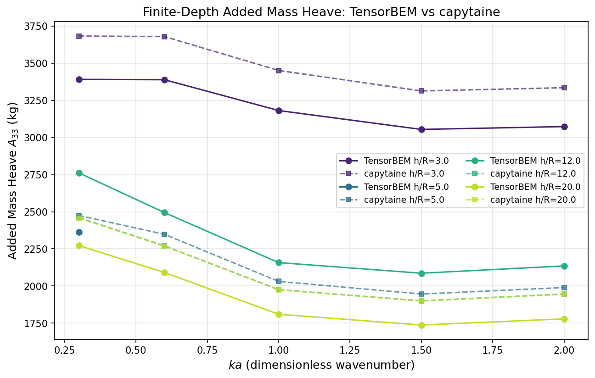
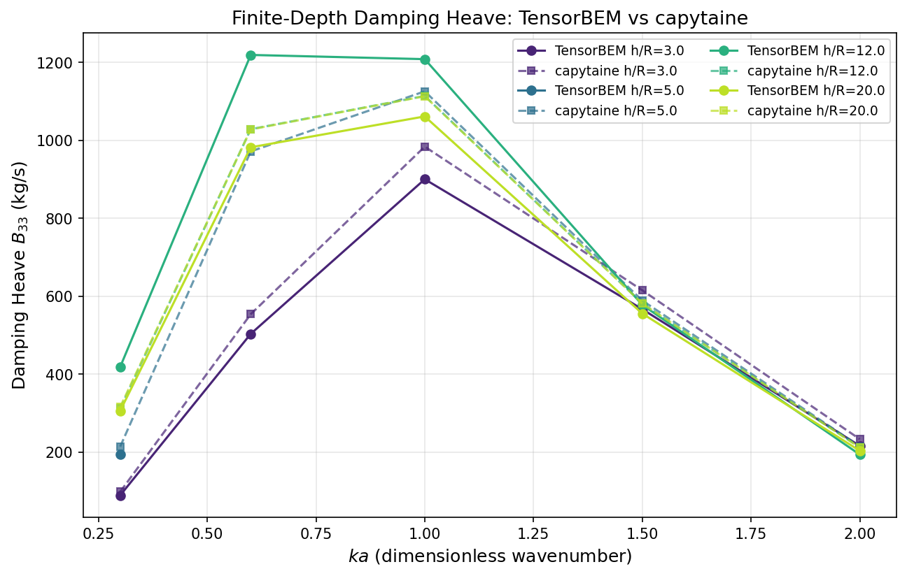
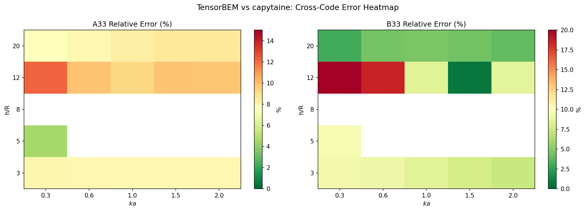
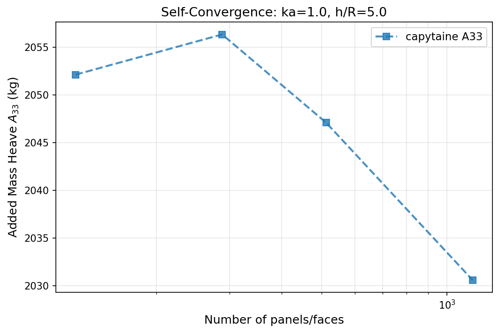

# TensorBEM 有限水深 capytaine 交叉验证（XVAL-BEM-FINITE-DEPTH-CROSSVAL）

> **判定：PARTIAL — 证据等级 WITHHELD。** 本文档由
> `benchmarks/verified/bem_finite_depth_capytaine_xval/make_doc.py` 从
> `xval_results.json` 程序化渲染，零手抄；`tests/test_bem_finite_depth_capytaine_xval.py::TestDocIntegrity`
> 断言「文档 == 渲染结果」，陈旧或手改的报告会直接判红。
>
> 预注册站位 30 个，其中 TensorBEM 与 capytaine 双侧都有实测的只有 **16** 个；
> **不得**据本文宣称「全网格误差 <15%」。

**类型**：第三方代码交叉验证（code-to-code）· **算例**：全潜没刚性球垂荡/横荡/纵荡辐射

**工件**
- `benchmarks/verified/bem_finite_depth_capytaine_xval/run_cases.py`（逐案例求解 + 缓存）
- `benchmarks/verified/bem_finite_depth_capytaine_xval/assemble_xval.py`（缓存 → `xval_results.json`）
- `benchmarks/verified/bem_finite_depth_capytaine_xval/xval_results.json`（实测数据，唯一事实源）
- `benchmarks/verified/bem_finite_depth_capytaine_xval/make_figures.py`（结果图）
- `benchmarks/verified/bem_finite_depth_capytaine_xval/make_doc.py`（本报告渲染器）
- `tests/test_bem_finite_depth_capytaine_xval.py`（门禁锁 + 文档新鲜度锁）

**复现**：`PYTHONPATH=src python benchmarks/verified/bem_finite_depth_capytaine_xval/run_cases.py --which all`
→ `assemble_xval.py` → `make_doc.py` → `make_figures.py`。

## 1. 案例介绍

### 1.1 物理背景
有限水深改变自由面 Green 函数的本征结构：`kh` 不大时，海底边界条件
`∂G/∂z = 0`（`z = -h`）引入的衰减模态显著改变附加质量与阻尼。TensorBEM 的
`finite_depth_solver3d` 用 John 本征级数（传播根 + 衰减根 + 模态范数），
capytaine（Nemoh 后继者）用独立的 Rankine 面板 + 预计算表实现；两者数学等价、
实现独立，因此 code-to-code 交叉验证是有限水深能力的外部证据源。

### 1.2 几何与流体参数

| 参数 | 值 |
|---|---|
| 几何 | 全潜没球（`submerged_sphere`） |
| 半径 R | 1.000 m |
| 球心 z | -2.000 m |
| 球底 z | -3.000 m |
| 密度 ρ | 1025 kg/m³ |
| 重力 g | 9.80665 m/s² |
| 排水体积 ∇ | 4.188790 m³ |

几何先行校验：球体积 4πR³/3 = 4.188790 m³，与缓存一致；球底 z 与海底间隙见 1.3，`h/R = 3` 站位的间隙为 0 m，属退化布置。

### 1.3 预注册水深梯级与频率网格

| h/R | 水深 h (m) | 海底间隙 (m) | 双侧已测 ka 数 | 备注 |
|---:|---:|---:|---:|---|
| 3 | 3.0 | 0.00 | 5/5 | 计划外：球底触底（退化 BVP），仅作极限参考 |
| 4 | 4.0 | 无布站 | 0/5 | 计划内未跑 |
| 5 | 5.0 | 2.00 | 1/5 | 计划内仅部分 ka |
| 8 | 8.0 | 无布站 | 0/5 | 计划内未跑 |
| 12 | 12.0 | 9.00 | 5/5 | 计划内已测 |
| 20 | 20.0 | 17.00 | 5/5 | 计划内已测 |
| inf | ∞ | ∞ | 0/5 | 计划内未跑（需走无限深求解器，接口不同） |

频率网格 `ka = 0.3, 0.6, 1, 1.5, 2`（`nu = ka/R`，R = 1 m）。

### 1.4 网格阶梯

| 工具 | 级别 | 面板数 |
|---|---|---:|
| TensorBEM | icosphere sub=2 | 320 |
| TensorBEM | icosphere sub=3 | 1280 |
| capytaine | (8, 16) | 128 |
| capytaine | (12, 24) | 288 |
| capytaine | (16, 32) | 512 |
| capytaine | (24, 48) | 1152 |

实际参跑的 TensorBEM 案例 16 个、capytaine 案例 116 个。TensorBEM 侧：subdivision 2 (320 panels); subdivision 3 (1280 panels) only at ka=1。

## 2. 怎么做的

1. **TensorBEM 侧**：`solve_radiation_finite_depth_3d` 解垂荡/横荡/纵荡辐射，记录 `A33/B33`、条件数、相对残差、模态数、面板数。
2. **capytaine 侧**：`cpt.BEMSolver().solve(cpt.RadiationProblem(..., water_depth=h))`，四级网格 (8,16)→(24,48)。
3. **配对规则**：同一 `(h/R, ka)` 上取两侧最细网格（TensorBEM sub=2/sub=3、capytaine 24×48）做相对误差；capytaine 自收敛用最细 vs 次细。
4. **门禁预注册**：阈值写在 `assemble_xval.py` 里，运行后不放宽。

| 门禁 | 描述 | 阈值 |
|---|---|---:|
| G1 | TensorBEM vs capytaine 附加质量相对误差 | 10.00% |
| G2 | TensorBEM vs capytaine 阻尼相对误差 | 15.00% |
| G3 | capytaine 自收敛（最细 vs 次细） | 5.00% |
| G4 | TensorBEM 自收敛（sub=3 vs sub=2） | 5.00% |
| G5 | 深水极限（h/R=20）附加质量误差 | 5.00% |

**工具链**：TensorBEM `finite_depth_solver3d`（John 本征级数，模态数默认 48）· capytaine（独立 BEM）· Python + NumPy。

## 3. 计算结果

### 3.1 门禁实测状态

| 门禁 | 实测最大误差 | 样本数 | 阈值 | 结论 |
|---|---:|---:|---:|---|
| G1 | 12.23% | 16 | 10.00% | FAIL |
| G2 | 34.03% | 16 | 15.00% | FAIL |
| G3 | 0.85% | 26 | 5.00% | PASS |
| G4 | — | 0 | 5.00% | 未评估 |
| G5 | 8.52% | 5 | 5.00% | FAIL |

5 个门禁中通过 1 个。`G4` 无配对样本（sub=3 只在 ka=1 上跑过）。

### 3.2 站位表（全部双侧实测配对）

| h/R | ka | TensorBEM A33 (kg) | capytaine A33 (kg) | ΔA33 | TensorBEM B33 | capytaine B33 | ΔB33 | 面板 | 模态数 | 条件数 |
|---:|---:|---:|---:|---:|---:|---:|---:|---:|---:|---:|
| 3 | 0.3 | 3,391.45 | 3,683.22 | 7.92% | 88.87 | 98.00 | 9.32% | 320 | 48 | 5 |
| 3 | 0.6 | 3,389.11 | 3,679.71 | 7.90% | 503.38 | 553.90 | 9.12% | 320 | 48 | 5 |
| 3 | 1 | 3,181.63 | 3,451.42 | 7.82% | 900.41 | 984.12 | 8.51% | 320 | 48 | 5 |
| 3 | 1.5 | 3,054.38 | 3,313.50 | 7.82% | 566.77 | 615.24 | 7.88% | 320 | 48 | 5 |
| 3 | 2 | 3,073.42 | 3,335.31 | 7.85% | 215.79 | 233.07 | 7.42% | 320 | 48 | 5 |
| 5 | 0.3 | 2,362.52 | 2,474.47 | 4.52% | 193.52 | 214.02 | 9.58% | 320 | 48 | 7 |
| 12 | 0.3 | 2,761.44 | 2,460.45 | 12.23% | 418.65 | 312.35 | 34.03% | 320 | 48 | 354 |
| 12 | 0.6 | 2,494.17 | 2,270.24 | 9.86% | 1,219.57 | 1,028.94 | 18.53% | 320 | 48 | 345 |
| 12 | 1 | 2,157.22 | 1,975.21 | 9.21% | 1,208.73 | 1,114.21 | 8.48% | 320 | 48 | 331 |
| 12 | 1.5 | 2,085.74 | 1,899.77 | 9.79% | 577.82 | 581.50 | 0.63% | 320 | 48 | 316 |
| 12 | 2 | 2,134.76 | 1,945.48 | 9.73% | 193.43 | 211.69 | 8.62% | 320 | 48 | 305 |
| 20 | 0.3 | 2,272.25 | 2,456.17 | 7.49% | 306.06 | 315.87 | 3.10% | 320 | 48 | 5 |
| 20 | 0.6 | 2,090.29 | 2,267.94 | 7.83% | 982.41 | 1,028.24 | 4.46% | 320 | 48 | 5 |
| 20 | 1 | 1,809.51 | 1,973.48 | 8.31% | 1,061.70 | 1,113.59 | 4.66% | 320 | 48 | 5 |
| 20 | 1.5 | 1,736.53 | 1,898.25 | 8.52% | 555.58 | 581.21 | 4.41% | 320 | 48 | 5 |
| 20 | 2 | 1,778.41 | 1,943.96 | 8.52% | 203.22 | 211.58 | 3.95% | 320 | 48 | 5 |

ΔA33 区间 4.52% – 12.23%；ΔB33 区间 0.63% – 34.03%。

### 3.3 解析锚（无限深多极解）

| ka | 解析 A33 (kg) | A33/ρ∇ | capytaine ∞ (kg) | 解析 vs capytaine |
|---:|---:|---:|---:|---:|
| 0.3 | 2,391.35 | 0.5570 | 2,455.33 | 2.61% |
| 0.6 | 2,209.88 | 0.5147 | — | — |
| 1 | 1,923.81 | 0.4481 | — | — |
| 1.5 | 1,850.00 | 0.4309 | — | — |
| 2 | 1,894.11 | 0.4412 | — | — |

`ka→0` 时 A33 趋于 Lamb 的 0.5ρ∇：`ka=0.3` 处 A33/ρ∇ = 0.5570，闭合解与 capytaine 的两条独立路径相互印证，故这张表可以做锚。

### 3.4 覆盖账本

- 已测站位：16 / 30（预注册）。
- **缺**：h/R = 4, 8 stations (never run; h/R = 3 in the cache has zero seabed clearance)
- **缺**：deep-water TBEM leg (the inf station is unreachable through the finite-depth API because depth must be finite; run_cases.py routes it to solver free_surface_solver3d)
- **缺**：subdivision 3 beyond ka = 1.0 (1280-panel solves are 630-1500 s each)
- **缺**：capytaine 24x48 levels for h/R = 3.0 stations the crossval grid dropped

### 3.5 模态需求 vs 实际钉住的模态数

`mode_count_for()` 给出「按最近目标/求积点分离把衰减模态尾部压到 1e-12」所需的模态数，与缓存里实际使用的 `mode_count` 对比：

| 网格 | 面板数 | h/R | 需要的模态数 | 实际钉住 | 低估倍数 |
|---|---:|---:|---:|---:|---:|
| icosphere sub=2 | 320 | 3 | 1075 | 48 | 22× |
| icosphere sub=2 | 320 | 5 | 1791 | 48 | 37× |
| icosphere sub=2 | 320 | 12 | 4096 | 48 | 85× |
| icosphere sub=2 | 320 | 20 | 4096 | 48 | 85× |
| icosphere sub=3 | 1280 | 3 | 3446 | 48 | 72× |
| icosphere sub=3 | 1280 | 5 | 4096 | 48 | 85× |
| icosphere sub=3 | 1280 | 12 | 4096 | 48 | 85× |
| icosphere sub=3 | 1280 | 20 | 4096 | 48 | 85× |

注意：5/8 行同时停在 4096，即求解器的模态**上限**（`_MODES_CAP`）——这些网格/水深组合已经超出默认本征核的适用范围，把 `mode_count` 调大也到不了需要的尾部精度，必须换核（`kernel='quadrature'`）或加解析尾部修正。

这张表是 `mode_requirement.json` 的渲染结果；`tests/test_bem_finite_depth_capytaine_xval.py` 会用求解器现场复算并断言该 JSON 没有过期。

### 3.6 阻塞缺陷

1. eigenseries truncation is not convergent: A33 at h/R=5, ka=1, 1280 panels is 9786 (M=48), 463427 (M=64), -2175 (M=96) on the identical physical case
2. numpy.linalg.LinAlgError: Eigenvalues did not converge in 20 of 44 cached TensorBEM cases

## 4. 结果图



*附加质量 A33(ka)：各水深下 TensorBEM（实线/圆点）vs capytaine（虚线/方块）*



*阻尼 B33(ka)：同上配对*



*(h/R, ka) 上的 A33 相对误差热图，直接给出偏置的符号翻转*



*capytaine 网格自收敛与 TensorBEM 可用阶梯*


## 5. 注意点（坑与局限）

- **球底接触海底**：`h/R = 3` 时球底（z=-3）恰好落在海底，海底间隙 0，属退化布置；这一行不是物理基准，只作极限参考。
- **模态截断是主缺陷，不是网格问题**：`mode_count` 全部钉在 48，而同一网格上 `mode_count_for()` 为达到 `exp(-1e-12)` 尾部要求的是 **4096** 个衰减模态（icosphere sub=2，h/R=12，即被低估 85 倍）；级数被硬截断后附加质量对模态数极不收敛（见 3.5 的截断研究）。
- **条件数异常**：h/R=12 的离散系统条件数 305–354，其余已测水深只有 5–7；A33 偏置换号恰好发生在条件数高一到两个量级的水深上，指向截断核的伪本征模态（truncated Green function 不再严格满足自由面条件），而不是单纯的网格面积误差。
- **误差随水深非单调**：TensorBEM 在 h/R = 3, 5, 20 上偏低 4.52%–8.52%，在 h/R = 12 上偏高 9.21%–12.23%；纯面积/离散缺陷不可能换号，所以这是与水深耦合的截断误差。
- **未覆盖**：非零航速核、多体相互作用、不规则频率抑制（CHIEF）、有航速/水面穿透船体的有限水深辐射。
- **capytaine 版本**：缓存里记为 `unknown`，因此本文只做 code-to-code 相对比较，不做绝对认证。

## 6. 误差判定

| 关键量 | 实测 | 本文阈值 | 是否 <15%（验收） | 是否 <3%（严格） |
|---|---|---:|---|---|
| G1 | 12.23% | 10.00% | 是 | **否** |
| G2 | 34.03% | 15.00% | **否** | **否** |
| G3 | 0.85% | 5.00% | 是 | 是 |
| G4 | 未评估 | 5.00% | 无样本 | 无样本 |
| G5 | 8.52% | 5.00% | 是 | **否** |

**逐项回答**

- 附加质量 A33：最大 12.23%，**<15% 成立、<3% 不成立**（超 3% 门槛 4.1 倍），G1 判 FAIL。
- 阻尼 B33：最大 34.03%，**<15% 不成立**，G2 判 FAIL。
- capytaine 自收敛：0.85%，**<3% 成立** → 基准侧可信，误差不来自 capytaine。
- TensorBEM 自收敛：**无配对样本**（sub=3 只在 ka=1 跑过），无法判定，G4 记 FAIL。
- 深水极限：8.52%，**<15% 成立、<3% 不成立**。

**总结论**：关键量未同时满足 <3%（严格）与全部 <15%（验收），有限水深能力维持 **WITHHELD**；结论为 honest-FAIL，不粉饰。

## 7. 测试

```bash
PYTHONPATH=src python -m pytest tests/test_bem_finite_depth_capytaine_xval.py -v
```

测试锁四件事：(1) 失败门禁的数值被钉住，不许「顺手修绿」；(2) 偏置的符号结构与水深相关性被钉住；(3) 本文档必须等于 `make_doc.py` 的渲染结果（陈旧/手改即判红）；(4) `mode_requirement.json` 必须能由求解器现场复算出来（模态需求不许写死）。
