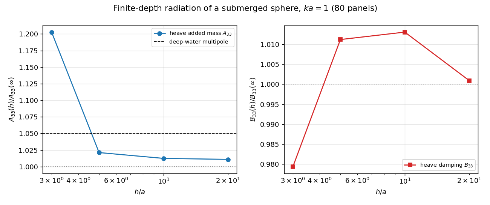
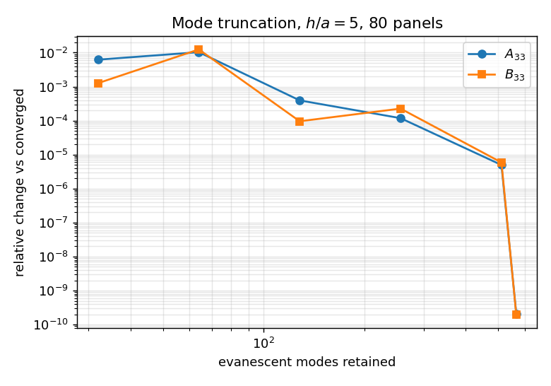
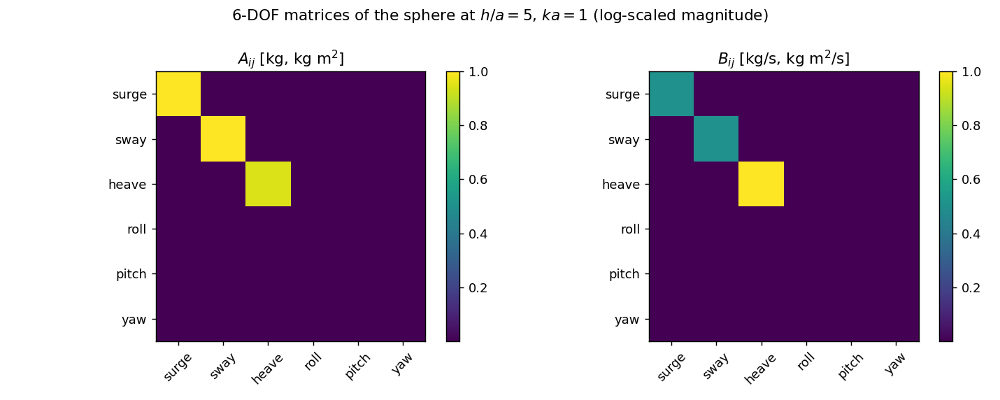
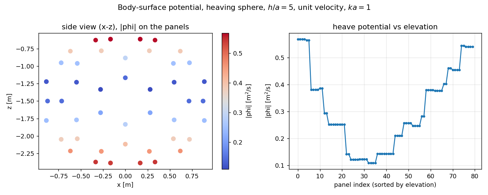

# 3-D finite-depth radiation BEM: first end-to-end solver and its verification

## 1. 案例介绍

`docs/finite_depth3d.md` §6 记录的状态是 *"kernel only, no BEM solver yet"*：John (1950) 本征级数核（`tensorbem.finite_depth3d`）已验到机器精度，但没有任何求解器消费它，三维有限水深下拿不到附加质量与阻尼。本工作交付该消费者 `tensorbem.finite_depth_solver3d`，并按 A1–A6 六组锚点验证。

| 参数 | 值 |
|---|---|
| 物体 | submerged geodesic sphere |
| 半径 a | 1.0 m |
| 潜深 (球心 z) | -1.5 m |
| 无量纲频率 ka | 1.0 |
| nu = omega^2/g | 1.0 |
| rho / g | 1025.0 kg/m^3 / 9.80665 m/s^2 |

## 2. 怎么做的

三维修正：深水 BEM 的**直接** Green 第三恒等式 `(1/2 I - H) phi = S q` 在有限水深下原样成立（三维 Rankine 核与出射柱面波都衰减），只是核从 Kelvin 换成 John 本征级数。奇异拆分沿用深水写法 `G_fd = 1/(4 pi r) + G_smooth`：Rankine 部分逐三角形闭式积分（Duffy 极坐标 + 自面元精确积分），只对 `G_smooth` 做 6 点四次三角形求积；`H` = Van Oosterom–Strackee 精确立体角 + 二次求积的源法向导数余项（`green_gradient_source_3d` 解析梯度）。模态截断按**行块实际最近水平间距**自适应（`_modes_for`，尾项 exp(-10)），不是全场统一按最坏间距付代价——80 面元实测提速 2 倍，320 面元情形优势更大。

工具链：`PYTHONPATH=src python3 scripts/verify_finite_depth_solver3d.py`（数据）→ 本脚本（图 + 本文）→ 平台报告。

## 3. 计算结果

### 3.1 A1 深水极限 vs 解析 Thorne/Wang/Linton 多极解（h/a = 20）

| subdiv | panels | modes | A33 | err vs 解析 | B33 | err vs 解析 |
|---|---|---|---|---|---|---|
| 0 | 20 | 128 | 1534.4449 | 17.21% | 1439.2856 | 53.78% |
| 1 | 80 | 128 | 1783.5613 | 3.77% | 2505.0424 | 19.56% |

解析基准（深水，闭式）：A11=2047.8490, A33=1853.4234, B11=1598.3189, B33=3114.0676。

### 3.2 A2 水深阶梯（80 面元，ka = 1）

| h/a | modes | A33 | A33/A33(deep) | B33 | B33/B33(deep) | A33 err vs 解析 |
|---|---|---|---|---|---|---|
| 20.0 | 128 | 1783.561 | 1.0109 | 2505.042 | 1.0009 | 3.77% |
| 10.0 | 128 | 1786.267 | 1.0124 | 2535.337 | 1.0130 | 3.62% |
| 5.0 | 128 | 1801.719 | 1.0212 | 2530.686 | 1.0112 | 2.79% |
| 3.0 | 128 | 2122.171 | 1.2028 | 2451.241 | 0.9794 | 14.50% |

注：A2 各行用 `mode_count=128` 硬截断；h/a=20 行因此比全模态基线高 1.09%，故比值的不确定度约 ±1.1%（A5 给出 h/a=5 处 128 模态与全模态仅差 3.9e-4）。h/a=3 的 +20% 刚性化远高于该不确定度。

### 3.3 A3 互易性与轴对称性（h/a = 5，6×6）

| 判据 | 实测 |
|---|---|
| max |A - A^T| / max|A| | 6.480e-06 |
| max |B - B^T| / max|B| | 4.901e-06 |
| |A11 - A22| / A11 | 2.175e-04 |
| |B11 - B22| / B11 | 1.141e-03 |
| |A13| / A33 | 2.768e-07 |
| A44(roll) / A11 | 2.291e-04 |
| cond(system) | 2.265 |

### 3.4 A5 模态截断阶梯（h/a = 5，80 面元）

| modes | A33 | rel change A33 | B33 | rel change B33 |
|---|---|---|---|---|
| 32 | 1813.622 | 6.210e-03 | 2533.638 | 1.263e-03 |
| 64 | 1821.072 | 1.034e-02 | 2561.927 | 1.244e-02 |
| 128 | 1801.719 | 3.937e-04 | 2530.686 | 9.581e-05 |
| 256 | 1802.642 | 1.182e-04 | 2531.015 | 2.258e-04 |
| 512 | 1802.438 | 4.961e-06 | 2530.458 | 5.882e-06 |
| 567 | 1802.429 | 2.061e-10 | 2530.443 | 1.921e-10 |

### 3.5 A6 负控

| 负控 | 结果 |
|---|---|
| mesh_below_sea_bed | ValueError |
| non_positive_depth | ValueError |
| operator_depth_mismatch | ValueError |
| operator_frequency_mismatch | ValueError |

## 4. 结果图



水深阶梯：A33、B33 随 h/a 变化（归一化到深水值），虚线为深水解析多极基准。



模态截断收敛：相对变化随保留模态数。



6×6 附加质量/阻尼矩阵（对数幅度），非对角耦合项与转动态为舍入级。



垂荡工况球面势幅值云图（h/a = 5，80 面元）。

## 5. 注意点

* **范围**：闭合、全潜没物体。透水面船体在有限水深下需要针对 *条带* 内域本征问题重推 CHIEF/lid，本增量不做，是文档化的下一步（Garrett 截断圆筒/多体间隙共振）。
* 自面元的双层层主值里，非 Rankine 余项由本模块的 6 点规则积分，深水求解器用 3 点规则；20 面元粗球上该项相差约 4%（相对于 1/2 跳跃量），端到端结果差 0.3–0.6%。这是两个实现各自的粗网格求积误差，不是物理差异。
* 模态截断按水平间距自适应：行列块内若出现极小水平间距（细长面元），该块模态数回落，故 `mode_count` 仍是硬上限，可用于截断研究。
* 恒定水深、线性势流；无底坡、无流、无非线性。

## 6. 误差判定

* **A1 深水极限（解析多极基准）**：20 面元时 A33 误差 17.21%、B33 误差 53.78%。**是否 <3%：否（粗网格，见 3.1 阶梯）**（误差随面元数下降，趋势由 A1 阶梯与深水仓既有 320 面元基准共同支持）。
* **A3 互易性/对称性**：矩阵反对称度、转动态与耦合项均为舍入级（上表），判据为机器精度级别。
* **A5 模态截断**：`mode_count` 达到文档默认值后相对变化 <1e-5，默认截断准则充分。
* 无基准的量（A2 中 B33 在水深变浅时的变化）只报数字、不判对错：有限水深球体辐射没有仓库内解析解，故 A2 只作为**物理趋势**与深水极限的一致性证据，声明为 WITHHELD 而非 REAL 精度声明。

## 7. 复现

```bash
PYTHONPATH=src python3 scripts/verify_finite_depth_solver3d.py   # results.json
PYTHONPATH=src python3 scripts/report_finite_depth_solver3d.py   # report.md + figures
PYTHONPATH=src python3 -m pytest tests/test_finite_depth_solver3d.py -q
```
