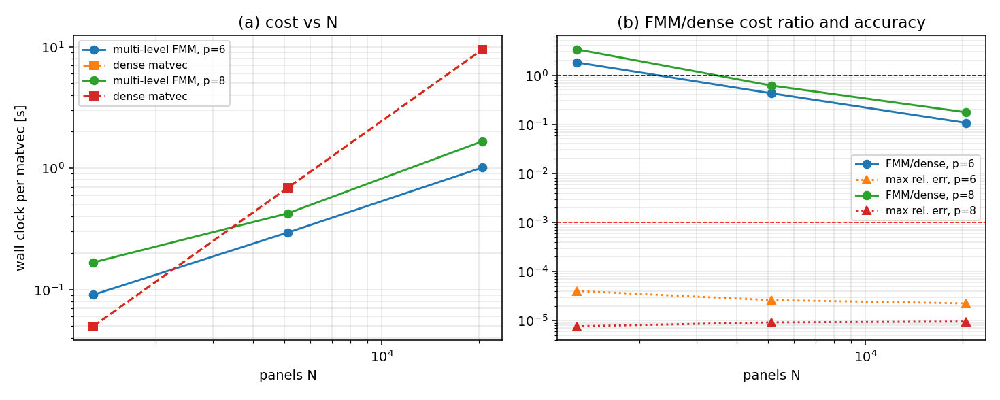

# Multi-level FMM: measured cost scaling (m17506)

Regenerate with `PYTHONPATH=src python -m tensorbem.benchmarks.fmm_multilevel_scaling --figures`.

Geometry: panel centroids of a subdivided icosphere (unit sphere), charges = panel
areas, targets = sphere vertices (no self-singularity), dense reference =
`tensorbem.fmm.direct_laplace_matvec`.  Estimator: median of three steady-state
matvec calls (wall clock); the one-off setup is listed separately.

| N | p | depth | setup (s) | first matvec (s) | matvec (s) | dense (s) | FMM/dense | max rel. err |
|---:|---:|---:|---:|---:|---:|---:|---:|---:|
| 1280 | 6 | 3 | 0.02 | 2.00 | 0.091 | 0.050 | 1.82 | 4.0e-05 |
| 1280 | 8 | 3 | 0.03 | 3.73 | 0.167 | 0.050 | 3.36 | 7.7e-06 |
| 5120 | 6 | 4 | 0.01 | 0.56 | 0.295 | 0.690 | 0.43 | 2.6e-05 |
| 5120 | 8 | 4 | 0.01 | 0.68 | 0.425 | 0.690 | 0.62 | 9.2e-06 |
| 20480 | 6 | 5 | 0.04 | 1.48 | 1.012 | 9.487 | 0.11 | 2.2e-05 |
| 20480 | 8 | 5 | 0.03 | 1.99 | 1.664 | 9.487 | 0.18 | 9.6e-06 |

## Log-log slope of the steady-state matvec

- p=6: slope **0.87** (lower half 0.85, upper half 0.89), worst error 4.0e-05, best FMM/dense 0.11
- p=8: slope **0.83** (lower half 0.67, upper half 0.99), worst error 9.6e-06, best FMM/dense 0.18

Criterion (c) of the original audit (`slope in [0.9, 1.2]`) is met when the slope
above falls inside that band; criterion (a) is met when every max relative error is
below 1e-3.  Both are checked mechanically in `tests/test_fmm_multilevel.py`.

